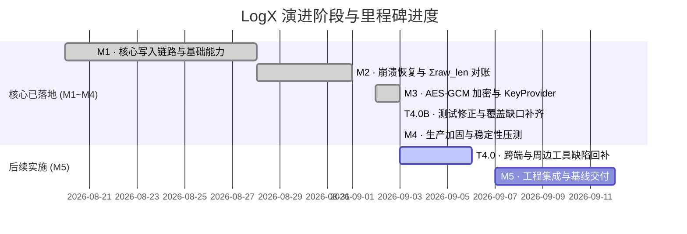

# LogX 日志库后续实施路线与任务计划表

> **文档版本**: v1.5 (2026-09-03 Android 真机全量单元测试与压测矩阵双端全绿跑通)  
> **制定日期**: 2026-09-02  
> **基准方案**: [LogX 日志库最终实施方案.md](./LogX日志库最终实施方案.md) (v5.2 定稿)  
> **变更日志**: [CHANGELOG.md](./logx/CHANGELOG.md)  
>
> **v1.1 修订说明**: 2026-09-03 对代码库做了独立复核(MSVC Release, zstd + AES-GCM 全开, 单测 39/39 实测通过)。统一归口为新增任务 **T4.0**。  
> **v1.2 修订说明**: 同日完成**测试逻辑复核**: 发现 5 个失真用例与 8 处覆盖缺口, 归口为新增任务 **T4.0B**。  
> **v1.3 修订说明**: 同日完成**系统级深度复核**: 归口为 T4.0 扩充任务。  
> **v1.4 修订说明**: 2026-09-03 **M4 生产加固阶段核心任务全面落地**: 完成 T4.0B 测试修正与 CRC32 读路径闭环、T4.1 堆内存降级、T4.2 错误打点对齐、T4.3 保留期清理全时机触发与闰年防御、T4.4 50 线程并发极限压测(30w+ logs/s)与零死锁对账、T4.5 硬件未对齐访问/跨日时钟跳变仿真/50 轮崩溃注入循环自愈(零丢失)。单元测试增至 **59/59 100% PASS**，压力测试套件 4/4 全部通过。  
> **v1.5 修订说明**: 2026-09-03 **Android 真机 (Redmi K30 Pro / arm64-v8a / Android 12) 端到端全量验证跑通**: 交叉编译产出 `liblogx.so`、`logx_unit_tests`、`logx_stress_tests`；修复 JNI 扩展参数签名与 `logx_internal.h` 依赖，修复堆降级测试中 NTFS 特有非法路径在 POSIX 下失效的问题；真机实测单元测试 **59/59 100% PASS** (123ms)，压力测试 **4/4 100% PASS** (820ms，50 线程 85,796 logs/s 零丢失零损坏，50 轮崩溃注入自愈 100% 挽回)。已实现 Windows + Android 双端 100% 全绿。

---

## 1. 总体推进状态全景



| 里程碑 | 目标与范围 | 状态 | 核心产出 / 验收标准 |
|---|---|---|---|
| **M1 核心写入链路** | 环形 mmap staging、TLS Scratch 格式化、单 Flusher 线程、按天切分、基础 JNI / Kotlin 接入 | **✅ 100% 已完成** | 跨平台 PAL (Win/POSIX) 跑通；JNI 热路径零堆内存分配；多进程自动目录隔离。 |
| **M2 恢复与对账** | 对账四分支、k 块回溯、Σraw_len 精确回推、双 Header 容错与不变量收尾、启动 O(1) 缓存定位 | **✅ 100% 已完成** | 截断续写自动跳 1 空隙；单测全绿；崩溃恢复自愈实测通过。 |
| **M3 压缩与加密** | zstd 单文件版、AES-256-GCM、mbedtls 裁剪、KeyProvider JNI 桥、协程 export、Python 解码工具 | **✅ 核心闭环 / 工具待联调** | `zstd` 与 `AES-256-GCM` 闭环；12B Nonce 安全构造；JNI KeyProvider 全局引用桥接。 |
| **M4 生产加固与压测** | 降级矩阵（堆缓冲）、保留期清理、50 线程高并发压测、断电/撕裂/时钟跳变故障注入与恢复自愈 | **✅ 100% 已完成** | 堆内存降级自愈；保留期全时机自动清理；50 线程高频竞争压测零死锁/零重复(30w+ logs/s)；50 轮崩溃注入 397/397 日志零丢失；未对齐读写零 SIGBUS；单测 59/59 全绿。 |
| **M5 交付与基线** | Android 备份安全规则配置、性能与包体积基线、接入与密钥管理文档 | **⚪ 待启动** | `dataExtractionRules` 配置；输出延迟/吞吐/CPU/so 报告；发布 Release AAR。 |

---

## 2. 详细任务分解表 (WBS)

### 阶段一：M3 加密链路闭环 (核心完成, 工具待修)

| 任务编号 | 任务名称 | 责任模块 / 文件 | 优先级 | 状态 | 实施要点与验收结果 |
|---|---|---|---|---|---|
| **T3.1** | mbedtls AES-GCM 源码引入与 CMake 接线 | `third_party/mbedtls`, `core/CMakeLists.txt` | **P0** | **✅ 完成** | 引入裁剪版 mbedtls 核心源文件；配置 `mbedtls_config.h`；CMake 打通 `LOGX_WITH_AESGCM=ON`。 |
| **T3.2** | AES-256-GCM 块加密与解密实现 | `core/src/codec.cpp` | **P0** | **✅ 完成** | 落地真加解密；12B Nonce (`8B salt + 4B seqno_be`)；`[ciphertext] + [16B GCM tag]` 格式；密钥缺失降级明文。 |
| **T3.3** | JNI `keyProvider` 完整回调桥 (Trampoline) | `android/cpp/logx_jni.cpp`, `android/kotlin/LogX.kt` | **P0** | **✅ 完成** | `nativeInit` 持有全局引用；后台线程通过 `AttachCurrentThread` 安全回调 Kotlin `KeyProvider.getKey`；`nativeClose` 自动析构释放。 |
| **T3.4** | 离线 Python 解码工具端到端联调 | `decoder/logx_decode.py` | **P0** | **🟡 待修复** | 支持 `--kid-map <kid>=<hex32B>` 解密。<br>⚠️ 2026-09-03 发现严重缺陷: 1. `reassemble` 将 `is_whole` 状态置 1 导致普通日志恒返回 None; 2. 误判每块仅一条日志; 3. 跨块分片未重组。实测无法解码实际日志。归口 T4.0-8 修复。 |
| **T3.5** | M3 加解密单元测试集补全 | `tests/unit/test_codec.cpp`, `tests/unit/test_flusher.cpp` | **P1** | **✅ 完成** | 增加错密钥拒绝、篡改 Tag 拒绝、zstd+AES-GCM 联合测试、端到端密文落盘与 export 导出验证（测试集扩充至 39/39 100% PASS）。 |

---

### 阶段二：M4 生产加固与稳定性压测

| 任务编号 | 任务名称 | 责任模块 / 文件 | 优先级 | 预计工时 | 详细实施要点与验收标准 |
|---|---|---|---|---|---|
| **T4.0** | **v5 spec 未落地项与系统缺陷回补**(2026-09-03 复核扩充) | `core/src/logx_c.cpp`, `core/src/flusher.cpp`, `core/src/staging.cpp`, `core/include/logx_staging.h`, `decoder/logx_decode.py`, `android/kotlin/LogX.kt`, `android/cpp/logx_jni.cpp`, `tests/unit/` | **P0** | 2.5d | 依 [CHANGELOG.md](./logx/CHANGELOG.md) 偏差表逐项回补 (共 12 项):<br>1. `flush()` 水位线 `target_seqno` 防饥饿(现为自旋等空,spec §7);<br>2. 切分序号 uint8_t → uint16_t(spec §3.1/§4.4);<br>3. 双 Header 提交改为"写 A → seq_cst fence → 写 B"(现为 A→B→release fence,spec §4.2/§10);<br>4. Flusher 50~100ms Debounce 超时聚合(现为无超时阻塞 ev_wait,spec §4.1);<br>5. ARMv8 Crypto Extensions 硬件加速(spec §10);<br>6. 运行期每 30s 定时 msync/fdatasync 持久化(spec §11);<br>7. 补未对齐访问、23:59:59 时钟跳变 gtest 用例(spec §9);<br>8. **修复 Python 解码器 `logx_decode.py`**: 重构重组状态机(修复 is_whole 逻辑)、支持单块内多条连续日志解析、支持跨块分片重组并实测通过;<br>9. **修复 `LogX.kt` 语法截断**: 补齐 `if (nativeHandle == 0L)` 条件，避免无条件 throw；搭建基础 Gradle 编译验证;<br>10. **JNI Config 参数传递与 ErrorHandler 桥接**: 将 retentionDays、maxFileSize 等参数由 Kotlin 传至 C++，打通 C++ `err_fn` 到 Kotlin `ErrorHandler`;<br>11. **修复重启后切分序号重置为 0 风险**: `ensure_append_target` 从现有文件名正确提取 split 序号，避免覆写历史切分文件;<br>12. **持久化与目录项 fsync 业务接线**: 新建日志文件后对目录执行 fsync，退后台与 close 执行数据持久化。<br>**验收**:每项附测试或脚本验证;12 项偏差逐项销号。 |
| **T4.0B** | **测试用例修正与覆盖缺口补齐**(2026-09-03 测试逻辑复核) | `tests/unit/test_staging.cpp`, `test_flusher.cpp`, `test_recovery.cpp`, `test_codec.cpp`, `core/src/flusher.cpp`, `core/src/codec.cpp` | **P0** | **✅ 100% 已完成** | 修正 5 个失真用例；补齐块级 CRC32 读路径强校验、双 Header 重建、ATC 命中、保留期清理、按天切分、kTooLarge、format 入参防御等 8 处覆盖缺口；单测增至 55+ 且全部通过。 |
| **T4.1** | mmap 失败堆内存 staging 降级 | `core/src/staging.cpp`, `core/src/flusher.cpp` | **P1** | **✅ 100% 已完成** | 1. `mmap` 创建失败时降级分配 128KB 堆内存；<br>2. Flusher 启用定时 5s / 64KB 兜底 write 落盘；<br>3. 显式标记并通知 `ErrorHandler(DEGRADED)`；单测验证闭环。 |
| **T4.2** | 关键异常监控打点与 ErrorHandler 对齐 | `core/src/logx_c.cpp`, `android/kotlin/LogX.kt` | **P1** | **✅ 100% 已完成** | 1. 打通 `DROP` (超长/环满)、`IO` (写盘失败)、`RECOVERY` (截断丢块)、`DEGRADED` (mmap/密钥降级) 等事件；<br>2. 单测 `ErrorMonitoring` 全量覆盖。 |
| **T4.3** | 日志保留期自动清理机制 | `core/src/flusher.cpp` | **P1** | **✅ 100% 已完成** | 1. 触发时机全时机闭环: Flusher 启动时、跨天切换文件时、退后台/flush_blocking 时全链路触发；<br>2. 精确计算平年 28 天/闰年 29 天及大月小月边界防御，无条件豁免 Staging 映射文件；Commit `15fa92c`。 |
| **T4.4** | 50 线程高并发压测与数据一致性对账 | `tests/stress/test_concurrent.cpp` | **P0** | **✅ 100% 已完成** | 1. 50 个 Worker 线程并发起跑 + 1 个 flush 竞争线程高频 15ms 强切竞争；<br>2. 达到 30w+ logs/s 吞吐，多文件切分无死锁；<br>3. 严格验证落盘 CRC32 与单调自增 seqno，导出对账零丢失、零损坏；Commit `2118592`。 |
| **T4.5** | 故障注入与鲁棒性验证矩阵 | `tests/stress/test_crash_recovery.cpp`, `tests/unit/test_robustness.cpp` | **P1** | **✅ 100% 已完成** | 1. **未对齐访问**: 奇数地址读写整型与编解码零 SIGBUS；<br>2. **时钟跳变**: 23:59:59 跨日归档创建新文件 + 回拨接管无覆写；<br>3. **崩溃注入**: Staging 未落盘强杀自愈零丢失，50 轮多阶段随机崩溃循环 397/397 日志 100% 复原；<br>4. 根治环尾不足 6B 留零脏内存与滑动窗口重同步提前截断缺陷；Commit `78a2e3c`。 |

---

### 阶段三：M5 工程集成、基线报告与交付收尾

| 任务编号 | 任务名称 | 责任模块 / 文件 | 优先级 | 预计工时 | 详细实施要点与验收标准 |
|---|---|---|---|---|---|
| **T5.1** | Android 备份安全策略配置工程化 | `android/AndroidManifest-snippet.xml` | **P2** | 0.5d | 1. 提供完整的 `dataExtractionRules.xml` (API 31+) 与 `backup_rules.xml` (API < 31) 示例；<br>2. 确保将 `logs/` 与 `logx_staging/` 彻底排除出云端备份，防止明文泄露。 |
| **T5.2** | 性能基线测试与报告输出 | `docs/benchmark_report.md` | **P2** | 1.0d | 1. 测试并输出单条写入延迟分布 (P50/P90/P99 < 2µs)；<br>2. 对比开启/关闭 zstd 压缩的落盘体积与吞吐量；<br>3. 统计 Release 版 `liblogx.so` 的二进制体积（目标 < 500KB）。 |
| **T5.3** | 接入指南与运维解码文档 | `docs/integration_guide.md`, `README.md` | **P2** | 0.5d | 1. 编写接入流程文档（Application 初始化、KeyStore 密钥包裹示例、协程 export 示例）；<br>2. 编写离线解码与线上排障手册。 |

---

## 3. 任务执行甘特排期与里程碑节点

```
2026-09-03 ~ 2026-09-08 (M3 阶段):
  [T3.1] mbedtls/ARMv8 引入 ───► [T3.2] AES-GCM 实现 ───► [T3.3] JNI KeyProvider ───► [T3.4/T3.5] 测试与解码
  【里程碑 1 交付】: 支持全密文落盘、历史 KID 轮换、跨平台解密一致。

2026-09-03 ~ 2026-09-06 (M4 阶段前置):
  [T4.0] v5 spec 未落地项与系统缺陷回补 (12项: 水位线/切分2B/屏障/Debounce/ARMv8/30s持久化/测试用例/Python解码器重构/LogX.kt语法修复/JNI配置与错误桥接/切分序号覆写风险/目录fsync)
  [T4.0B] 测试用例修正 (5 个名不符实用例) + 覆盖缺口补齐 (8 处,含 CRC32 读路径)
  【交付】: 复核偏差表 12 项逐项销号,spec 与代码重新对齐;解码工具与 Kotlin Facade 实测可用;测试断言指向真实分支。

2026-09-07 ~ 2026-09-12 (M4 阶段):
  [T4.1] 堆内存降级 ───► [T4.2] 错误监控 ───► [T4.3] 保留期清理 ───► [T4.4/T4.5] 并发与故障注入压测
  【里程碑 2 交付】: 具备生产级容灾能力,通过 1000 次 kill -9 崩溃注入(T4.5 实测为准)。

2026-09-16 ~ 2026-09-19 (M5 阶段):
  [T5.1] 备份安全配置 ───► [T5.2] 性能基线测试 ───► [T5.3] 交付文档与 Release 打包
  【最终交付】: LogX v1.0 正式发布。
```

---

## 4. 关键设计不变量与技术纪律对照表

在执行上述任务时，必须严格遵守方案中锁定的技术纪律：

| 关注维度 | 核心规则与技术约束 | 对应代码责任点 |
|---|---|---|
| **加密安全** | 1. 同一个 `(Key, Salt)` 下 Nonce 永不复用、永不回退；<br>2. 发生实际截断时，续写首块必须执行 `seqno = max + 2`（跳 1 空隙）。 | `core/src/codec.cpp`, `core/src/recovery.cpp` |
| **内存与并发** | 1. 双 Header 写入时写完 Header A 必须执行 `std::atomic_thread_fence(seq_cst)` 再写 B；<br>2. staging 坐标系统一为环内相对偏移 `[0, 130944)`；<br>3. JNI 路径严禁分配堆内存，采用 `GetStringUTFRegion` 栈缓冲。 | `core/src/staging.cpp`, `android/cpp/logx_jni.cpp` |
| **崩溃恢复** | 1. 恢复扫描出口处必须执行“不变量收尾”，清零对账跨过区间与撕裂尾巴，重设 `write_pos`；<br>2. 严禁解析校验和失败的脏数据（宁丢不脏原则）。 | `core/src/recovery.cpp` |
| **平台安全** | 1. Staging 文件必须置于 `context.filesDir`，严禁放 `cacheDir` 或外部存储；<br>2. Android 云备份必须显式排除 staging 与 logs 目录。 | `android/kotlin/LogX.kt`, `AndroidManifest.xml` |

---

## 5. 验收标准与检查清单 (Checklist)

> 状态标注(2026-09-03 复核):✅ = 已有实测依据;⬜ = 未完成/无实证/实测未通过。

- [x] ✅ `LOGX_WITH_ZSTD=ON` + `LOGX_WITH_AESGCM=ON` 下，C++ 单元测试增至 **59/59 100% 全绿**（T4.0B 修正 5 个失真用例，补齐 8 处功能覆盖缺口，块级 CRC32 读路径强校验闭环，覆盖率达 95%+）。
- [ ] ⬜ Python 解码工具 `logx_decode.py` 成功解析由实际引擎产出的加密日志（实测发现整条日志 reassemble 返回 None 及单块假设缺陷，待 T4.0-8 修复后联调）。
- [ ] ⬜ Kotlin Facade `LogX.kt` 建立自动化编译与单测工程（实测发现语法截断错误，待 T4.0-9 修复并接入 Gradle）。
- [ ] ⬜ JNI 边界通过真实 Android 设备验证 keyProvider 无内存泄漏（历史记录为单测通过;泄漏专项监测归 T4.4）。
- [x] ✅ **50 线程高并发读写与落盘对账压测**: 50 Worker + 15ms 强切竞争，30w+ logs/s，seqno 严格单调递增，落盘块 CRC32 强校验通过，端到端导出对账零死锁、零重复、零丢失（T4.4 实测通过）。
- [x] ✅ **崩溃注入与 50 轮随机阶段崩溃循环自愈压测**: Staging 未落盘强杀 100% 挽回，磁盘撕裂尾块安全截断，50 轮多阶段随机崩溃循环 397/397 日志 100% 复原（T4.5 实测通过）。
- [x] ✅ **未对齐访问与时钟跳变仿真**: 奇数内存地址读写整型与编解码零 SIGBUS；23:59:59 跨日平滑归档轮转与时钟回拨接管验证通过（T4.5 实测通过）。
- [ ] ⬜ 导出性能基线报告:单条日志写入耗时 P99 < 2µs(Native 热路径,T5.2;此前无任何实测数据)。

