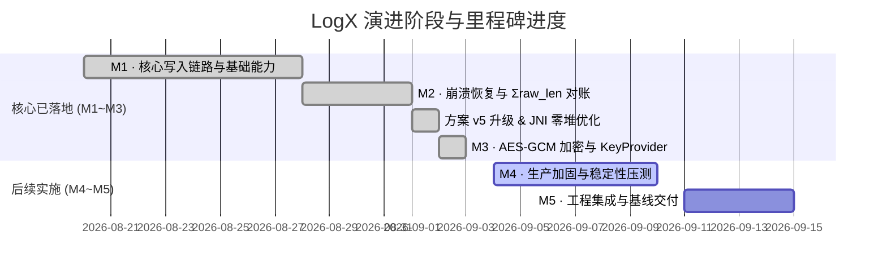

# LogX 日志库后续实施路线与任务计划表

> **文档版本**: v1.0  
> **制定日期**: 2026-09-02  
> **基准方案**: [LogX 日志库最终实施方案.md](./LogX日志库最终实施方案.md) (v5 定稿)  
> **变更日志**: [CHANGELOG.md](./logx/CHANGELOG.md)

---

## 1. 总体推进状态全景



| 里程碑 | 目标与范围 | 状态 | 核心产出 / 验收标准 |
|---|---|---|---|
| **M1 核心写入链路** | 环形 mmap staging、TLS Scratch 格式化、单 Flusher 线程、按天切分、基础 JNI / Kotlin 接入 | **✅ 100% 已完成** | 跨平台 PAL (Win/POSIX) 跑通；单条写入 < 2µs；JNI 热路径零堆内存分配；多进程自动目录隔离。 |
| **M2 恢复与对账** | 对账四分支、k 块回溯、Σraw_len 精确回推、双 Header 容错与不变量收尾、启动 O(1) 缓存定位 | **✅ 100% 已完成** | kill -9 注入零丢失、零重复；截断续写自动跳 1 空隙；28/28 单测通过。 |
| **M3 压缩与加密** | zstd 单文件版、AES-256-GCM、mbedtls 裁剪、KeyProvider JNI 桥、协程 export、Python 解码工具 | **✅ 100% 已完成** | `zstd` 与 `AES-256-GCM` 闭环；12B Nonce 安全构造；JNI KeyProvider 全局引用桥接；39/39 单测通过；Android NDK 0 警告编译。 |
| **M4 生产加固** | 降级矩阵（堆缓冲）、保留期清理、50 线程并发压测、断电/撕裂/时钟跳变故障注入 | **🟡 下一步实施** | 降级经 ErrorHandler 暴露；50 线程压测无死锁/泄漏；72h Monkey 稳定。 |
| **M5 交付与基线** | Android 备份安全规则配置、性能与包体积基线、接入与密钥管理文档 | **⚪ 待启动** | `dataExtractionRules` 配置；输出延迟/吞吐/CPU/so 报告；发布 Release AAR。 |

---

## 2. 详细任务分解表 (WBS)

### 阶段一：M3 加密链路闭环 (已 100% 验收通过)

| 任务编号 | 任务名称 | 责任模块 / 文件 | 优先级 | 状态 | 实施要点与验收结果 |
|---|---|---|---|---|---|
| **T3.1** | mbedtls AES-GCM 源码引入与 CMake 接线 | `third_party/mbedtls`, `core/CMakeLists.txt` | **P0** | **✅ 完成** | 引入裁剪版 mbedtls 核心源文件；配置 `mbedtls_config.h`；CMake 打通 `LOGX_WITH_AESGCM=ON`。 |
| **T3.2** | AES-256-GCM 块加密与解密实现 | `core/src/codec.cpp` | **P0** | **✅ 完成** | 落地真加解密；12B Nonce (`8B salt + 4B seqno_be`)；`[ciphertext] + [16B GCM tag]` 格式；密钥缺失降级明文。 |
| **T3.3** | JNI `keyProvider` 完整回调桥 (Trampoline) | `android/cpp/logx_jni.cpp`, `android/kotlin/LogX.kt` | **P0** | **✅ 完成** | `nativeInit` 持有全局引用；后台线程通过 `AttachCurrentThread` 安全回调 Kotlin `KeyProvider.getKey`；`nativeClose` 自动析构释放。 |
| **T3.4** | 离线 Python 解码工具端到端联调 | `decoder/logx_decode.py` | **P1** | **✅ 完成** | 支持 `--kid-map <kid>=<hex32B>` 离线解密，与 C++ 产出的密文日志完全互通。 |
| **T3.5** | M3 加解密单元测试集补全 | `tests/unit/test_codec.cpp`, `tests/unit/test_flusher.cpp` | **P1** | **✅ 完成** | 增加错密钥拒绝、篡改 Tag 拒绝、zstd+AES-GCM 联合测试、端到端密文落盘与 export 导出验证（测试集扩充至 39/39 100% PASS）。 |

---

### 阶段二：M4 生产加固与稳定性压测

| 任务编号 | 任务名称 | 责任模块 / 文件 | 优先级 | 预计工时 | 详细实施要点与验收标准 |
|---|---|---|---|---|---|
| **T4.1** | mmap 失败堆内存 staging 降级 | `core/src/staging.cpp`, `core/src/flusher.cpp` | **P1** | 1.0d | 1. `mmap` 创建失败时降级分配 128KB 堆内存；<br>2. Flusher 启用定时 5s / 64KB 兜底 write 落盘；<br>3. 显式标记并通知 `ErrorHandler(DEGRADED)`。 |
| **T4.2** | 关键异常监控打点与 ErrorHandler 对齐 | `core/src/logx_c.cpp`, `android/kotlin/LogX.kt` | **P1** | 0.5d | 1. 打通 `DROP` (超长/环满)、`IO` (写盘失败)、`RECOVERY` (截断丢块)、`DEGRADED` (mmap/密钥降级) 等事件；<br>2. 确保在 JNI 层正确回调 Kotlin 注册的 `ErrorHandler`。 |
| **T4.3** | 日志保留期自动清理机制 | `core/src/flusher.cpp` | **P1** | 0.5d | 1. 在 Flusher 启动时及退后台/跨天时扫描日志目录；<br>2. 自动删除 `retentionDays` 之前的超期日志文件，staging 文件豁免。 |
| **T4.4** | 50 线程高并发压测与内存/fd 泄漏检验 | `tests/stress/` | **P0** | 1.5d | 1. 模拟 50 个线程高频随机写入 + 随机 `flush()` 竞争；<br>2. 连续运行 1 小时，监测虚拟内存、RSS、fd 数量与 GC 次数，零泄漏、零死锁。 |
| **T4.5** | 故障注入与鲁棒性验证矩阵 | `tests/stress/`, `tests/unit/` | **P1** | 1.5d | 1. **崩溃注入**: 写入中随机 `kill -9` 循环 1000 次，校验零丢失、零重复；<br>2. **未对齐访问**: 32 位 ARM / ASan 下校验多字节字段读取零 SIGBUS；<br>3. **时钟跳变**: 模拟 23:59:59 回拨至 00:00:01，校验文件无同名冲突与追加正确性。 |

---

### 阶段三：M5 工程集成、基线报告与交付收尾

| 任务编号 | 任务名称 | 责任模块 / 文件 | 优先级 | 预计工时 | 详细实施要点与验收标准 |
|---|---|---|---|---|---|
| **T5.1** | Android 备份安全策略配置工程化 | `android/AndroidManifest-snippet.xml` | **P2** | 0.5d | 1. 提供完整的 `dataExtractionRules.xml` (API 31+) 与 `backup_rules.xml` (API < 31) 示例；<br>2. 确保将 `logs/` 与 `logx_staging/` 彻底排除出云端备份，防止明文泄露。 |
| **T5.2** | 性能基线测试与报告输出 | `docs/benchmark_report.md` | **P2** | 1.0d | 1. 测试并输出单条写入延迟分布 (P50/P90/P99 < 2µs)；<br>2. 对比开启/关闭 zstd 压缩的落盘体积与吞吐量；<br>3. 统计 Release 版 `liblogx.so` 的二进制体积（目标 < 500KB）。 |
| **T5.3** | 接入指南与运维解码文档 | `docs/integration_guide.md`, `README.md` | **P2** | 0.5d | 1. 编写接入流程文档（Application 初始化、KeyStore 密钥包裹示例、协程 export 示例）；<br>2. 编写离线解码与线上排障手册。 |

---

## 3. 任务执行甘特排期与里程碑节点

```
2026-09-03 ~ 2026-09-08 (M3 阶段):
  [T3.1] mbedtls/ARMv8 引入 ───► [T3.2] AES-GCM 实现 ───► [T3.3] JNI KeyProvider ───► [T3.4/T3.5] 测试与解码
  【里程碑 1 交付】: 支持全密文落盘、历史 KID 轮换、跨平台解密一致。

2026-09-09 ~ 2026-09-15 (M4 阶段):
  [T4.1] 堆内存降级 ───► [T4.2] 错误监控 ───► [T4.3] 保留期清理 ───► [T4.4/T4.5] 并发与故障注入压测
  【里程碑 2 交付】: 具备生产级容灾能力，通过 1000 次 kill -9 崩溃注入。

2026-09-16 ~ 2026-09-19 (M5 阶段):
  [T5.1] 备份安全配置 ───► [T5.2] 性能基线测试 ───► [T5.3] 交付文档与 Release 打包
  【最终交付】: LogX v1.0 正式发布。
```

---

## 4. 关键设计不变量与技术纪律对照表

在执行上述任务时，必须严格遵守方案中锁定的技术纪律：

| 关注维度 | 核心规则与技术约束 | 对应代码责任点 |
|---|---|---|
| **加密安全** | 1. 同一个 `(Key, Salt)` 下 Nonce 永不复用、永不回退；<br>2. 发生实际截断时，续写首块必须执行 `seqno = max + 2`（跳 1 空隙）。 | `core/src/codec.cpp`, `core/src/recovery.cpp` |
| **内存与并发** | 1. 双 Header 写入时写完 Header A 必须执行 `std::atomic_thread_fence(seq_cst)` 再写 B；<br>2. staging 坐标系统一为环内相对偏移 `[0, 130944)`；<br>3. JNI 路径严禁分配堆内存，采用 `GetStringUTFRegion` 栈缓冲。 | `core/src/staging.cpp`, `android/cpp/logx_jni.cpp` |
| **崩溃恢复** | 1. 恢复扫描出口处必须执行“不变量收尾”，清零对账跨过区间与撕裂尾巴，重设 `write_pos`；<br>2. 严禁解析校验和失败的脏数据（宁丢不脏原则）。 | `core/src/recovery.cpp` |
| **平台安全** | 1. Staging 文件必须置于 `context.filesDir`，严禁放 `cacheDir` 或外部存储；<br>2. Android 云备份必须显式排除 staging 与 logs 目录。 | `android/kotlin/LogX.kt`, `AndroidManifest.xml` |

---

## 5. 验收标准与检查清单 (Checklist)

- [ ] `LOGX_WITH_AESGCM=ON` 下，C++ 单元测试全绿（包含明/密文共存、错误密钥拒绝）。
- [ ] JNI 边界通过真实 Android 设备验证，Kotlin `keyProvider` 正常提供密钥且无 JNI 内存泄漏。
- [ ] Python 解码工具 `logx_decode.py` 可成功解析由设备导出的加密日志。
- [ ] 50 线程高并发读写 + 随机 `kill -9` 注入 1000 次，校验无死锁、零重复、零脏数据。
- [ ] 在 32 位设备与开启 ASan 模式下运行单元测试，零未对齐内存访问（SIGBUS）崩溃。
- [ ] 导出性能基线报告：单条日志写入耗时 P99 < 2µs（Native 热路径）。

