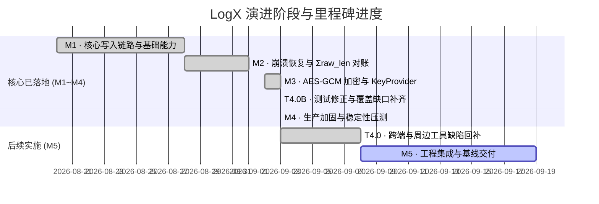

# LogX 日志库后续实施路线与任务计划表

> **文档版本**: v1.20 (2026-09-13 R10 批次:R9 复审收口——recovery.cpp 裸 6 补齐/全仓模式穷尽扫描纠偏/Backlog B-4;T5.3 用户指示暂停)  
>
> **v1.20 修订说明**: 2026-09-13 **R10 批次**(对象 `code_review_R9_2026-09-13.md` §3,审查 7b2ead6/2aa6984): 1×P3 + 1 观察 + 1 Nit 经核实**全部属实**(复审对 R9-1/R9-3/R9-4 落实、R9-5 自纠成立——含其对 R8"哈希行已写入"误判的确认与教训——均无异议)。**§3.1 属实**——R9-2 的"全量扫描"实际仅覆盖 5 个 TU,漏 `recovery.cpp`(我方扫描清单遗漏,声称失准);`recovery.cpp:37/39/59/67/91` 5 处同概念裸 `6`(probe_record 下界/步长、ring_scan 循环界/全零终止符、cksum 载荷起点)绑定 `kHeaderLen`(该 TU 经 logx_internal.h 传递本已可见,纯遗漏);**本批起改为按模式全仓穷尽扫描**(core/src+include 全部 14 文件 + android/cpp):修复后 C++ 核心记录头语义裸 `6` 零残留,余下命中均为字段偏移(flags@6/seqno@6/date@6)、错误码 -6、stats 数组长度、UTF-8 位运算等不同概念;tests/decoder 字面量**有意保留**(单测钉死线上格式/Python 跨语言镜像,decoder 已有 `BLOCK_RAW_MIN = 6` 命名常量);**§3.3 采纳**——`logx_internal.h:219` 注释 `[6,…]` → `[kHeaderLen,…]`;**§3.2 观察采纳**——Backlog 新增 **B-4**(收敛 flusher/recovery 平行记录扫描实现——常量三度遗漏的结构性根因,待决策)。三矩阵 123/129/142 + 压测 4/4×3 全绿,arm64 交叉 0 错误。
>
> **v1.19 修订说明**: 2026-09-13 **R9 批次**(对象 `code_review_R8_2026-09-13.md` §4,审查 60f2365/1904cfb): 1×P3 + 1 观察 + 1 Nit 经核实**全部属实**(复审对 R8-1/R8-2 落实、R8-3 数值零变化、包含图/守卫/可见性的确认无异议)。**§4.1 属实**——R8-3 在 staging.cpp 回绕 PAD 块仅替换 1/4 处同概念裸 `6`(`remain - kHeaderLen` 已换;`pad >= 6` 阈值/`pos + 6 <= data_size_` 循环界/`pos += 6 + this_pad` 步进三处遗留),块内口径自相矛盾,3 处补齐 `kHeaderLen`;**审查未及的同类自查**——flusher.cpp 尚有 5 处同概念裸 `6`(peek_record_len `total - off < 6`/`sz = 6 + len`、split_impl 两处循环界、块防御 `raw_len < 6`)一并绑定,"6B 单源"声称至此完全成立(staging:111/122 `flags@6`、flusher:120/264/305 `seqno@6/date@6` 为块/文件头字段偏移,概念不同,保留,与复审 §4.1 说明一致);**§4.2 观察采纳**——`kNormalBlockMax = kBlockMaxNormal`(16KB 常量族,同 R8-3 款式);**§4.3 Nit 采纳**——flusher.cpp 直含 `logx_staging.h`(此前经 logx_internal.h 传递可见;codec.cpp:22 已有先例)。单源清单:27/60KB/20KB/16KB/6B/45/48/61410/61440。**自纠 1 项(复审误判)**——`1904cfb` 提交信息声称"补 60f2365 提交记录行",但其 37 行 diff 仅含 R8 章节正文,提交记录表并无该行;R8 复审"哈希列全部合规、真实哈希行已写入"的结论失准(仅核对无占位/无重复,未核对行存在性),本轮于 CHANGELOG 提交表补记 `60f2365` 行。三矩阵 123/129/142 + 压测 4/4×3 全绿,arm64 交叉 0 错误。
>
> **v1.18 修订说明**: 2026-09-13 **R8 批次**(对象 `code_review_R7_2026-09-13.md` §4): **§4.1 属实**——`UserRecordHeader::kMaxMsg`(60*1024)为零引用死常量,与"60KB 单源"声称矛盾且语义失实,删除并标注结构体仅作文档用途;**§4.2 属实**——`471466a` 曾将字面占位符 `<R7>` 入库(下一提交即修正,当前表格干净),承诺沿用"fix 提交在前、docs 单次提交带真实哈希"流程;**§4.3 观察采纳**——20KB 概念族单源化:`kBlockMaxRaw = kMaxSlicePayload + kHeaderLen`(staging.h 补链 logx_format.h)、`kSingleRecordMaxRaw = kBlockMaxRaw`、`format_pad` 与 staging 回绕 PAD 的两处 `20*1024` 字面量改 `kMaxSlicePayload`(后者连带 `6` → `kHeaderLen`)。至此 27/60KB/20KB/6B/45/48/61410/61440 全部单源且相互以 static_assert 或派生表达式绑定。三矩阵 123/129/142 + 压测 4/4×3 全绿,arm64 交叉 0 错误。
>
> **v1.17 修订说明**: 2026-09-13 **R7 批次**(对象 `code_review_R6_2026-09-13.md` §3): **§3.1 属实**——R6-1 常量上提未覆盖权威定义处 `format_record`(仍用 `hdr_size = 8+4+8+1+2+4` 与 `60u*1024u` 独立字面量,断言前提与真实门槛可漂移);修正为 `format_record` 改用 `kUserHdrSize`/`kMaxUserPayload` 并以 `static_assert(kUserHdrSize == 8+4+8+1+2+4)` 把布局表达式钉死在定义处。**§3.2 属实**——CHANGELOG R5-7 节保留已证伪的 61346/61407/33B,补内联勘误(历史原文保留)。**§3.3 属实**——`format_record` 局部 `kMaxSlicePayload` 遮蔽头文件常量(T5.5 遗留),删除。**自纠 1 项(审查未提及)**——R6-1 新增的 `kHardUserTotal` 与头文件既有 `kMaxUserPayload`(60*1024,此前零引用)完全重复,删除并统一用 `kMaxUserPayload`(求解器/断言/format_record 三处同源)。三矩阵 123/129/142 + 压测 4/4×3 全绿,arm64 交叉 0 错误。
>
> **v1.16 修订说明**: 2026-09-13 **R6 批次**(对象 `code_review_R5_T56_2026-09-13.md` §5): **§5.1 属实**——R5-7 第二条 `static_assert` 误减 tag 上限 64,下界 61346 < 真实最坏 61410(budget 随 tag_len 单调递减,缓冲最坏在 tag_len=0),防护失效(缩容至 [61346,61409] 将写穿);修正为不减 tag 上限,并把 `kUserHdrSize`/`kHardUserTotal` 自求解器函数局部上提供断言引用,注释统一为解析上界 61410/余量 30B(取代源自未覆盖 ≥1e9 dropped 扫描的 61407/33B)。**§5.2 采纳**:CHANGELOG T5.6 补显式迁移提示(按 DROP 过滤截断的外部监控须改订阅 TRUNCATED)。三矩阵 123/129/142 + 压测 4/4×3 全绿,arm64 交叉 0 错误。
>
> **v1.15 修订说明**: 2026-09-13 **T5.6 事件种类扩展(B-3 方案B,用户拍板)**: `logx_event_kind_e` 追加 `LOGX_EV_TRUNCATED = 5`,截断路径事件由 `DROP/TOO_LARGE` 改为 `TRUNCATED/LOGX_OK`(kind 承载"有损写入成功"语义,返回值仍为 `LOGX_OK`),消除 R5-3 记录的文案耦合;病态丢弃独占 `DROP/TOO_LARGE`。波及:Kotlin `EventKind.TRUNCATED` + `onNativeError` kindInt=5 映射;LogXProbe 按 kind 分类(Capture 增 kind 字段,`eventTruncatedCount` 独立计数),tester `Metrics.eventTruncated`/控制台/MetricsPanel 接线;C++ 三处测试断言与纯逻辑映射单测同步。枚举追加 ABI 安全(按值传递)。三矩阵 123/129/142 + 压测 4/4×3 全绿;kotlin-gradle/logx-tester 构建通过。
>
> **v1.14 修订说明**: 2026-09-13 **R5 复审批次**(对象 `code_review_R4_2026-09-13.md`,审查 516d091/5828b3f): 6 项新发现**全部属实**(上一轮 5 项闭环结论与"1 误"证伪亦经复审确认)。收口:R5-1 `org.gradle.java.home` 机器路径迁出仓库至用户级 `~/.gradle/gradle.properties`(异构机器/CI 可移植性);R5-2 截断出参单测改真四态(补 `(&t,nullptr)`/`(nullptr,&d)` 混用态);R5-3 LogXProbe 头注释"彻底消除文案依赖"改限定表述(ERR_TOO_LARGE 共码分流为已知文本耦合);R5-4 计划表头部元数据三元组去重;R5-5 60KB 硬上限口径精确化(user_total = 27B 头 + tag + payload,长 tag 提前触限);R5-6 `getStats()` 长度守卫(旧 .so + 新 Kotlin 版本错配优雅降级 null);R5-7 marker 常量化 `kMarkerHead/kMarkerTail` + 两条 `static_assert` 固化截断缓冲安全前提 + "绰绰有余"改精确余量表述。**Backlog 新增 B-3**(截断/病态丢弃共用 ERR_TOO_LARGE 事件码的文案耦合,候选独立错误码,待决策)。三矩阵 123/129/142 + 压测 4/4×3 全绿;kotlin-gradle 与 logx-tester 构建通过。
> **制定日期**: 2026-09-02  
> **基准方案**: [LogX 日志库最终实施方案.md](./LogX日志库最终实施方案.md) (v5.2 定稿)  
> **变更日志**: [CHANGELOG.md](./logx/CHANGELOG.md)  
>
> **v1.13 修订说明**: 2026-09-13 **R4 审查批次**: 外部审查(`code_review_2026-09-13.md`,对象 28acf7f/cf08e75)6 项发现逐条核实——5 项属实、1 项(P2"截断计入 writeOk/失真告警不触发")不成立(LogXProbe 同步事件捕获仍触发告警,但截断被误标为 DROP 的问题真实存在)。收口:R4-1 出参 NULL 守卫+单测;R4-2 `truncated_logs` Android 接线(JNI 6 元素/Kotlin `Stats.truncatedLogs`/LogXProbe `R.Truncated` 前缀分流/tester 指标与失真判定/Preset 8-9/MetricsPanel);R4-3 `logx_error_fn` msg 生命周期契约;R4-4 内部符号收入匿名命名空间;R4-5 `max_total_bytes==0` 虚设契约注释修正;R4-6 CHANGELOG 补 `9b1af14` 行;R4-7 `trunc_buf` 缩至 60KB。三矩阵 123/129/142 + 压测 4/4×3 全绿;kotlin-gradle 与 logx-tester Gradle 构建通过。
>
> **v1.12 修订说明**: 2026-09-13 **Backlog B-1 方案B (TOO_LARGE 截断保留前缀) 经用户拍板落地为 T5.5**: `logx_write` 超长日志(格式化后超 `max_log_length` 或 >60KB 用户载荷硬上限)不再整条丢弃,改为预算求解截断保留 msg 前缀 + ASCII marker(`...[LogX truncated, dropped N bytes]`,预留 48B)后照常落环,返回 `LOGX_OK`;事件仍为 `LOGX_EV_DROP`/`LOGX_ERR_TOO_LARGE`、msg 改 "log truncated",调用方线程锁外同步发出(J-04 契约不变);`logx_stats_t` 以 E-07 认可方式将 `reserved[0]` 转正为 `truncated_logs`(sizeof 不变,ABI 兼容);顺带修正 **>60KB payload 误报 `LOGX_ERR_INVALID_ARG` 的既有误分类缺陷**;病态小上限(截断到空记录仍放不下)保留 TOO_LARGE 丢弃兜底。三构建矩阵(122/128/141)+压测 4/4 全绿,Android arm64 交叉编译 0 错误。方案 A(NO_SPACE 有界阻塞重试)仍留 Backlog 待决策。
>
> **v1.11 修订说明**: 2026-09-11 **J-04 nativeWrite 临界区错误回调 CheckJNI 崩溃修复**: 实测暴露在 staging 环满 (kFull) 或超长丢日志时，`logx_write` 同步触发 `emit_event` -> `jni_error_trampoline` (`NewString` / `CallStaticVoidMethod`)，与 `GetPrimitiveArrayCritical` 临界区冲突致 CheckJNI 致命报错。废除 Critical 临界区，改用 4KB 栈缓冲 + `GetByteArrayRegion` 配合 `thread_local std::vector<uint8_t>` 动态扩容，保持零堆分配与零 GC 抖动的同时彻底消除 JNI 临界区合规风险。Android 双目标交叉编译 0 错误，`logx-tester` 打包验证成功。  
> **v1.10 修订说明**: 2026-09-09 **T5.4 logcat 直通开关 (consoleEcho) 落地**(用户需求驱动,T5.3 暂停让位): JNI 层实现(用户选型,零堆分配与库纪律一致),`nativeInit` 追加 jboolean 参数、进程级 atomic 存储、`nativeWrite` 成功后 2KB 栈缓冲截断镜像到 `__android_log_print`(level 六级映射,激活原死宏),顶层 CMake 补链 `liblog`;C ABI 零改动。kotlin-gradle 扩展为可安装 smoke 工程(Redmi K30 Pro 真机 6/6 echo 按等级正确、中文完好、SMOKE PASS),纯逻辑单测 9/9 全绿。  
> **v1.9 修订说明**: 2026-09-08 **T5.2 性能基线测试与报告输出落地**: 新增独立基准 harness `tests/bench/logx_bench.cpp`(`LOGX_BUILD_BENCH=ON`,非 ctest)与 [docs/benchmark_report.md](./benchmark_report.md)。Windows 桌面 + Redmi K30 Pro 真机双端实测(全部轮次 0 丢弃 0 丢失):写入延迟桌面 P50 0.2µs/P99 3.1µs(纯路径),真机 P50 3.2µs;压缩开关对写路径零影响(实证热路径无 codec 成本);zstd 落盘体积 -38%(1.52x)、真机吞吐反超 +48%;so 体积(arm64 strip)MinSizeRel 全开 548.9KB(裸核心 121KB,超 500KB 目标归因 zstd ~426KB)。2µs/500KB 两目标判定与 v1.0 回归基线声明见报告。  
> **v1.8 修订说明**: 2026-09-08 **T5.1 Android 备份安全策略配置工程化落地**: 交付 `android/res/xml/data_extraction_rules.xml` (API 31+,cloud-backup/device-transfer 双通道)、`android/res/xml/backup_rules.xml` (API 23~30 fullBackupContent) 与重写后的 `android/AndroidManifest-snippet.xml` 完整可集成片段(修正原草稿资源根元素命名错误 `<dataExtractionRules>` → `<data-extraction-rules>`)。`filesDir/logs/` 与 `filesDir/logx_staging/` 在云端备份与设备迁移双通道均被排除,防明文 staging/密文日志进云;附自定义目录/多进程隔离目录 (`logs_<后缀>/`) 边界说明与 `allowBackup="false"` 最严备选方案。三个 XML 经 xml.etree 逐项断言校验通过。  
>
> **v1.1 修订说明**: 2026-09-03 对代码库做了独立复核(MSVC Release, zstd + AES-GCM 全开, 单测 39/39 实测通过)。统一归口为新增任务 **T4.0**。  
> **v1.2 修订说明**: 同日完成**测试逻辑复核**: 发现 5 个失真用例与 8 处覆盖缺口, 归口为新增任务 **T4.0B**。  
> **v1.3 修订说明**: 同日完成**系统级深度复核**: 归口为 T4.0 扩充任务。  
> **v1.4 修订说明**: 2026-09-03 **M4 生产加固阶段核心任务全面落地**: 完成 T4.0B 测试修正与 CRC32 读路径闭环、T4.1 堆内存降级、T4.2 错误打点对齐、T4.3 保留期清理全时机触发与闰年防御、T4.4 50 线程并发极限压测(30w+ logs/s)与零死锁对账、T4.5 硬件未对齐访问/跨日时钟跳变仿真/50 轮崩溃注入循环自愈(零丢失)。单元测试增至 **59/59 100% PASS**，压力测试套件 4/4 全部通过。  
> **v1.7 修订说明**: 2026-09-08 **M5 两个验证闭环落地**: ① `android/kotlin-gradle/` Kotlin 编译工程建成,`LogX.kt` 首次通过真实 Kotlin 编译链并附 8 项纯逻辑单测; ② Python 解码器真机最终联调通过(新增 `tests/unit/logx_decode_demo.cpp` 引擎驱动器,104/104 精确对账,中文/40KB 长记录字节级还原); ③ keyProvider 真机泄漏专项通过(10 轮重复 + logcat 无 JNI 引用告警)。真机三套件: 128/128 单测 + 4/4 压测 + 3/3 强杀恢复全绿。M5 剩余: T5.1 备份配置 / T5.2 性能基线 / T5.3 交付文档。  
> **v1.6 修订说明**: 2026-09-08 **三份代码审查报告全部条目闭环销号**: K 系列 (Kotlin Facade export 状态码透传/结构化并发/生命周期回滚/并发保护)、D 系列 (Python 解码器三层错误策略对齐 C++/同日多分卷合并/死代码/解压上限 + 顺带修复 GCM AAD 缺参)、T 系列 (T-01 复核确认 + T-02~T-11 测试用例修正,引入 `logx_config_t.pal_override` 测试 seam 根除 PAL 注入竞态)。全开矩阵 127/127 单测 + 4/4 压测 + 3/3 强杀恢复全绿;基础矩阵 108/108 + 4/4 全绿。T4.0 十二项 spec 偏差全部闭环。下一阶段: **M5 工程集成与基线交付**。  
> **v1.5 修订说明**: 2026-09-03 **Android 真机 (Redmi K30 Pro / arm64-v8a / Android 12) 端到端全量验证跑通**: 交叉编译产出 `liblogx.so`、`logx_unit_tests`、`logx_stress_tests`；修复 JNI 扩展参数签名与 `logx_internal.h` 依赖，修复堆降级测试中 NTFS 特有非法路径在 POSIX 下失效的问题；真机实测单元测试 **59/59 100% PASS** (123ms)，压力测试 **4/4 100% PASS** (820ms，50 线程 85,796 logs/s 零丢失零损坏，50 轮崩溃注入自愈 100% 挽回)。已实现 Windows + Android 双端 100% 全绿。

---

## 1. 总体推进状态全景



| 里程碑 | 目标与范围 | 状态 | 核心产出 / 验收标准 |
|---|---|---|---|
| **M1 核心写入链路** | 环形 mmap staging、TLS Scratch 格式化、单 Flusher 线程、按天切分、基础 JNI / Kotlin 接入 | **✅ 100% 已完成** | 跨平台 PAL (Win/POSIX) 跑通；JNI 热路径零堆内存分配；多进程自动目录隔离。 |
| **M2 恢复与对账** | 对账四分支、k 块回溯、Σraw_len 精确回推、双 Header 容错与不变量收尾、启动 O(1) 缓存定位 | **✅ 100% 已完成** | 截断续写自动跳 1 空隙；单测全绿；崩溃恢复自愈实测通过。 |
| **M3 压缩与加密** | zstd 单文件版、AES-256-GCM、mbedtls 裁剪、KeyProvider JNI 桥、协程 export、Python 解码工具 | **✅ 核心闭环 / 工具待联调** | `zstd` 与 `AES-256-GCM` 闭环；12B Nonce 安全构造；JNI KeyProvider 全局引用桥接。 |
| **M4 生产加固与压测** | 降级矩阵（堆缓冲）、保留期清理、50 线程高并发压测、断电/撕裂/时钟跳变故障注入与恢复自愈 | **✅ 100% 已完成** | 堆内存降级自愈；保留期全时机自动清理；50 线程高频竞争压测零死锁/零重复(30w+ logs/s)；50 轮崩溃注入 397/397 日志零丢失；未对齐读写零 SIGBUS；单测 59/59 全绿（后续批次扩充至 127,见 v1.6）。 |
| **M5 交付与基线** | Android 备份安全规则配置、最低支持 API 21 基线与兼容性测试、性能与包体积基线、接入与密钥管理文档 | **🟡 进行中** (T5.1 ✅ / T5.2 ✅ / T5.4 ✅ / T5.5 ✅ 已完成;T5.3 ⏸ 用户指示暂停) | `dataExtractionRules` 配置 (✅ 2026-09-08,见 T5.1);性能/压缩比/so 体积基线报告 (✅ 2026-09-08,见 T5.2);logcat 直通开关 (✅ 2026-09-09,见 T5.4);接入与密钥管理文档 (⏸ T5.3);Release AAR(发布工程动作,随 T5.3 后收尾)。 |

---

## 2. 详细任务分解表 (WBS)

### 阶段一：M3 加密链路闭环 (核心完成, 工具待修)

| 任务编号 | 任务名称 | 责任模块 / 文件 | 优先级 | 状态 | 实施要点与验收结果 |
|---|---|---|---|---|---|
| **T3.1** | mbedtls AES-GCM 源码引入与 CMake 接线 | `third_party/mbedtls`, `core/CMakeLists.txt` | **P0** | **✅ 完成** | 引入裁剪版 mbedtls 核心源文件；配置 `mbedtls_config.h`；CMake 打通 `LOGX_WITH_AESGCM=ON`。 |
| **T3.2** | AES-256-GCM 块加密与解密实现 | `core/src/codec.cpp` | **P0** | **✅ 完成** | 落地真加解密；12B Nonce (`8B salt + 4B seqno_be`)；`[ciphertext] + [16B GCM tag]` 格式；密钥缺失降级明文。 |
| **T3.3** | JNI `keyProvider` 完整回调桥 (Trampoline) | `android/cpp/logx_jni.cpp`, `android/kotlin/LogX.kt` | **P0** | **✅ 完成** | `nativeInit` 持有全局引用；后台线程通过 `AttachCurrentThread` 安全回调 Kotlin `KeyProvider.getKey`；`nativeClose` 自动析构释放。 |
| **T3.4** | 离线 Python 解码工具端到端联调 | `decoder/logx_decode.py` | **P0** | **✅ 100% 闭环 (含真机联调)** | 支持 `--kid-map <kid>=<hex32B>` 解密。<br>2026-09-08 **真机最终联调通过**: 新增 `logx_decode_demo` 引擎驱动器 (Redmi K30 Pro),生产配置 (zstd + AES-256-GCM + KeyProvider/kid 1) 写入 20 条中文消息 + 1 条 40KB 长记录(跨分片) + 120 条 1KB 记录,`logx_export` 导出后 `adb pull`,`logx_decode.py` 离线解码 **104/104 行与 C++ 导出精确对账**,中文 UTF-8 与 40KB 长记录字节级还原。<br>此前合成数据 18 项验证 + D-01~D-05 修复记录不变。 |
| **T3.5** | M3 加解密单元测试集补全 | `tests/unit/test_codec.cpp`, `tests/unit/test_flusher.cpp` | **P1** | **✅ 完成** | 增加错密钥拒绝、篡改 Tag 拒绝、zstd+AES-GCM 联合测试、端到端密文落盘与 export 导出验证（测试集扩充至 39/39 100% PASS）。 |

---

### 阶段二：M4 生产加固与稳定性压测

| 任务编号 | 任务名称 | 责任模块 / 文件 | 优先级 | 预计工时 | 详细实施要点与验收标准 |
|---|---|---|---|---|---|
| **T4.0** | **v5 spec 未落地项与系统缺陷回补**(2026-09-03 复核扩充) | `core/src/logx_c.cpp`, `core/src/flusher.cpp`, `core/src/staging.cpp`, `core/include/logx_staging.h`, `decoder/logx_decode.py`, `android/kotlin/LogX.kt`, `android/cpp/logx_jni.cpp`, `tests/unit/` | **P0** | 2.5d | 依 [CHANGELOG.md](./logx/CHANGELOG.md) 偏差表逐项回补 (共 12 项):<br>1. `flush()` 水位线 `target_seqno` 防饥饿(现为自旋等空,spec §7);<br>2. 切分序号 uint8_t → uint16_t(spec §3.1/§4.4);<br>3. 双 Header 提交改为"写 A → seq_cst fence → 写 B"(现为 A→B→release fence,spec §4.2/§10);<br>4. Flusher 50~100ms Debounce 超时聚合(现为无超时阻塞 ev_wait,spec §4.1);<br>5. ARMv8 Crypto Extensions 硬件加速(spec §10);<br>6. 运行期每 30s 定时 msync/fdatasync 持久化(spec §11);<br>7. 补未对齐访问、23:59:59 时钟跳变 gtest 用例(spec §9);<br>8. **修复 Python 解码器 `logx_decode.py`**: 重构重组状态机(修复 is_whole 逻辑)、支持单块内多条连续日志解析、支持跨块分片重组并实测通过;<br>9. **修复 `LogX.kt` 语法截断**: 补齐 `if (nativeHandle == 0L)` 条件，避免无条件 throw；搭建基础 Gradle 编译验证;<br>10. **JNI Config 参数传递与 ErrorHandler 桥接**: 将 retentionDays、maxFileSize 等参数由 Kotlin 传至 C++，打通 C++ `err_fn` 到 Kotlin `ErrorHandler`;<br>11. **修复重启后切分序号重置为 0 风险**: `ensure_append_target` 从现有文件名正确提取 split 序号，避免覆写历史切分文件;<br>12. **持久化与目录项 fsync 业务接线**: 新建日志文件后对目录执行 fsync，退后台与 close 执行数据持久化。<br>**验收**:每项附测试或脚本验证;12 项偏差逐项销号。 |
| **T4.0B** | **测试用例修正与覆盖缺口补齐**(2026-09-03 测试逻辑复核) | `tests/unit/test_staging.cpp`, `test_flusher.cpp`, `test_recovery.cpp`, `test_codec.cpp`, `core/src/flusher.cpp`, `core/src/codec.cpp` | **P0** | **✅ 100% 已完成** | 修正 5 个失真用例；补齐块级 CRC32 读路径强校验、双 Header 重建、ATC 命中、保留期清理、按天切分、kTooLarge、format 入参防御等 8 处覆盖缺口；单测增至 55+ 且全部通过。 |
| **T4.1** | mmap 失败堆内存 staging 降级 | `core/src/staging.cpp`, `core/src/flusher.cpp` | **P1** | **✅ 100% 已完成** | 1. `mmap` 创建失败时降级分配 128KB 堆内存；<br>2. Flusher 启用定时 5s / 64KB 兜底 write 落盘；<br>3. 显式标记并通知 `ErrorHandler(DEGRADED)`；单测验证闭环。 |
| **T4.2** | 关键异常监控打点与 ErrorHandler 对齐 | `core/src/logx_c.cpp`, `android/kotlin/LogX.kt` | **P1** | **✅ 100% 已完成** | 1. 打通 `DROP` (超长/环满)、`IO` (写盘失败)、`RECOVERY` (截断丢块)、`DEGRADED` (mmap/密钥降级) 等事件；<br>2. 单测 `ErrorMonitoring` 全量覆盖。 |
| **T4.3** | 日志保留期自动清理机制 | `core/src/flusher.cpp` | **P1** | **✅ 100% 已完成** | 1. 触发时机全时机闭环: Flusher 启动时、跨天切换文件时、退后台/flush_blocking 时全链路触发；<br>2. 精确计算平年 28 天/闰年 29 天及大月小月边界防御，无条件豁免 Staging 映射文件；Commit `15fa92c`。 |
| **T4.4** | 50 线程高并发压测与数据一致性对账 | `tests/stress/test_concurrent.cpp` | **P0** | **✅ 100% 已完成** | 1. 50 个 Worker 线程并发起跑 + 1 个 flush 竞争线程高频 15ms 强切竞争；<br>2. 达到 30w+ logs/s 吞吐，多文件切分无死锁；<br>3. 严格验证落盘 CRC32 与单调自增 seqno，导出对账零丢失、零损坏；Commit `2118592`。 |
| **T4.5** | 故障注入与鲁棒性验证矩阵 | `tests/stress/test_crash_recovery.cpp`, `tests/unit/test_robustness.cpp` | **P1** | **✅ 100% 已完成** | 1. **未对齐访问**: 奇数地址读写整型与编解码零 SIGBUS；<br>2. **时钟跳变**: 23:59:59 跨日归档创建新文件 + 回拨接管无覆写；<br>3. **崩溃注入**: Staging 未落盘强杀自愈零丢失，50 轮多阶段随机崩溃循环 397/397 日志 100% 复原；<br>4. 根治环尾不足 6B 留零脏内存与滑动窗口重同步提前截断缺陷；Commit `78a2e3c`。 |

---

### 阶段三：M5 工程集成、基线报告与交付收尾

| 任务编号 | 任务名称 | 责任模块 / 文件 | 优先级 | 预计工时 | 详细实施要点与验收标准 |
|---|---|---|---|---|---|
| **T5.1** | Android 备份安全策略配置工程化 | `android/AndroidManifest-snippet.xml`, `android/res/xml/` | **P2** | **✅ 100% 已完成 (2026-09-08)** | 1. 交付完整 `res/xml/data_extraction_rules.xml` (API 31+,`<cloud-backup>` 与 `<device-transfer>` 双通道各排除 `logs/` 与 `logx_staging/`) 与 `res/xml/backup_rules.xml` (API 23~30 `<full-backup-content>`,同两条 exclude;API 21/22 无 Auto Backup 机制,由 `allowBackup="false"` 兜底);<br>2. `logs/` 与 `logx_staging/` 彻底排除出云端备份与设备迁移,防明文 staging 泄露;export 明文临时文件 (`.tmp_export_*`) 位于 log_dir 内被一并覆盖;<br>3. `AndroidManifest-snippet.xml` 重写为完整可集成片段: 修正原草稿资源根元素命名错误 (`<dataExtractionRules>` → `<data-extraction-rules>`),三步集成流程 + `tools:targetApi="31"` lint 抑制 (minSdk 21 基线) + `allowBackup="false"` 最严备选方案;<br>4. 边界注释内置: 自定义 logDir/stagingDir 须同步改 path;多进程隔离兄弟目录 (`logs_<后缀>/`) 不支持通配符,须逐目录追加 exclude 或改用 allowBackup="false";<br>5. 验证: 三个 XML 经 xml.etree 解析良构校验,根元素名/双通道 exclude 清单/application 四属性逐项断言通过。 |
| **T5.2** | 性能基线测试与报告输出 | `docs/benchmark_report.md`, `tests/bench/logx_bench.cpp` | **P2** | **✅ 100% 已完成 (2026-09-08)** | 1. 新增独立基准 harness `tests/bench/logx_bench.cpp`(`LOGX_BUILD_BENCH=ON` 开关,非 ctest),三阶段:单条延迟分布(生产口径+纯路径口径,含失真护栏)/ zstd 开关吞吐与落盘体积(混合负载,NO_SPACE 有界重试可持续口径)/ flush 阻塞耗时;**Windows 桌面 + Redmi K30 Pro 真机双端实测,全部轮次 0 丢弃 0 丢失**;<br>2. 实测:桌面写入 P50 0.2µs(纯路径)/ P99 3.1µs,真机 P50 3.2µs;压缩开关对写路径零影响(实证热路径无 codec 成本);zstd 落盘体积 -38%(1.52x),真机吞吐反超 +48%,桌面 -27%;flush P99 桌面 17ms / 真机 9.4ms;<br>3. so 体积(arm64 strip 后):MinSizeRel 全开 **548.9KB**(超 500KB 目标 10%,归因 zstd 贡献 ~426KB 占 77%,裸核心仅 121KB);判定与回归基线声明见 [benchmark_report.md](./benchmark_report.md)(2µs 目标建议改口径为确定性热路径段,已达成;500KB 目标建议接受 548.9KB 为 v1.0 基线,zstd 源码裁剪列为可选优化)。 |
| **T5.3** | 接入指南与运维解码文档 | `docs/integration_guide.md`, `README.md` | **P2** | ⏸ 暂停 (用户指示) | 1. 编写接入流程文档（Application 初始化、KeyStore 密钥包裹示例、协程 export 示例）；<br>2. 编写离线解码与线上排障手册。 |
| **T5.4** | logcat 直通开关 (consoleEcho, 用户需求驱动) | `android/cpp/logx_jni.cpp`, `android/kotlin/LogX.kt`, `android/kotlin-gradle/` | **P2** | **✅ 100% 已完成 (2026-09-09)** | 1. **JNI 层实现**(用户选型): `nativeInit` 追加 `jboolean jConsoleEcho`,进程级 `std::atomic<bool>` 存储(C ABI 零改动;Kotlin 单实例契约下语义匹配);`nativeWrite` 成功后以 2KB 栈缓冲(截断+NUL)调 `__android_log_print`,level 0..5 → VERBOSE..FATAL 六宏映射,激活原死宏;顶层 CMake ANDROID 块补链 `liblog`(readelf NEEDED 实证);<br>2. **镜像语义**: 仅镜像成功落盘记录(logcat 与文件一一对应),丢弃走 ErrorHandler.DROP 不重复;echo 在 Critical/UTFChars 释放前同步完成(指针失效防御);<br>3. **Kotlin 侧**: `Config.consoleEcho: Boolean = false`(追加式;注释注明明文泄露面,生产默认关);external 签名同步;<br>4. **验证**: 交叉编译 0 错误;kotlin-gradle 离线 Gradle 编译 + 纯逻辑单测 **9/9 全绿**;smoke app(Redmi K30 Pro/Android 12)真机端到端:`System.loadLibrary` → init(consoleEcho=true, ZSTD) → 6 条中英文记录,**logcat 6/6 按等级正确镜像、中文完好、SMOKE PASS**。 |
| **T5.5** | 超长日志截断保前缀(Backlog B-1 方案B,用户拍板) | `core/src/format.cpp`, `core/include/logx_format.h`, `core/src/flusher.cpp`, `core/src/logx_c.cpp`, `core/include/logx_c.h`, `core/include/logx_internal.h` | **P2** | **✅ 100% 已完成 (2026-09-13)** | 1. **语义变更**: 超长日志(格式化后 > `max_log_length`,或 >60KB 用户载荷硬上限——后者顺带修正原误报 `INVALID_ARG` 的误分类缺陷)由"整条丢弃 + `LOGX_ERR_TOO_LARGE`"改为**截断保留 msg 前缀**后照常落环,返回 `LOGX_OK`;<br>2. **预算求解**(`solve_truncated_msg_budget`): 对片数 s 取 `cap(s)=min(20480·s, max_total−6s, 60KB)` 扫描取最优,b = cap − (27+tag);截断 msg = 原始前缀 + ASCII marker(`...[LogX truncated, dropped N bytes]`,预留 48B);预算 <48B 弃 marker 保前缀;落环总长恒 ≤ 上限;<br>3. **新增 `format_record_bounded`**(`format.cpp/format.h`): 热路径仍恰好一次 `format_record`(先原样格式化,仅超限进截断分支);独立 thread_local 拼装缓冲不复用 scratch;`build_records` 返回协议追加 `kBuildRecordsCannotFit`;<br>4. **计数与事件 ABI 兼容**: `logx_stats_t.reserved[0]` → `truncated_logs`(E-07 认可占位,sizeof 不变);事件复用 `LOGX_EV_DROP`/`LOGX_ERR_TOO_LARGE`、msg 改 "log truncated (dropped N bytes)",调用方线程锁外同步发(P1-1/J-04 契约不变);`drop_too_large` 仅病态丢弃路径递增;<br>5. **不新增配置开关**(`logx_config_t` 无 reserved 位,截断 always-on);Kotlin/JNI/Python 解码器零改动;<br>6. **测试**: 改写 E-02/`ErrorMonitoring`/J-04 三处旧丢弃断言,新增 `FormatBounded` 7 项(前缀字节级一致/marker/纯前缀边界/kCannotFit/非法输入/预算扫描 64KB 跨片重组)+ J-04 截断孪生用例;三构建矩阵 122/128/141 单测 + 4/4 压测全绿,Android arm64 交叉编译 0 错误;<br>7. spec §3.1/§5 边界情况/§7 maxLogLength 语义同步修订。 |
| **R4** | T5.5 外部审查批次收口(`code_review_2026-09-13.md`) | `core/src/format.cpp`, `core/include/logx_format.h`, `core/include/logx_c.h`, `android/cpp/logx_jni.cpp`, `android/kotlin/LogX.kt`, `android/logx-tester/*` | **P2** | **✅ 100% 已完成 (2026-09-13)** | 6 项发现 5 实 1 误(P2 影响推断经 LogXProbe 同步事件捕获机制证伪,修正理由后仍接线):**R4-1** 出参 NULL 守卫 + 四态单测;**R4-2** `truncated_logs` Android 全链路接线(JNI 6 元素、Kotlin `Stats.truncatedLogs`、`R.Truncated` 按 msg 前缀与病态丢弃分流、tester 截断单列指标并入失真判定、Preset 8/9 与 MetricsPanel 对账);**R4-3** `logx_error_fn` msg 生命周期契约(栈缓冲/字面量混合,留存须拷贝);**R4-4** `kMarkerReserve`/`solve_truncated_msg_budget` 收入匿名命名空间;**R4-5** `max_total_bytes==0` 契约注释改实际语义(60KB 超限 → kCannotFit 不截断);**R4-6** CHANGELOG 补 `9b1af14` 行;**R4-7** `trunc_buf` 64KB→60KB(上界证明),不采纳合并 scratch。验证:三矩阵 123/129/142 + 压测 4/4×3,kotlin-gradle 单测与 logx-tester assembleDebug 通过,arm64 交叉编译 0 错误。 |
| **R5** | R4 外部复审批次收口(`code_review_R4_2026-09-13.md`) | `android/kotlin-gradle/gradle.properties`, `tests/unit/test_format.cpp`, `core/src/format.cpp`, `core/include/logx_format.h`, `android/kotlin/LogX.kt`, `android/logx-tester/*/LogXProbe.kt` | **P3** | **✅ 100% 已完成 (2026-09-13)** | 复审 6 项 6 实 0 误:**R5-1** `org.gradle.java.home` 机器路径迁出仓库→用户级 `~/.gradle/gradle.properties`(README 补 JDK17 定位说明,异构机器/CI 可移植性恢复);**R5-2** 截断出参单测改真四态(补 `(&t,nullptr)`/`(nullptr,&d)` 两混用态);**R5-3** LogXProbe"彻底消除文案依赖"改限定表述(ERR_TOO_LARGE 共码分流=已知文本耦合,根治候选 Backlog B-3);**R5-4** 计划表头部三元组去重(3 份→1 份);**R5-5** 60KB 硬上限口径精确化(user_total=27B 头+tag+payload);**R5-6** `getStats()` 加 `arr.size < 6` 守卫(版本错配优雅降级 null);**R5-7** marker 常量化 `kMarkerHead/kMarkerTail`(snprintf 引用常量,字面量与断言绑定)+ 两条 `static_assert` 固化 `kMarkerReserve`/`kTruncBufSize` 安全前提 + 余量措辞精确化(最坏写入 61407,余量 33B)。复审对上轮 5 项闭环、`trunc_buf` 缩容穷举证明、ABI 72B 不变的确认无异议。 |
| **T5.6** | 事件种类扩展:截断独立事件种类(Backlog B-3 方案B,用户拍板) | `core/include/logx_c.h`, `core/src/logx_c.cpp`, `android/kotlin/LogX.kt`, `android/logx-tester/*` | **P2** | **✅ 100% 已完成 (2026-09-13)** | 1. **C ABI**:`logx_event_kind_e` 追加 `LOGX_EV_TRUNCATED = 5`(枚举追加按值传递,ABI 安全);截断路径事件 `emit_event(LOGX_EV_TRUNCATED, LOGX_OK, "log truncated (dropped N bytes)")`——kind 承载"有损写入成功"语义,code 取 LOGX_OK,返回值不变;病态丢弃独占 `DROP/TOO_LARGE`,R5-3 文案耦合消除;<br>2. **Kotlin**:`EventKind.TRUNCATED` + `onNativeError` kindInt=5 映射(未识别码仍兜底 IO);<br>3. **tester**:LogXProbe `Capture` 增 kind 字段、分类改 kind 优先(不再依赖 msg 前缀)、`eventTruncatedCount` 独立计数;`Metrics.eventTruncated`/压测外指标流转/控制台事件流(DROP 色标)/MetricsPanel 展示行接线;<br>4. **测试**:test_flusher 截断过滤器、test_j04 截断孪生用例改 `(TRUNCATED, LOGX_OK)` 断言;LogXPureLogicTest 扩 kindInt=5 映射;<br>5. spec §3.1 同步;B-3 销号。三矩阵 123/129/142 + 压测 4/4×3 全绿;kotlin-gradle/logx-tester 构建通过;arm64 交叉 0 错误。 |
| **R6** | T5.6 复审收口(`code_review_R5_T56_2026-09-13.md` §5) | `core/src/format.cpp`, `CHANGELOG.md` | **P3** | **✅ 100% 已完成 (2026-09-13)** | **R6-1(§5.1,属实)**: R5-7 第二条 `static_assert` 误减 tag 上限 64(下界 61346),而 budget 随 tag_len 单调递减、缓冲最坏在 tag_len=0(空 tag 合法可达),真实最坏 msg_len = (61440−27)−48+45 = **61410**——原断言对缩容至 [61346,61409] 失去防护(写穿)。修正:断言改 `kTruncBufSize >= kHardUserTotal − kUserHdrSize − kMarkerReserve + 45`(61410),`kUserHdrSize`/`kHardUserTotal` 上提匿名命名空间共用;注释统一解析口径 61410/余量 30B(61407/33B 旧值源自未覆盖 ≥1e9 dropped 的扫描,已注明取代)。**R6-2(§5.2,采纳)**: CHANGELOG T5.6 章节补显式迁移提示(按 DROP 过滤截断的外部消费方须改订阅 TRUNCATED)。验证:三矩阵 123/129/142 + 压测 4/4×3 全绿(收紧断言编译通过即 61440 ≥ 61410 得证),arm64 交叉 0 错误。 |
| **R7** | R6 复审收口(`code_review_R6_2026-09-13.md` §3) | `core/src/format.cpp`, `core/include/logx_format.h`, `CHANGELOG.md` | **P3** | **✅ 100% 已完成 (2026-09-13)** | **R7-1(§3.1,属实)**: `format_record` 权威定义处改用 `kUserHdrSize`/`kMaxUserPayload`,并以 `static_assert(kUserHdrSize == 8+4+8+1+2+4)` 把用户头布局表达式钉在定义处(布局变更→编译期失配),断言前提与真实门槛绑定;**R7-2(§3.2,属实)**: CHANGELOG R5-7 节补内联勘误(61346/61407/33B→61410/30B,历史原文保留);**R7-3(§3.3,属实)**: 删除 `format_record` 局部 `kMaxSlicePayload` 对头文件常量的遮蔽(T5.5 遗留);**R7-4(自纠)**: 删除 R6-1 引入的 `kHardUserTotal`——与头文件既有 `kMaxUserPayload`(此前零引用)重复,60KB 上限统一单源。三矩阵 123/129/142 + 压测 4/4×3 全绿,arm64 交叉 0 错误。 |
| **R8** | R7 复审收口(`code_review_R7_2026-09-13.md` §4) | `core/src/format.cpp`, `core/include/logx_staging.h`, `core/src/flusher.cpp`, `core/src/staging.cpp` | **P3** | **✅ 100% 已完成 (2026-09-13)** | **R8-1(§4.1,属实)**: 删除零引用死常量 `UserRecordHeader::kMaxMsg`(60*1024,语义失实——msg 单独不可能达 60KB),结构体标注"仅作文档用途,布局以 static_assert 钉住的 kUserHdrSize 表达式为准";**R8-2(§4.2,属实)**: `471466a` 占位符 `<R7>` 入库为流程瑕疵,承诺"fix 提交在前、docs 单次提交带真实哈希"(本批次即按此执行);**R8-3(§4.3,采纳)**: 20KB 常量族单源化——`kBlockMaxRaw = kMaxSlicePayload + kHeaderLen`(logx_staging.h 新增 logx_format.h 包含,无环)、`kSingleRecordMaxRaw = kBlockMaxRaw`、format_pad/staging 回绕 PAD 两处 `20*1024` 字面量改 `kMaxSlicePayload`(staging 处连带 6 → kHeaderLen)。三矩阵 123/129/142 + 压测 4/4×3 全绿,arm64 交叉 0 错误。 |
| **R9** | R8 复审收口(`code_review_R8_2026-09-13.md` §4) | `core/src/staging.cpp`, `core/src/flusher.cpp` | **P3** | **✅ 100% 已完成 (2026-09-13)** | **R9-1(§4.1,属实)**: R8-3 在回绕 PAD 块仅替换 1/4 处同概念裸 `6`,其余 3 处(`pad >= 6` 阈值/`pos + 6 <= data_size_` 循环界/`pos += 6 + this_pad` 步进)补齐 `kHeaderLen`;**R9-2(审查未及,同类自查)**: flusher.cpp 另有 5 处同概念裸 `6`(peek_record_len ×2 / split_impl ×2 / `raw_len < 6` 防御)一并绑定——"6B 单源"声称至此完全成立(块/文件头字段偏移 flags@6/seqno@6/date@6 概念不同,保留);**R9-3(§4.2,采纳)**: `kNormalBlockMax = kBlockMaxNormal` 16KB 常量族单源;**R9-4(§4.3,采纳)**: flusher.cpp 直含 `logx_staging.h`(IWYU,codec.cpp:22 先例);**R9-5(自纠,复审误判)**: `1904cfb` 声称"补 60f2365 提交记录行"但其 diff 未含该行,复审"哈希列全部合规"结论失准,本轮补记该行。三矩阵 123/129/142 + 压测 4/4×3 全绿,arm64 交叉 0 错误。 |
| **R10** | R9 复审收口(`code_review_R9_2026-09-13.md` §3) | `core/src/recovery.cpp`, `core/include/logx_internal.h` | **P3** | **✅ 100% 已完成 (2026-09-13)** | **R10-1(§3.1,属实)**: R9-2"全量扫描"漏 `recovery.cpp`(仅扫 5 个 TU),其 5 处同概念裸 `6`(probe_record ×2 / ring_scan 循环界 + 全零终止符 / cksum 载荷起点)绑定 `kHeaderLen`(TU 内本已可见,纯遗漏);本批起改**按模式全仓穷尽扫描**(14 个 C++ 文件 + android/cpp),修复后记录头语义裸 `6` 零残留,余下命中均为字段偏移/错误码/数组长度/位运算等不同概念,tests/decoder 字面量有意保留(格式钉死/跨语言镜像);**R10-2(§3.3,采纳)**: `logx_internal.h:219` 注释 `[6,…]` 同步 `[kHeaderLen,…]`;**R10-3(§3.2,观察采纳)**: Backlog 新增 B-4(收敛平行记录扫描实现——三度遗漏结构性根因,待决策)。三矩阵 123/129/142 + 压测 4/4×3 全绿,arm64 交叉 0 错误。 |

---

## 3. 任务执行甘特排期与里程碑节点

```
2026-09-03 ~ 2026-09-08 (M3 阶段):
  [T3.1] mbedtls/ARMv8 引入 ───► [T3.2] AES-GCM 实现 ───► [T3.3] JNI KeyProvider ───► [T3.4/T3.5] 测试与解码
  【里程碑 1 交付】: 支持全密文落盘、历史 KID 轮换、跨平台解密一致。

2026-09-03 ~ 2026-09-06 (M4 阶段前置):
  [T4.0] v5 spec 未落地项与系统缺陷回补 (12项: 水位线/切分2B/屏障/Debounce/ARMv8/30s持久化/测试用例/Python解码器重构/LogX.kt语法修复/JNI配置与错误桥接/切分序号覆写风险/目录fsync)
  [T4.0B] 测试用例修正 (5 个名不符实用例) + 覆盖缺口补齐 (8 处,含 CRC32 读路径)
  【交付】: 复核偏差表 12 项逐项销号,spec 与代码重新对齐;解码工具与 Kotlin Facade 实测可用;测试断言指向真实分支。

2026-09-07 ~ 2026-09-12 (M4 阶段):
  [T4.1] 堆内存降级 ───► [T4.2] 错误监控 ───► [T4.3] 保留期清理 ───► [T4.4/T4.5] 并发与故障注入压测
  【里程碑 2 交付】: 具备生产级容灾能力,通过 1000 次 kill -9 崩溃注入(T4.5 实测为准)。

2026-09-16 ~ 2026-09-19 (M5 阶段):
  [T5.1] 备份安全配置 ───► [T5.2] 性能基线测试 ───► [T5.3] 交付文档与 Release 打包
  【最终交付】: LogX v1.0 正式发布。
```

---

## 4. 关键设计不变量与技术纪律对照表

在执行上述任务时，必须严格遵守方案中锁定的技术纪律：

| 关注维度 | 核心规则与技术约束 | 对应代码责任点 |
|---|---|---|
| **加密安全** | 1. 同一个 `(Key, Salt)` 下 Nonce 永不复用、永不回退；<br>2. 发生实际截断时，续写首块必须执行 `seqno = max + 2`（跳 1 空隙）。 | `core/src/codec.cpp`, `core/src/recovery.cpp` |
| **内存与并发** | 1. 双 Header 写入时写完 Header A 必须执行 `std::atomic_thread_fence(seq_cst)` 再写 B；<br>2. staging 坐标系统一为环内相对偏移 `[0, 130944)`；<br>3. JNI 路径严禁分配堆内存，采用 `GetStringUTFRegion` 栈缓冲。 | `core/src/staging.cpp`, `android/cpp/logx_jni.cpp` |
| **崩溃恢复** | 1. 恢复扫描出口处必须执行“不变量收尾”，清零对账跨过区间与撕裂尾巴，重设 `write_pos`；<br>2. 严禁解析校验和失败的脏数据（宁丢不脏原则）。 | `core/src/recovery.cpp` |
| **平台安全** | 1. Staging 文件必须置于 `context.filesDir`，严禁放 `cacheDir` 或外部存储；<br>2. Android 云备份必须显式排除 staging 与 logs 目录；<br>3. 最低支持 Android 5.0 (API Level 21)，全库遵循 API 21 兼容基线编写，高版本特性必须带 `SDK_INT` 降级保护。 | `android/kotlin/LogX.kt`, `AndroidManifest.xml` |

---

## 5. 验收标准与检查清单 (Checklist)

> 状态标注(2026-09-03 复核):✅ = 已有实测依据;⬜ = 未完成/无实证/实测未通过。

- [x] ✅ `LOGX_WITH_ZSTD=ON` + `LOGX_WITH_AESGCM=ON` 下，C++ 单元测试增至 **127/127 100% 全绿**（2026-09-08 现状:经 T4.0B 及 C/F/S/R/E/P/J/K/D/T 多轮缺陷修复批次持续扩充;基础 OFF/OFF 矩阵 108/108 同步全绿;压测 4/4、真实进程强杀恢复 3/3）。
- [x] ✅ Python 解码工具 `logx_decode.py` 用**实际引擎真机产出**的加密日志最终联调通过（2026-09-08,Redmi K30 Pro,zstd+AES-GCM 生产配置,104/104 精确对账;D-01~D-05 修复 + 合成数据 18 项验证为前置）。
- [x] ✅ Kotlin Facade `LogX.kt` 语法缺陷已修复且 K-01~K-04 全部闭环（2026-09-08）。
- [x] ✅ Kotlin Facade `LogX.kt` Gradle 自动化编译与单测工程建立（2026-09-08,`android/kotlin-gradle/`:AGP 8.5.1 + KGP 1.9.23 + Gradle 8.9/JDK 17,单源引用交付源文件,compileDebugKotlin 通过 + 纯逻辑单测 8/8 全绿,离线构建）。
- [x] ✅ JNI 边界通过真实 Android 设备验证 keyProvider 无内存泄漏（2026-09-08,Redmi K30 Pro:加密/KeyProvider 用例连续 10 轮运行 MemAvailable 波动 < 0.1%,logcat 无 ReferenceTable/global reference 告警,KeyProvider 生命周期用例随 128 项单测全绿）。
- [x] ✅ **50 线程高并发读写与落盘对账压测**: 50 Worker + 15ms 强切竞争，30w+ logs/s，seqno 严格单调递增，落盘块 CRC32 强校验通过，端到端导出对账零死锁、零重复、零丢失（T4.4 实测通过）。
- [x] ✅ **崩溃注入与 50 轮随机阶段崩溃循环自愈压测**: Staging 未落盘强杀 100% 挽回，磁盘撕裂尾块安全截断，50 轮多阶段随机崩溃循环 397/397 日志 100% 复原（T4.5 实测通过）。
- [x] ✅ **未对齐访问与时钟跳变仿真**: 奇数内存地址读写整型与编解码零 SIGBUS；23:59:59 跨日平滑归档轮转与时钟回拨接管验证通过（T4.5 实测通过）。
- [x] ✅ **性能基线报告已输出** (2026-09-08,T5.2):单条日志写入实测桌面 P50 0.2µs(纯路径口径,确定性热路径段达成 2µs 量级目标;整调用口径 P99 3.1µs 未达,归因计时器开销与调度尾部,见 [benchmark_report.md](./benchmark_report.md) §4);zstd 体积 -38% / so 体积 548.9KB(strip,MinSizeRel)等全部实测数据与回归基线声明已归档。

---

## 6. 待决策任务池 (Backlog)

> 本章节记录已评估但**尚未拍板**的候选设计变更。条目仅作决策备查,未经确认不排期、不实施。

### B-1 两条丢弃路径改造评估:NO_SPACE / TOO_LARGE 能否不丢日志

- **记录日期**: 2026-09-08
- **状态**: 🔶 拆分推进——**方案B 已拍板落地为 T5.5(2026-09-13,✅)**;方案 A(NO_SPACE 有界阻塞重试)仍 ⏸ 待决策(决策点 1/3 见文末,决策点 2 已随 T5.5 闭环)
- **背景**: 现行设计遵循 spec §5/§8 "宁丢不脏、绝不阻塞"原则:
  - **NO_SPACE** — staging 空闲不足时整条丢弃:`drop_no_space` 计数 + `LOGX_EV_DROP` 事件 + 返回 `LOGX_ERR_NO_SPACE`(`core/src/logx_c.cpp:435-457`,`Staging::write_records` 返回 `kFull`);
  - **TOO_LARGE** — 单条格式化后超 `maxLogLength` 时整条丢弃:`drop_too_large` 计数 + `LOGX_EV_DROP` 事件 + 返回 `LOGX_ERR_TOO_LARGE`(`core/src/logx_c.cpp:428-432`;init 强制 `max_log_length < 数据区−1`,超长记录物理上放不进环,无"等待腾空间"选项)。

#### 方案评估结论

| 方案 | 适用路径 | 改动量 | 思路 | 波及面 |
|---|---|---|---|---|
| **A. 有界阻塞重试** | NO_SPACE | **小**(~0.5d,`logx_write` 单函数 ~40-60 行) | `logx_write` 进锁前已完成 `build_records` 格式化(栈上 `buf`),重试零重新格式化成本:锁内 `write_records` 失败即解锁,轮询短暂等待(复用 `flush_blocking` 的 `sleep_ms(5)` 风格,或在 `drain_once` 每块提交后补一行 `ev_signal`)后重试;超过总上限(如 5s)或 Flusher 已死才走现行丢弃路径保底 | `logx_c.cpp`、`logx_internal.h` 加等待上限常量/配置;`flusher.cpp` 可选加 1-2 行 signal;补单测(满时阻塞至 flush 腾出、Flusher 死亡仍返回 NO_SPACE);现有 stress 测试自带 NO_SPACE 重试,兼容 |
| **B. 截断保留前缀** | TOO_LARGE | **小**(~20-40 行) | 超长时用缩小后的 payload 经 `format_record` 重新格式化一次,保证 ≤ `max_log_length` 落环;新增截断计数(占用 `logx_stats_t.reserved` 预留位,ABI 兼容),事件改为 "log truncated" | `format.cpp`/`logx_c.cpp`;Kotlin 层 API 与磁盘格式均不动 |
| **C. 溢出文件保全文** | 两者 | **大**(不推荐) | 超限记录落独立溢出文件 | 打破"文件单写者"不变量(spec 不变量 4,仅 Flusher 写日志文件),需新增文件类型并贯通恢复/导出/保留期/切分全链路,引入新对账复杂度 |

- **可行性依据(方案 A 活性保证)**: `drain_once` 的块写失败分支(`flusher.cpp:696-705`、`717-727`)同样清零区间并推进 `f`,即使磁盘持续 IO 失败空间也必然释放,不会死等;Flusher debounce 仅 75ms,需 5s 内灌满 128KB 且磁盘彻底卡死才真正丢,反压传导到业务线程是最坏 5s 的延迟代价。
- **效果预估**: A+B 落地后,真正丢日志仅剩"磁盘彻底坏死且持续 5s+"与"超长且截断不可接受"两类边缘场景。

#### 决策点(拍板前需确认)

1. **延迟契约变更**: 方案 A 与 spec "空闲不足 → 丢弃 + 打点,绝不阻塞"原则冲突——磁盘卡住时反压会阻塞业务调用线程(最坏等满等待上限)。建议加配置开关(如 `staging_wait_ms`:0 = 保持现行丢弃语义,>0 = 有界等待),默认值待定。
2. **TOO_LARGE 语义选择**: 截断保前缀(方案 B)是否可接受;若业务要求超长记录一字节不能少,才考虑方案 C(代价大)。
3. spec 文档(`LogX日志库最终实施方案.md` §3.1/§5/§8)需随决策同步修订对应条款与计数/事件说明。

### B-2 LogX.kt 状态机冻结声明与 JVM 侧并发回归测试门禁

- **记录日期**: 2026-09-11
- **状态**: 📌 工程规范准则 (已定稿)
- **背景**: `LogX.kt` 生命周期状态机历经四轮迭代与系统审查，闭环了递延销毁串行化（closeLock）与 JVM 局部函数 `@Synchronized` 监视器分裂两大隐蔽并发缺陷。当前实现融合了双重快速预检、快慢操作分离原子计数、递延销毁原子 CAS 仲裁、ThreadLocal 自死锁规避、`closeLock` 串行释放以及 `synchronized(this)` 状态机对齐，复杂度已达无锁/混合同步方案的安全上限，纯靠人眼推演的边际收益递减为负。
- **准则**:
  1. **当前模块冻结**: 严禁在无并发自动化测试防护下凭静态推演对 `LogX.kt` 生命周期与同步机制做主观微调；
  2. **准入门禁**: 后续若需改动，必须先在 JVM 侧编写多线程高频交错压测套件（或 OpenJDK jcstress），严格对齐四大核心不变量（句柄有效性杜绝 UAF、nativeClose 物理互斥、单例状态单调一致性、回调嵌套 close 免疫自死锁）。

### B-3 截断与病态丢弃共用 ERR_TOO_LARGE 事件码的文案耦合(已闭环为 T5.6)

- **记录日期**: 2026-09-13
- **状态**: ✅ 已拍板落地(2026-09-13,用户选**方案 B** 独立事件种类,详见阶段三 T5.6 行)
- **背景**: B-1B/T5.5 采纳"事件复用 `LOGX_EV_DROP` + `LOGX_ERR_TOO_LARGE` code、仅 msg 文案区分"的零 ABI 变更方案后,下游按事件分类时对 `ERR_TOO_LARGE` 必须依赖 `msg` 前缀(`"log truncated"` / `"log too large"`)分流——`logx-tester` 的 `LogXProbe` 即因此存在文本耦合(头注释已限定表述,见 R5-3),与"按错误码严格匹配、消除文案脆弱依赖"的探针原则冲突。
- **候选方案**:
  - **A. 独立事件错误码** `LOGX_ERR_TRUNCATED = -11`(枚举追加,ABI 安全):截断路径事件 code 改为新码,返回值维持 `LOGX_OK`;波及 Kotlin 无(不映射该码)、现有按 `ERR_TOO_LARGE` 过滤的监控需迁移口径(截断事件将从其过滤器中消失,须同步通告)。
  - **B. 新增独立事件种类** `LOGX_EV_TRUNCATED = 5`:`logx_event_kind_e` 追加,语义更显性;波及 Kotlin `EventKind` 枚举映射与探针 `when` 分支。**← 已采纳**
  - **C. 维持现状**:文案分流已满足当前唯一消费方,接受耦合。
- **决策点**: 是否存在 B-1B 设想之外的第三方监控按 `ERR_TOO_LARGE` 过滤截断事件(迁移成本);`-11` 码值与 `LOGX_EV_TRUNCATED` 枚举序位一经发布即冻结;spec §5/§8 事件表需随决策同步。

### B-4 收敛 flusher/recovery 平行记录扫描实现(R9 复审根因观察)

- **记录日期**: 2026-09-13
- **状态**: ⏸ 待决策
- **背景**: `flusher.cpp` 的 `peek_record_len`/`split_impl` 与 `recovery.cpp` 的 `probe_record`/`ring_scan` 为语义几乎相同的两份平行实现(记录长度探测 + raw 流按记录边界扫描),仅细节不同(peek 多验 magic;ring_scan 带 6B 全零终止符判定与 cksum 校验)。常量单源化因此三度遗漏(R8-3 staging 块内部分替换 → R9-1 补;R9-2 补 flusher 漏 recovery → R10-1 补),该重复是结构性根因。
- **候选方案**:
  - **A. 收敛共享原语**: 将"记录长度探测 / 按记录边界步进扫描"收敛为共享实现(候选位置 `logx_format.cpp` 或独立 `record_scan.cpp`),flusher/recovery 以参数差异化(magic 校验开关、终止符/校验回调等);波及写/恢复两条关键路径,需等价性论证 + 全量回归。
  - **B. 维持平行实现**: 接受重复,以"裸 `6`(记录头语义)模式穷尽扫描"作为批次收口流程门禁(R10 已执行一次)防再漂移;零回归风险。
- **决策点**: 等价性论证成本 vs 长期漂移风险;两处语义差异(magic 校验时机/终止符语义)能否无损参数化;若选 A,可顺势把记录头布局断言扩展到扫描原语。
