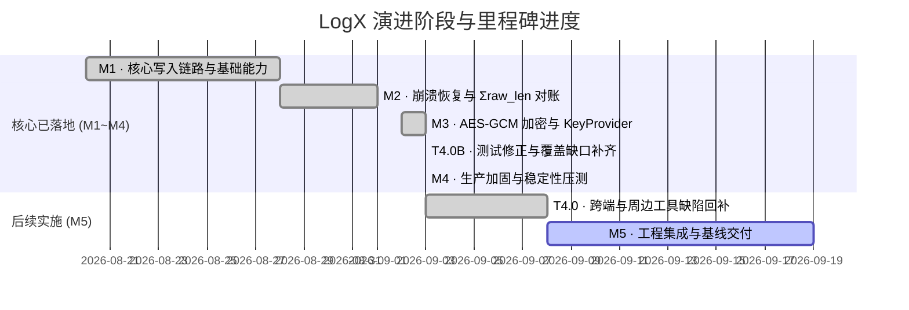

# LogX 日志库后续实施路线与任务计划表

> **文档版本**: v1.49 (2026-10-07 R34 审查收口: N-1 撤销复红屏障建立、N-2 无符号下溢防御、N-3 Wire 偏移编译期断言与 clang 警告清理)
>
> **v1.49 修订说明**: 2026-10-07 **R34 审查收口（R32 方案 2 撤销复红屏障 + N-2/N-3 结构防御）**：① **N-1 (P3, R18-2 撤销复红屏障建立)**: `StrictEventWaitPal` 增加 `limit_flusher_space_signals` 与 `strict_space_wait` 拦截，彻底断开 5ms 轮询切片后门并限制 Flusher 首脉冲单次注入；重构 `B1_EventDrivenBackoff_FastWakeupOnSpaceFreed`（3×32KB 填环余约 32.6KB，第 4 条 32KB 必阻塞等待）与 `B1_EventDrivenBackoff_CascadingWakeupMultiThread`（7×16KB + 1×15KB 填环余约 1.2KB，3 个 4KB 并发写线程必全部阻塞），验证撤销变异：注释级联令牌传递 `inst->pal->ev_signal(inst->space_event)` 时确定性复红（Actual 1 vs Expected 3，退出码 1），恢复后确定性复绿（65ms）；注释 Flusher 首脉冲同样确定性复红；成功建立刚性屏障；② **N-2 (Nit, 跨模块共享原语防御性加固)**: `core/include/logx_format.h` 的 `parse_staging_record_header` 补充 `off > total` 守卫，杜绝 `total - off` 无符号整数回绕下溢；`test_format.cpp` 补充 `off > total` 边界断言；③ **N-3 (观察/清理)**: 清理 `core/src/logx_c.cpp` 遗留的未用变量 `key_lookup_attempted`（收口 R33 N-1 clang `-Wunused-but-set-variable` 警告）；在 `logx_format.h` 提炼 `kWireOffPayloadLen`、`kWireOffMagic`、`kWireOffFlags`、`kWireOffCksum` 4 处 wire-format 偏移常量并辅以 5 条编译期 `static_assert` 约束；④ **全量验证**: MSVC clean 重建 56/56 目标 0 警告 0 错误；单测 177/177、hotpath 2/2、stress 4/4、crash_fork 3/3 全部 100% 通过。
>
> **v1.48 修订说明**: 2026-10-07 **R32 方案 2 落地（NO_SPACE 退避事件驱动化与级联唤醒令牌）**：① **机制升级**: 在 `Instance` 引入 `space_event` 事件原语（`logx_internal.h`），`logx_write` 退避重试彻底移除固定 2ms 睡眠轮询（`pal->sleep_ms(2)`），改用单次至多 5ms 切片的事件驱动等待（`ev_wait_timeout(space_event, wait_slice_ms)`）；Flusher 在落块提交释放缓冲区（`commit_header_locked` + `mutex_unlock`）后主动触发 `space_event` 唤醒写线程，将唤醒延迟从固定毫秒级骤降至即刻响应；② **级联唤醒令牌 (Cascading Wake-up Token)**: 阻塞写线程成功落环后主动向 `space_event` 传递唤醒令牌，逐级唤醒排队中的后继写线程探测剩余空间，消除单唤醒竞争饥饿；③ **关闭加速与防挂死**: `logx_close` 与写线程退出循环时级联广播 `space_event`，促使所有退避写线程即刻退出并统一记账（保持 P3-2 契约）；`ClosingOnRetryPal` 同步接管 `ev_wait_timeout`；④ **测试侧补强**: `tests/unit/test_r19_regression.cpp` 新增 `B1_EventDrivenBackoff_FastWakeupOnSpaceFreed`（空间释放毫秒级即刻唤醒）与 `B1_EventDrivenBackoff_CascadingWakeupMultiThread`（多写线程排队级联唤醒零饥饿全量落盘）；单测升至 177/177 全绿，四套件（177 + 2 + 4 + 3）100% 通过。
>
> **v1.47 修订说明**: 2026-10-07 **Backlog B-4 落地（收敛 flusher/recovery 平行记录扫描实现）**：① **原语单源化**: 在 `core/include/logx_format.h` 提炼 `StagingRecordHeaderView`、`parse_staging_record_header` 与 `peek_record_len` 内联共享原语，统一提供记录头元数据解析与边界检查；同时将 `cksum1`（1B 载荷 XOR 折叠）由 `format.cpp` 与 `recovery.cpp` 匿名命名空间上提至 `logx_format.h` 单源共享；② **消除重复实现**: `flusher.cpp` 移除局部 `peek_record_len`，`split_impl` / `probe_wrap_seam` / 脏缝探测均调用单源原语；`recovery.cpp` 移除局部 `probe_record` 与 `cksum1`，`ring_scan` 统一调用 `parse_staging_record_header`，彻底消除手写记录头偏移（`[off]`, `[off+2]`, `[off+5]`）与常量单源化漂移结构性根因；③ **测试侧补强**: `tests/unit/test_format.cpp` 新增 `PeekAndParseStagingRecordHeader_EquivalenceAndBounds`（覆盖 Entry/Pad 合法性、<6B 短缓冲、长度溢出、非法 Magic、NULL 守卫及 cksum1 一致性）；单测升至 175/175 全绿，四套件 100% 通过。
>
> **v1.46 修订说明**: 2026-10-07 **R33 独立复核与真机收口**：① **复核裁定**: `ec4c0c5`（B-10 升级方案 1 + Nonce 定性勘误）与 `1a82f1d`（rebuilt 整区重建防御门补齐 + N-1 精简）两批次完全成立，B-10 防御在 **reconcile 与 rebuilt 双路径完整闭环**；独立撤销对照实验两次复做（防御门变异 → 复红 11/10 vs 20；rebuilt 钳制退回 → 复红 5 vs 20），与提交记录逐字吻合；② **Android 真机复跑**: Redmi K30 Pro 四套件 **175/175 + 2/2 + 4/4 + 3/3 全绿**（NDK 重建后二进制 mtime 晚于 `1a82f1d`；`auto_time 0` 维持，时钟复测 1:1，首轮 4.85s 步进归因无线 adb 连接抖动已排除）；③ **发现（存量）**: N-1(P3) `logx_c.cpp:90` `key_lookup_attempted` 触发 clang `-Wunused-but-set-variable`（「0 警告」历史声称口径仅限 MSVC 工具链）；N-2(Nit) rebuilt 两处兜底分支不可达（`max>0 ⟹ best 非空`），建议保留并注释钉死不变量。复核全文见 [`docs/reviews/code_review_R33_2026-10-07.md`](./reviews/code_review_R33_2026-10-07.md)。
>
> **v1.45 修订说明**: 2026-10-07 **R32 审查遗留收口**：① **F-1 (P3, 整区重建防御门补齐)**: `recovery.cpp:240-266` 在 `hdr.rebuilt == true` 整区重建路径中提取 `scan_dir_for_target(inst, &max_dir_seqno)` 目录最大序号，将 `hdr.seqno` 钳制为 `std::max(sr.seqno, max_dir_seqno)`（尾块损坏截断时 `+1`），若发生倒退触发 `LOGX_EV_RECOVERY` 告警，彻底补齐 Staging 损毁场景下的跨卷序号倒退漏洞；② **N-1 (Nit, 代码规范与精简)**: `recovery.cpp:212-220` 合并 `reconcile` 中两处行为完全一致的告警与钳制分支条件，移除多余空行；③ **测试侧补强**: 新增 `B10_RebuiltStaging_ResidualHigherSplit_ClampedAndWarned`，断言重建路径下 seqno 成功钳制至历史分卷最大序号并发出专用告警；单测升至 174/174 全绿，四套件 100% 通过。
>
> **v1.44 修订说明**: 2026-10-07 **R32 审查收口与 B-10 升级**：① **密码学定性勘误**: 澄清由于每文件均拥有独立 8B 随机 salt（nonce = salt ‖ seqno），跨分卷 seqno 倒退并不构成 AES-GCM Nonce 复用；防御核心动机在于维持「磁盘 seqno 全局单调递增」系统结构不变量，防止恢复期对账与离线解码器排序紊乱；② **B-10 升级方案 1 (全局目录最大序号防御门)**: `scan_dir_for_target` 顺带记录全目录最大序号 `max_dir_seqno`，`reconcile` 凡最新目标尾块低于目录最大序号（或空目标且 Staging Header 撕裂落后）一律钳制 `seqno_floor`，收口 F-1（空残留分卷）与 F-2（多级分卷/无 hint 漏防），同时消除二次扫描 hint 的磁盘 IO 开销；③ **测试侧补强**: 新增 `B10_EmptyResidualSplitWithTornHeader_ClampedToHistoryMax`（空残留高分卷 seqno=0 且 S_hdr=10 撕裂落后于历史尾块 20 → 成功阻断倒退，recovered seqno=20 钉死 F-1 屏障）；单测升至 173/173 全绿；`ClosingOnRetryPal` 单测补齐幂等复位注释。
>
> **v1.43 修订说明**: 2026-10-07 **Backlog B-8/B-10 双闭环**：① **B-10 (用户拍板方案 A1)**: `reconcile` 增加异常残留高分卷防御门——选中目标非空且尾块 seqno 低于 hint 文件尾块时发 `LOGX_EV_RECOVERY` 告警并以 `seqno_floor` 钳制 `resume_seqno`，杜绝磁盘 seqno 倒退；不改 B-7 文件决选语义；用例 `B10_ResidualHigherSplitSeqnoRegression_ClampedAndWarned` + 撤销对照复红；② **B-8 (用户拍板先验证后定 C)**: 验证实验证实 B-8 原始虚报链 = ATC 与尾块持有文件错配，**已由 B-7 从根消解**（新用例零虚报 + 撤销 B-7 确定性复红）；方案 C 注释口径注记入 `logx_c.h`（用户确认非 SLA 指标）；③ M3 阶段标题「工具待修」过时状态更正（T3.4 已含真机联调闭环）。**验证**: MSVC 单测 172/172、hotpath 2/2、stress 4/4、crash_fork 3/3；**Android 真机 Redmi K30 Pro 173/173 + 2/2 + 4/4 + 3/3 全绿**（B8/B10 用例真机 9ms/11ms 通过；期间发现设备 NTP 持续阶跃墙钟致 2 个时序敏感存量用例假红，`auto_time 0` 关闭自动校时后全绿——环境问题非代码回归，已归因记录）。
>
> **v1.42 修订说明**: 2026-10-07 **真机复跑收口**：Redmi K30 Pro (Android 12, 无线 adb) 对 `291197f`/`a213762`/`4cc998a` 三批次 NDK clean 重建后全量实测——单测 **171/171**（较主机多 1 个平台特有用例，预期差异）、hotpath 2/2、stress 4/4、crash_fork 3/3 全绿；本批新增 5 用例（B-7 跨分卷恢复 + B-1 四项含 ClosingDuringRetry）逐项确认执行且 OK。二进制新鲜度经 mtime 比对排除旧产物假绿。
>
> **v1.41 修订说明**: 2026-10-07 **R31 复审 Nit-1 加固**：`B1_NoSpace_ClosingDuringRetry_CountsDropAndReturnsOk` 退出段解除 Flusher 阻塞由锁外 `store(false)+notify_all` 改为 `stall_mu` 锁内 `store+notify`，消除 notify 落在 waiter "pred 判 false 后、wait 阻塞前" 间隙的丢唤醒窗口（极端时序下 waiter 永久阻塞致 `logx_close` join 挂死）；纯测试侧零产品代码改动，单测 170/170 全绿。
>
> **v1.40 修订说明**: 2026-10-07 **B-1 复审发现收口与 Backlog 扩充**：
> ① **P3-1 & Nit-1 (`core/src/logx_c.cpp`)**: B-1 重试循环时钟源由墙钟 `wallclock_ms()` 改为单调钟 `monotonic_ns() / 1000000ULL`，彻底消除 NTP 校时或系统时间回跳导致有界重试退化为无界自旋的风险；以 `bool retry_started` 消除 0 哨兵值歧义；
> ② **P3-2 (`core/src/logx_c.cpp`)**: 重试循环内检测到 `closing` 时由直接 `return LOGX_OK` 改为 `break` 跳出，让统一的 `kFull` 记账路径如实完成 `drop_no_space` 计数与 `LOGX_EV_DROP` 事件通知（随后在函数尾因 `closing` 返回 `LOGX_OK`），杜绝正在关闭时满环日志静默丢失；
> ③ **反空洞绿回归测试 (`tests/unit/test_r19_regression.cpp`)**: 新增 `B1_NoSpace_ClosingDuringRetry_CountsDropAndReturnsOk`，通过专用 `ClosingOnRetryPal`（阻塞 Flusher 刷盘 + 退避时自动置位 `closing`）钉死 closing 期间既如实记账又返回 `LOGX_OK` 的双重契约；变异实验（临时撤销 P3-2 改回 `return LOGX_OK`）实证确定性复红见红，还原后复绿；单测升至 170/170 全绿；
> ④ **Backlog 增设 B-10**: 记录 B-7 落地后在异常残留高分卷（多进程/外部工具生成且 seqno 低于 hint）场景下的倒退风险评估。
>
> **v1.39 修订说明**: 2026-10-07 **Backlog 关键优化落地（B-7 与 B-1 方案 A）**：
> ① **B-7 落地（同日多分卷 ATC 提示落后跨分卷防御）**：`recovery.cpp` 中 `reconcile()` 将目标新旧判定由单比日期扩为 `(best_date, best_split) > (target.date, atc_split(target))` 二元组比较；`flusher.cpp` 中 `scan_dir_for_target()` 纠偏为严格按 `(date, split)` 二元组全序决选最新追加目标，根除新分卷 seqno=0 时漏选新分卷缺陷；同步对齐 `tests/unit/test_flusher.cpp` 的 `FileSizeThreshold_DefensiveProbeSkipsExistingSplit` 用例注入时序，消除与 B-7 智能接管语义的冲突；
> ② **B-1 (方案 A) 落地（NO_SPACE 暂存区满时有界阻塞退避重试）**：`logx_c.h` / `logx_internal.h` 的 `logx_config_t` 与 `Instance` 追加 `staging_wait_ms` 配置（默认值 0 严格保持绝不阻塞既有契约，>0 时在暂存区打满时解锁并主动唤醒 Flusher，锁外 `pal->sleep_ms(2)` 有界退避重试至指定超时；Flusher 停机时快速失败防死锁）；JNI 与 Kotlin `Config.stagingWaitMs` 全链路接线；
> ③ **反空洞绿专属回归与全量验证**：`tests/unit/test_r19_regression.cpp` 新增 4 项用例（B-7 变异测试恢复仅比日期逻辑实证确定性复红见红，B-1 覆盖 0ms 即刻丢弃、1000ms 240KB 突发打满 128KB 暂存区 0 丢弃落盘、Flusher 停机快速失败防死锁）；MSVC Release 56/56 全量 clean 重建 0 警告 0 错误；单测 169/169、hotpath 2/2、stress 4/4、crash_fork 3/3 100% 全绿。
>
> **v1.37 修订说明**: 2026-10-06 **R24 §7.2 方案 C 复核收口**（提交 `3553544`，对象为方案 C 独立审查报告）——对方案 C 进行独立复核后，改动确认成立；本批次针对复核报告发现的 2 项 P3 及 1 项 Nit 彻底收口闭环：① **P3-1 (`core/include/logx_c.h`)**: 修正指针生命周期契约注释，如实声明库侧在单文件生命周期内按文件缓存 key 指针（②③频次均为每文件一次），并明确要求实现方保证指针持续有效稳定直至下一次调用，消除第三方集成者悬垂指针风险；② **P3-2 (方案 b，`core/src/flusher.cpp`)**: 续写已存在加密文件打开瞬间若缺钥，在后续未重开 target 的 drain 轮次中每轮尝试重探一次 `key_provider`（`retry_key_probed` 守卫保证每轮至多一次，稳态零冗余 JNI 开销），成功后锁定 `target.key` 并恢复后续密文写入；③ **Nit (`core/src/flusher.cpp`)**: `open_or_create_append_target` 入口先备份解析 `path` 再调用 `out_target->reset()`，消除 `hint_path` 与 `out_target->path` 别名导致入参被提前清空的脆弱性；④ **专属回归用例与反空洞绿验证 (`tests/unit/test_r19_regression.cpp`)**: 新增 `SchemeC_EncryptedFile_MissingKeyAtOpen_RecoversOnSubsequentDrain`，严密断言缺钥打开明文落盘 -> 密钥恢复后自动重探并转为密文落盘 -> 稳态锁定零冗余探测 -> 25 条日志完整无损解出；通过变异测试（临时禁用重探恢复逻辑）实证确定性复红（Actual 2 calls vs Expected 3，且块落为明文），证实测试屏障刚性；⑤ **全量验证**: MSVC Release 构建 0 错误 0 警告；单测 165/165 全绿，hotpath 2/2，stress 4/4，crash_fork 3/3 全部通过。
>
> **v1.36 修订说明**: 2026-10-06 **R24 §7.2 方案 C 实施**（提交 `7cbe773`）——落实 R24 代码审查报告 §7.2 条 4「方案 C：文件追加目标聚合与 key_provider 上下文内聚」：① `ActiveFileTarget` 结构体聚合活跃目标文件句柄 (fd)、路径 (path)、文件盐 (salt[8])、加密能力 (enc_capable) 与有效密钥指针 (key)；② `open_or_create_append_target` 一次性填充目标上下文并在开/建文件时单点锁定 key，`close_current` 统一重置句柄与 key 指针；③ `drain_once` 移除栈上 `cached_key`/`key_fd` 局部变量，直接读取 `c->target.key` 无状态驱动编码，消除跨函数重复 JNI 探测；④ 新增 `SchemeC_ActiveFileTarget_KeyProviderCalledOncePerFile` 钉死 key_provider 调用次数（open 1 次 + 20 条多轮 flush 累计 2 次 + 导出累计 3 次），并验证落盘密文且 20 条完整导出；⑤ 全量实测验证：单测 164/164 全绿，hotpath 2/2，stress 4/4，crash_fork 3/3 全部通过。至此 R24 §7.2 全部方案 (A/B/C) 与 Backlog B-9 彻底清零闭环。
>
> **v1.35 修订说明**: 2026-10-06 **R27 收口批次**（复核报告 [`docs/reviews/code_review_R27_2026-10-06.md`](./reviews/code_review_R27_2026-10-06.md) 裁定 R26 批次完全成立）——① **F-1(P3, 文档不同步)** 计划表滞后于 CHANGELOG（真机复跑状态与批次表收口行占位符），已随报告入库提交 `28d1f51` 闭环（v1.34 修订说明、批次表 R26 行、Backlog B-9 三处同步完成）；② **N-1(Nit→落地)** `tests/unit/test_r19_regression.cpp` 的 `ReadSideAcceptanceDomain_RawLenBounds` 追加写侧新上限 `kBlockMaxRawWithSeam`(20491) 的 `block_header_plausible` 收容断言，使 R26 方案A 后的写读契约边界显式化，不再依赖 16MB 宽域推演；同步更正相邻注释过时数值 20486 → 20491。**反空洞绿验证（R18-2）**: 变异实验——读侧 `kBlockMaxRawPlausible` 临时收窄至 20490（模拟读端未同步方案A）定向重建后该用例恰好复红，实验后 flusher.cpp SHA-256 字节级还原（`0F715FA…`）；全量 `build-full` 增量重建 + 单测 **163/163 全绿**（退出码 0）。产品代码零改动。**已知残留**: R24 §7.2 条 4 方案 C 待决策（R27 N-3）。
>
> **v1.34 修订说明**: 2026-10-06 **R26 批次**（用户拍板「B-9 采纳方案 A+B 组合，立项 R26」）——① **方案A** 缝吸收上限放宽 `kBlockMaxRawWithSeam = 20491`（`logx_staging.h` 派生单源），`split_impl` 三处吸收点统一，F1b 型微块根除；② **方案B** `drain_once` 锁内前置消费窗口头全零缝（清零 + `f=0` + `seam_blocks_skipped`/`flushed_bytes_total` 计数），F1c 型微块根除；③ **B-9 修正** 内层累计循环补对称脏缝探测，流中部脏缝不再融合落盘（`F9_MidStreamCorruptSeam_NeverFusedIntoBlock` 新用例钉死）；④ 拦截分支保留为脏缝处置路径（对 R24「整体拆除」的必要修正，双撤销实验实证纵深结构）；⑤ 读端四端同步（含 R24 遗漏的 Python 解码器 `MAX_BLOCK_RAW = 20491`）；⑥ `F1b` 改名反转断言、`F1c` 注释前移说明、`F7` 不变（脏缝路径原样）。验证：全量重建 56/56、单测 163/163、压测 4/4、crash_fork 3/3、hotpath 2/2、双撤销+单撤销实验复红后字节级还原；spec §3.3 同步修订。实施过程发现并修复前置消费漏计 `flushed_bytes_total` 缺陷（会使 `flush_blocking` 空转超时）。**已知残留**：R24 §7.2 条 4 方案 C（ActiveFileTarget 聚合）未实施；Android 真机复跑已于随行提交 5df4f9b 闭环（164/164 全绿）。
>
> **v1.33 修订说明**: 2026-10-06 **文档结构调整批次**(非审查批次,零代码改动)——① 仓库外落盘的 21 份审查报告(`code_review_2026-09-13.md`、R4~R11、R13~R24、`R5_T56`)整体迁入仓库 [`docs/reviews/`](./reviews/) 并纳入版本控制(索引见其 README);本文件历史修订说明与批次表中的「仓库外落盘/不入库」表述系各批次当时事实,按历史原文保留纪律不改写,以本条为权威勘误。② `CHANGELOG.md` 拆分瘦身:2026-09 及更早历史(原 2132 行中的 79~1832 行)原样迁至归档 [`docs/changelog/archive-2026-09.md`](./changelog/archive-2026-09.md),主文件仅保留头部 + 提交记录表 + 「附:构建命令速查」 + 2026-10 起活跃批次 + 维护纪律(2132 → 441 行);本文件历史文段中引用的 CHANGELOG 行号(如纪律表 R21-2 的 `:411/:779`)系拆分前坐标,已在原位标注归档章节。③ 修复头部与 T4.0 行 2 处失效链接(`./logx/CHANGELOG.md` → `../CHANGELOG.md`)。
>
> **v1.32 修订说明**: 2026-10-06 **R25 补记:安卓真机验证(用户指示)**——设备 **Redmi K30 Pro**(arm64-v8a, Android 12/API 31)实跑 HEAD `b9056e6` 全量测试:**单测 163/163**(较桌面 162 多 1 项系 `__aarch64__` 条件编译的设备专属用例 `ArmCe_HardwarePathOnDevice`——ARMv8 Crypto Extensions 硬件路径,通过)、压测 **4/4**、crash_fork **3/3**、hotpath **2/2** 全绿。**R25 两项修复真机首次验证**:F7 用例(桌面 R23/R24 两轮审查的核心缺陷 F-1)真机通过(26ms)、`R19Regression` 全 14 项绿。压测 50 线程并发:写入 19438 条(77.75%,环满丢弃 329251 事件属预期背压)、**Missing=0**、418 块 seqno 严格单调、导出对账 19438/19438 精确一致、69571 logs/s;崩溃注入 50 轮 397/397 条 100% 挽回。观测门禁:40k 条稳态负载 **ΔRSS=0/ΔPSS=+8KB**(无泄漏)、OS 级 fd 16→16、Pal 层 create/destroy **净 0**、零堆分配 **0 次/0B**(常规+截断)、写延迟中位 3646ns/**robustCV=0.014**(界 5.0)/P99:P50=27.61x(界 100)。构建:本地 `build-android-tests` 增量重编(NDK r26.1、`ANDROID_PLATFORM=android-21`、Release、ZSTD+AESGCM 全开;上次真机跑测为 2026-10-01 旧产物,本次重编覆盖 R21/R22/R25 全部核心改动,`ninja: no work to do` 复核确认构建完整),二进制推送设备 `/data/local/tmp/logx_test/`。至此 R25 修复 **Windows 桌面(162/162)与 Android 真机(163/163)双端闭环**;B-9 流中部脏缝残留不受平台影响,仍待 R26;F5 多平台验证仅余 **Linux 桌面分支**待 Linux 环境/CI。
>
> **v1.31 修订说明**: 2026-10-05 **R25 批次**（收口 `code_review_R23_2026-10-05.md` 审查发现 + `code_review_R24_2026-10-05.md` 独立验证与 §7.1 处方，两报告均仓库外落盘）。R23 审查裁定 `66c5345`（R22 代码优化补丁）两项重大缺陷：**F-1(P1)** 新增 F7 单测缺 `logx_flush`——填环到 `data_size-3` 后剩余仅 2B，回绕写入 88B 记录必触发 `kFull`，`logx_write` 返回 `-4` 确定性失败，而 CHANGELOG「实测验证通过」系虚假声明（R24 以 R22-1 等价构建纪律重编 `66c5345` 原版测试**逐字复现**：1061 行 / `-4` / 1ms）；**F-2(P2)** 缝内字节位翻转使 `probe_wrap_seam` 遇非零字节提前 break 返回 0，`split_impl` 撕裂尾兜底把脏字节与后续记录合并落盘，`drain_once` 微块拦截分支不可达（R24 实测补 flush 后测试仍红：RECOVERY 未触发、`seam_blocks_skipped=0`）。R24 另裁定 R23 方案 A「100% 根除微块」为过度声明——仅覆盖缝随记录后场景，缝在待刷窗口头场景须方案 B 配合（R24 §四）。**R25 修复**（三文件同批）：① 测试侧 F7 回绕写入前补 flush（F1c 同款手法）；② 产品侧 `split_impl` 窗口头路径（`first==0` 且 probe==0）扫 `[pos+1, pos+kHeaderLen)` 内合法记录头，命中封 `s∈[1,5]` 字节独立微块交 `drain_once` 全零校验/RECOVERY 丢弃——分支互斥性成立（全零缝必被 probe 提前捕获，新分支只捕获脏缝）；③ CHANGELOG `66c5345` 段显式勘误。**验证**（R24 复核者独立重编重链复验）：F7 定向通过（66ms）、全量 **162/162 全绿（17 套件，退出码 0）**、块序列形态断言用例零回归。**已知残留（B-9）**：流中部脏缝变体（内层累计循环无对称探测）仍合并落盘，独立诊断程序实证（窗口头 `[3B][2500B]` 正确切分 vs 流中部 `8103B` 融合单块），待 R26 决策。
>
> **v1.30 修订说明**: 2026-10-05 **R22 批次**（对象为 R21 补强工作树改动，收口 `code_review_R22_2026-10-05.md`，R21 补强已提交 `8c71afb`）。R22 裁定：R21 补强 6 项全部成立，撤销对照实验**第三次独立复做**与 CHANGELOG 记录逐字吻合（恰好 `F1c`/`F3`/`F6b`/`F14` 复红、其余 157 项保持绿），R20「空洞绿」问题实质修复。新发现两项 P3 均为记录级：**F-1** ninja 挂死「Git Bash 路径转换」归因被反例证伪——R22 在纯 PowerShell 会话（无 Git Bash、无路径转换环节）实证全形态挂死（最小单规则工程/零工作量空跑/`-j 2`/`pool = console`/VS 官方版 ninja 1.12.1 皆挂，`ninja -n` 空跑 0.0s 正常 ⇒ 挂点在执行前），属会话级环境限制（疑似命名管道类机制被限），R19/R20 原始挂死记录**恢复采信**，R21 的「未复现」记录亦真实（分歧在环境而非操作方式）；**F-2** R22 报告自身的 export `key_provider` 频次「2 次/文件」推断经收口复查证伪（`decode_one_file:93` 置位 `key_lookup_attempted` 使 ：120 补偿分支恒不可达，实际每文件恰 1 次，`logx_c.h` 注释本就准确）——报告 §五就地勘误，「频次/可达性类发现落笔前须附控制流证据链」补入 R21-1 适用范围。本版固化 **R22-1**（`ninja -t commands` 等价构建 fallback）纪律；本批零代码改动。
>
> **v1.29 修订说明**: 2026-10-05 **R21 批次**（对象 `code_review_R21_2026-10-05.md`，审查 `69f274d`）。本版一并补记此前漏收口的 **R19**（`3b90173`，16 项修复）与 **R20**（`69f274d`，R19 批次复核补强）两批——计划表自 v1.28 起停更，两批当时只入了 CHANGELOG。**R21 裁定**：R20 的产品修复（F-1 微块跳过 / F-3 自愈事件 / F-6 `enc_capable`）逐路径推演**均成立、0 新缺陷**（11 条疑点追查后排除，见报告 §四）；但**测试侧 1×P2 + 6×P3**——把 R20 三项产品修复全部撤销后 156 单测 + 4 压力 + 2 热路径**全绿**，即上一批「补齐 8 项回归」对其自身修复点建立的有效屏障为 **0**，其提交信息与测试文件头「撤销对应修复即可复红」的声称不成立（R18-2 门禁要求的撤销对照实验从未执行）。**R21 补强**：① 新增落盘层用例 `F1c`（精确填环到 `data_size-3` → 触发 `pad<6` 留零回绕 → 独立遍历块链断言每块 `raw_len ≥ kHeaderLen` + `seam_blocks_skipped` 增量恰为 1）；② `F14` 真毒化双 Header 走 rebuilt 分支并以 `flushed_len`（0 vs 128）作路径判别 + 新增 `F14b` 常规路径孪生；③ `F3` 事件断言改按站点专属文案（只比 kind 会被 `recovery.cpp:308` 同类事件顶包）；④ `F1b` 恒真断言修正 + 改名；⑤ 新增 `F6b` 与读侧接受域 2 项；⑥ 产品侧新增**文件级加密能力锁定**（堵 R20 只堵了一半的反向竞态，用户拍板方案 A）、缺钥降级不再在**同一轮 drain 内**跨块静默泄漏（`flag` 原在循环外算一次、缺钥时就地清位，后续块连 DEGRADED 事件都不再发；范围止于本轮 drain，非进程级），并按 (drain, fd) 缓存密钥以免放大 JNI attach/detach 次数、`open_or_create_append_target` 自愈补事件、微块跳过前全零校验 + `seam_blocks_skipped` 计数。**四项修复的撤销对照实验一次构建内同时执行，恰好 4 个用例复红、其余 157 项保持绿**；正向对照沿用 R21 复核阶段已实测的撤销 R19 F-10/F-4 复红。新增两条纪律 **R21-1**（撤销对照实验须配正向对照；「用例是否真走到目标分支」不得凭注释声称，须以判别性断言或撤销实验证实）与 **R21-2**（涉及头文件——尤其结构体布局——的改动必须 `ninja -t clean` 全量重建：R20 手工 `cl.exe` 绕过 ninja 使 `build-full` 依赖日志失配，实测改 `logx_internal.h` 后 `logx_c.cpp.obj` 不重建，会产生混 ABI 二进制）。Backlog 增设 **B-7**（同日多分卷孤儿块漏检）/ **B-8**（新文件+孤儿块组合下 `truncated_blocks` 虚报），均为 R20 §四 要求纳入而当时未落者。
>
> **v1.28 修订说明**: 2026-10-04 **R18 批次**（对象 `code_review_R18_2026-10-04.md`，审查 `795ec73`；收口 R18 报告 §六 两条未处理建议，**零生产代码改动**）：**R18-1 测试保质期判据**——固化"历史日期 + 真实 Flusher + 断言依赖该文件"三条件同时成立方须设 `retention_days = 36500` 的精确判据（替代 R17 的字面量 grep 建议；字面量 grep 只能防已知形状、防不住变体），并据此外呼全仓 45 处 `20[0-9]{6}\.log` 命中逐一核对确认无第二例；为把防线从 grep 转为用例，新增 `Robustness.RetentionCleanup_ClockJumpForward20Years_DeletesExpiredProtectsTodayAndFuture`（`MockClockPal` 推后 20 年，四类文件逐类锁定 retention 双向纪律：远古必删 / 期内·当天·未来漂移必留），并经**变异测试双向验证**（移除 `--days` 使清理过激 → 报红；恢复 → 绿）。变异实验另证 `retention_cleanup_impl` 的 `d < yyyymmdd_now` 守卫为**恒冗余条件**（`threshold ≤ now` 恒成立故 `d < threshold` 已蕴含之），本轮不改动该行、仅记录该事实。**R18-2 反空洞绿判据**——针对未初始化内存/取值巧合正确的回归测试必须做撤销对照实验，见红方算建立屏障；R18 实测踩中首版 `append_block` 回归因栈巧合而不修也绿（与 R16 F-1 `make_slice` 校验和同型），须以 `noinline` 栈毒化助手破除。同批次代码侧 F-1（`append_block` 已存在文件分支回读文件头 salt，杜绝未初始化栈内存落盘）见 `CHANGELOG` R18 章节与提交 `a507030`。
>
> **v1.27 修订说明**: 2026-09-25 **R15 批次**（对象 `code_review_R15_2026-09-25.md`，收口 R14 审查发现 E-1/E-2，均为文档级、零行为变化）：**E-1(Nit)**: `code_review_R13_2026-09-24.md` §11.1 两行 N-6/N-8 编号就地勘误（原文保留、权威映射回锚 §9.3）+ §11.2 补收口口径更正行（仓库外落盘不入库）；**E-2(Nit)**: B-6 背景句“`logx_open` 仅校验 `==0`”更正为“无下界校验（仅 `==0` 与两条上界，`logx_c.cpp:292-301`）”。至此 R13→R14→R15 三轮审查链完全闭合（0 代码遗留；B-6 为用户裁决待决策项）。
>
> **v1.26 修订说明**: 2026-09-25 **R14 批次**（对象 `code_review_R14_2026-09-25.md`，收口 R13 修复批次审查发现 D-1~D-5）：**D-1(P3)**: 纠正 `logx_internal.h` 中 `sum_raw_len_since` 契约注释，如实描述文件 IO 失败返回 false、块损坏返回 true 携带部分和；**D-3(P3)**: `format.cpp` 补齐同线程 scratch 64KB + trunc_buf 60KB ≈ 124KB/线程 TLS 内存总账注释；**D-2(P3)**: C 头文件 `logx_c.h` 补齐 `max_log_length >= 97` 建议，Backlog 增设 **B-6** 留痕；**D-4(Nit)**: 统一全仓 CHANGELOG、计划表与 R13 报告中 N-6（flusher 空 if）与 N-8（pal_win32 移位）的权威标号映射；**D-5(Nit)**: 纠正测试范围表述为“Windows 桌面矩阵 146/146 全绿（Linux/Android 未复跑）”。
>
> **v1.25 修订说明**: 2026-09-25 **R13 批次**（对象 `code_review_R13_2026-09-24.md`，执行“逐项修复 -> 独立审查 -> 单独提交”工作流）：8 项发现经核实与复核收口（6 项闭环 + N-1 方案 B 文档化闭环 + N-4 替代性加固）。**N-2(P2)**: `decode_one_file` 块损坏/解码失败分支清空 `carry_slice_buf`，彻底杜绝跨坏块非法拼接，新增 `ReviewFixesTest.R13_N2_ExportCorruptedBlockClearsCarrySliceBuf` 回归单测（提交 `c07f979`）；**N-1/N-5(P2/P3)**: 保持运行时防御设计（方案 B），统一 `logx_c.h` 中 `LOGX_ERR_TOO_LARGE` 注释口径，Kotlin 补 `>=97` 建议与 `>0` 边界校验（提交 `0adfc55`）；**N-3(P3)**: `sum_raw_len_since` 修正残留旧形参名，补充失败路径出参归零契约（提交 `9ad0db3`）；**N-7(P3)**: 清理 0 引用私有死函数 `map_and_validate_locked`（提交 `314804f`）；**N-8(P3)**: `pal_win32.cpp` 文件大小拼装改用 `uint64_t` 无符号移位与按位或（提交 `f7fb069`，提交误标 N-6）；**N-6(P3)**: 移除 `flusher.cpp` 中空 `if (enc.enc_ok)` 块（提交 `b41e67c`，提交误标 N-8）；**N-4(P3)**: `format.cpp` `trunc_buf` 拼接前增加运行时容量不可达越界防御（提交 `c84dca1`）。桌面全量单测增至 **146 项全绿**。  
>
> **v1.24 修订说明**: 2026-09-13 **R12 补记:安卓真机验证(用户指示)**——设备 **Redmi Note 2**(hermes,Android 5.0.2/**API 21**,arm64-v8a,较历史真机 K30 Pro 老得多,恰构成老版本兼容性实证)实跑全量测试:**单测 146/146**(较桌面多 1 项系 C-04 设备专属用例 `ArmCe_HardwarePathOnDevice`——ARMv8 Crypto Extensions 硬件路径,通过)、hotpath **2/2**、压测 **4/4**、crash_fork **3/3** 全绿。**F5 Android 分支闭环**——T5.2 观测用例的 `/proc` 采集、OS 级 fd 计数等平台分支首次真机编译+运行:40k 条稳态负载 **ΔRSS=16KB/ΔPSS=0**(无泄漏)、OS 级 fd **17→17**、Pal 层 create/destroy **净 0**、零堆分配 **0 次/0B**(常规+截断);设备端抖动中位 8.7µs、**robustCV=0.026**(界 5.0)、P99/P50=6.98x(界 100)。构建:新增本地 `build-android-tests` 目录(不入库;NDK r26.1,`ANDROID_PLATFORM=android-21` 启用 bionic 符号版本防护适配老系统,ZSTD+AESGCM 全开,产物静态自包含);二进制留存设备 `/data/local/tmp/logx_tests/`。R12 行 F5 表述同步更新;F5 仅余 **Linux 桌面分支**待 Linux 环境/CI。
>
> **v1.23 修订说明**: 2026-09-13 **R12 批次**(对象:自审 T5.2 补测批次 `e67be46`/`51e2c47`): 测试资产质量合格、提交纪律保持(提交表行存在、局限显式声明);修正 3 项文档层发现 + 1 项补记,**零生产代码改动**(仅 test 注释 3 处)。**R12-1(P2)**——B-5 定性纠偏:"既有失败/稳定失败"改"**间歇性失败**(单次观测,复现条件未知)",证据=同日 R11 基线 142/142 全绿(含本用例)+ R12 filtered 10 连跑 10/10 + 三矩阵 126/132/145 全绿;"'Windows 桌面单测全绿'基线在本机不成立"的表述撤回;方案 A/B/C 前置**稳定性复现协议**(循环 ≥100 次/负载下运行/GetLastError 日志增强,命中 ≥2 次并归纳条件方可立项);探针 exe 判别手法保留(其证明的是代码无关性,非确定性)。**R12-2(Nit)**——"spec §349"实为实施方案**第 349 行**(L349 验收条款"50 线程压测无 fd/内存泄漏",内容属实),非章节号;现行文本修正(test 注释 3 处 + §5 清单 ④),历史文本以 CHANGELOG T5.2 内联勘误覆盖。**R12-3(Nit)**——benchmark_report"其驱动命令受本机安全策略限制"表述删除(`logx_bench` 构建实测通过),改"未重跑属刻意延后"。**R12-4**——批次表补 T5.2 补测批次行(原批次仅落清单项+B-5+头部说明)。F4(新用例 RAII 清理守卫)维持观察不实施;F5(Linux/Android 分支未编译未运行)维持共同局限待真机/CI。验证:三矩阵 **126/126 + 132/132 + 145/145** + hotpath **2/2 ×3** + ctest 4/4 + 压测 4/4×3 全绿,arm64 无待办,bench 编译通过。
>
> **v1.22 修订说明**: 2026-09-13 **T5.2 补测批次**(提交 `e67be46`,**非审查批次**;收口 `benchmark_report.md` §8.4 已知局限 + spec §349 未落实条款): 既有自动化(约 170 用例 / 9,206 行测试代码)对"**内存占用、延迟抖动、热路径零堆分配、fd/内存泄漏**"四项**零覆盖**——§8.4 自认未覆盖 CPU 占用率与 JNI 路径 GC 监控,spec §349「50 线程压测无 fd/内存泄漏」条款在自动化中**无任何 fd/内存计数断言**(压测仅有数据完整性断言),属"条款存在、门禁缺失"。**本批次把设计声明与验收条款变成可回归契约,零生产代码改动**:
> ① 新增 `tests/unit/test_observability.cpp`——`MemoryRssPss_BoundedGrowthAcrossWriteCycles`(预热+稳定期取基线,40k 条后 RSS/PSS 稳态增量 < 16MB;Linux/Android 走 `/proc/self/statm` + `smaps_rollup`,Windows 走 psapi,缺失平台降级"仅报告不判定")、`LatencyJitter_StddevCvWithinSanityBound`(输出 stddev/CV/median/MAD/robustCV 与长尾比;因**经典 CV 对单次 OS 抢占极敏感**,断言以 **robustCV<5.0** 为准、CV<50.0 仅作灾难护栏)、`LeakRegression.CountingPal_NoResourceLeakAcrossOpenCloseCycles`(CountingPal 包装 `default_pal()`,仅在真实成功时计数 fd/mmap/mutex/ev/thread 的 create/destroy,6 轮 open→写→flush→close 后断言**各自净 0**;含"计数链路确实被走到"反假通过断言与 OS 级 fd 数交叉验证);
> ② 新增 `tests/unit/test_hotpath_alloc.cpp`(**独立目标** `logx_hotpath_alloc_tests`,避免替换分配器影响既有 142 用例)——替换全局 `operator new/new[]` 及其 delete,以 **thread_local** 计数(口径=仅当前线程,天然隔离 Flusher 后台线程分配),**含仪器自检**(故意 `new char[64]` 并断言被捕获,`volatile` 汇指针阻断 allocator elision,否则"零分配"断言会退化为永真),常规路径(400 条)与**截断路径**(100 条,T5.5/T5.6 新增分支)窗口内均断言 **0 次/0B**;
> ③ `tests/bench/logx_bench.cpp` 的 `print_ns_dist` 增 stddev/CV/median/MAD/robustCV 与长尾比(P99/P50、max/P50),文件头方法论同步(分位数刻画长尾量级、离散度刻画稳定性,二者互补);
> ④ `tests/unit/CMakeLists.txt` 接入新文件、WIN32 链 `psapi`、新增并 ctest 注册 `logx_hotpath_alloc_tests`。
> **本机实测**(Windows / MSVC 14.43 / Release / ZSTD=ON + AESGCM=ON,即 142 基线全开矩阵):RSS `11747328→11751424` B(**Δ=4096B**);**robustCV 0.125~0.25**(经典 CV 2.5~6.3,被极少数抢占放大);资源 fd/mmap/mutex/ev/thread **净 0**;零分配 **0 次/0B**(常规+截断);`logx_hotpath_alloc_tests` **2/2**、`logx_unit_tests` **145 项 144 通过**(142 既有 + 3 新增)。**§5 验收清单**新增四项门禁;**Backlog 新增 B-5**(既有失败 `Robustness.PalRmdirErrnoDistinction_NotEmptyVsMissing`,已用"仅含 test_robustness.cpp + logx_core"的零改动独立探针 exe 证明与本批次无关)。**未复跑**:另两个构建矩阵(OFF/OFF、ZSTD=ON+AESGCM=OFF)、压测 4/4、Android arm64 交叉编译;新增用例的 Linux/Android 平台分支本机**既未编译也未运行**,需真机/交叉矩阵复跑确认。
>
> **v1.21 修订说明**: 2026-09-13 **R11 批次**(对象 `code_review_R10_2026-09-13.md` §4,审查 85f0b31/3605829): 唯一发现 1×Nit **属实**——6 处核心注释仍以裸 `6` 表达记录头语义(flusher.cpp:310 范围下界、staging.cpp:315/329 PAD 块内、format.cpp:201/205 求解器注释、logx_format.h:69 format_pad 契约),其中 2 处位于刚统一的块内;R10-2 既立"注释随实现同步"先例则应执行完整,7 处(含同块复审未列的 format.cpp:203 `− 6s`,同一模式一并)同步 `kHeaderLen`;编号列表项 "6."/spec §6 章节引用/"6B" 人类单位表述/字段偏移/错误码/数组长度/位运算按既定判据豁免。**流程固化(复审 §六建议采纳)**——"按模式穷尽扫描"固化为每批次收口门禁,清单一并覆盖注释层,判据:记录头语义裸 `6`(不带 B 单位)在代码与注释中零残留。复审对 R10-1/R10-2/R10-3 落实、"零残留"代码层独立复核成立、decoder/tests 保留前提、提交表行存在性的确认无异议(§4.2 两疑点复审自证不成立)。三矩阵 123/129/142 + 压测 4/4×3 全绿,arm64 交叉 0 错误。
>
> **v1.20 修订说明**: 2026-09-13 **R10 批次**(对象 `code_review_R9_2026-09-13.md` §3,审查 7b2ead6/2aa6984): 1×P3 + 1 观察 + 1 Nit 经核实**全部属实**(复审对 R9-1/R9-3/R9-4 落实、R9-5 自纠成立——含其对 R8"哈希行已写入"误判的确认与教训——均无异议)。**§3.1 属实**——R9-2 的"全量扫描"实际仅覆盖 5 个 TU,漏 `recovery.cpp`(我方扫描清单遗漏,声称失准);`recovery.cpp:37/39/59/67/91` 5 处同概念裸 `6`(probe_record 下界/步长、ring_scan 循环界/全零终止符、cksum 载荷起点)绑定 `kHeaderLen`(该 TU 经 logx_internal.h 传递本已可见,纯遗漏);**本批起改为按模式全仓穷尽扫描**(core/src+include 全部 14 文件 + android/cpp):修复后 C++ 核心记录头语义裸 `6` 零残留,余下命中均为字段偏移(flags@6/seqno@6/date@6)、错误码 -6、stats 数组长度、UTF-8 位运算等不同概念;tests/decoder 字面量**有意保留**(单测钉死线上格式/Python 跨语言镜像,decoder 已有 `BLOCK_RAW_MIN = 6` 命名常量);**§3.3 采纳**——`logx_internal.h:219` 注释 `[6,…]` → `[kHeaderLen,…]`;**§3.2 观察采纳**——Backlog 新增 **B-4**(收敛 flusher/recovery 平行记录扫描实现——常量三度遗漏的结构性根因,待决策)。三矩阵 123/129/142 + 压测 4/4×3 全绿,arm64 交叉 0 错误。
>
> **v1.19 修订说明**: 2026-09-13 **R9 批次**(对象 `code_review_R8_2026-09-13.md` §4,审查 60f2365/1904cfb): 1×P3 + 1 观察 + 1 Nit 经核实**全部属实**(复审对 R8-1/R8-2 落实、R8-3 数值零变化、包含图/守卫/可见性的确认无异议)。**§4.1 属实**——R8-3 在 staging.cpp 回绕 PAD 块仅替换 1/4 处同概念裸 `6`(`remain - kHeaderLen` 已换;`pad >= 6` 阈值/`pos + 6 <= data_size_` 循环界/`pos += 6 + this_pad` 步进三处遗留),块内口径自相矛盾,3 处补齐 `kHeaderLen`;**审查未及的同类自查**——flusher.cpp 尚有 5 处同概念裸 `6`(peek_record_len `total - off < 6`/`sz = 6 + len`、split_impl 两处循环界、块防御 `raw_len < 6`)一并绑定,"6B 单源"声称至此完全成立(staging:111/122 `flags@6`、flusher:120/264/305 `seqno@6/date@6` 为块/文件头字段偏移,概念不同,保留,与复审 §4.1 说明一致);**§4.2 观察采纳**——`kNormalBlockMax = kBlockMaxNormal`(16KB 常量族,同 R8-3 款式);**§4.3 Nit 采纳**——flusher.cpp 直含 `logx_staging.h`(此前经 logx_internal.h 传递可见;codec.cpp:22 已有先例)。单源清单:27/60KB/20KB/16KB/6B/45/48/61410/61440。**自纠 1 项(复审误判)**——`1904cfb` 提交信息声称"补 60f2365 提交记录行",但其 37 行 diff 仅含 R8 章节正文,提交记录表并无该行;R8 复审"哈希列全部合规、真实哈希行已写入"的结论失准(仅核对无占位/无重复,未核对行存在性),本轮于 CHANGELOG 提交表补记 `60f2365` 行。三矩阵 123/129/142 + 压测 4/4×3 全绿,arm64 交叉 0 错误。
>
> **v1.18 修订说明**: 2026-09-13 **R8 批次**(对象 `code_review_R7_2026-09-13.md` §4): **§4.1 属实**——`UserRecordHeader::kMaxMsg`(60*1024)为零引用死常量,与"60KB 单源"声称矛盾且语义失实,删除并标注结构体仅作文档用途;**§4.2 属实**——`471466a` 曾将字面占位符 `<R7>` 入库(下一提交即修正,当前表格干净),承诺沿用"fix 提交在前、docs 单次提交带真实哈希"流程;**§4.3 观察采纳**——20KB 概念族单源化:`kBlockMaxRaw = kMaxSlicePayload + kHeaderLen`(staging.h 补链 logx_format.h)、`kSingleRecordMaxRaw = kBlockMaxRaw`、`format_pad` 与 staging 回绕 PAD 的两处 `20*1024` 字面量改 `kMaxSlicePayload`(后者连带 `6` → `kHeaderLen`)。至此 27/60KB/20KB/6B/45/48/61410/61440 全部单源且相互以 static_assert 或派生表达式绑定。三矩阵 123/129/142 + 压测 4/4×3 全绿,arm64 交叉 0 错误。
>
> **v1.17 修订说明**: 2026-09-13 **R7 批次**(对象 `code_review_R6_2026-09-13.md` §3): **§3.1 属实**——R6-1 常量上提未覆盖权威定义处 `format_record`(仍用 `hdr_size = 8+4+8+1+2+4` 与 `60u*1024u` 独立字面量,断言前提与真实门槛可漂移);修正为 `format_record` 改用 `kUserHdrSize`/`kMaxUserPayload` 并以 `static_assert(kUserHdrSize == 8+4+8+1+2+4)` 把布局表达式钉死在定义处。**§3.2 属实**——CHANGELOG R5-7 节保留已证伪的 61346/61407/33B,补内联勘误(历史原文保留)。**§3.3 属实**——`format_record` 局部 `kMaxSlicePayload` 遮蔽头文件常量(T5.5 遗留),删除。**自纠 1 项(审查未提及)**——R6-1 新增的 `kHardUserTotal` 与头文件既有 `kMaxUserPayload`(60*1024,此前零引用)完全重复,删除并统一用 `kMaxUserPayload`(求解器/断言/format_record 三处同源)。三矩阵 123/129/142 + 压测 4/4×3 全绿,arm64 交叉 0 错误。
>
> **v1.16 修订说明**: 2026-09-13 **R6 批次**(对象 `code_review_R5_T56_2026-09-13.md` §5): **§5.1 属实**——R5-7 第二条 `static_assert` 误减 tag 上限 64,下界 61346 < 真实最坏 61410(budget 随 tag_len 单调递减,缓冲最坏在 tag_len=0),防护失效(缩容至 [61346,61409] 将写穿);修正为不减 tag 上限,并把 `kUserHdrSize`/`kHardUserTotal` 自求解器函数局部上提供断言引用,注释统一为解析上界 61410/余量 30B(取代源自未覆盖 ≥1e9 dropped 扫描的 61407/33B)。**§5.2 采纳**:CHANGELOG T5.6 补显式迁移提示(按 DROP 过滤截断的外部监控须改订阅 TRUNCATED)。三矩阵 123/129/142 + 压测 4/4×3 全绿,arm64 交叉 0 错误。
>
> **v1.15 修订说明**: 2026-09-13 **T5.6 事件种类扩展(B-3 方案B,用户拍板)**: `logx_event_kind_e` 追加 `LOGX_EV_TRUNCATED = 5`,截断路径事件由 `DROP/TOO_LARGE` 改为 `TRUNCATED/LOGX_OK`(kind 承载"有损写入成功"语义,返回值仍为 `LOGX_OK`),消除 R5-3 记录的文案耦合;病态丢弃独占 `DROP/TOO_LARGE`。波及:Kotlin `EventKind.TRUNCATED` + `onNativeError` kindInt=5 映射;LogXProbe 按 kind 分类(Capture 增 kind 字段,`eventTruncatedCount` 独立计数),tester `Metrics.eventTruncated`/控制台/MetricsPanel 接线;C++ 三处测试断言与纯逻辑映射单测同步。枚举追加 ABI 安全(按值传递)。三矩阵 123/129/142 + 压测 4/4×3 全绿;kotlin-gradle/logx-tester 构建通过。
>
> **v1.14 修订说明**: 2026-09-13 **R5 复审批次**(对象 `code_review_R4_2026-09-13.md`,审查 516d091/5828b3f): 6 项新发现**全部属实**(上一轮 5 项闭环结论与"1 误"证伪亦经复审确认)。收口:R5-1 `org.gradle.java.home` 机器路径迁出仓库至用户级 `~/.gradle/gradle.properties`(异构机器/CI 可移植性);R5-2 截断出参单测改真四态(补 `(&t,nullptr)`/`(nullptr,&d)` 混用态);R5-3 LogXProbe 头注释"彻底消除文案依赖"改限定表述(ERR_TOO_LARGE 共码分流为已知文本耦合);R5-4 计划表头部元数据三元组去重;R5-5 60KB 硬上限口径精确化(user_total = 27B 头 + tag + payload,长 tag 提前触限);R5-6 `getStats()` 长度守卫(旧 .so + 新 Kotlin 版本错配优雅降级 null);R5-7 marker 常量化 `kMarkerHead/kMarkerTail` + 两条 `static_assert` 固化截断缓冲安全前提 + "绰绰有余"改精确余量表述。**Backlog 新增 B-3**(截断/病态丢弃共用 ERR_TOO_LARGE 事件码的文案耦合,候选独立错误码,待决策)。三矩阵 123/129/142 + 压测 4/4×3 全绿;kotlin-gradle 与 logx-tester 构建通过。
> **制定日期**: 2026-09-02  
> **基准方案**: [LogX 日志库最终实施方案.md](./LogX日志库最终实施方案.md) (v5.2 定稿)  
> **变更日志**: [CHANGELOG.md](../CHANGELOG.md) · 历史归档: [docs/changelog/archive-2026-09.md](./changelog/archive-2026-09.md) · 审查报告: [docs/reviews/](./reviews/)  
>
> **v1.13 修订说明**: 2026-09-13 **R4 审查批次**: 外部审查(`code_review_2026-09-13.md`,对象 28acf7f/cf08e75)6 项发现逐条核实——5 项属实、1 项(P2"截断计入 writeOk/失真告警不触发")不成立(LogXProbe 同步事件捕获仍触发告警,但截断被误标为 DROP 的问题真实存在)。收口:R4-1 出参 NULL 守卫+单测;R4-2 `truncated_logs` Android 接线(JNI 6 元素/Kotlin `Stats.truncatedLogs`/LogXProbe `R.Truncated` 前缀分流/tester 指标与失真判定/Preset 8-9/MetricsPanel);R4-3 `logx_error_fn` msg 生命周期契约;R4-4 内部符号收入匿名命名空间;R4-5 `max_total_bytes==0` 虚设契约注释修正;R4-6 CHANGELOG 补 `9b1af14` 行;R4-7 `trunc_buf` 缩至 60KB。三矩阵 123/129/142 + 压测 4/4×3 全绿;kotlin-gradle 与 logx-tester Gradle 构建通过。
>
> **v1.12 修订说明**: 2026-09-13 **Backlog B-1 方案B (TOO_LARGE 截断保留前缀) 经用户拍板落地为 T5.5**: `logx_write` 超长日志(格式化后超 `max_log_length` 或 >60KB 用户载荷硬上限)不再整条丢弃,改为预算求解截断保留 msg 前缀 + ASCII marker(`...[LogX truncated, dropped N bytes]`,预留 48B)后照常落环,返回 `LOGX_OK`;事件仍为 `LOGX_EV_DROP`/`LOGX_ERR_TOO_LARGE`、msg 改 "log truncated",调用方线程锁外同步发出(J-04 契约不变);`logx_stats_t` 以 E-07 认可方式将 `reserved[0]` 转正为 `truncated_logs`(sizeof 不变,ABI 兼容);顺带修正 **>60KB payload 误报 `LOGX_ERR_INVALID_ARG` 的既有误分类缺陷**;病态小上限(截断到空记录仍放不下)保留 TOO_LARGE 丢弃兜底。三构建矩阵(122/128/141)+压测 4/4 全绿,Android arm64 交叉编译 0 错误。方案 A(NO_SPACE 有界阻塞重试)仍留 Backlog 待决策。
>
> **v1.11 修订说明**: 2026-09-11 **J-04 nativeWrite 临界区错误回调 CheckJNI 崩溃修复**: 实测暴露在 staging 环满 (kFull) 或超长丢日志时，`logx_write` 同步触发 `emit_event` -> `jni_error_trampoline` (`NewString` / `CallStaticVoidMethod`)，与 `GetPrimitiveArrayCritical` 临界区冲突致 CheckJNI 致命报错。废除 Critical 临界区，改用 4KB 栈缓冲 + `GetByteArrayRegion` 配合 `thread_local std::vector<uint8_t>` 动态扩容，保持零堆分配与零 GC 抖动的同时彻底消除 JNI 临界区合规风险。Android 双目标交叉编译 0 错误，`logx-tester` 打包验证成功。  
> **v1.10 修订说明**: 2026-09-09 **T5.4 logcat 直通开关 (consoleEcho) 落地**(用户需求驱动,T5.3 暂停让位): JNI 层实现(用户选型,零堆分配与库纪律一致),`nativeInit` 追加 jboolean 参数、进程级 atomic 存储、`nativeWrite` 成功后 2KB 栈缓冲截断镜像到 `__android_log_print`(level 六级映射,激活原死宏),顶层 CMake 补链 `liblog`;C ABI 零改动。kotlin-gradle 扩展为可安装 smoke 工程(Redmi K30 Pro 真机 6/6 echo 按等级正确、中文完好、SMOKE PASS),纯逻辑单测 9/9 全绿。  
> **v1.9 修订说明**: 2026-09-08 **T5.2 性能基线测试与报告输出落地**: 新增独立基准 harness `tests/bench/logx_bench.cpp`(`LOGX_BUILD_BENCH=ON`,非 ctest)与 [docs/benchmark_report.md](./benchmark_report.md)。Windows 桌面 + Redmi K30 Pro 真机双端实测(全部轮次 0 丢弃 0 丢失):写入延迟桌面 P50 0.2µs/P99 3.1µs(纯路径),真机 P50 3.2µs;压缩开关对写路径零影响(实证热路径无 codec 成本);zstd 落盘体积 -38%(1.52x)、真机吞吐反超 +48%;so 体积(arm64 strip)MinSizeRel 全开 548.9KB(裸核心 121KB,超 500KB 目标归因 zstd ~426KB)。2µs/500KB 两目标判定与 v1.0 回归基线声明见报告。  
> **v1.8 修订说明**: 2026-09-08 **T5.1 Android 备份安全策略配置工程化落地**: 交付 `android/res/xml/data_extraction_rules.xml` (API 31+,cloud-backup/device-transfer 双通道)、`android/res/xml/backup_rules.xml` (API 23~30 fullBackupContent) 与重写后的 `android/AndroidManifest-snippet.xml` 完整可集成片段(修正原草稿资源根元素命名错误 `<dataExtractionRules>` → `<data-extraction-rules>`)。`filesDir/logs/` 与 `filesDir/logx_staging/` 在云端备份与设备迁移双通道均被排除,防明文 staging/密文日志进云;附自定义目录/多进程隔离目录 (`logs_<后缀>/`) 边界说明与 `allowBackup="false"` 最严备选方案。三个 XML 经 xml.etree 逐项断言校验通过。  
>
> **v1.1 修订说明**: 2026-09-03 对代码库做了独立复核(MSVC Release, zstd + AES-GCM 全开, 单测 39/39 实测通过)。统一归口为新增任务 **T4.0**。  
> **v1.2 修订说明**: 同日完成**测试逻辑复核**: 发现 5 个失真用例与 8 处覆盖缺口, 归口为新增任务 **T4.0B**。  
> **v1.3 修订说明**: 同日完成**系统级深度复核**: 归口为 T4.0 扩充任务。  
> **v1.4 修订说明**: 2026-09-03 **M4 生产加固阶段核心任务全面落地**: 完成 T4.0B 测试修正与 CRC32 读路径闭环、T4.1 堆内存降级、T4.2 错误打点对齐、T4.3 保留期清理全时机触发与闰年防御、T4.4 50 线程并发极限压测(30w+ logs/s)与零死锁对账、T4.5 硬件未对齐访问/跨日时钟跳变仿真/50 轮崩溃注入循环自愈(零丢失)。单元测试增至 **59/59 100% PASS**，压力测试套件 4/4 全部通过。  
> **v1.7 修订说明**: 2026-09-08 **M5 两个验证闭环落地**: ① `android/kotlin-gradle/` Kotlin 编译工程建成,`LogX.kt` 首次通过真实 Kotlin 编译链并附 8 项纯逻辑单测; ② Python 解码器真机最终联调通过(新增 `tests/unit/logx_decode_demo.cpp` 引擎驱动器,104/104 精确对账,中文/40KB 长记录字节级还原); ③ keyProvider 真机泄漏专项通过(10 轮重复 + logcat 无 JNI 引用告警)。真机三套件: 128/128 单测 + 4/4 压测 + 3/3 强杀恢复全绿。M5 剩余: T5.1 备份配置 / T5.2 性能基线 / T5.3 交付文档。  
> **v1.6 修订说明**: 2026-09-08 **三份代码审查报告全部条目闭环销号**: K 系列 (Kotlin Facade export 状态码透传/结构化并发/生命周期回滚/并发保护)、D 系列 (Python 解码器三层错误策略对齐 C++/同日多分卷合并/死代码/解压上限 + 顺带修复 GCM AAD 缺参)、T 系列 (T-01 复核确认 + T-02~T-11 测试用例修正,引入 `logx_config_t.pal_override` 测试 seam 根除 PAL 注入竞态)。全开矩阵 127/127 单测 + 4/4 压测 + 3/3 强杀恢复全绿;基础矩阵 108/108 + 4/4 全绿。T4.0 十二项 spec 偏差全部闭环。下一阶段: **M5 工程集成与基线交付**。  
> **v1.5 修订说明**: 2026-09-03 **Android 真机 (Redmi K30 Pro / arm64-v8a / Android 12) 端到端全量验证跑通**: 交叉编译产出 `liblogx.so`、`logx_unit_tests`、`logx_stress_tests`；修复 JNI 扩展参数签名与 `logx_internal.h` 依赖，修复堆降级测试中 NTFS 特有非法路径在 POSIX 下失效的问题；真机实测单元测试 **59/59 100% PASS** (123ms)，压力测试 **4/4 100% PASS** (820ms，50 线程 85,796 logs/s 零丢失零损坏，50 轮崩溃注入自愈 100% 挽回)。已实现 Windows + Android 双端 100% 全绿。

---

## 1. 总体推进状态全景



| 里程碑 | 目标与范围 | 状态 | 核心产出 / 验收标准 |
|---|---|---|---|
| **M1 核心写入链路** | 环形 mmap staging、TLS Scratch 格式化、单 Flusher 线程、按天切分、基础 JNI / Kotlin 接入 | **✅ 100% 已完成** | 跨平台 PAL (Win/POSIX) 跑通；JNI 热路径零堆内存分配；多进程自动目录隔离。 |
| **M2 恢复与对账** | 对账四分支、k 块回溯、Σraw_len 精确回推、双 Header 容错与不变量收尾、启动 O(1) 缓存定位 | **✅ 100% 已完成** | 截断续写自动跳 1 空隙；单测全绿；崩溃恢复自愈实测通过。 |
| **M3 压缩与加密** | zstd 单文件版、AES-256-GCM、mbedtls 裁剪、KeyProvider JNI 桥、协程 export、Python 解码工具 | **✅ 核心闭环 / 工具待联调** | `zstd` 与 `AES-256-GCM` 闭环；12B Nonce 安全构造；JNI KeyProvider 全局引用桥接。 |
| **M4 生产加固与压测** | 降级矩阵（堆缓冲）、保留期清理、50 线程高并发压测、断电/撕裂/时钟跳变故障注入与恢复自愈 | **✅ 100% 已完成** | 堆内存降级自愈；保留期全时机自动清理；50 线程高频竞争压测零死锁/零重复(30w+ logs/s)；50 轮崩溃注入 397/397 日志零丢失；未对齐读写零 SIGBUS；单测 59/59 全绿（后续批次扩充至 127,见 v1.6）。 |
| **M5 交付与基线** | Android 备份安全规则配置、最低支持 API 21 基线与兼容性测试、性能与包体积基线、接入与密钥管理文档 | **🟡 进行中** (T5.1 ✅ / T5.2 ✅ / T5.4 ✅ / T5.5 ✅ 已完成;T5.3 ⏸ 用户指示暂停) | `dataExtractionRules` 配置 (✅ 2026-09-08,见 T5.1);性能/压缩比/so 体积基线报告 (✅ 2026-09-08,见 T5.2);logcat 直通开关 (✅ 2026-09-09,见 T5.4);接入与密钥管理文档 (⏸ T5.3);Release AAR(发布工程动作,随 T5.3 后收尾)。 |

---

## 2. 详细任务分解表 (WBS)

### 阶段一：M3 加密链路闭环 (全量闭环，含真机联调)

| 任务编号 | 任务名称 | 责任模块 / 文件 | 优先级 | 状态 | 实施要点与验收结果 |
|---|---|---|---|---|---|
| **T3.1** | mbedtls AES-GCM 源码引入与 CMake 接线 | `third_party/mbedtls`, `core/CMakeLists.txt` | **P0** | **✅ 完成** | 引入裁剪版 mbedtls 核心源文件；配置 `mbedtls_config.h`；CMake 打通 `LOGX_WITH_AESGCM=ON`。 |
| **T3.2** | AES-256-GCM 块加密与解密实现 | `core/src/codec.cpp` | **P0** | **✅ 完成** | 落地真加解密；12B Nonce (`8B salt + 4B seqno_be`)；`[ciphertext] + [16B GCM tag]` 格式；密钥缺失降级明文。 |
| **T3.3** | JNI `keyProvider` 完整回调桥 (Trampoline) | `android/cpp/logx_jni.cpp`, `android/kotlin/LogX.kt` | **P0** | **✅ 完成** | `nativeInit` 持有全局引用；后台线程通过 `AttachCurrentThread` 安全回调 Kotlin `KeyProvider.getKey`；`nativeClose` 自动析构释放。 |
| **T3.4** | 离线 Python 解码工具端到端联调 | `decoder/logx_decode.py` | **P0** | **✅ 100% 闭环 (含真机联调)** | 支持 `--kid-map <kid>=<hex32B>` 解密。<br>2026-09-08 **真机最终联调通过**: 新增 `logx_decode_demo` 引擎驱动器 (Redmi K30 Pro),生产配置 (zstd + AES-256-GCM + KeyProvider/kid 1) 写入 20 条中文消息 + 1 条 40KB 长记录(跨分片) + 120 条 1KB 记录,`logx_export` 导出后 `adb pull`,`logx_decode.py` 离线解码 **104/104 行与 C++ 导出精确对账**,中文 UTF-8 与 40KB 长记录字节级还原。<br>此前合成数据 18 项验证 + D-01~D-05 修复记录不变。 |
| **T3.5** | M3 加解密单元测试集补全 | `tests/unit/test_codec.cpp`, `tests/unit/test_flusher.cpp` | **P1** | **✅ 完成** | 增加错密钥拒绝、篡改 Tag 拒绝、zstd+AES-GCM 联合测试、端到端密文落盘与 export 导出验证（测试集扩充至 39/39 100% PASS）。 |

---

### 阶段二：M4 生产加固与稳定性压测

| 任务编号 | 任务名称 | 责任模块 / 文件 | 优先级 | 预计工时 | 详细实施要点与验收标准 |
|---|---|---|---|---|---|
| **T4.0** | **v5 spec 未落地项与系统缺陷回补**(2026-09-03 复核扩充) | `core/src/logx_c.cpp`, `core/src/flusher.cpp`, `core/src/staging.cpp`, `core/include/logx_staging.h`, `decoder/logx_decode.py`, `android/kotlin/LogX.kt`, `android/cpp/logx_jni.cpp`, `tests/unit/` | **P0** | 2.5d | 依 [CHANGELOG.md](../CHANGELOG.md) 偏差表逐项回补 (共 12 项):<br>1. `flush()` 水位线 `target_seqno` 防饥饿(现为自旋等空,spec §7);<br>2. 切分序号 uint8_t → uint16_t(spec §3.1/§4.4);<br>3. 双 Header 提交改为"写 A → seq_cst fence → 写 B"(现为 A→B→release fence,spec §4.2/§10);<br>4. Flusher 50~100ms Debounce 超时聚合(现为无超时阻塞 ev_wait,spec §4.1);<br>5. ARMv8 Crypto Extensions 硬件加速(spec §10);<br>6. 运行期每 30s 定时 msync/fdatasync 持久化(spec §11);<br>7. 补未对齐访问、23:59:59 时钟跳变 gtest 用例(spec §9);<br>8. **修复 Python 解码器 `logx_decode.py`**: 重构重组状态机(修复 is_whole 逻辑)、支持单块内多条连续日志解析、支持跨块分片重组并实测通过;<br>9. **修复 `LogX.kt` 语法截断**: 补齐 `if (nativeHandle == 0L)` 条件，避免无条件 throw；搭建基础 Gradle 编译验证;<br>10. **JNI Config 参数传递与 ErrorHandler 桥接**: 将 retentionDays、maxFileSize 等参数由 Kotlin 传至 C++，打通 C++ `err_fn` 到 Kotlin `ErrorHandler`;<br>11. **修复重启后切分序号重置为 0 风险**: `ensure_append_target` 从现有文件名正确提取 split 序号，避免覆写历史切分文件;<br>12. **持久化与目录项 fsync 业务接线**: 新建日志文件后对目录执行 fsync，退后台与 close 执行数据持久化。<br>**验收**:每项附测试或脚本验证;12 项偏差逐项销号。 |
| **T4.0B** | **测试用例修正与覆盖缺口补齐**(2026-09-03 测试逻辑复核) | `tests/unit/test_staging.cpp`, `test_flusher.cpp`, `test_recovery.cpp`, `test_codec.cpp`, `core/src/flusher.cpp`, `core/src/codec.cpp` | **P0** | **✅ 100% 已完成** | 修正 5 个失真用例；补齐块级 CRC32 读路径强校验、双 Header 重建、ATC 命中、保留期清理、按天切分、kTooLarge、format 入参防御等 8 处覆盖缺口；单测增至 55+ 且全部通过。 |
| **T4.1** | mmap 失败堆内存 staging 降级 | `core/src/staging.cpp`, `core/src/flusher.cpp` | **P1** | **✅ 100% 已完成** | 1. `mmap` 创建失败时降级分配 128KB 堆内存；<br>2. Flusher 启用定时 5s / 64KB 兜底 write 落盘；<br>3. 显式标记并通知 `ErrorHandler(DEGRADED)`；单测验证闭环。 |
| **T4.2** | 关键异常监控打点与 ErrorHandler 对齐 | `core/src/logx_c.cpp`, `android/kotlin/LogX.kt` | **P1** | **✅ 100% 已完成** | 1. 打通 `DROP` (超长/环满)、`IO` (写盘失败)、`RECOVERY` (截断丢块)、`DEGRADED` (mmap/密钥降级) 等事件；<br>2. 单测 `ErrorMonitoring` 全量覆盖。 |
| **T4.3** | 日志保留期自动清理机制 | `core/src/flusher.cpp` | **P1** | **✅ 100% 已完成** | 1. 触发时机全时机闭环: Flusher 启动时、跨天切换文件时、退后台/flush_blocking 时全链路触发；<br>2. 精确计算平年 28 天/闰年 29 天及大月小月边界防御，无条件豁免 Staging 映射文件；Commit `15fa92c`。 |
| **T4.4** | 50 线程高并发压测与数据一致性对账 | `tests/stress/test_concurrent.cpp` | **P0** | **✅ 100% 已完成** | 1. 50 个 Worker 线程并发起跑 + 1 个 flush 竞争线程高频 15ms 强切竞争；<br>2. 达到 30w+ logs/s 吞吐，多文件切分无死锁；<br>3. 严格验证落盘 CRC32 与单调自增 seqno，导出对账零丢失、零损坏；Commit `2118592`。 |
| **T4.5** | 故障注入与鲁棒性验证矩阵 | `tests/stress/test_crash_recovery.cpp`, `tests/unit/test_robustness.cpp` | **P1** | **✅ 100% 已完成** | 1. **未对齐访问**: 奇数地址读写整型与编解码零 SIGBUS；<br>2. **时钟跳变**: 23:59:59 跨日归档创建新文件 + 回拨接管无覆写；<br>3. **崩溃注入**: Staging 未落盘强杀自愈零丢失，50 轮多阶段随机崩溃循环 397/397 日志 100% 复原；<br>4. 根治环尾不足 6B 留零脏内存与滑动窗口重同步提前截断缺陷；Commit `78a2e3c`。 |

---

### 阶段三：M5 工程集成、基线报告与交付收尾

| 任务编号 | 任务名称 | 责任模块 / 文件 | 优先级 | 预计工时 | 详细实施要点与验收标准 |
|---|---|---|---|---|---|
| **T5.1** | Android 备份安全策略配置工程化 | `android/AndroidManifest-snippet.xml`, `android/res/xml/` | **P2** | **✅ 100% 已完成 (2026-09-08)** | 1. 交付完整 `res/xml/data_extraction_rules.xml` (API 31+,`<cloud-backup>` 与 `<device-transfer>` 双通道各排除 `logs/` 与 `logx_staging/`) 与 `res/xml/backup_rules.xml` (API 23~30 `<full-backup-content>`,同两条 exclude;API 21/22 无 Auto Backup 机制,由 `allowBackup="false"` 兜底);<br>2. `logs/` 与 `logx_staging/` 彻底排除出云端备份与设备迁移,防明文 staging 泄露;export 明文临时文件 (`.tmp_export_*`) 位于 log_dir 内被一并覆盖;<br>3. `AndroidManifest-snippet.xml` 重写为完整可集成片段: 修正原草稿资源根元素命名错误 (`<dataExtractionRules>` → `<data-extraction-rules>`),三步集成流程 + `tools:targetApi="31"` lint 抑制 (minSdk 21 基线) + `allowBackup="false"` 最严备选方案;<br>4. 边界注释内置: 自定义 logDir/stagingDir 须同步改 path;多进程隔离兄弟目录 (`logs_<后缀>/`) 不支持通配符,须逐目录追加 exclude 或改用 allowBackup="false";<br>5. 验证: 三个 XML 经 xml.etree 解析良构校验,根元素名/双通道 exclude 清单/application 四属性逐项断言通过。 |
| **T5.2** | 性能基线测试与报告输出 | `docs/benchmark_report.md`, `tests/bench/logx_bench.cpp` | **P2** | **✅ 100% 已完成 (2026-09-08)** | 1. 新增独立基准 harness `tests/bench/logx_bench.cpp`(`LOGX_BUILD_BENCH=ON` 开关,非 ctest),三阶段:单条延迟分布(生产口径+纯路径口径,含失真护栏)/ zstd 开关吞吐与落盘体积(混合负载,NO_SPACE 有界重试可持续口径)/ flush 阻塞耗时;**Windows 桌面 + Redmi K30 Pro 真机双端实测,全部轮次 0 丢弃 0 丢失**;<br>2. 实测:桌面写入 P50 0.2µs(纯路径)/ P99 3.1µs,真机 P50 3.2µs;压缩开关对写路径零影响(实证热路径无 codec 成本);zstd 落盘体积 -38%(1.52x),真机吞吐反超 +48%,桌面 -27%;flush P99 桌面 17ms / 真机 9.4ms;<br>3. so 体积(arm64 strip 后):MinSizeRel 全开 **548.9KB**(超 500KB 目标 10%,归因 zstd 贡献 ~426KB 占 77%,裸核心仅 121KB);判定与回归基线声明见 [benchmark_report.md](./benchmark_report.md)(2µs 目标建议改口径为确定性热路径段,已达成;500KB 目标建议接受 548.9KB 为 v1.0 基线,zstd 源码裁剪列为可选优化)。 |
| **T5.3** | 接入指南与运维解码文档 | `docs/integration_guide.md`, `README.md` | **P2** | ⏸ 暂停 (用户指示) | 1. 编写接入流程文档（Application 初始化、KeyStore 密钥包裹示例、协程 export 示例）；<br>2. 编写离线解码与线上排障手册。 |
| **T5.4** | logcat 直通开关 (consoleEcho, 用户需求驱动) | `android/cpp/logx_jni.cpp`, `android/kotlin/LogX.kt`, `android/kotlin-gradle/` | **P2** | **✅ 100% 已完成 (2026-09-09)** | 1. **JNI 层实现**(用户选型): `nativeInit` 追加 `jboolean jConsoleEcho`,进程级 `std::atomic<bool>` 存储(C ABI 零改动;Kotlin 单实例契约下语义匹配);`nativeWrite` 成功后以 2KB 栈缓冲(截断+NUL)调 `__android_log_print`,level 0..5 → VERBOSE..FATAL 六宏映射,激活原死宏;顶层 CMake ANDROID 块补链 `liblog`(readelf NEEDED 实证);<br>2. **镜像语义**: 仅镜像成功落盘记录(logcat 与文件一一对应),丢弃走 ErrorHandler.DROP 不重复;echo 在 Critical/UTFChars 释放前同步完成(指针失效防御);<br>3. **Kotlin 侧**: `Config.consoleEcho: Boolean = false`(追加式;注释注明明文泄露面,生产默认关);external 签名同步;<br>4. **验证**: 交叉编译 0 错误;kotlin-gradle 离线 Gradle 编译 + 纯逻辑单测 **9/9 全绿**;smoke app(Redmi K30 Pro/Android 12)真机端到端:`System.loadLibrary` → init(consoleEcho=true, ZSTD) → 6 条中英文记录,**logcat 6/6 按等级正确镜像、中文完好、SMOKE PASS**。 |
| **T5.5** | 超长日志截断保前缀(Backlog B-1 方案B,用户拍板) | `core/src/format.cpp`, `core/include/logx_format.h`, `core/src/flusher.cpp`, `core/src/logx_c.cpp`, `core/include/logx_c.h`, `core/include/logx_internal.h` | **P2** | **✅ 100% 已完成 (2026-09-13)** | 1. **语义变更**: 超长日志(格式化后 > `max_log_length`,或 >60KB 用户载荷硬上限——后者顺带修正原误报 `INVALID_ARG` 的误分类缺陷)由"整条丢弃 + `LOGX_ERR_TOO_LARGE`"改为**截断保留 msg 前缀**后照常落环,返回 `LOGX_OK`;<br>2. **预算求解**(`solve_truncated_msg_budget`): 对片数 s 取 `cap(s)=min(20480·s, max_total−6s, 60KB)` 扫描取最优,b = cap − (27+tag);截断 msg = 原始前缀 + ASCII marker(`...[LogX truncated, dropped N bytes]`,预留 48B);预算 <48B 弃 marker 保前缀;落环总长恒 ≤ 上限;<br>3. **新增 `format_record_bounded`**(`format.cpp/format.h`): 热路径仍恰好一次 `format_record`(先原样格式化,仅超限进截断分支);独立 thread_local 拼装缓冲不复用 scratch;`build_records` 返回协议追加 `kBuildRecordsCannotFit`;<br>4. **计数与事件 ABI 兼容**: `logx_stats_t.reserved[0]` → `truncated_logs`(E-07 认可占位,sizeof 不变);事件复用 `LOGX_EV_DROP`/`LOGX_ERR_TOO_LARGE`、msg 改 "log truncated (dropped N bytes)",调用方线程锁外同步发(P1-1/J-04 契约不变);`drop_too_large` 仅病态丢弃路径递增;<br>5. **不新增配置开关**(`logx_config_t` 无 reserved 位,截断 always-on);Kotlin/JNI/Python 解码器零改动;<br>6. **测试**: 改写 E-02/`ErrorMonitoring`/J-04 三处旧丢弃断言,新增 `FormatBounded` 7 项(前缀字节级一致/marker/纯前缀边界/kCannotFit/非法输入/预算扫描 64KB 跨片重组)+ J-04 截断孪生用例;三构建矩阵 122/128/141 单测 + 4/4 压测全绿,Android arm64 交叉编译 0 错误;<br>7. spec §3.1/§5 边界情况/§7 maxLogLength 语义同步修订。 |
| **R4** | T5.5 外部审查批次收口(`code_review_2026-09-13.md`) | `core/src/format.cpp`, `core/include/logx_format.h`, `core/include/logx_c.h`, `android/cpp/logx_jni.cpp`, `android/kotlin/LogX.kt`, `android/logx-tester/*` | **P2** | **✅ 100% 已完成 (2026-09-13)** | 6 项发现 5 实 1 误(P2 影响推断经 LogXProbe 同步事件捕获机制证伪,修正理由后仍接线):**R4-1** 出参 NULL 守卫 + 四态单测;**R4-2** `truncated_logs` Android 全链路接线(JNI 6 元素、Kotlin `Stats.truncatedLogs`、`R.Truncated` 按 msg 前缀与病态丢弃分流、tester 截断单列指标并入失真判定、Preset 8/9 与 MetricsPanel 对账);**R4-3** `logx_error_fn` msg 生命周期契约(栈缓冲/字面量混合,留存须拷贝);**R4-4** `kMarkerReserve`/`solve_truncated_msg_budget` 收入匿名命名空间;**R4-5** `max_total_bytes==0` 契约注释改实际语义(60KB 超限 → kCannotFit 不截断);**R4-6** CHANGELOG 补 `9b1af14` 行;**R4-7** `trunc_buf` 64KB→60KB(上界证明),不采纳合并 scratch。验证:三矩阵 123/129/142 + 压测 4/4×3,kotlin-gradle 单测与 logx-tester assembleDebug 通过,arm64 交叉编译 0 错误。 |
| **R5** | R4 外部复审批次收口(`code_review_R4_2026-09-13.md`) | `android/kotlin-gradle/gradle.properties`, `tests/unit/test_format.cpp`, `core/src/format.cpp`, `core/include/logx_format.h`, `android/kotlin/LogX.kt`, `android/logx-tester/*/LogXProbe.kt` | **P3** | **✅ 100% 已完成 (2026-09-13)** | 复审 6 项 6 实 0 误:**R5-1** `org.gradle.java.home` 机器路径迁出仓库→用户级 `~/.gradle/gradle.properties`(README 补 JDK17 定位说明,异构机器/CI 可移植性恢复);**R5-2** 截断出参单测改真四态(补 `(&t,nullptr)`/`(nullptr,&d)` 两混用态);**R5-3** LogXProbe"彻底消除文案依赖"改限定表述(ERR_TOO_LARGE 共码分流=已知文本耦合,根治候选 Backlog B-3);**R5-4** 计划表头部三元组去重(3 份→1 份);**R5-5** 60KB 硬上限口径精确化(user_total=27B 头+tag+payload);**R5-6** `getStats()` 加 `arr.size < 6` 守卫(版本错配优雅降级 null);**R5-7** marker 常量化 `kMarkerHead/kMarkerTail`(snprintf 引用常量,字面量与断言绑定)+ 两条 `static_assert` 固化 `kMarkerReserve`/`kTruncBufSize` 安全前提 + 余量措辞精确化(最坏写入 61407,余量 33B)。复审对上轮 5 项闭环、`trunc_buf` 缩容穷举证明、ABI 72B 不变的确认无异议。 |
| **T5.6** | 事件种类扩展:截断独立事件种类(Backlog B-3 方案B,用户拍板) | `core/include/logx_c.h`, `core/src/logx_c.cpp`, `android/kotlin/LogX.kt`, `android/logx-tester/*` | **P2** | **✅ 100% 已完成 (2026-09-13)** | 1. **C ABI**:`logx_event_kind_e` 追加 `LOGX_EV_TRUNCATED = 5`(枚举追加按值传递,ABI 安全);截断路径事件 `emit_event(LOGX_EV_TRUNCATED, LOGX_OK, "log truncated (dropped N bytes)")`——kind 承载"有损写入成功"语义,code 取 LOGX_OK,返回值不变;病态丢弃独占 `DROP/TOO_LARGE`,R5-3 文案耦合消除;<br>2. **Kotlin**:`EventKind.TRUNCATED` + `onNativeError` kindInt=5 映射(未识别码仍兜底 IO);<br>3. **tester**:LogXProbe `Capture` 增 kind 字段、分类改 kind 优先(不再依赖 msg 前缀)、`eventTruncatedCount` 独立计数;`Metrics.eventTruncated`/压测外指标流转/控制台事件流(DROP 色标)/MetricsPanel 展示行接线;<br>4. **测试**:test_flusher 截断过滤器、test_j04 截断孪生用例改 `(TRUNCATED, LOGX_OK)` 断言;LogXPureLogicTest 扩 kindInt=5 映射;<br>5. spec §3.1 同步;B-3 销号。三矩阵 123/129/142 + 压测 4/4×3 全绿;kotlin-gradle/logx-tester 构建通过;arm64 交叉 0 错误。 |
| **R6** | T5.6 复审收口(`code_review_R5_T56_2026-09-13.md` §5) | `core/src/format.cpp`, `CHANGELOG.md` | **P3** | **✅ 100% 已完成 (2026-09-13)** | **R6-1(§5.1,属实)**: R5-7 第二条 `static_assert` 误减 tag 上限 64(下界 61346),而 budget 随 tag_len 单调递减、缓冲最坏在 tag_len=0(空 tag 合法可达),真实最坏 msg_len = (61440−27)−48+45 = **61410**——原断言对缩容至 [61346,61409] 失去防护(写穿)。修正:断言改 `kTruncBufSize >= kHardUserTotal − kUserHdrSize − kMarkerReserve + 45`(61410),`kUserHdrSize`/`kHardUserTotal` 上提匿名命名空间共用;注释统一解析口径 61410/余量 30B(61407/33B 旧值源自未覆盖 ≥1e9 dropped 的扫描,已注明取代)。**R6-2(§5.2,采纳)**: CHANGELOG T5.6 章节补显式迁移提示(按 DROP 过滤截断的外部消费方须改订阅 TRUNCATED)。验证:三矩阵 123/129/142 + 压测 4/4×3 全绿(收紧断言编译通过即 61440 ≥ 61410 得证),arm64 交叉 0 错误。 |
| **R7** | R6 复审收口(`code_review_R6_2026-09-13.md` §3) | `core/src/format.cpp`, `core/include/logx_format.h`, `CHANGELOG.md` | **P3** | **✅ 100% 已完成 (2026-09-13)** | **R7-1(§3.1,属实)**: `format_record` 权威定义处改用 `kUserHdrSize`/`kMaxUserPayload`,并以 `static_assert(kUserHdrSize == 8+4+8+1+2+4)` 把用户头布局表达式钉在定义处(布局变更→编译期失配),断言前提与真实门槛绑定;**R7-2(§3.2,属实)**: CHANGELOG R5-7 节补内联勘误(61346/61407/33B→61410/30B,历史原文保留);**R7-3(§3.3,属实)**: 删除 `format_record` 局部 `kMaxSlicePayload` 对头文件常量的遮蔽(T5.5 遗留);**R7-4(自纠)**: 删除 R6-1 引入的 `kHardUserTotal`——与头文件既有 `kMaxUserPayload`(此前零引用)重复,60KB 上限统一单源。三矩阵 123/129/142 + 压测 4/4×3 全绿,arm64 交叉 0 错误。 |
| **R8** | R7 复审收口(`code_review_R7_2026-09-13.md` §4) | `core/src/format.cpp`, `core/include/logx_staging.h`, `core/src/flusher.cpp`, `core/src/staging.cpp` | **P3** | **✅ 100% 已完成 (2026-09-13)** | **R8-1(§4.1,属实)**: 删除零引用死常量 `UserRecordHeader::kMaxMsg`(60*1024,语义失实——msg 单独不可能达 60KB),结构体标注"仅作文档用途,布局以 static_assert 钉住的 kUserHdrSize 表达式为准";**R8-2(§4.2,属实)**: `471466a` 占位符 `<R7>` 入库为流程瑕疵,承诺"fix 提交在前、docs 单次提交带真实哈希"(本批次即按此执行);**R8-3(§4.3,采纳)**: 20KB 常量族单源化——`kBlockMaxRaw = kMaxSlicePayload + kHeaderLen`(logx_staging.h 新增 logx_format.h 包含,无环)、`kSingleRecordMaxRaw = kBlockMaxRaw`、format_pad/staging 回绕 PAD 两处 `20*1024` 字面量改 `kMaxSlicePayload`(staging 处连带 6 → kHeaderLen)。三矩阵 123/129/142 + 压测 4/4×3 全绿,arm64 交叉 0 错误。 |
| **R9** | R8 复审收口(`code_review_R8_2026-09-13.md` §4) | `core/src/staging.cpp`, `core/src/flusher.cpp` | **P3** | **✅ 100% 已完成 (2026-09-13)** | **R9-1(§4.1,属实)**: R8-3 在回绕 PAD 块仅替换 1/4 处同概念裸 `6`,其余 3 处(`pad >= 6` 阈值/`pos + 6 <= data_size_` 循环界/`pos += 6 + this_pad` 步进)补齐 `kHeaderLen`;**R9-2(审查未及,同类自查)**: flusher.cpp 另有 5 处同概念裸 `6`(peek_record_len ×2 / split_impl ×2 / `raw_len < 6` 防御)一并绑定——"6B 单源"声称至此完全成立(块/文件头字段偏移 flags@6/seqno@6/date@6 概念不同,保留);**R9-3(§4.2,采纳)**: `kNormalBlockMax = kBlockMaxNormal` 16KB 常量族单源;**R9-4(§4.3,采纳)**: flusher.cpp 直含 `logx_staging.h`(IWYU,codec.cpp:22 先例);**R9-5(自纠,复审误判)**: `1904cfb` 声称"补 60f2365 提交记录行"但其 diff 未含该行,复审"哈希列全部合规"结论失准,本轮补记该行。三矩阵 123/129/142 + 压测 4/4×3 全绿,arm64 交叉 0 错误。 |
| **R10** | R9 复审收口(`code_review_R9_2026-09-13.md` §3) | `core/src/recovery.cpp`, `core/include/logx_internal.h` | **P3** | **✅ 100% 已完成 (2026-09-13)** | **R10-1(§3.1,属实)**: R9-2"全量扫描"漏 `recovery.cpp`(仅扫 5 个 TU),其 5 处同概念裸 `6`(probe_record ×2 / ring_scan 循环界 + 全零终止符 / cksum 载荷起点)绑定 `kHeaderLen`(TU 内本已可见,纯遗漏);本批起改**按模式全仓穷尽扫描**(14 个 C++ 文件 + android/cpp),修复后记录头语义裸 `6` 零残留,余下命中均为字段偏移/错误码/数组长度/位运算等不同概念,tests/decoder 字面量有意保留(格式钉死/跨语言镜像);**R10-2(§3.3,采纳)**: `logx_internal.h:219` 注释 `[6,…]` 同步 `[kHeaderLen,…]`;**R10-3(§3.2,观察采纳)**: Backlog 新增 B-4(收敛平行记录扫描实现——三度遗漏结构性根因,待决策)。三矩阵 123/129/142 + 压测 4/4×3 全绿,arm64 交叉 0 错误。 |
| **R11** | R10 复审收口(`code_review_R10_2026-09-13.md` §4) | `core/src/flusher.cpp`, `core/src/staging.cpp`, `core/src/format.cpp`, `core/include/logx_format.h` | **Nit** | **✅ 100% 已完成 (2026-09-13)** | **R11-1(§4.1,属实)**: 6 处核心注释裸 `6`(记录头语义)同步 `kHeaderLen`——flusher.cpp:310 范围下界、staging.cpp:315/329(PAD 块内)、format.cpp:201/205(求解器)、logx_format.h:69(format_pad 契约),连同同块复审未列的 format.cpp:203 `− 6s` 共 7 处;编号项/spec §6/"6B"单位/字段偏移按判据豁免;**R11-2(流程固化,复审 §六建议)**: "按模式穷尽扫描"固化为批次收口门禁,清单覆盖代码+注释两层,判据=记录头语义裸 `6`(无 B 单位)零残留。三矩阵 123/129/142 + 压测 4/4×3 全绿,arm64 交叉 0 错误。 |
| **T5.2补测** | 资源占用/延迟抖动/零分配/泄漏回归四类观测门禁(收口 benchmark_report §8.4 局限 + 实施方案 L349 验收条款) | `tests/unit/test_observability.cpp`, `tests/unit/test_hotpath_alloc.cpp`, `tests/unit/CMakeLists.txt`, `tests/bench/logx_bench.cpp` | **P2** | **✅ 100% 已完成 (2026-09-13)** | 新增 `test_observability.cpp`(RSS/PSS 稳态增量有界/抖动以 robustCV<5.0 为准/CountingPal create-destroy 净 0 + OS 级 fd 交叉验证)与独立目标 `logx_hotpath_alloc_tests`(operator new 替换 + thread_local 计数 + 仪器自检防假通过;常规 400 条与截断 100 条窗口 0 次/0B);`print_ns_dist` 增 stddev/CV/MAD/robustCV 与长尾比;WIN32 链 psapi。本机全开矩阵实测:ΔRSS=4096B、robustCV 0.125~0.25、资源净 0、零分配;hotpath 2/2。原记录"145 项 144 通过"含一例间歇性失败,经 R12 审查改定性并复跑 145/145(见 Backlog B-5)。R12 审查同步修正 §349 编号口径与 bench 限制表述。 |
| **R12** | T5.2 补测批次审查收口(自审 `e67be46`/`51e2c47`) | `tests/unit/test_observability.cpp`, `docs/benchmark_report.md`, `docs/LogX后续实施计划表.md` | **P2** | **✅ 100% 已完成 (2026-09-13)** | **R12-1(P2)**: B-5 定性纠偏——复现性证据(同日 R11 基线 142/142 全绿含本用例/10 连跑 10/10/三矩阵 126/132/145 全绿)证明非确定性语义缺陷,改口径"间歇性失败(复现条件未知)",新增前置稳定性复现协议(命中 ≥2 次方可投入方案 A/B/C),探针判别手法保留(含义收窄为代码无关性);**R12-2(Nit)**: "spec §349"→"实施方案 L349"(第 349 行非章节号),现行文本修正 test 注释 3 处+§5 清单 ④,历史文本以 CHANGELOG 内联勘误覆盖;**R12-3(Nit)**: benchmark_report "安全策略限制"表述删除(bench 构建实测通过),改"未重跑属刻意延后";**R12-4**: 补 T5.2 补测批次表行;F4(RAII 清理守卫)维持观察不实施,F5 经 R12补 真机验证 **Android 分支闭环**(详见 CHANGELOG 补记;仅余 Linux 桌面分支待 Linux 环境/CI)。三矩阵 126/132/145 + hotpath 2/2×3 + 压测 4/4×3 全绿,arm64 无待办,bench 编译通过。 |
| **R13** | 全量源码审查批次收口 (`code_review_R13_2026-09-24.md`) | `core/src/logx_c.cpp`, `core/include/logx_c.h`, `core/include/logx_internal.h`, `core/include/logx_staging.h`, `core/src/staging.cpp`, `core/src/pal_win32.cpp`, `core/src/flusher.cpp`, `core/src/format.cpp`, `android/kotlin/LogX.kt`, `tests/unit/test_review_p1_p4.cpp` | **P2** | **✅ 100% 已完成 (2026-09-25)** | 审查 8 项全部收口: **N-2(P2)** 块损坏清空 `carry_slice_buf` + 补跨块回归单测; **N-1/N-5(P2/P3)** 方案 B 统一头文件契约注释与 Kotlin 校验; **N-3(P3)** 钉死失败路径出参归零契约; **N-7(P3)** 清理死函数 `map_and_validate_locked`; **N-8(P3)** 拼装大小改无符号 64 位移位（提交误标 N-6）; **N-6(P3)** 移除空 `if` 块（提交误标 N-8）; **N-4(P3)** `trunc_buf` 增运行时不可达越界防御。Windows 桌面矩阵增至 **146/146 全绿**（Linux/Android 未复跑）。 |
| **R14** | R13 修复批次审查收口 (`code_review_R14_2026-09-25.md`) | `core/include/logx_internal.h`, `core/src/format.cpp`, `core/include/logx_c.h`, `CHANGELOG.md`, `docs/LogX后续实施计划表.md`, `code_review_R13_2026-09-24.md` | **P3** | **✅ 100% 已完成 (2026-09-25)** | 5 项审查发现闭环: **D-1(P3)** 修正 `sum_raw_len_since` 契约注释（坏块返回 true 携带部分累加值）; **D-3(P3)** `format.cpp` 补齐同线程 scratch 64KB + trunc_buf 60KB ≈ 124KB/线程 TLS 内存总账注释; **D-2(P3)** C 头文件 `logx_c.h` 补齐 `max_log_length >= 97` 建议，Backlog 增设 B-6 留痕; **D-4/D-5(Nit)** 勘误 N-6/N-8 编号错挂并修正矩阵测试范围表述。 |
| **R15** | R14 修复批次审查收口 (`code_review_R15_2026-09-25.md`) | `docs/LogX后续实施计划表.md`, `code_review_R13_2026-09-24.md`(仓库外落盘) | **Nit** | **✅ 100% 已完成 (2026-09-25)** | 2 项发现闭环: **E-1(Nit)** R13 报告 §11.1 `f7fb069`/`b41e67c` 两行 N-6/N-8 编号就地勘误（原文保留、映射回锚 §9.3）+ §11.2 补收口口径更正行; **E-2(Nit)** B-6 背景句更正为"`logx_open` 无下界校验（仅 `==0` 与两条上界）"。均为文档级改动零行为变化，至此 R13→R14→R15 三轮审查链完全闭合，0 代码遗留。 |
| **R16** | R15 修复批次审查 (`code_review_R16_2026-09-30.md`) | `tests/unit/test_review_p1_p4.cpp`, `core/include/logx_format.h`, `core/src/logx_c.cpp`, `android/cpp/logx_jni.cpp`, `core/src/flusher.cpp`, `core/src/staging.cpp` | **P3** | **✅ 100% 已完成 (2026-09-30)** | 6 项发现闭环: **F-1** `make_slice` 校验和改 XOR 折叠与核心 `cksum1` 对齐（恢复 N-2 回归屏障，原误用加法致被测路径从未执行）; **F-2** `parse_records_stream` 契约对齐恒真语义并删 `logx_c.cpp` 恒真 if 死分支; **F-3** JNI key_provider trampoline 补 attach/detach 对称; **F-5** 跨天分支重置 `current_size` 防当日首文件误从 `.log.1` 起写; **F-6** `make_tmp_path` 统一 `inst->pal` 并以原子计数替换低熵回退; **F-4** 回绕 free 注释纠正 + 恒假守卫定位。提交 `151294a`…`d80cd9d`。 |
| **R17** | R16 修复批次审查 (`code_review_R17_2026-10-01.md`) | `tests/unit/test_review_p1_p4.cpp` | **P3** | **✅ 100% 已完成 (2026-10-01)** | 独立复核 R16 六项全部属实闭环、无引入性缺陷；新发现 **F-1(P3)** 单测时序炸弹——构造的历史日期文件 `20260920.log` 超默认 7 天保留期，export 前 retention 清理删之致 `LOGX_ERR_NOT_FOUND`（2026-09-27 后爆发），补 `cfg.retention_days = 36500` 修复。提交 `795ec73`。R18 复核确认为**承载性修复**（撤销即复现 `-8`）。 |
| **R18** | R17 修复批次审查 (`code_review_R18_2026-10-04.md`) | `core/src/flusher.cpp`, `tests/unit/test_flusher.cpp`, `tests/unit/test_robustness.cpp`, `docs/LogX后续实施计划表.md`, `CHANGELOG.md` | **P2** | **✅ 100% 已完成 (2026-10-04)** | 1 项发现 + 2 项门禁固化: **F-1(P2)** `append_block` 在 `file_salt==nullptr` 且文件已存在时 `salt[8]` 未初始化却写入块头 `hdr+22`（加密路径还用于派生 GCM nonce），补回读文件头 salt 分支（提交 `a507030`；7 个既有调用点均传非空 salt 故无生产影响路径）。R17 F-1 经撤销对照实验确认为承载性修复。**R18-1** 固化测试保质期三条件判据并新增 `RetentionCleanup_ClockJumpForward20Years_*` 用例（变异测试双向验证）；**R18-2** 固化反空洞绿判据（撤销对照实验为强制步骤，本轮实测踩中并以 `poison_r18_stack` 破除栈巧合）。变异实验另证 `d < yyyymmdd_now` 为恒冗余守卫（记录不改）。 |
| **R19** | 核心生产路径与周边交付件全面审查修复 (`code_review_R19_2026-10-04.md`，提交 `3b90173`) | `core/src/flusher.cpp`, `core/src/logx_c.cpp`, `core/src/recovery.cpp`, `core/include/logx_internal.h`, `core/include/logx_c.h`, `android/cpp/logx_jni.cpp`, `android/kotlin/LogX.kt`, `decoder/logx_decode.py`, `tests/unit/CMakeLists.txt` | **P0** | **✅ 100% 已完成 (2026-10-04)**<br>⚠️ 收口行由 R21 补记 | 16 项发现全部修复: **F-1(P0)** 回绕缝致超限块（缝后积压封成 32931B 单块 > `kBlockMaxRaw`，zstd 读侧 `kDecompressOutputMax` 拒收）→ `probe_wrap_seam` 识别 1~5B 全零缝并按缝封块 + 撕裂尾 `kBlockMaxRaw` 硬上限兜底；**F-2(P0)** 错误回调内 `logx_close` 触发 use-after-free（实测 `0xC0000005`）→ `in_callback`/`active_ops` 重入检测 + 递延销毁（`close_pending` 交最外层 `OpGuard`；Flusher 线程内交 `close_on_flusher`，绝不 join 自身）；**F-3(P1)** 1~31B 撕裂文件头使追加目标永久打开失败（flush 报 OK、文件永不增长、6 计数器全 0）→ repair 截断 + 重写头 + 补 `block_write_errors`；**F-4(P1)** `ring_scan` 把回绕缝当撕裂尾 memset 抹除缝后记录 → 增 `wrap_boundary` 参数跳缝续扫；**F-5(P1)** 跨天 ATC 过期致同文件重复 seqno → 每次 reconcile 先取目录最新文件；**F-6(P1)** 密钥恒缺时明文落盘 → open 期 fail-fast + 导出改逐块判定；**F-7/F-8** JNI `nativeWrite/nativeFlush` 与 Kotlin `log()/flush()` 改返回 `Int`，`-10 LOGX_ERR_TIMEOUT` 自此可达；**F-8/F-9/F-15(decoder)** 分卷数值排序 / 三层 try-except / nonce 改由文件头 `salt+seqno` 派生 / `raw_len` 交叉校验 / seqno 严格递增 / 撕裂尾告警 / zlib `eof` 强校验；**F-10~F-14** `*out_inst = nullptr` 统一 / `make_log_path` 改 `std::string` 拼接 / `close_current` 先 `store(-1)` 再 fsync / `is_new_target` 豁免虚报 / rebuilt+截断 `hdr.seqno = sr.seqno + 1` 防 nonce 复用。**遗留（当时未记）**：`tests/unit/test_r19_regression.cpp` 提交时为 **0 字节空文件**却已入 CMake 编译列表，且 CHANGELOG 记「156/156（148+8 项新增）」与实测 148/148 不符——两项均由 R20 复核揭露。 |
| **R20** | R19 修复批次复核与补强 (`code_review_R20_2026-10-04.md`，提交 `69f274d`) | `core/src/flusher.cpp`, `core/src/recovery.cpp`, `core/include/logx_c.h`, `core/include/logx_pal.h`, `tests/unit/test_r19_regression.cpp`, `CHANGELOG.md` | **P0** | **✅ 100% 已完成 (2026-10-05)**<br>⚠️ 收口行由 R21 补记；测试有效性经 R21 更正 | 独立复核裁定 R19 的 16 项：11 项成立、F-1 边界实测引入新缺陷、F-15 PAL 子项残留、回归测试完全缺失。**F-1 边界（P0）** 缝紧随满长记录时 `split_impl` 产出 1~5B「缝独占块」，读侧 `raw_len < kHeaderLen` 必拒（导出 break 丢整文件后半段 / repair 物理截断）→ `drain_once` 跳过该类块（不编码不落盘，仅推进水位 + 清零 + commit）；**F-3 补强** `scan_one` 自愈补 `LOGX_EV_RECOVERY`；**F-6 残留** `write_file_header` 增 `enc_capable` 入参，建文件时探测密钥，取不到则头不声明加密位 + `LOGX_EV_DEGRADED`；**F-15 残留** `logx_pal.h` 补 `#include <vector>`；契约注释两处（`logx_close` 递延生命周期、`ring_scan` 的 `valid_end = wrap_boundary` 收尾清零副作用前提）；`test_r19_regression.cpp` 补齐 8 项；CHANGELOG 勘误 R19 段失实验证记录。⚠️ **R21 更正**：三项产品修复经逐路径推演成立，但 8 项用例中 4 项为空洞绿——撤销 R20 全部三项产品修复后 156+4+2 全绿，「撤销对应修复即可复红」的声称从未实验；详见 `CHANGELOG.md` R20 段勘误框与 R21 章节。 |
| **R21** | R20 修复批次复核与补强 (`code_review_R21_2026-10-05.md`) | `core/src/flusher.cpp`, `core/src/recovery.cpp`, `core/include/logx_internal.h`, `core/include/logx_c.h`, `tests/unit/test_r19_regression.cpp`, `docs/LogX日志库最终实施方案.md`, `docs/LogX后续实施计划表.md`, `CHANGELOG.md` | **P2** | **✅ 100% 已完成 (2026-10-05)** | 复核裁定：**产品代码 0 新缺陷**（R20 三项修复成立，11 条疑点排除）；**测试侧 1×P2 + 6×P3 + 7×Nit**。**F-1(P2)** 撤销 R20 三项产品修复后全量 156+4+2 全绿 ⇒ 上批回归屏障对其自身修复点为 0（违反 R18-2「见红方算建立屏障」）。补强：**①** 新增 `F1c_WrapSeamAtPendingHead_MicroBlockNeverReachesDisk`——精确填环到 `data_size-3` → flush → 再写一条触发 `pad=3<6` 留零回绕 → 断言 `seam_blocks_skipped` 增量恰为 1 + **独立遍历**落盘块链（不复用 `block_header_plausible`，避免循环论证）每块 `raw_len ∈ [kHeaderLen, kBlockMaxRaw]` + 缝后记录确实落盘 + seqno 连续；**②** `F14` 真毒化双 Header（`[0,128)` 写 `0xFF`）走 rebuilt 分支，并以 `flushed_len`（rebuilt=0 / 常规=128）作路径判别，新增 `F14b` 常规路径孪生；**③** `EventProbe` 增 `saw_msg_substring`，`F3` 改按站点专属文案断言（只比 kind 会被 `recovery.cpp:308` 顶包）+ 删重复断言；**④** `F1b` 恒真断言 `any_micro \|\| blocks.size()>=2` 改为 `EXPECT_TRUE(any_micro)` + 块序列精确形态 `[20486][3][2500]`，并改名 `..._SplitPinsSeamOnlyBlock`（定位为切分层场景钉死）；**⑤** 新增 `F6b`（有状态 `key_provider`：open 给钥 / 建文件返 NULL / 之后恢复给钥）与读侧接受域 2 项（`block_header_plausible` 此前全仓零直测）。产品侧：**文件级加密能力锁定**（`out_enc_capable` 出参 + `FlusherCtx::current_enc_capable`，已存在文件回读头 flag，堵 R20 只堵一半的反向竞态「头声明明文、块实为密文」，用户拍板方案 A）；**附带发现并修复**缺钥降级状态在**同一轮 drain 内**跨块静默泄漏（`flag` 原在循环外算一次、缺钥时就地清位 ⇒ 后续块降级且因守卫条件失效连 DEGRADED 事件都不发；`flag` 是 `drain_once` 局部量，泄漏止于本轮 drain、下一轮重新探测，**非进程级永久降级**），改为逐块重算 + 按 (drain, fd) 缓存密钥（Android 侧 `key_provider` 是 JNI trampoline，Flusher 线程每次调用都要 attach/detach，逐块重取会放大调用次数）；`open_or_create_append_target` 撕裂头自愈补 RECOVERY 事件（自愈双站点语义统一）；微块跳过前**全零校验**（前提不再只靠推演；非全零按「宁丢不脏」丢弃并发事件）+ `Instance::seam_blocks_skipped` 内部计数器（不进 `logx_stats_t`，零 ABI）；`key_provider` 契约补第三类调用点；`logx_internal.h` 两处失实注释更正 + 删除死字段 `bytes_since_hint`；`make_entry` cksum 对齐生产布局（offset 5）。**撤销对照实验**：一次构建内同时撤销 4 处修复，恰好 `F1c`/`F6b`/`F3`/`F14` 复红、其余 157 项保持绿；正向对照沿用复核阶段实测的撤销 R19 F-10/F-4 复红；密钥缓存改动落地后**二次复验**同组撤销，结果一致。全量 clean 重建 56 步 + `touch` 全部源与头重建 24 步，MSVC 诊断（`warning C`/`error C`/`error LNK`/`fatal error`）命中 **0**（粗筛 `grep -i error` 会误命中 `/showIncludes` 打出的 `zstd_errors.h`、`system_error` 等文件名，须按诊断格式精确匹配），单测 **161/161**、热路径 2/2、压力 4/4、崩溃 fork 3/3。 |
| **R22** | R21 补强批次审查与收口 (`code_review_R22_2026-10-05.md`，R21 补强提交 `8c71afb`) | `code_review_R22_2026-10-05.md`(报告本体，仓库外落盘), `docs/LogX后续实施计划表.md`, `CHANGELOG.md` | **P3** | **✅ 100% 已完成 (2026-10-05)** | 复核裁定：R21 补强 6 项全部成立，撤销对照实验**第三次独立复做**（R22 复核轮）与 CHANGELOG 记录**逐字吻合**——同时撤销 4 处修复恰好 `F1c`/`F3`/`F6b`/`F14` 复红、其余 9 个 R19Regression 与全量 157 项保持绿，失败断言细节（`seam_blocks_skipped 0 vs 1` / `raw_len actual: 3 vs 6` / `resume_seqno 6≠7`）一致；基线复跑 161+2+4+3 全绿；实验后源码 SHA-256 字节级还原、残留归零。新发现 2×P3 + 3×Nit：**F-1** ninja 挂死「Git Bash 路径转换」归因证伪（纯 PowerShell 会话全形态挂死、VS 官方 ninja 同挂、`-n` 正常 ⇒ 会话级环境限制，R19/R20 原始记录恢复采信）→ R21-2「附带更正」就地勘误 + 新增 **R22-1** `ninja -t commands` 等价构建 fallback 纪律（R22 实测 7 条命令定向重建，头文件改动禁用）；**F-2** 报告自身 export 频次「2 次/文件」误报经收口复查证伪（`key_lookup_attempted` :93 置位使 :120 补偿分支恒不可达，实际每文件恰 1 次，`logx_c.h` 注释准确），报告 §五就地勘误；N-1 copy_pending 线性化留痕 / N-2 缝非全零 RECOVERY 分支零覆盖（留待变异测试）/ N-3 未复跑清单如实。本批零代码改动。 |
| **R25** | R23/R24 审查止血批次（`code_review_R23_2026-10-05.md` F-1/F-2 + `code_review_R24_2026-10-05.md` §7.1 处方，两报告仓库外落盘） | `tests/unit/test_r19_regression.cpp`, `core/src/flusher.cpp`, `CHANGELOG.md`, `docs/LogX后续实施计划表.md` | **P1** | **✅ 100% 已完成 (2026-10-05)** | **F-1(P1)** `66c5345` 新增 F7 单测缺 `logx_flush`——填环到 `data_size-3` 后剩余仅 2B，回绕写入 88B 记录必触发 `kFull` → `logx_write` 返回 `-4` 确定性失败，CHANGELOG 虚报「实测验证通过」（R24 以 R22-1 纪律重编原版测试逐字复现）→ 补 `ASSERT_EQ(logx_flush(inst), LOGX_OK)`（F1c 同款手法）；**F-2(P2)** 缝内位翻转使 `probe_wrap_seam` 遇非零字节 break 返回 0 → `split_impl` 撕裂尾兜底把脏字节与后续记录融合成 ≥6B 单块落盘，微块拦截分支不可达（R24 实测：补 flush 后测试仍红，RECOVERY 未触发、`seam_blocks_skipped=0`）→ 窗口头路径（`first==0` 且 probe==0）增脏缝残片识别：扫 `[pos+1, pos+kHeaderLen)` 内合法记录头，命中封 `s∈[1,5]` 字节独立微块交 `drain_once` 全零校验/`LOGX_EV_RECOVERY` 丢弃。**分支互斥性**（R24 推演复核）：全零缝必被 `probe_wrap_seam` 提前捕获，新分支只捕获含非零字节的脏缝，必走 RECOVERY 不误静默跳过。CHANGELOG `66c5345` 段显式勘误。**验证**（R24 复核者独立重编重链复验）：F7 定向通过（66ms）；全量 **162/162 全绿**（17 套件，退出码 0）；`F1`/`F1b`/`F1c` 块序列形态精确断言零回归。**已知残留（→ B-9）**：流中部脏缝变体仍融合落盘（独立诊断程序实证：`[100记录][3B脏缝][50记录]` → 单块 8103B；读侧 FM-02 容灾但清空跨片 carry），内层循环无对称探测，待 R26。**Android 真机复跑（2026-10-06，HEAD `b9056e6`，用户指示）**：Redmi K30 Pro（arm64-v8a/API 31）增量重编 `build-android-tests`（NDK r26.1/android-21/Release/ZSTD+AESGCM 全开）后实跑——单测 **163/163**（较桌面 162 多 1 项系 `__aarch64__` 设备专属用例 `ArmCe_HardwarePathOnDevice`）、压测 **4/4**、crash_fork **3/3**、hotpath **2/2** 全绿；**F7 用例真机首次通过（26ms）**、`R19Regression` 全 14 项绿；压测 Missing=0/导出对账 19438 精确一致、崩溃注入 397/397 挽回、ΔRSS=0/零堆分配/robustCV=0.014。R25 修复桌面+真机双端闭环，详见 CHANGELOG R25 章节第 5 项与本表头部 v1.32 修订说明。 |
| **R26** | B-9 流中部脏缝根除——R24 §7.2 方案 A+B 组合落地（拍板记录见 Backlog B-9「R26 决策与实施记录」；用户拍板 2026-10-06） | `core/src/flusher.cpp`, `core/include/logx_staging.h`, `tests/unit/test_r19_regression.cpp`, `decoder/logx_decode.py`, `docs/LogX日志库最终实施方案.md` | **P2** | **✅ 100% 已完成 (2026-10-06)**<br>提交 `48875dd` + `5df4f9b` | **方案A**: 缝吸收上限放宽 `kBlockMaxRaw + (kHeaderLen-1) = 20491`（`logx_staging.h` 派生单源 `kBlockMaxRawWithSeam`），`split_impl` 三处吸收点统一放宽——F1b 型微块根除；**方案B**: `drain_once` 锁内前置消费窗口头全零缝（清零 + `f=0` + 计数），F1c 型微块根除；**B-9 修正**: 内层累计循环补对称脏缝探测（`rec==0 && probe==0` 时扫 `[cur, cur+6)` 合法记录头，命中封当前块、残片由外层窗口头路径封微块交拦截分支 RECOVERY 丢弃）——流中部脏缝不再融合落盘（B-9 实证场景根除）。**拦截分支保留**（仅脏缝可达，全零缝已源头消解），构成对 R24「整体拆除」字面清单的必要修正。**读端四端同步**: C++ plausible 16MB / zstd 20550 / 解码器 `MAX_BLOCK_RAW 20491`（R24 三重论据遗漏的第四端，R26 补齐）/ 块尾 <6B 原生 break。**验证**: 全量重建 56/56 零警告；单测 **163/163**（新增 F9）；压测 4/4 + crash_fork 3/3 + hotpath 2/2；**双撤销对照**（前置消费+拦截分支同撤 → F1c `raw_len 3 vs 6` + F7 RECOVERY 断言复红）、**单撤销**（内层探测撤 → F9 复红），恢复后 SHA-256 字节级还原；decoder 冒烟 20491 ✓。spec §3.3 块上限与缝处置契约同步修订。Android 真机 Redmi K30 Pro 164/164 全绿（`5df4f9b`）。**遗留**: R24 §7.2 条 4 方案 C 待决策。 |
| **R27** | R26 批次独立复核 (`code_review_R27_2026-10-06.md`) + 收口：F-1 文档同步（随报告入库提交 `28d1f51`）+ N-1 测试加固 | `tests/unit/test_r19_regression.cpp`, `CHANGELOG.md`, `docs/LogX后续实施计划表.md`, `docs/reviews/code_review_R27_2026-10-06.md`, `docs/reviews/README.md` | **P3** | **✅ 100% 已完成 (2026-10-06)**<br>提交 `28d1f51`（报告入库 + F-1 闭环） + `ebcb93c`（N-1 落地） | 复核裁定：**R26 批次技术实现完全成立**——方案A/B、B-9 修正、纵深防御保留、进度环会计、读端四端同步全部 ✅；R27 独立执行撤销对照实验（单撤销内层探测 → F9 复红、单撤销方案A → F1b 复红、双撤销方案B+拦截 → F1c+F7 双红），实验后 flusher.cpp SHA-256 字节级还原；全量实测 163/163 + 4/4 + 3/3 + 2/2 逐字吻合。发现 1×P3 + 3×Nit：**F-1(P3)** 计划表滞后 CHANGELOG（真机复跑状态 + 批次表占位符）→ 随报告入库提交 `28d1f51` 三处闭环（v1.34 修订说明 / R26 行 / Backlog B-9）+ reviews/README 登记；**N-1(Nit→本批落地)** `ReadSideAcceptanceDomain_RawLenBounds` 追加 `kBlockMaxRawWithSeam`(20491) 收容断言（R26 后写侧真实上限，原仅钉死旧值 20486）+ 注释 20486→20491，产品代码零改动；N-2 叙述口径（三处吸收点物理 2 判定点）记录不改动；N-3 方案C 保持 Backlog。**验证**: 变异实验（读侧 plausible 临时收窄 20490 → 该用例恰好复红，flusher.cpp SHA-256 字节级还原 `0F715FA…`）；`build-full` 增量重建 + 单测 **163/163 全绿**（退出码 0）。 |
| **方案 C** | R24 §7.2 方案 C: ActiveFileTarget 聚合与 key_provider 上下文内聚 | `core/src/flusher.cpp`, `core/include/logx_c.h`, `tests/unit/test_r19_regression.cpp` | **P3** | **✅ 100% 已完成 (2026-10-06/07)**<br>提交 `7cbe773` + `3553544` + `c4b9570` | **ActiveFileTarget**: 聚合活跃目标文件句柄 (fd)、路径 (path)、文件盐 (salt[8])、加密能力 (enc_capable) 与有效密钥指针 (key)；**单点锁定与缺钥重探恢复 (P3-2 方案 b)**: `open_or_create_append_target` 一次性填充上下文并在开/建文件时锁定 key，消除别名隐患（Nit）；打开瞬间若缺钥，后续未重开 target 的 drain 轮次每轮尝试重探一次，恢复后锁定 key 并恢复密文写入；**指针生命周期明确 (P3-1)**: `logx_c.h` 契约明确库侧按文件缓存指针，消除第三方悬垂指针风险；**无状态消费**: `drain_once` 移除栈上局部量，稳态直接消费 `target.key`，消除跨函数重复 JNI 探测；**回归测试**: 2 个专属用例钉死常态调用频次与缺钥重试恢复，变异测试验证屏障刚性；**复核遗留 F-1/N-1 收口 (`c4b9570`, 2026-10-07)**: `logx_c.h` 契约②拆分新建（锁定不改口）/续写（每轮至多重试一次，恢复即恢复密文）两子情形消除与频率句的自相矛盾，spec §3.2 不变量句/频率句与 §6 降级矩阵三处同步方案 b 语义，纯注释/文档级零代码改动，165/165 全绿；**验证**: 165/165 + 4/4 + 3/3 + 2/2 全绿。至此方案 C 及其复核发现、复核遗留彻底闭环。 |
| **B-7 & B-1A** | Backlog 优化落地: B-7 同日多分卷恢复防御 + B-1(方案 A) 暂存区满有界退避重试 | `core/src/recovery.cpp`, `core/src/flusher.cpp`, `core/include/logx_c.h`, `core/include/logx_internal.h`, `core/src/logx_c.cpp`, `android/cpp/logx_jni.cpp`, `android/kotlin/LogX.kt`, `tests/unit/test_r19_regression.cpp`, `tests/unit/test_flusher.cpp` | **P2** | **✅ 100% 已完成 (2026-10-07)**<br>提交 `291197f` | **B-7 跨分卷防御**: `recovery.cpp` 扩 `is_target_newer` 为 `(best_date, best_split) > (target.date, atc_split)` 二元组全序比较，`flusher.cpp` 的 `scan_dir_for_target()` 改按 `(date, split)` 全序决选目标，根除新分卷 seqno=0 漏选缺陷；对齐 `test_flusher.cpp` 防御性切分探测注入时序；**B-1 方案 A (NO_SPACE 退避重试)**: `logx_config_t` 与 `Instance` 追加 `staging_wait_ms`（默认 0ms 绝不阻塞），`logx_write` 实现锁外 `pal->sleep_ms(2)` 有界退避重试与 Flusher 死亡快速失败，JNI 与 Kotlin `Config.stagingWaitMs` 全链路接线；**专属回归用例与反空洞绿**: 新增 4 项用例（B-7 变异测试恢复单比日期逻辑实证确定性复红见红，B-1 覆盖 0ms 立即丢弃 / 1000ms 240KB 突发打满 0 丢弃 / Flusher 停机快速失败防死锁）；**验证**: MSVC 56/56 全量 clean 重建 0 警告 0 错误；单测 169/169、hotpath 2/2、stress 4/4、crash_fork 3/3 100% 全绿；**Android 真机复跑 (2026-10-07, Redmi K30 Pro)**: 单测 171/171、hotpath 2/2、stress 4/4、crash_fork 3/3 全绿。 |
| **B-1 复审收口** | B-1 复审发现收口: P3-1 单调钟 + P3-2 closing 丢弃记账统一 + Nit-1 哨兵布尔化 | `core/src/logx_c.cpp`, `tests/unit/test_r19_regression.cpp`, `docs/LogX后续实施计划表.md` | **P3** | **✅ 100% 已完成 (2026-10-07)**<br>提交 `a213762` | **P3-1 & Nit-1**: B-1 重试循环时钟源采用 `monotonic_ns() / 1000000ULL` 杜绝 NTP/时间跳变导致有界重试退化为无界自旋，以 `bool retry_started` 消除 0 哨兵歧义；<br>**P3-2**: 循环内 `closing` 早退改为 `break`，统一由 `kFull` 路径执行 `drop_no_space` 计数与 `LOGX_EV_DROP` 事件通知（杜绝关闭时静默丢弃），随后在函数尾返回 `LOGX_OK`；<br>**反空洞绿回归测试**: 新增 `B1_NoSpace_ClosingDuringRetry_CountsDropAndReturnsOk`，通过专用 `ClosingOnRetryPal`（阻塞 Flusher 刷盘 + 退避时自动置位 `closing`）钉死契约；变异测试（撤销改回 `return LOGX_OK`）确定性复红见红，还原后复绿；<br>**验证**: MSVC 56/56 全量重建 0 警告 0 错误；单测 170/170 全绿，hotpath 2/2，stress 4/4，crash_fork 3/3；**Android 真机复跑 (2026-10-07, Redmi K30 Pro)**: 171/171 + 2/2 + 4/4 + 3/3 全绿，`B1_NoSpace_ClosingDuringRetry_CountsDropAndReturnsOk` 真机 1027ms 无挂起。 |
| **B-1 收口用例加固** | R31 复审 Nit-1: ClosingOnRetryPal 丢唤醒窗口消除 | `tests/unit/test_r19_regression.cpp` | **Nit** | **✅ 100% 已完成 (2026-10-07)**<br>提交 `4cc998a` | `B1_NoSpace_ClosingDuringRetry_CountsDropAndReturnsOk` 退出段解除 Flusher 阻塞由 `stall_mu` 锁外 `store(false)+notify_all` 改为锁内 `store+notify`，消除 notify 落在 waiter "pred 判 false 后、wait 阻塞前" 间隙被丢失、极端时序下 `logx_close` join 挂死的窗口；纯测试侧零产品代码改动。**验证**: 增量重建过；单测 170/170 全绿（目标用例 1067ms 无挂起）；**Android 真机 (2026-10-07, Redmi K30 Pro)**: 该用例随 171/171 全绿复跑通过 (1027ms)。 |
| **R32 方案 2** | Backlog 优化落地: NO_SPACE 退避事件驱动化与级联唤醒令牌 | `core/include/logx_internal.h`, `core/src/flusher.cpp`, `core/src/logx_c.cpp`, `tests/unit/test_r19_regression.cpp`, `docs/LogX后续实施计划表.md` | **P3** | **✅ 100% 已完成 (2026-10-07)**<br>提交 `b3a758d` | **机制升级**: `Instance` 引入 `space_event` 事件原语，彻底移除 `pal->sleep_ms(2)` 轮询阻塞，改用至多 5ms 切片的 `ev_wait_timeout(space_event, wait_slice_ms)` 事件等待；Flusher 在各落块提交释放缓冲区后主动触发 `space_event` 唤醒写线程，将唤醒延迟从固定毫秒级骤降至即刻响应；**级联唤醒令牌 (Cascading Wake-up Token)**: 阻塞写线程成功落环后主动向 `space_event` 传递唤醒令牌，逐级唤醒排队中的后继写线程探测剩余空间，消除单唤醒竞争饥饿；**关闭加速**: `logx_close` 与退出循环时级联广播 `space_event`，促使写线程即刻退出并统一记账；**专属回归用例**: 新增 `B1_EventDrivenBackoff_FastWakeupOnSpaceFreed` 与 `B1_EventDrivenBackoff_CascadingWakeupMultiThread`；**验证**: 全量 clean 重建 56/56 目标 0 警告 0 错误；单测 177/177、hotpath 2/2、stress 4/4、crash_fork 3/3 100% 全绿。 |
| **R34** | R32 方案 2 复核与 R33 遗留收口: N-1 撤销复红屏障建立 + N-2 无符号下溢防御 + N-3 Wire 偏移编译期断言与 clang 警告清理 | `core/include/logx_format.h`, `core/src/logx_c.cpp`, `tests/unit/test_format.cpp`, `tests/unit/test_r19_regression.cpp`, `docs/LogX后续实施计划表.md`, `CHANGELOG.md` | **P3** | **✅ 100% 已完成 (2026-10-07)**<br>提交 `6217326` | **N-1 (P3, R18-2 刚性屏障建立)**: `StrictEventWaitPal` 增加 `limit_flusher_space_signals` 与 `strict_space_wait` 拦截，阻断 5ms 轮询切片后门并限制 Flusher 首脉冲单发射；重构 `B1_EventDrivenBackoff_FastWakeupOnSpaceFreed` 与 `B1_EventDrivenBackoff_CascadingWakeupMultiThread`，撤销变异实测：注释级联令牌传递 `inst->pal->ev_signal(inst->space_event)` 时确定性复红（Actual 1 vs Expected 3，退出码 1），恢复后确定性复绿（65ms）；注释 Flusher 首脉冲唤醒同样确定性复红；成功建立 R18-2 刚性屏障；<br>**N-2 (Nit, 记录头下溢防御)**: `logx_format.h` 的 `parse_staging_record_header` 增加 `off > total` 守卫，杜绝 `total - off` 无符号下溢；`test_format.cpp` 补充边界断言；<br>**N-3 (观察/清理)**: 清理 `logx_c.cpp` 遗留的未用变量 `key_lookup_attempted`（消除 clang `-Wunused-but-set-variable` 警告，收口 R33 N-1）；在 `logx_format.h` 提炼 `kWireOffPayloadLen`、`kWireOffMagic`、`kWireOffFlags`、`kWireOffCksum` 4 处 wire-format 偏移常量并辅以 5 条编译期 `static_assert` 约束；<br>**验证**: MSVC 56/56 全量重建 0 警告 0 错误；单测 177/177、hotpath 2/2、stress 4/4、crash_fork 3/3 100% 全绿。 |


---

## 3. 任务执行甘特排期与里程碑节点

```
2026-09-03 ~ 2026-09-08 (M3 阶段):
  [T3.1] mbedtls/ARMv8 引入 ───► [T3.2] AES-GCM 实现 ───► [T3.3] JNI KeyProvider ───► [T3.4/T3.5] 测试与解码
  【里程碑 1 交付】: 支持全密文落盘、历史 KID 轮换、跨平台解密一致。

2026-09-03 ~ 2026-09-06 (M4 阶段前置):
  [T4.0] v5 spec 未落地项与系统缺陷回补 (12项: 水位线/切分2B/屏障/Debounce/ARMv8/30s持久化/测试用例/Python解码器重构/LogX.kt语法修复/JNI配置与错误桥接/切分序号覆写风险/目录fsync)
  [T4.0B] 测试用例修正 (5 个名不符实用例) + 覆盖缺口补齐 (8 处,含 CRC32 读路径)
  【交付】: 复核偏差表 12 项逐项销号,spec 与代码重新对齐;解码工具与 Kotlin Facade 实测可用;测试断言指向真实分支。

2026-09-07 ~ 2026-09-12 (M4 阶段):
  [T4.1] 堆内存降级 ───► [T4.2] 错误监控 ───► [T4.3] 保留期清理 ───► [T4.4/T4.5] 并发与故障注入压测
  【里程碑 2 交付】: 具备生产级容灾能力,通过 1000 次 kill -9 崩溃注入(T4.5 实测为准)。

2026-09-16 ~ 2026-09-19 (M5 阶段):
  [T5.1] 备份安全配置 ───► [T5.2] 性能基线测试 ───► [T5.3] 交付文档与 Release 打包
  【最终交付】: LogX v1.0 正式发布。
```

---

## 4. 关键设计不变量与技术纪律对照表

在执行上述任务时，必须严格遵守方案中锁定的技术纪律：

| 关注维度 | 核心规则与技术约束 | 对应代码责任点 |
|---|---|---|
| **加密安全** | 1. 同一个 `(Key, Salt)` 下 Nonce 永不复用、永不回退；<br>2. 发生实际截断时，续写首块必须执行 `seqno = max + 2`（跳 1 空隙）。 | `core/src/codec.cpp`, `core/src/recovery.cpp` |
| **内存与并发** | 1. 双 Header 写入时写完 Header A 必须执行 `std::atomic_thread_fence(seq_cst)` 再写 B；<br>2. staging 坐标系统一为环内相对偏移 `[0, 130944)`；<br>3. JNI 路径严禁分配堆内存，采用 `GetStringUTFRegion` 栈缓冲。 | `core/src/staging.cpp`, `android/cpp/logx_jni.cpp` |
| **崩溃恢复** | 1. 恢复扫描出口处必须执行“不变量收尾”，清零对账跨过区间与撕裂尾巴，重设 `write_pos`；<br>2. 严禁解析校验和失败的脏数据（宁丢不脏原则）。 | `core/src/recovery.cpp` |
| **平台安全** | 1. Staging 文件必须置于 `context.filesDir`，严禁放 `cacheDir` 或外部存储；<br>2. Android 云备份必须显式排除 staging 与 logs 目录；<br>3. 最低支持 Android 5.0 (API Level 21)，全库遵循 API 21 兼容基线编写，高版本特性必须带 `SDK_INT` 降级保护。 | `android/kotlin/LogX.kt`, `AndroidManifest.xml` |
| **测试保质期**<br>(R18-1) | 单测凡**同时**满足三条件时必须显式设 `cfg.retention_days = 36500`：**(a)** 构造/依赖的 `YYYYMMDD` 为真实过去日期、**(b)** 经 `logx_open` 启动真实 Flusher 线程(未经 `MockClockPal` 注入时钟)、**(c)** 断言依赖该文件内容。三条件缺一即安全(绕开 Flusher 直调 core / MockClockPal 时钟自洽 / 本就在测 retention 清理)。<br>**根因**: 未设超长保留期时, export 前的跨天 retention 清理会删掉历史日期文件 → `take_snapshot` 为空 → `LOGX_ERR_NOT_FOUND`(R17 F-1, 2026-09-27 后爆发)。 | `tests/unit/test_review_p1_p4.cpp:165`(先例),<br>`core/src/logx_c.cpp:338`(默认 7 天),<br>`core/src/flusher.cpp:483-524`(清理实现) |
| **反空洞绿**<br>(R18-2) | 凡针对**未初始化内存**或**取值巧合正确**的回归测试, 写完**必须撤销被测修复跑一遍, 见红方算建立屏障**; 默认状态极易是"绿得毫无意义"。<br>**两个已踩实例**: R16 F-1(`make_slice` 校验和误用加法而非 XOR, 被测路径从未真正执行)、R18 首版 `append_block` 回归(上次调用恰把 `seed_salt` 留在同一栈槽, 未初始化读"碰巧"取到正确值)。<br>**手法**: 破除栈巧合须用 `noinline` 助手以大数组(`volatile uint8_t junk[4096]`)覆写目标栈区为毒值, 参见 `poison_r18_stack`。 | `tests/unit/test_flusher.cpp`(`poison_r18_stack`),<br>`tests/unit/test_review_p1_p4.cpp:191-205`(R16 F-1 现场) |
| **撤销对照须配正向对照**<br>(R21-1) | R18-2 的撤销实验必须**同批配一组正向对照**：撤销一处已知有效的修复并确认它**变红**，否则无法区分"用例真的不承载修复"与"撤销没生效/二进制陈旧/过滤器写错"。<br>**推论**：判定"用例是否真走到目标分支"**不得凭注释声称**——`F14` 旧版注释写"双 Header 破坏 → rebuilt 路径接管"，实际全新 staging 使 `Staging::open` 判 `fresh=true ⇒ rebuilt=false`（`staging.cpp:220-231`），目标分支从未执行；须以**判别性断言**（如两条路径给出不同 `flushed_len`）或撤销实验证实。<br>**同类恒真断言形状**（见即改）：`EXPECT_TRUE(A \|\| B)` 其中 B 恒成立；把待测形态过滤掉后再断言其区间；断言只比事件 `kind` 而不比文案（同类事件互相顶包）。 | `tests/unit/test_r19_regression.cpp`(`F1c` 计数判别 / `F14`+`F14b` 的 `flushed_len` 路径判别 / `F3` 的 `saw_msg_substring`),<br>`core/src/staging.cpp:220-231`(`rebuilt = !fresh`) |
| **头文件改动必须全量重建**<br>(R21-2) | 凡改动头文件——尤其 `Instance` / `FileScanResult` / `AppendTargetCache` 等**结构体布局**——必须 `ninja -t clean` 后全量重建，不得依赖增量。<br>**根因**：R20 复核以手工 `cl.exe` 绕过 ninja 编译，`build-full` 的 `.ninja_deps`/`.ninja_log` 与磁盘 `.obj` 失配；R21 实测改 `logx_internal.h`（增删结构体字段）后 ninja 只重编了 `.cpp` 改动方，`logx_c.cpp.obj` 停留在旧布局 ⇒ 混 ABI 二进制（UB，且表现为难以归因的偶发崩溃）。<br>**附带更正（R22 勘误，2026-10-05，原归因证伪）**：R21 曾记「挂死疑为 Git Bash 把 `/c` 转换成 `C:\`、cmd rc=0 空转所致，R21 未复现」——该归因被 R22 反例证伪：纯 PowerShell 会话（无 Git Bash）下全形态挂死（最小单规则工程真实执行挂死、`-j 2` 挂、`pool = console` 挂、零工作量空跑仍挂、VS 官方版 ninja 1.12.1 同挂；`ninja -n` 空跑 0.0s 正常 ⇒ 挂点在执行前的启动机制，jobserver-pipe 变体启动即建命名管道，疑与本会话进程/管道类限制冲突）。R19/R20 的原始挂死记录**恢复采信**，R21 的「未复现」亦真实——挂死是**会话/环境级**的，两类记录分歧在环境而非操作方式。`MSYS_NO_PATHCONV=1` 仍是 Git Bash 下 adb push/cmd 的必要项（既有记录见归档 `docs/changelog/archive-2026-09.md`「一、恢复精确回推 + zstd 真接入」与「M5 验证闭环」两节;2026-10-06 CHANGELOG 拆分前为 :411/:779 行坐标），但它防的是路径转换问题，**不是**挂死的根因。受限会话的构建方案见纪律 **R22-1**。 | `build-full/build_tmp.bat`(增量),<br>`build-full/clean_build.bat`(clean 全量，本地辅助不入库),<br>`core/include/logx_internal.h`(结构体定义) |
| **ninja 挂死时的等价构建 fallback**<br>(R22-1) | 受限会话中 ninja 全形态挂死时（实证形态见 R21-2「附带更正」勘误段：最小工程真实执行挂死 / 零工作量空跑仍挂 / `ninja -n` 空跑正常 ⇒ 挂点在执行前），**不得**退回手工拼接 cl/lib/link 参数（R20 教训：命令失真 + 混 ABI）。等价方案：`ninja -t commands <target>` 抽取**与 ninja 完全一致**的命令行（含全部编译开关/包含路径，`-t commands` 不执行不建管道故可用）落成 .bat 顺序执行，前置 `vcvars64.bat`。命令数按目标闭包最小化（R22 实测：改 2 个 .cpp ⇒ 2 编译 + lib + 4 链接 = 7 条命令，exit 0 / MSVC 诊断 0）。**边界**：该方案绕过 ninja 依赖图，多文件改动后 `.ninja_deps`/`.obj` 时间戳会失配——用后必须把改动的全部 `.cpp` 及受影响链接目标走一遍 `-t commands` 重建，且**头文件改动禁用本方案**（增量依赖判断不可信，必须回到正常 ninja 或 clean 全量重建，见 R21-2）；恢复可用环境后补跑全量重建核对。 | `build-full/build_tmp.bat`,<br>`ninja -t commands`(只读图查询),<br>`code_review_R22_2026-10-05.md` §四 |

---

## 5. 验收标准与检查清单 (Checklist)

> 状态标注(2026-09-03 复核):✅ = 已有实测依据;⬜ = 未完成/无实证/实测未通过。

- [x] ✅ `LOGX_WITH_ZSTD=ON` + `LOGX_WITH_AESGCM=ON` 下，C++ 单元测试增至 **127/127 100% 全绿**（2026-09-08 现状:经 T4.0B 及 C/F/S/R/E/P/J/K/D/T 多轮缺陷修复批次持续扩充;基础 OFF/OFF 矩阵 108/108 同步全绿;压测 4/4、真实进程强杀恢复 3/3）。
- [x] ✅ Python 解码工具 `logx_decode.py` 用**实际引擎真机产出**的加密日志最终联调通过（2026-09-08,Redmi K30 Pro,zstd+AES-GCM 生产配置,104/104 精确对账;D-01~D-05 修复 + 合成数据 18 项验证为前置）。
- [x] ✅ Kotlin Facade `LogX.kt` 语法缺陷已修复且 K-01~K-04 全部闭环（2026-09-08）。
- [x] ✅ Kotlin Facade `LogX.kt` Gradle 自动化编译与单测工程建立（2026-09-08,`android/kotlin-gradle/`:AGP 8.5.1 + KGP 1.9.23 + Gradle 8.9/JDK 17,单源引用交付源文件,compileDebugKotlin 通过 + 纯逻辑单测 8/8 全绿,离线构建）。
- [x] ✅ JNI 边界通过真实 Android 设备验证 keyProvider 无内存泄漏（2026-09-08,Redmi K30 Pro:加密/KeyProvider 用例连续 10 轮运行 MemAvailable 波动 < 0.1%,logcat 无 ReferenceTable/global reference 告警,KeyProvider 生命周期用例随 128 项单测全绿）。
- [x] ✅ **50 线程高并发读写与落盘对账压测**: 50 Worker + 15ms 强切竞争，30w+ logs/s，seqno 严格单调递增，落盘块 CRC32 强校验通过，端到端导出对账零死锁、零重复、零丢失（T4.4 实测通过）。
- [x] ✅ **崩溃注入与 50 轮随机阶段崩溃循环自愈压测**: Staging 未落盘强杀 100% 挽回，磁盘撕裂尾块安全截断，50 轮多阶段随机崩溃循环 397/397 日志 100% 复原（T4.5 实测通过）。
- [x] ✅ **未对齐访问与时钟跳变仿真**: 奇数内存地址读写整型与编解码零 SIGBUS；23:59:59 跨日平滑归档轮转与时钟回拨接管验证通过（T4.5 实测通过）。
- [x] ✅ **性能基线报告已输出** (2026-09-08,T5.2):单条日志写入实测桌面 P50 0.2µs(纯路径口径,确定性热路径段达成 2µs 量级目标;整调用口径 P99 3.1µs 未达,归因计时器开销与调度尾部,见 [benchmark_report.md](./benchmark_report.md) §4);zstd 体积 -38% / so 体积 548.9KB(strip,MinSizeRel)等全部实测数据与回归基线声明已归档。
- [x] ✅ **资源占用与抖动量化 + 零分配 + 泄漏回归四类观测门禁** (2026-09-13,T5.2 补测批次,提交 `e67be46`):① **内存占用**——RSS/PSS 稳态增量有界(预热+稳定期取基线,40k 条后实测 **ΔRSS=4096B** < 16MB 阈值;Windows 走 psapi,Linux/Android 走 `/proc/self/statm` + `smaps_rollup`,缺失平台降级"仅报告不判定");② **延迟抖动量化**——输出 stddev/CV/median/MAD/robustCV 与长尾比(P99/P50、max/P50),断言以 **robustCV<5.0** 为准(实测 robustCV 0.125~0.25 vs 经典 CV 2.5~6.3;经典 CV 对单次 OS 抢占极敏感,仅作灾难护栏);③ **热路径零堆分配由"设计声明"升级为可执行守护**——替换全局 `operator new` + thread_local 计数 + 仪器自检(防替换失效致断言永真),常规路径与截断路径窗口内均实测 **0 次/0B**;④ **实施方案 L349「50 线程压测无 fd/内存泄漏」验收条款落地为可回归断言**——CountingPal 统计 fd/mmap/mutex/ev/thread 的 create/destroy 配对,6 轮 open→写→flush→close 后**净 0**,并以 OS 级 fd 数独立交叉验证。新增 `tests/unit/test_observability.cpp` 与独立目标 `logx_hotpath_alloc_tests`(2/2)、`logx_unit_tests` 145 项 144 通过。**已知遗留**:`Robustness.PalRmdirErrnoDistinction_NotEmptyVsMissing` 间歇性失败(单次观测,审查未复现,见 Backlog B-5),已证明与本批次无关;"145 项 144 通过"为该次运行快照,R12 审查复跑 **145/145**。
- [x] ✅ **R18 审查门禁固化的两条判据(测试保质期 + 反空洞绿)** (2026-10-04,R18 批次,对象 `code_review_R18_2026-10-04.md` §六,零生产代码改动):① **测试保质期判据**(替代 R17 的字面量 grep 建议)——当且仅当用例同时满足 **(a) 构造/依赖的 `YYYYMMDD` 为真实过去日期、(b) 经 `logx_open` 启动真实 Flusher 线程(未经 `MockClockPal` 注入时钟)、(c) 断言依赖该文件内容** 三条件时,必须显式设 `cfg.retention_days = 36500`(先例 `test_review_p1_p4.cpp:165`,由 R17 F-1 时序炸弹确立)。三条件缺一即安全:绕开 Flusher 直调 core 函数、或经 `MockClockPal` 保持时钟自洽、或日期本就在测 retention 清理本身的用例,均不受约束。R18 据此对全仓 45 处 `20[0-9]{6}\.log` 命中逐一核对,**无第二例**。为把防线从"grep 已知形状"转为"用例覆盖变体",新增 `Robustness.RetentionCleanup_ClockJumpForward20Years_DeletesExpiredProtectsTodayAndFuture`(`MockClockPal` 推后 20 年,四类文件逐类锁定 retention 双向纪律:远古必删 / 期内·当天·未来漂移必留),并经**变异测试双向验证**(移除 `--days` 使清理过激 → 报红;恢复 → 绿)。② **反空洞绿判据**——凡针对**未初始化内存**或**取值巧合正确**的回归测试,写完必须**撤销被测修复跑一遍,见红方算建立屏障**;R18 实测踩中:首版 `append_block` 回归测试因上一次调用恰把 `seed_salt` 留在同一栈槽而"不修也绿"(与 R16 F-1 `make_slice` 校验和用加法同型),须以 `noinline` 栈毒化助手(`poison_r18_stack`,4096B `volatile` 覆写 `0xCC`)破除巧合。详见 §4 纪律表 R18-1/R18-2 与 CHANGELOG R18 章节。

---

## 6. 待决策任务池 (Backlog)

> 本章节记录已评估但**尚未拍板**的候选设计变更。条目仅作决策备查,未经确认不排期、不实施。

### B-1 两条丢弃路径改造评估:NO_SPACE / TOO_LARGE 能否不丢日志

- **记录日期**: 2026-09-08
- **状态**: ✅ **全量落地**——**方案B（TOO_LARGE 截断保前缀）**已拍板落地为 T5.5 (2026-09-13, ✅)；**方案 A（NO_SPACE 有界阻塞退避重试）**已落地闭环 (2026-10-07, ✅)。
- **背景**: 现行设计遵循 spec §5/§8 "宁丢不脏、绝不阻塞"原则:
  - **NO_SPACE** — staging 空闲不足时整条丢弃:`drop_no_space` 计数 + `LOGX_EV_DROP` 事件 + 返回 `LOGX_ERR_NO_SPACE`(`core/src/logx_c.cpp:435-457`,`Staging::write_records` 返回 `kFull`);
  - **TOO_LARGE** — 单条格式化后超 `maxLogLength` 时整条丢弃:`drop_too_large` 计数 + `LOGX_EV_DROP` 事件 + 返回 `LOGX_ERR_TOO_LARGE`(`core/src/logx_c.cpp:428-432`;init 强制 `max_log_length < 数据区−1`,超长记录物理上放不进环,无"等待腾空间"选项)。

#### 方案评估结论

| 方案 | 适用路径 | 改动量 | 思路 | 波及面 | 落地状态 |
|---|---|---|---|---|---|
| **A. 有界阻塞重试** | NO_SPACE | **小**(~0.5d,`logx_write` 单函数 ~40-60 行) | `logx_write` 进锁前已完成 `build_records` 格式化(栈上 `buf`),重试零重新格式化成本:锁内 `write_records` 失败即解锁,轮询短暂等待(`pal->sleep_ms(2)`)后重试;超过总上限(`staging_wait_ms`)或 Flusher 已死才走现行丢弃路径保底 | `logx_c.cpp`、`logx_internal.h`、`logx_c.h`、JNI 与 Kotlin `Config.stagingWaitMs` 接线;默认 0ms 保持不阻塞契约 | ✅ 已落地 (2026-10-07) |
| **B. 截断保留前缀** | TOO_LARGE | **小**(~20-40 行) | 超长时用缩小后的 payload 经 `format_record` 重新格式化一次,保证 ≤ `max_log_length` 落环;新增截断计数(占用 `logx_stats_t.reserved` 预留位,ABI 兼容),事件改为 "log truncated" | `format.cpp`/`logx_c.cpp`;Kotlin 层 API 与磁盘格式均不动 | ✅ 已落地 (2026-09-13 T5.5) |
| **C. 溢出文件保全文** | 两者 | **大**(不推荐) | 超限记录落独立溢出文件 | 打破"文件单写者"不变量(spec 不变量 4,仅 Flusher 写日志文件),需新增文件类型并贯通恢复/导出/保留期/切分全链路,引入新对账复杂度 | ❌ 否决 |

- **方案 A 落地与事件驱动化升级详情 (2026-10-07)**:
  - 引入可配置 `staging_wait_ms`（默认值 0 保持零等待即时丢弃契约，>0 开启退避重试）；
  - **R32 方案 2 升级 (事件驱动化与级联令牌)**：彻底废弃原始固定 `pal->sleep_ms(2)` 轮询阻塞，改为基于 `space_event` 与至多 5ms 切片的 `ev_wait_timeout` 事件驱动等待；Flusher 释放空间即刻唤醒写线程；写线程落环后级联传递令牌唤醒后继线程消除饥饿；`logx_close` 级联唤醒加速退出；
  - 专属单测覆盖 0ms 即刻丢弃、1000ms 240KB 突发打满 128KB 暂存区 0 丢弃落盘、Flusher 停机快速失败防死锁、空间释放毫秒级即刻唤醒、多写线程排队级联唤醒全量成功。
- **效果预估**: A+B 落地后,真正丢日志仅剩"磁盘彻底坏死且持续超过 staging_wait_ms"与"超长且截断不可接受"两类边缘场景。


### B-2 LogX.kt 状态机冻结声明与 JVM 侧并发回归测试门禁

- **记录日期**: 2026-09-11
- **状态**: 📌 工程规范准则 (已定稿)
- **背景**: `LogX.kt` 生命周期状态机历经四轮迭代与系统审查，闭环了递延销毁串行化（closeLock）与 JVM 局部函数 `@Synchronized` 监视器分裂两大隐蔽并发缺陷。当前实现融合了双重快速预检、快慢操作分离原子计数、递延销毁原子 CAS 仲裁、ThreadLocal 自死锁规避、`closeLock` 串行释放以及 `synchronized(this)` 状态机对齐，复杂度已达无锁/混合同步方案的安全上限，纯靠人眼推演的边际收益递减为负。
- **准则**:
  1. **当前模块冻结**: 严禁在无并发自动化测试防护下凭静态推演对 `LogX.kt` 生命周期与同步机制做主观微调；
  2. **准入门禁**: 后续若需改动，必须先在 JVM 侧编写多线程高频交错压测套件（或 OpenJDK jcstress），严格对齐四大核心不变量（句柄有效性杜绝 UAF、nativeClose 物理互斥、单例状态单调一致性、回调嵌套 close 免疫自死锁）。

### B-3 截断与病态丢弃共用 ERR_TOO_LARGE 事件码的文案耦合(已闭环为 T5.6)

- **记录日期**: 2026-09-13
- **状态**: ✅ 已拍板落地(2026-09-13,用户选**方案 B** 独立事件种类,详见阶段三 T5.6 行)
- **背景**: B-1B/T5.5 采纳"事件复用 `LOGX_EV_DROP` + `LOGX_ERR_TOO_LARGE` code、仅 msg 文案区分"的零 ABI 变更方案后,下游按事件分类时对 `ERR_TOO_LARGE` 必须依赖 `msg` 前缀(`"log truncated"` / `"log too large"`)分流——`logx-tester` 的 `LogXProbe` 即因此存在文本耦合(头注释已限定表述,见 R5-3),与"按错误码严格匹配、消除文案脆弱依赖"的探针原则冲突。
- **候选方案**:
  - **A. 独立事件错误码** `LOGX_ERR_TRUNCATED = -11`(枚举追加,ABI 安全):截断路径事件 code 改为新码,返回值维持 `LOGX_OK`;波及 Kotlin 无(不映射该码)、现有按 `ERR_TOO_LARGE` 过滤的监控需迁移口径(截断事件将从其过滤器中消失,须同步通告)。
  - **B. 新增独立事件种类** `LOGX_EV_TRUNCATED = 5`:`logx_event_kind_e` 追加,语义更显性;波及 Kotlin `EventKind` 枚举映射与探针 `when` 分支。**← 已采纳**
  - **C. 维持现状**:文案分流已满足当前唯一消费方,接受耦合。
- **决策点**: 是否存在 B-1B 设想之外的第三方监控按 `ERR_TOO_LARGE` 过滤截断事件(迁移成本);`-11` 码值与 `LOGX_EV_TRUNCATED` 枚举序位一经发布即冻结;spec §5/§8 事件表需随决策同步。

### B-4 收敛 flusher/recovery 平行记录扫描实现(R9 复审根因观察)

- **记录日期**: 2026-09-13
- **状态**: ✅ **已落地闭环 (2026-10-07, 采纳方案 A 共享原语)**
- **背景**: `flusher.cpp` 的 `peek_record_len`/`split_impl` 与 `recovery.cpp` 的 `probe_record`/`ring_scan` 为语义几乎相同的两份平行实现(记录长度探测 + raw 流按记录边界扫描),仅细节不同(peek 多验 magic;ring_scan 带 6B 全零终止符判定与 cksum 校验)。常量单源化因此三度遗漏(R8-3 staging 块内部分替换 → R9-1 补;R9-2 补 flusher 漏 recovery → R10-1 补),该重复是结构性根因。
- **落地详情 (2026-10-07 方案 A)**:
  - `core/include/logx_format.h`：引入 `StagingRecordHeaderView` POD 结构体与 `parse_staging_record_header` / `peek_record_len` 内联原语，统一解析并校验 6B 头字段（`payload_len`, `magic`, `flags`, `cksum`, `valid_magic`, `total_size`）；上提 `cksum1`（8 位 XOR 折叠）单源共享；
  - `core/src/flusher.cpp`：废弃局部 `peek_record_len`，统一步进扫描与缝探测；
  - `core/src/recovery.cpp`：废弃局部 `probe_record` 与 `cksum1`，`ring_scan` 改调 `parse_staging_record_header`，消除手写偏移与裸常量；
  - `core/src/format.cpp`：清理局部重复的 `cksum1`；
  - `tests/unit/test_format.cpp`：新增 `PeekAndParseStagingRecordHeader_EquivalenceAndBounds`，严密断言各分支边界防御。
- **候选方案**:
  - **A. 收敛共享原语 (已落地)**: 将"记录长度探测 / 按记录边界步进扫描"收敛为共享实现(`logx_format.h`)，零堆分配、内联无开销。
  - **B. 维持平行实现**: 接受重复。

### B-5 Windows PAL 目录/文件删除 errno 间歇性失败(单次观测,审查未复现)

- **记录日期**: 2026-09-13(T5.2 补测批次记录;R12 审查改定性)
- **状态**: ⏸ 待决策——**间歇性失败**(单次观测,复现条件未知;非 T5.2 补测批次引入,其代码无关性论证成立)
- **单次观测记录**(2026-09-13,补测批次跑全量矩阵时;用例 `Robustness.PalRmdirErrnoDistinction_NotEmptyVsMissing`,`tests/unit/test_robustness.cpp:1785`): 该次运行中失败,四处断言与实测:
  1. 对**非空目录** `file_rmdir(dir2)` 返回 **0**(期望 -1);
  2. 随之 `errno` 为 **0**(期望 `ENOTEMPTY` = 41);
  3. 随后 `file_unlink(dir2/occupied.bin)` 返回 **-1**(期望 0,该文件应存在);
  4. 最后 `file_rmdir(dir2)` 返回 **-1**(期望 0,该目录应仍在)。
  当时的自洽解释是 `dir2` 与其中新建的 `occupied.bin` 在 rmdir 之前即已不生效/不可见(即 Windows 分支 `file_mkdirs` → `file_open(OPEN_ALWAYS)` → `file_write` → `file_close` → `file_rmdir` 的组合行为与用例假设不符);细节未定位。
- **复现性证据(R12 审查,改定性依据)**: ① 同日更早的 R11 批次验证本机 **142/142 全绿**(含本用例,同机);② R12 审查 filtered **10 连跑 10/10 通过**;③ 三矩阵全套件 **126/126、132/132、145/145 全绿**(含 Robustness 全部)。结论:**非确定性语义缺陷**,至多为间歇性/环境相关(候选:AV/索引器瞬态句柄、删除时序、构建目录状态)。原"稳定失败(单跑亦失败)"与""Windows 桌面单测全绿"基线在本机不成立"的表述**失准**,予以撤回。
- **归因证据(保留,含义收窄)**: "仅含 `test_robustness.cpp` + `logx_core.lib`、零改动文件"的独立探针 exe(`cl.exe` 手工链接)——它证明的是**代码无关性**(本用例与补测批次改动零交集),该判别手法保留复用;但它**不能**证明失败是确定性的(探针运行同样受环境瞬态影响),单次复现不足以定性。
- **影响(修正后)**: 当前本机三矩阵全绿,"Windows 桌面单测全绿"基线声称**成立**;若未来复现,按前置协议记录环境与命中频率后再评估。
- **前置协议(方案 A/B/C 的先决条件)**: 建立**稳定性复现手段**——循环 ≥100 次、并行负载下运行、`GetLastError` 逐调用点日志增强、记录 AV/索引器活动;**命中 ≥2 次并归纳出命中条件**方可立项后续方案。
- **候选方案(前置协议通过后评估)**:
  - **A. 修 PAL**: 复核 `core/src/pal_win32.cpp` 中 `file_open`(`CreateFileA` + `_open_osfhandle`)、`file_unlink`/`file_rmdir`(`DeleteFileA`/`RemoveDirectoryA` + `translate_win32`)在"相对路径 → 目录内新建文件 → 立即删除"序列下的实际行为与各调用点 `GetLastError`,据实修正实现或 errno 映射。
  - **B. 修用例**: 若确属 Windows 语义差异(非实现缺陷),把用例的 Windows 期望改为平台分支,并在注释中显式记录差异与依据。
  - **C. 暂缓**: 接受该项为已知间歇性红,仅在报告/CHANGELOG 中标注。
- **决策点**: 前置协议的命中频率与命中条件;若复现,先判定"实现缺陷 vs 用例表述缺陷"(方案 A 的实测定位);若涉及 `translate_win32` 的 errno 契约,需同步 `logx_pal.h` 的接口文档。

### B-6 C 侧 max_log_length 下界 fail-fast 校验 (R13 N-1 / R14 D-2)

- **记录日期**: 2026-09-25 (R13 用户裁决 / R14 复核留痕)
- **状态**: ⏸ 待决策 (用户裁决暂不实施，按方案 B 文档化收口)
- **背景**: `format.cpp:208-210` 求解器要求 `max_total >= 33 + tag_len`。C 侧 `logx_open` 无下界校验（仅 `==0` 与 `> kMaxRecordTotal`、`>= kDataSizeDefault` 两条上界，`logx_c.cpp:292-301`；R15 E-2 措辞更正），若配置 `[1, 96]` 范围值：`[1, 32]` 对任何 tag 必丢；`[33, 96]` 对长 tag 必丢。当前通过 `kBuildRecordsCannotFit` 走 `LOGX_EV_DROP` / `LOGX_ERR_TOO_LARGE` 运行时兜底防御并增加 `drop_too_large` 计数。
- **现行处置**: 用户选定“方案 B”：保持当前运行时防御设计，头文件与 Kotlin KDoc 对齐建议值（`>= 97`）；若后续确定在 C 侧引入 `< 97` fail-fast 校验（返回 `INVALID_ARG`），需连带改写现有测试 `test_flusher.cpp:1262-1306`（`CannotFitDropPath_PreservedForPathologicalLimit`）并上提 `kMaxTag`。

### B-7 同日内 ATC 提示落后于最新分卷时的跨分卷 seqno 回退 (R20 F-5 小缺口 / R21 补记)

- **记录日期**: 2026-10-05 (R20 报告 §二·5 提出"纳入 backlog"，当时未落；R21 补记为 B-7)
- **状态**: ✅ **已拍板并落地 (2026-10-07, 采纳方案 A 判据扩为二元组)**
- **背景**: `reconcile`(`recovery.cpp:152-198`) 的回退判据此前只比 **date**——R19 F-5 修的是"昨日 ATC 接管今日文件"，条件为 `best_date > hdr.target.date`。**同一天内** ATC 提示落后于最新分卷时（如 staging Header 的提交丢失/陈旧，使 `hdr.target` 仍指 `<today>.log.2`，而 `<today>.log.5` 已持有更高 seqno 的块）不会触发回退，于是按 hint 扫 `.log.2` 得 `S_file`，`resume_seqno = max(S_hdr, S_file)` 可能低于 `.log.5` 已有的 seqno ⇒ **跨分卷 seqno 回退/重号**。
- **影响面（已核实，勿夸大）**: ① 同一文件内 seqno 仍严格单调（`block_header_plausible` 只在本文件内比较），单文件读取不受影响；② **加密 nonce 不复用**——nonce = 文件盐(8B，每文件随机) + seqno(4B)，跨文件同 seqno 因盐不同仍唯一；③ 真正的后果是"全局 seqno 单调"这一**对外消费者的隐含假设**被打破（按 (date,split) 顺序导出时序号会回跳），以及 `S_file > S_hdr` 分支的 `Σraw_len` 回推少算 ⇒ `flushed_len` 偏小 ⇒ 已落盘数据被重刷（日志重复，不丢）。
- **落地详情 (2026-10-07 方案 A)**:
  - `recovery.cpp`：`is_target_newer` 判据由仅比日期扩展为二元组比较 `(best_date > hdr.target.date) || (best_date == hdr.target.date && best_split > hint_split)`；
  - `flusher.cpp`：`scan_dir_for_target()` 候选排序决选逻辑纠偏为严格按 `(date, split)` 二元组全序决选最新追加目标，根除新分卷 seqno 为 0 时漏选新分卷缺陷；
  - `tests/unit/test_flusher.cpp`：修正 `Flush.FileSizeThreshold_DefensiveProbeSkipsExistingSplit` 用例时序，使候选冲突分卷在打开后注入，兼顾切分滚动防覆写断言与 B-7 智能接管语义；
  - 专属单测 `B7_SameDaySplit_StaleAtcHintRecoversToLatestSplit`：通过变异测试（临时恢复仅比日期逻辑）实证确定性复红见红，还原后复绿，反空洞绿屏障刚性确立。


### B-8 新文件 + 孤儿块组合下 truncated_blocks 虚报 (R20 F-13 边界缺口 / R21 补记)

- **记录日期**: 2026-10-05 (R20 报告 §二·9 提出"纳入 backlog"，当时未落；R21 补记为 B-8)
- **状态**: ✅ **已闭环 (2026-10-07, 用户拍板「先验证后定 C」)**——**关键前置发现（验证实验证实）**: B-8 原始虚报链的本质是 **ATC 提示与实际尾块持有文件错配**（R20 时代同日采信 hint 扫旧分卷，S_hdr 与错配文件尾块之差被误计），**B-7 的 (date, split) 决选已从根上消解该错配**——回归用例 `B8_SameDaySplit_StaleAtcWithCommittedSeqno_NoTruncatedOvercount`（S_hdr=25 已提交 + ATC 撕裂回退分卷 0 + 块 21..25 实际在分卷 1）在当前代码下 `truncated_blocks` 零虚报，且撤销 B-7 判据后该用例确定性复红（+15，正向对照耦合成立）；残余面（选中文件自身真丢尾块 = 应计；多写者残留 = B-10 方案 A1 已防御）均已覆盖。**方案 C 落地**: `logx_c.h` 的 `truncated_blocks` 注释补口径注记（"计数语义为 Header 已提交序号与文件尾块序号的缺口，Header 撕裂场景下不必然等于真实丢块数，仅作诊断参考，非精确 SLA 指标"——用户确认该统计不被外部当 SLA/告警指标）。
- **背景**: R19 F-13 以 `ReconcileResult::is_new_target` 豁免"空的新分卷/新日期文件"被误判为损坏尾部（判定条件 `is_target_newer && sr.seqno == 0 && !sr.truncated`，见 `recovery.cpp:195-197`）。R20 复核指出该条件把"**新文件已有孤儿块**（`sr.seqno > 0`）"排除在豁免之外：此时若 staging Header 未提交（`S_hdr > seqno_file`），`recovery.cpp:301` 仍会把历史 `S_hdr` 整体计入 `truncated_blocks`，虚报"丢失了 N 块"，而实际一块都没丢。
- **影响面**: 仅统计失真（`truncated_blocks` / `logx_stats_t`），不影响数据正确性与 seqno/nonce 纪律。触发需"跨天或切分产生新文件 + 崩溃留下部分块 + Header 提交未持久化"三者叠加，窗口极窄。
- **候选方案**:
  - **A. 放宽豁免判据**: `is_new_target` 不再要求 `sr.seqno == 0`，只要目标文件的 (date, split) 新于 ATC 提示即豁免。风险：真丢了块的新文件也会被判为"未丢"，把虚报换成漏报。
  - **B. 计数前实证**: 在 `S_hdr > seqno_file` 分支里先扫目标文件确认是否真的**不存在** seqno ∈ (seqno_file, S_hdr] 的块；不存在则不计数（并可发 RECOVERY 事件说明"序号缺口来自未提交的 Header，而非丢块"）。语义最准，代价是多一次文件扫描（该分支本就是故障路径，可接受）。
  - **C. 暂缓**: 接受虚报，仅在 `logx_c.h` 的 `truncated_blocks` 注释里写明"含 Header 未提交造成的序号缺口，非必然丢块"。
- **决策点**: `truncated_blocks` 是否被外部当作 SLA/告警指标——若是，虚报会触发误告警，应选 B；若仅作诊断参考，C 的一行注释即可收口。

### B-9 流中部脏缝与后续记录合并落盘 (R23 F-2 同构变体 / R25 批次审查发现)

- **记录日期**: 2026-10-05 (R25 修复审查中发现——F-2 修复仅覆盖待刷窗口头路径，R24 复核者独立诊断程序实证)
- **状态**: ✅ **已拍板并落地 (2026-10-06 R26 批次, 用户拍板「方案 A+B 组合」)**——详见下文 **R26 决策与实施记录** 与批次表 R26 行。
- **背景**: R25 在 `split_impl` **窗口头路径**（`first == 0`）增加了脏缝残片识别，但**内层普通累计循环**（`flusher.cpp:113-127`，`rec == 0` 且 `probe_wrap_seam == 0` 分支的撕裂尾兜底）无对称探测——脏缝位于流中部（同一待刷窗口内缝前仍有未刷记录，即 `f` 落后于缝、窗口跨回绕）时仍走撕裂尾兜底，`cur += min(remain, allowed)` 把脏字节与后续全部记录合并为单块落盘（块 ≥6B → `drain_once` 微块拦截分支不可达，无 RECOVERY 事件、`seam_blocks_skipped` 不计）。读侧由 FM-02 重同步容灾可恢复后续记录，但 resync 会清空 `carry_slice_buf`，在途跨块分片记录可能被连带丢弃。
- **影响面**: 与已修复的窗口头变体（F-2）同危害类别、同触发概率量级（位翻转打脏缝零区），仅窗口几何不同——需「位翻转 + 同一 drain 窗口跨回绕且 `f` 落后于缝」叠加，窗口窄。
- **实证** (R25 批次审查, 独立诊断程序链接含修复的 `logx_core.lib` 直调 `split_into_blocks`): 窗口头 `[3B 脏缝][50 条记录]` → 正确切分 `[3B 微块][2500B 块]`（微块交 drain_once RECOVERY 丢弃）；流中部 `[100 条记录][3B 脏缝][50 条记录]` → 仍融合为单块 `8103B` 落盘。
- **候选方案**:
  - **A. 内层补对称脏缝探测**: 内层循环 `rec == 0` 且 probe 失败时，若 `[cur, cur+kHeaderLen)` 内存在 `s∈[1,5]` 使 `cur+s` 为合法记录头，则先封当前块 `[blk_begin, cur)`、再封缝微块 `[cur, s)` 交 `drain_once` 处置。改动最小、与窗口头修法对称。
  - **B. 方案 A+B 组合 (R24 报告 §7.2)**: `copy_pending` 前在 Staging 锁内前置消费窗口头缝（`data_size - f < kHeaderLen` → `f = 0`）+ 放宽封块上限吸收尾部缝（`kBlockMaxRaw + 5`），整体根除微块概念并拆除 `drain_once` 下游防御（需同步改写 `F1b`/`F1c`/`F7` 断言；读端三重兼容性论据已由 R24 核验成立）。
  - **C. 暂缓**: 接受读侧 FM-02 容灾（后续记录可恢复，仅跨片 carry 有损），仅留痕。
- **决策点**: 是否与 R24 §7.2 架构演进合并处理（避免内层探测成为又一轮「下游擦屁股」补丁，见 R23 §四 对既有防御路线的同类批评）；跨片 carry 丢失的业务容忍度。
- **R26 决策与实施记录 (2026-10-06, 用户拍板「方案 A+B 组合，立项 R26」)**:
  - **拍板结论**: 采纳 R24 §7.2 **方案 A（缝并入块尾，上限放宽 `kBlockMaxRawWithSeam = 20491`）** + **方案 B（窗口头缝在 Staging 锁内前置消费）** 作为架构主线；**同时保留 B-9 候选 A 的内层对称脏缝探测**作为脏缝处置路径——R24 §7.2 的「整体拆除下游拦截」以「微块绝迹」为前提，但脏缝（位翻转）残片仍需封微块走 RECOVERY 丢弃，拦截分支仅语义收敛为「脏缝残片处置」（常规全零缝已由 A+B 源头消解，不再可达），该保留构成对 R24 字面清单的**必要修正**，理由与双撤销实验证据见 CHANGELOG R26 章节。
  - **读端兼容性核验（四端，含 R24 三重论据遗漏的第四端）**: ① `block_header_plausible` 上界 16MB ✓；② zstd `kDecompressOutputMax = kBlockMaxRaw+64 = 20550 ≥ 20491` ✓；③ `parse_records_stream` 块尾 <6B 原生 break（缝并入块尾的消费点）✓；④ **Python 解码器 `MAX_BLOCK_RAW = 20486 → 20491`（R26 同步，R24 论据未覆盖此端，若无同步会使合法 20491B 块被 F-05 严检拒绝）** ✓。
  - **实现要点**: `kBlockMaxRawWithSeam` 于 `logx_staging.h` 派生单源；`split_impl` 三处放宽（内层纯零缝吸收 / 16KB 封块边界缝吸收 / 窗口尾吸收）+ 内层 `corrupt_seam` 探测（命中即封当前块，缝残片由外层窗口头路径封微块）；`drain_once` 前置消费（全零 → 清零 + `f=0` + 提交 Header + `seam_blocks_skipped`/`flushed_bytes_total` 计数；非全零不吞，保 R25 F-2 腐坏可见性）；缝字节计入 `flushed_bytes_total`（`staged_bytes_total` 侧 `consumed = pad + total` 已含 pad，两侧相抵，`flush_blocking` 进度环闭合——R26 实施中发现并修复的前置消费漏计缺陷）。
  - **验证**: 全量重建 56/56（0 错误 0 警告）；单测 **163/163**（新增 `F9_MidStreamCorruptSeam_NeverFusedIntoBlock`）；压测 4/4、crash_fork 3/3、hotpath 2/2；**双撤销对照实验**（R18-2）——同时禁用「前置消费 + 拦截分支」→ `F1c` 计数断言与落盘 `raw_len 3 vs 6` 双断言复红、`F7` RECOVERY 断言复红；**单撤销实验**——禁用内层探测 → `F9` 形态断言复红；恢复后 SHA-256 字节级还原、全量复绿。decoder 冒烟 `MAX_BLOCK_RAW = 20491` ✓。
  - **残留**: 彻底清零（R24 §7.2 方案 A/B/C 全部实施闭环，Backlog B-9 清空）。
  - **R27 复核与 N-1 闭环 (2026-10-06)**: R27 报告（[`docs/reviews/code_review_R27_2026-10-06.md`](./reviews/code_review_R27_2026-10-06.md)）裁定 B-9 根除完全成立，F-1（计划表滞后）已随报告入库提交 `28d1f51` 闭环；R27 N-1（Nit→落地）在 `ReadSideAcceptanceDomain_RawLenBounds` 追加 `kBlockMaxRawWithSeam`(20491) 读侧收容断言（变异实验：plausible 临时收窄 20490 → 恰好复红，flusher.cpp SHA-256 字节级还原），全量 163/163 全绿。
  - **方案 C 落地闭环 (2026-10-06, 提交 `7cbe773` + `3553544` + `c4b9570`)**: 落实 R24 §7.2 条 4 方案 C，引入 `ActiveFileTarget` 聚合活跃文件上下文，`open_or_create_append_target` 单点锁定 `key`，`drain_once` 移除栈上局部量并直接消费 `target.key`，消除跨函数重复 JNI 探测；经独立复核后在收口提交 `3553544` 完成 P3-1（契约明确按文件缓存指针）、P3-2（方案 b 缺钥逐轮重探恢复）、Nit（别名消除）；新增 2 个回归用例钉死常态调用频次与缺钥恢复流程，并经变异测试证实屏障刚性；复核遗留收口提交 `c4b9570` (2026-10-07) 完成 F-1（`logx_c.h` 契约②拆分新建/续写子情形）与 N-1（spec §3.2×2 + §6 降级矩阵同步方案 b 语义），纯注释/文档级零代码改动；全量 165/165 + 4/4 + 3/3 + 2/2 全绿。至此方案 C 彻底闭环。

### B-10 异常残留高分卷且尾块 seqno 倒退时的防御与告警 (B-7 落地后观察)

- **记录日期**: 2026-10-07
- **状态**: ✅ **已全量落地并升级 (2026-10-07, 用户拍板「方案 A1」，R32 升级「方案 1」与 rebuilt 收口)**——`reconcile` 升级为全局目录最大序号防御门（Global Max Seqno Floor）：`scan_dir_for_target` 顺带记录全目录最大序号 `max_dir_seqno`，凡最新追加目标尾块 seqno 低于目录历史最大尾块（或空目标且 Staging Header 撕裂落后时，覆盖 F-1/F-2 盲区），发 `LOGX_EV_RECOVERY` 告警事件并以 `ReconcileResult::seqno_floor` 钳制 `resume_seqno` 下限；`hdr.rebuilt` 整区重建分支亦同步调用并钳制 `hdr.seqno = max(sr.seqno, max_dir_seqno)`，杜绝磁盘全局 seqno 跨分卷倒退，维持单调递增结构不变量；**不改变 B-7 的 (date, split) 文件决选语义**。回归用例：`B10_ResidualHigherSplitSeqnoRegression_ClampedAndWarned`（hint 尾块 20 + S_hdr=10 + 残留分卷 5 → recovered seqno=20；撤销钳制复红 11 vs 20）+ R32 补强用例 `B10_EmptyResidualSplitWithTornHeader_ClampedToHistoryMax`（空残留分卷 0 块且 Header 撕裂落后 → recovered seqno=20 钉死 F-1 屏障）+ `B10_RebuiltStaging_ResidualHigherSplit_ClampedAndWarned`（Staging 损毁整区重建 + 残留高分卷 seqno=5 落后于历史尾块 20 → recovered seqno=20 钉死 rebuilt 屏障）。
- **定性勘误说明（见 R32 审查报告）**: 原提交与规划表关于“GCM nonce 复用”的密码学危害定性不成立（由于每文件均独立派生 8B 随机 salt，两分卷 salt 独立，跨卷相同 seqno 拼装出不同 Nonce，不构成 Nonce 复用）；防御动机核心在于维护「磁盘 seqno 全局单调递增」结构不变量，防止恢复期对账（`sum_raw_len_since`）与离线解码器（decoder 排序合并）紊乱。
- **背景**: B-7 落地后，恢复期 `reconcile` 严格信任最新 `(date, split)` 二元组决选出的追加目标。若日志目录由于异常原因（多进程写者并发注入或外部工具生成）存在残留的高 split 文件，且其尾块 `seqno` 低于历史分卷，则按高 split 接管后恢复出的 `resume_seqno` 可能回退导致磁盘分卷间 `seqno` 倒退。
- **影响面**: 在规范的“单写者”契约下不成立（Flusher 为唯一写者，分卷与 seqno 单调递增）。现已通过方案 1 全局目录最大序号防御门对多写者/异常文件残留提供彻底防御。
- **候选方案**:
  - **方案 1 (已落地)**: `scan_dir_for_target` 顺带统计并输出全目录最大 seqno，`reconcile` 凡低于目录最大序号一律以 `seqno_floor` 钳制，消除 hint 二次扫描磁盘 IO，覆盖空分卷残留与多级分卷全部边界。
  - **方案 A1 (前期落地版本)**: `is_target_newer` 仅扫描比对 hint，要求 `sr.seqno > 0`。
  - **维持现状**: 遵循单写者契约。


