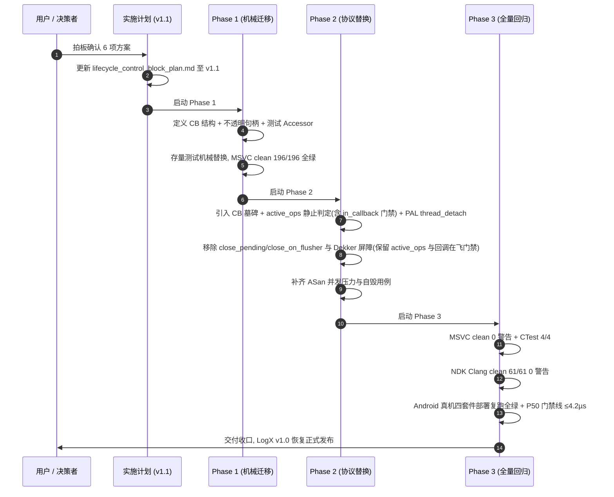

# LogX T5.8 生命周期堆控制块（Control Block）待决策项方案分析与裁决建议

> **文档版本**: v1.9 (2026-10-25)  
> **任务编号**: T5.8（生命周期堆控制块重构专项，根治 R41-05 尾读 UAF）  
> **关联实施计划**: [`lifecycle_control_block_plan.md`](file:///d:/Project/Android_Project/LogX/logx/docs/lifecycle_control_block_plan.md) v1.9  
> **关联审查报告**: [`reviews/code_review_R44_2026-10-18.md`](file:///d:/Project/Android_Project/LogX/logx/docs/reviews/code_review_R44_2026-10-18.md)、[`reviews/code_review_R45_2026-10-24.md`](file:///d:/Project/Android_Project/LogX/logx/docs/reviews/code_review_R45_2026-10-24.md)、[`reviews/code_review_R46_2026-10-24.md`](file:///d:/Project/Android_Project/LogX/logx/docs/reviews/code_review_R46_2026-10-24.md)、[`reviews/code_review_R47_2026-10-24.md`](file:///d:/Project/Android_Project/LogX/logx/docs/reviews/code_review_R47_2026-10-24.md)、[`reviews/code_review_R48_2026-10-25.md`](file:///d:/Project/Android_Project/LogX/logx/docs/reviews/code_review_R48_2026-10-25.md)、[`reviews/code_review_R49_2026-10-25.md`](file:///d:/Project/Android_Project/LogX/logx/docs/reviews/code_review_R49_2026-10-25.md)  
> **当前状态**: ✅ **六项决策已拍板，代码落地、测试余量收口与真机 + Windows/WSL Release + ASan/LSan + TSan 门禁已全部达成（当前代码全量复跑），具备发布条件**（详见权威报告 [`test_report_T5.8_android_real_device_and_asan.md`](./test_report_T5.8_android_real_device_and_asan.md) v2.1）  
>
> **v1.9 修订说明（R49 代码收口批）**：决策结论不变。R49 的代码类 P3 全部落地（死宏、LSan ignore 位置、CMake 注释、阈值分支）；WSL Release 首编暴露的 N-1 `<condition_variable>` 缺失与 N-2 aes.c 未引用函数告警一并修复。全端按当前代码复跑：Windows Release/ASan 212/212、WSL Release/ASan 212/212、WSL TSan 210/210（2 skipped）、Android ASan 213/213，动态插桩 847 项全绿。  
>
> **v1.8 修订说明（R49 审查文档收口）**：决策结论不变。R49 复审（`1cb5c44`）判定核心 `ensure_append_target` 竞争修复成立、无 P0/P1；本版仅同步门禁证据口径——plan §7.3 补 WSL ASan+LSan 212/212 与 TSan 210/210 两行，并如实标注 Android/Windows ASan 数据来源时效（Android 213 为 `c3e33e1` 产物、Windows 212 为改动前产物，R49 已重建 MSVC ASan 并抽验关键用例）。  
>
> **v1.7 修订说明（双端全量套件 + ASan 动态内存检测 + P50 基准重测全部闭环）**：决策层结论全部在真机与双端 ASan 严苛测试下获得实证支撑。① Redmi K30 Pro 真机四套件 213/213 项全绿（含 ARM-CE 指令流水线与 50 线程强并发）；② Stage A 生产配置实测 P50 = 3.750 µs（满足 ≤ 4.2µs 门禁，余量 10.7%），Stage B 吞吐 84k logs/s（压缩比 1.52x）；③ Android Clang ASan 213/213 全绿 + Windows MSVC ASan 212/212 全绿（双端合计 425 项全绿），捕获并修复 FormatBounded 缓冲区溢出隐患，超时机制升级单调时钟彻底杜绝假超时，适配 MSVC ASan 栈影子特性；④ Windows MSVC 主机 203/203 全绿，核心质量门禁已全部达成。
>
> **v1.6 修订说明（R47 待收口 4 项代码闭环）**：决策层结论不变。`P2-N1` 以 `Instance` 存活净计数（构造+1/析构-1）+ 内存阈值收紧（host 3MB / Android 4MB）双闸落地，变异验证删 `delete inst` 双红；`P3-N1` 采用"注释如实化"路径（core 侧 `gen` 暴露属 API 设计变更，按 R47 建议不做，契约已声明残留窗口）；`P3-N4` `cb->pal` 写侧补 `release` 配对；`P3-N5` `append_block` 改用入参 `kid`（行为不变）。验证：MSVC/NDK 双端 0 警告、四套件 212 项全绿、内存有界用例 3 轮稳定。
>
> **v1.5 修订说明（依据 R47 复核）**：决策层结论不变（六项拍板均成立、无需重新裁决），仅校正状态口径——v1.4 的"已全量收口"在 R47 逐项复核与 5 组变异实验下修正为"10 成立 / 2 部分"：`P2-03` 的 5 类资源配对断言有效，但 8MB 内存阈值放过了 Instance 级泄漏（删 `delete inst` 后增量 6.02MB 仍绿）；`P3-08` 的 `nativeClose` 主动清扫在单实例递延关闭下对被关闭实例自身无效（水位未推进），现由 `logx_c.h` 契约如实声明残留窗口。`P2-02` 的历史基线勘误经 git 核对成立（`431d5ee~1` 即返回 `LOGX_ERR_STATE`）。
>
> **v1.4 修订说明（R46 4×P2 + 8×P3 全量闭环）**：v1.3 指出的全部实现细节余量（`append_block` 补走 `invoke_key_provider`、`cb->pal` 原子化、`logx_c.h` 空句柄契约与 `on_destroy` 文案修正、`nativeClose` 主动清扫宿主线程 TLS、`OpenCloseMemoryBounded` 真实资源/内存断言与测试静止态注入）已全部落地并通过 MSVC + Android NDK clean 构建与 CTest 4/4 验证。
>
> **v1.1 修订说明（独立复核：对照 R44 原文、实施计划 v1.0、现行实现与测试代码逐项核实）**：
> 1. **决策二/三补回"回调在飞门禁"**：同步关停判定必须为 `active_ops == 0 && in_callback == 0`（或等价 `flusher_busy`）。v1.0 转写 R44 方案 B 时丢失了 `in_callback == 0` 条件——按 v1.0 原文实施，R43 形态（Flusher 阻塞在用户回调内时另一线程 close，`active_ops==0` 恰成立）会走同步路径：`flush_blocking` 因 Flusher 阻塞 5s 超时返回 false，`thread_join` 等待回调返回，而 R43 用例在 close 返回后才放行回调 ⇒ **无界死锁**。现行代码正是靠 `in_callback > 0 → 递延`（[logx_c.cpp:506](file:///d:/Project/Android_Project/LogX/logx/core/src/logx_c.cpp#L506)）规避该形态。
> 2. **纠正"剥离其它 3 个状态"的说法**：老 4 态（`active_ops`/`in_callback`/`close_pending`/`close_on_flusher`）中仅剥离 `close_pending`/`close_on_flusher` 两态与 Dekker 双检；`active_ops` 与回调在飞门禁必须保留（`in_callback` 保留或以 `flusher_busy` 等价承担）；`closing` 改由 CB 的 `is_closing` 承载。§四 路线图原"移除 active_ops/closing 等 4 状态"与决策二自相矛盾，一并更正。
> 3. **同步判定不允许自旋等待**：在途 `logx_flush`（最长 5s）与 `logx_export`（含用户回调、文件 IO）同样计入 `active_ops`，自旋等待会把 close 阻塞在长操作上，违背现行"非零即递延、立即返回"语义；改为检查一次、非零即转递延。
> 4. **性能门禁对齐回归基线**：真机热路径写入 P50 门禁线定为 ≤ 4.2µs（`benchmark_report.md` 登记的 B2 回归基线，实测 3.958µs）；4.0µs 仅作成功线参考，避免 ~1% 余量被运行噪声打成假红。
> 5. **CB 留存量级修正**：墓碑 CB 字段约 56B，计入分配器开销约 80~100B/个；数千轮 open/close 累计约数百 KB（原"数十 KB"低估约一个量级），"可忽略"结论不变，但须按 R44 清单补 10k 轮 open/close 内存上界断言。
> 6. **新增 `cb->inst` 原子化约束**：墓碑模型下陈旧裸句柄无引用地读 `inst`，dispose 胜出者写 `inst = nullptr`，普通指针并发读写构成 C++11 数据竞争（UB）；要求 `std::atomic<Instance*>` 并以 `exchange(nullptr)` 唯一胜出语义承担销毁认领（替代被删除的 `close_pending.exchange`）。
> 7. **决策五补全 R44-06 清单**：`logx_set_error_handler`/`logx_get_stats` 的生命周期守卫与无效句柄清零输出一并纳入迁移范围。

---

## 一、 背景与决策必要性

在 2026-10-18，针对 T5.8 实施计划初稿（`lifecycle_control_block_plan.md` v1.0）开展了外部代码审查（R44 批次）。评审结论指出：
> **“方向正确，但 v1.0 不能直接进入实施。”**

现稿存在 3 项阻断级问题（P0）：
1. **R44-01 尾读 UAF 未根除**：裸句柄传入后在第一次解引用读取 `cb->is_closing` 时无引用保护，UAF 从 `Instance` 平移到了控制块（Control Block）；
2. **R44-02 关停时序丢数据**：计划在 `flush_blocking` 前置 `flusher_exit`，且递延销毁路径 `dispose_instance` 完全未调用 `flush`，导致在途写入日志丢失；
3. **R44-03 引用协议不闭合**：`acquire_strong` 内存序不完备、初始化 `strong=2/weak=2` 对 Flusher 启动失败处理缺失、`strong==2` 同步快速路径判定不可靠。

为了在动工前根治上述隐患，R44 报告第 §八 节梳理出了 **6 大关键决策项**。本文档针对这 6 个决策项展开完整的候选方案优缺点对比，并给出明确的技术裁决与倾向建议，作为将实施计划修订为 v1.1 的权威依据。

---

## 二、 6 大关键决策项深度分析与方案对比

### 决策一：并发 `close` 的契约与入口保护（根治 R44-01 尾读 UAF）

- **核心矛盾**：
  外部调用方持有的 `logx_instance_t*` 是裸指针。在计划 v1.0 的弱引用模型下，当某一线程完成 `logx_close` 并触发 `delete cb` 后，若恰好有另一个并发写线程或并发 `close` 线程正执行至入口点首行指令（`cb->is_closing.load()` 或 `cb->strong_count.load()`），此时该线程尚未持有任何弱引用或强引用，读取已释放内存即触发内存非法访问（heap-use-after-free）。
- **候选方案列表**：

| 方案 | 具体做法 | 优势 | 代价与风险 |
|---|---|---|---|
| **A. 收窄 C ABI 契约** | 明确在契约中规定：`logx_close` 不得与同句柄的任何其他 API 并发调用；要求调用方负责外部同步。 | 库内实现最简单；CB 结构体可随弱引用归零安全 `delete`。 | 破坏现行 C ABI 契约与已有 R41 回归单测；将并发防护心智转嫁给上层调用方；治标不治本。 |
| **B. 句柄注册表 + Epoch / RCU** | 维护全局句柄注册表，每次 API 入口按句柄查找并登记读者 Epoch；`close` 标记注销后需等全局 Epoch 推进（确认无在途读者）再物理释放 CB。 | 逻辑完备；CB 最终能够安全物理释放。 | 写入热路径每次都需查全局表或维护原子 Epoch，引入全局核间竞争与性能损耗；实现复杂度高。 |
| **C. CB 墓碑模型 (Tombstone)** *(推荐)* | 实例 `close` 销毁时，**仅物理释放 `Instance` 数据主体，永久保留控制块（CB）自身**；CB 内将 `inst` 置空。后续陈旧裸句柄访问永远读到有效内存并安全返回 `LOGX_ERR_STATE`。 | 1. **裸指针入口天然绝对安全**，彻底消除 UAF 窗口； 2. 热路径零额外开销、零全局锁，保持单次原子操作； 3. **大幅简化架构**：可完全删除 `weak_count` 及其配套机制； 4. 顺带根治地址复用引发的 ABA 假句柄问题。 | 每次 open/close 会留存一个极小的 CB 结构（字段约 56B，计入分配器开销约 80~100B/个）。移动端通常为进程级单实例，单测数千轮累积留存约数百 KB，影响可忽略；另按 R44 清单补 10k 轮 open/close 内存上界断言兜底。 |
| **D. 代际槽表 (Generation Slot Table)** | 内部维护固定容量槽位数组，句柄编码为 `index + generation`；close 后自增 generation，槽位可循环复用。 | 内存有界且安全；无长期堆留存。 | 需设计槽位上限、扩容机制与耗尽回收策略；实现复杂度与代码体积较大。 |

- **💡 倾向建议：【采纳方案 C（CB 墓碑模型）】**
  - **技术论据**：移动端客户端日志库首要保障的是**热路径的极致性能与零崩溃风险**。方案 C 兼具“零热路径损耗”与“绝对消除尾读 UAF”双重优势。更关键的是，采用墓碑模型后，原计划中复杂的弱引用机制（`weak_count`、启动双弱引用、退出二次递减）被整体剔除，控制块退化为 `strong_count + is_closing + inst`，状态机大幅精简，代码可读性与可验证性显著提升。
  - **墓碑模型的落地硬约束（复核新增，必须写入 v1.1 计划）**：
    1. **`cb->inst` 必须为 `std::atomic<Instance*>`**：陈旧裸句柄在**无任何引用**的情况下读取 `inst`，而 dispose 胜出者会写 `inst = nullptr`；普通指针的并发读写构成 C++11 数据竞争（UB），不能用"实际不会崩"辩护。读侧以 acquire 载入、判空后使用；
    2. **销毁认领采用 `inst.exchange(nullptr)` 唯一胜出语义**：递延分支的收尾者、`close` 兜底、最后一个退出者可能并发尝试销毁，`exchange(nullptr)` 天然保证恰好一个胜出者执行 `dispose_instance`，替代被删除的 `close_pending.exchange` 认领原语；败者直接返回；
    3. **dispose 完成前必须清空 `cb->pal` 并清零 `cb->flusher_tid`**（对齐 R44-08 / R44-10 / R45-09）：防止陈旧句柄/二次 close 经 CB 解引用已析构的 Pal 或发生 TID 复用误判；
    4. **`on_destroy` 执行线程契约与 `thread_local` 约束（R45-12）**：递延销毁下 `on_destroy` 在最后完成销毁认领的线程（可能是 `logx_close` 调用线程、最后退出的并发操作线程或 Flusher 后台线程）上执行；实现方不得依赖回调线程身份，亦不得仅在 `on_destroy` 内清理跨线程 `thread_local` 状态（JNI 层通过登记全局已销毁代数水位并在 `lookup`/`allocate_slot` 入口跨 `owner` 惰性清零驱逐闭合）。

---

### 决策二：关停与持久化排空（Flush）的归属时序（根治 R44-02 丢数据）

- **核心矛盾**：
  计划初稿的关闭时序为：置位 `is_closing` → 置位 `flusher_exit` → `flush_blocking`。此时若有在途写线程刚跨过 `is_closing` 检查并在当前窗口写入 staging 环，Flusher 线程可能已提前退出；而在随后的递延销毁路径 `dispose_instance` 中完全没有持久化刷盘逻辑，导致这部分在途数据永久丢失。
- **候选方案列表**：

| 方案 | 具体做法 | 优势 | 代价与风险 |
|---|---|---|---|
| **A. 纯引用计数静止 (Pure Quiescence)** | 关闭时不通知写线程主动退出，仅阻断新操作并等待所有强引用归零；由最后一个释放强引用的线程执行 flush 与物理销毁。 | 理论模型统一，所有清理全部收敛在强引用归零点。 | 若最后一个释放强引用的是前台写线程，前台线程将被迫承担数十毫秒的磁盘 IO 与线程 join；若最后释放的是 Flusher 线程，则无法自我 join，易死锁。 |
| **B. 强引用 + `active_ops` 精确静止判定（含回调在飞门禁）** *(推荐)* | 1. `logx_close` 原子置位 `is_closing = true` 阻断新操作进入； 2. **检查一次** `active_ops == 0 && in_callback == 0`：成立则同步关停；**不成立立即转递延销毁**，绝不自旋等待（在途 `logx_flush` 最长 5s、`logx_export` 含用户回调与文件 IO，均计入 `active_ops`，自旋会把 close 阻塞在长操作上，违背现行"非零即递延、立即返回"契约）； 3. 同步路径：主线程先执行 `flush_blocking(inst)` 排空环区全部在途数据落盘（此时新操作已被 `is_closing` 阻断、在途操作已静止，微秒级窗口内无新提交）； 4. 置位 `flusher_exit = true` 并安全 join Flusher 线程； 5. 递减主句柄强引用触发销毁。递延路径由最后一个退出者/回调退出点经 `inst.exchange(nullptr)` 认领收尾。 | 1. 排空时序清晰严格，100% 杜绝在途日志丢失； 2. 磁盘 IO 与线程 join 均在发起 close 的线程执行，不转嫁给并发写线程； 3. **回调在飞门禁规避 R43 死锁形态**（Flusher 阻塞在用户回调内时 `active_ops==0` 恰成立，若缺门禁将同步 join 自锁——见文档头部修订说明 1）； 4. 状态机单一可测：仅剥离 `close_pending`/`close_on_flusher` 与 Dekker 双检，`active_ops` 与回调在飞门禁保留。 | 需保留 `active_ops` 计数器与回调在飞门禁（`in_callback` 或等价 `flusher_busy`），并非"仅剩一个计数器"。 |
| **C. 现稿顺序 + 在 `dispose_instance` 补 `flush`** | 维持原计划顺序，但在最终物理销毁 `dispose_instance` 中补加 `flush_blocking`。 | 对初稿计划改动最小。 | 当 Flusher 线程因回调自毁而执行 `dispose_instance` 时，`flush_blocking` 会因 `flusher_running == false` 立即失败返回（事件报 "flush skipped: flusher not running"），在途数据仍丢失且仅被 5s 超时/停转事件兜住——并非死锁，但同样违反"绝不丢已提交日志"底线。 |

- **💡 倾向建议：【采纳方案 B（强引用 + `active_ops` 精确静止判定，含回调在飞门禁）】**
  - **技术论据**：日志库的核心底线是“绝不丢失已向调用方确认提交的日志”。方案 B 实现了确定性的排空顺序：`阻断新进入者 (is_closing) → 确认在途静止 (active_ops==0 && in_callback==0，一次检查、非零即递延) → 同步落盘 (flush_blocking) → 停机后台线程 (join) → 物理释放`。该时序完全消除了跨线程职责交错，具备严格的数学闭环。
  - **复核更正（相对 R44 §八 方案 B 的转写差异）**：R44 对方案 B 的完整表述是“`close` 在 `ops==0 && in_callback==0` 才同步，否则**递延**”。v1.0 转写时丢失了 `in_callback == 0` 门禁并把“否则递延”误写为“快速自旋等待”，两处均会引入回归（R43 死锁形态 / close 被长导出阻塞），本版已按 R44 原文修正。

---

### 决策三：`EventGuard` 与关闭期事件处理（解决 R44-04 吞事件）

- **核心矛盾**：
  计划初稿中，错误回调守卫 `EventGuard` 在构造时调用 `acquire_strong()`，一旦遇到 `is_closing == true` 便直接早退并丢弃事件。这导致在 `close` 流程期间发生的关键事件（例如关闭期的 `flush_blocking` 磁盘写满/IO 错误、跨天清理自愈告警、以及 R43 回归测试探针）被静默吞掉，违背了 LogX 的可观测性契约。
- **候选方案列表**：

| 方案 | 具体做法 | 优势 | 代价与风险 |
|---|---|---|---|
| **A. 删除 `EventGuard`，改用 `flusher_busy` 状态守卫** | 事件发射不占用强引用，改用专用的原子布尔或回调深度计数器，关闭时若在回调中则延缓销毁。 | 解耦了业务操作强引用与只读监控通知。 | 重新引入了专门的原子协调变量，增加了状态机分支。 |
| **B. 保留 `EventGuard`，但允许关闭期分发事件** *(推荐)* | 结合方案 C 的墓碑模型：控制块不销毁。在 `emit_event` 内部，即使 `is_closing == true`，只要 `inst != nullptr`（**原子读**），依然允许执行用户错误回调；当且仅当 `inst == nullptr` 时早退。`acquire_strong()` 在关闭期**不得**作为事件放行的前置条件（否则 `is_closing==true` 时 acquire 失败会重新引入吞事件回退）；穿透窗口的生命周期安全由调用方既有引用保证（在途操作持 OpGuard 强引用、Flusher 持循环引用、close 同步主干自身在排空后才释放）。 | 完整保留关闭阶段系统异常的可观测性；已有测试套件与监控完全兼容；**无需新增协调变量**——关停协议所需的回调在飞门禁复用决策二保留的 `in_callback`（或等价 `flusher_busy`），非"凭空零变量"。 | 需在控制块内部明确定义“允许事件回调穿透”的时机：读侧 `inst != nullptr` 与 dispose 胜出者的 `exchange(nullptr)` 构成 release/acquire 配对，且穿透仅对"本就持有引用的调用方"安全；对无引用的陈旧句柄路径，`inst` 已为空自然早退。 |
| **C. 保持现稿** | `is_closing == true` 时一律不发射任何错误事件。 | 无需修改初稿代码。 | 破坏已有监控契约；测试探针失效；关闭期 IO 错误成黑盒。 |

- **💡 倾向建议：【采纳方案 B（允许关闭期分发事件）】**
  - **技术论据**：在 CB 墓碑模型支撑下，`inst` 在关闭的主干阶段依然安全有效。允许关闭期的异常事件（如落盘失败、文件头撕裂修复等）正常通知至上层 `ErrorHandler`，完全符合健壮性与排障要求。
  - **复核补充**：R44 §八 对本项首推方案 A（删除 EventGuard + `flusher_busy`），B 为明示的"最小改动备选"。本裁决取 B，但**采纳 A 的核心精神**：关停同步判定必须感知"回调在飞"（`in_callback > 0` 或 `flusher_busy == true` 一律转递延），否则 R43 形态死锁（见决策二与文档头部修订说明 1）。即：**决策三 B 与决策二 B 是绑定组合，二者必须同时落入 v1.1**。

---

### 决策四：Flusher 线程内触发 close 时的线程句柄回收（解决 R44-05 泄漏）

- **核心矛盾**：
  在错误回调嵌套场景（用户在 `ErrorHandler` 中调用 `logx_close`），若当前执行线程正是 Flusher 线程自身，则无法执行 `thread_join(self)`，否则导致线程自我死锁。计划初稿跳过了 join，但未能妥善处理 OS 原生线程句柄的关闭回收，导致线程句柄泄漏。
- **候选方案列表**：

| 方案 | 具体做法 | 优势 | 代价与风险 |
|---|---|---|---|
| **A. 扩展 PAL 接口，增加 `thread_detach`** *(推荐)* | 在 `logx_pal.h` 的 `Pal` 抽象中新增 `void thread_detach(pal_thread_t t)`。POSIX 端映射为 `pthread_detach`，Win32 端映射为 `CloseHandle`。当由 Flusher 线程执行销毁时，调用 `thread_detach` 后自然退出。 | 遵循操作系统原生标准；零额外常驻资源；彻底杜绝线程句柄泄漏。 | 需要轻微扩展 PAL 接口（仅涉及 `pal_win32.cpp` 与 `pal_posix.cpp` 各数行代码）。 |
| **B. 引入独立 Reaper 线程 / 异步回收队列** | 建立全局或宿主级后台 Reaper 线程，将未 join 的孤儿线程句柄推入队列异步 join。 | 无需修改 PAL 接口。 | 严重过度设计；为一个极端重入边界引入常驻守护线程，得不偿失。 |
| **C. 契约层禁止在回调内调用 close** | 修改契约，声明在回调中调用 close 属于未定义行为（UB）。 | 库内无需处理自销毁。 | 破坏已有单测防护（如 R19 F-2 防重入死锁用例）；削弱 Android 移动端容灾能力。 |

- **💡 倾向建议：【采纳方案 A（扩展 PAL 接口增加 `thread_detach`）】**
  - **技术论据**：POSIX `pthread_detach` 与 Windows `CloseHandle` 是多线程编程中解耦线程生命周期、回收内核线程对象资源的行业标准手段。扩展 PAL 原语代价极低，改动明确且完全可控。

---

### 决策五：C++ 内部句柄类型与单元测试迁移（解决 R44-06 错转型）

- **核心矛盾**：
  C ABI 接口统一以 `logx_instance_t*` 作为不透明句柄。在当前存量 C++ 单测中，存在多处直接 `static_cast<Instance*>(h)` 的旧写法。重构后句柄实际指向 `InstanceControlBlock*`，若不予类型隔离，旧代码强转将发生结构体偏移错位，引发隐蔽的内存踩踏。
- **候选方案列表**：

| 方案 | 具体做法 | 优势 | 代价与风险 |
|---|---|---|---|
| **A. C++ 将句柄改为严格不透明类型 + 显式测试 Accessor** *(推荐)* | 1. C++ 内部声明不透明前置结构体 `struct logx_instance_t;`； 2. 库内部严格通过 `reinterpret_cast<InstanceControlBlock*>(h)` 转换； 3. 为单元测试提供专用测试头文件（如 `tests/test_accessor.h`），提供 `Instance* test_get_instance(logx_instance_t* h)` 穿透控制块； 4. 批量迁移存量单测（实测 28 处 `static_cast<Instance*>`：`test_r19_regression.cpp` 8 处、`test_robustness.cpp` 18 处、`test_crash_recovery.cpp` 2 处）； 5. **一并迁移状态直访与守卫缺口**（R44-06 全量清单）：6 处 `inst->closing` 直写、1 处 `inst->flusher_tid` 直读改经 Accessor/契约接口；`logx_set_error_handler`/`logx_get_stats` 纳入生命周期守卫（走引用守卫，关闭后返回 `LOGX_ERR_STATE` / 输出清零——`get_stats` 为 `void`，无效句柄时须显式清零输出）。 | 1. **编译期强类型安全**：任何遗留的裸强转均在编译期报错阻断； 2. 彻底杜绝运行期隐蔽内存踩踏； 3. 测试穿透逻辑收敛至单一 seam； 4. 覆盖 R44-06 全部迁移面，避免"句柄改了但守卫缺口仍在"的半成品状态。 | 需对测试代码中的强转与状态直访进行批量机械迁移（约 35 处直接触点）。 |
| **B. 保持 `using logx_instance_t = Instance;` 或伪装类型** | 将 `InstanceControlBlock` 作为 `Instance` 的头部首字段或通过宏兼容。 | 存量测试代码改动量最小。 | 结构体内存布局脆弱；破坏“控制块独立于实例数据”的架构初衷，未来极易因笔误造成踩内存。 |

- **💡 倾向建议：【采纳方案 A（严格不透明类型 + 显式测试 Accessor）】**
  - **技术论据**：重构的核心目标是提升健壮性与消除 UAF。必须借助编译器类型系统阻断所有危险的裸指针强转。提供专用的测试 Accessor 既保障了测试的穿透探测能力，又捍卫了产品代码的类型边界。
  - **复核更正**：迁移规模实测为 28 处强转 + 6 处 `closing` 直写 + 1 处 `flusher_tid` 直读 + crash 模拟手工拆解用例（`test_crash_recovery.cpp:64`），约 20~30 处的原估算偏低；且 R44-06 明确要求 `logx_set_error_handler`/`logx_get_stats` 一并加引用守卫，否则 close 并发时这两条路径仍是无保护 UAF 面。v1.1 计划的 WBS 应把状态直访迁移与守卫补齐并入句柄类型变更的**同一步**，避免中途不可编译。

---

### 决策六：验收基线与性能门禁口径（对齐 R44-12）

- **核心矛盾**：
  实施计划初稿中记录的单元测试用例数量为 197 项，但 R44 评审基于实际 `build-full` clean 重建产物通过 `--gtest_list_tests` 实测数为 **196 项**（历史统计口径偏差）；此外，重构涉及核心并发生命周期，若缺乏 ASan 严密验证，在普通分配器保留内存的机制下容易出现假绿。
- **候选方案列表**：

| 方案 | 具体做法 | 优势 | 代价与风险 |
|---|---|---|---|
| **A. 实测 196 基线 + clean 全量构建 + ASan 覆盖 + 性能门禁** *(推荐)* | 1. 勘误测试基线为实测的 **196 项**（重构新增用例在此基础上如实递增）； 2. 严格遵循 **R21-2** 纪律（头文件变更强制 clean 全量重建）； 3. 严格遵循 **B-11-1** 纪律（NDK Clang clean 构建 61/61 0 警告）； 4. 引入 MSVC/Clang **AddressSanitizer (ASan)** 并发压力测试验证； 5. 固化性能门禁：真机热路径写入 P50 **门禁线 ≤ 4.2µs**（对齐 `benchmark_report.md` 登记的 B2 回归基线，实测 3.958µs；4.0µs 仅作成功线参考，不作门禁——余量仅 ~1%，会被运行噪声打成假红）。 | 严密真实，杜绝口径失实；强制 ASan 根除空洞绿；确保发布件体积与延迟指标无劣化，且门禁数值与既有回归基线一致可执行。 | 验收阶段需执行 clean 全量编译与真机部署，耗时略长。 |
| **B. 沿用文档旧的 197 口径，采用增量构建验收** | 沿用初稿 197 数字，不执行 clean 全量重建与 ASan 专项验证。 | 验收流程耗时较短。 | 存在混 ABI 崩溃风险；普通内存分配器易掩盖 UAF 假绿；文档口径失实。 |

- **💡 倾向建议：【采纳方案 A（实测 196 基线 + clean 全量 + ASan + 性能门禁）】**
  - **技术论据**：恪守 LogX 已建立的高标准质量工程纪律（R21-2、R18-2、B-11-1）。在正式恢复 v1.0 发布状态前，必须以真实、严谨的实测数据作为验收凭证。
  - **复核补充**：性能门禁采用**双线口径**——成功线 4.0µs / 门禁线 4.2µs（B2 实测 3.958µs + 噪声余量，见 `benchmark_report.md` "回归基线更新"）。单测基线数字不硬编码，以 clean 重建后 `--gtest_list_tests` 实数为准（R44-12 要求，当前实测 196）。

---

## 三、 决策项裁决汇总矩阵

| # | 决策主题 | 备选方案族 | **推荐采纳方案** | 核心权衡与落地要点 |
|:---:|---|---|:---:|---|
| **1** | **并发 close 契约与入口保护** | A: 收窄契约 B: 全局表/epoch C: CB 墓碑模型 D: 代际槽表 | **C. CB 墓碑模型** | **零热路径开销；根治裸句柄尾读 UAF；彻底删除 weak 计数复杂度；留存约 80~100B/个可忽略；`cb->inst` 须原子化并以 `exchange(nullptr)` 认领销毁。** |
| **2** | **关停与持久化排空时序** | A: 纯引用计数 B: 强引用+active_ops C: 现稿顺序+补 flush | **B. 强引用 + active_ops 精确静止（含回调在飞门禁）** | **阻断新写 → 一次检查 `active_ops==0 && in_callback==0`（非零即递延，不自旋）→ 刷盘落盘 → 停止 Flusher；100% 杜绝在途日志静默丢失；回调门禁规避 R43 死锁形态。** |
| **3** | **EventGuard 与关闭期事件** | A: 删除+flusher_busy B: 允许关闭期发事件 C: 维持现稿吞事件 | **B. 允许关闭期发事件（与决策二 B 绑定）** | **维持系统关闭期与自愈期的异常可观测性；消除测试探针失效盲区；穿透前提 = 决策二的回调在飞门禁，二者必须同时落地。** |
| **4** | **Flusher 自毁线程回收** | A: PAL thread_detach B: 独立 Reaper 线程 C: 契约禁止自销毁 | **A. PAL 增 `thread_detach`** | **遵循 POSIX/Win32 原生线程分离回收标准；彻底消除内核句柄泄漏。** |
| **5** | **句柄类型与单测迁移** | A: 不透明类型+Accessor B: 伪装为 Instance | **A. 不透明类型 + 测试 Accessor** | **编译期杜绝裸指针强转踩内存；28 处强转 + 7 处状态直访一并迁移；`set_error_handler`/`get_stats` 补生命周期守卫。** |
| **6** | **验收基线与门禁口径** | A: 实测 196+clean+ASan B: 沿用文档 197 口径 | **A. 实测 196 基线 + clean + ASan** | **实事求是核实数字；防范分配器假绿；恪守 R21-2 / B-11-1 构建门禁；性能门禁双线口径（成功 4.0µs / 门禁 4.2µs）。** |

---

## 四、 后续行动路线（计划修订与分阶段实施）

本决策方案经用户确认/拍板后，按以下三阶段顺序推进实施：

1. **方案修订（v1.1）**：
   - 将上述 6 项决策融合并更新至 [`docs/lifecycle_control_block_plan.md`](file:///d:/Project/Android_Project/LogX/logx/docs/lifecycle_control_block_plan.md)；
   - 彻底删除 `weak_count` 相关拓扑，重写引用获取与 `active_ops` 排空时序图；
   - **同步关停判定写为 `active_ops == 0 && in_callback == 0`（一次检查、非零即递延）**；保留 `active_ops` 与回调在飞门禁，仅删除 `close_pending`/`close_on_flusher` 与 Dekker 双检；
   - `cb->inst` 定义为 `std::atomic<Instance*>`，销毁认领采用 `exchange(nullptr)` 唯一胜出语义；
   - 按 R44-03 补 `acquire_strong` 内存序（CAS 成功序 `acq_rel`、成功后二次 acquire 检查 `is_closing`）；按 R44-07 补 open 失败路径清单与启动引用归属——初始强引用 = 1（归主句柄），**不得在构造期假设 Flusher 引用已存在**；墓碑模型删除 `weak_count` 后，R44-07 的"弱引用回收"子项随之取消，简化为"Flusher 强引用在 `thread_start` 前由父线程显式获取、任意 open 失败路径按引用计数回收"。
2. **Phase 1（机械迁移，行为不变）**：
   - 落地 `InstanceControlBlock` 基础结构与不透明句柄定义；
   - 在 `tests/` 引入 `test_accessor.h` 并迁移测试用例中的强转（28 处）与状态直访（7 处）；
   - **同批为 `logx_set_error_handler`/`logx_get_stats` 补生命周期守卫**（R44-06）；
   - 维持既有并发逻辑不变，验证全量 clean 构建与测试通过。
3. **Phase 2（协议替换与 Dekker 状态机拆除）**：
   - 落地 CB 墓碑模型、`OpGuard`、`active_ops` 静止排空判定（含 `in_callback==0` 门禁）与 PAL `thread_detach`；
   - 删除 `close_pending`/`close_on_flusher` 两态与 Dekker 屏障（**保留** `active_ops` 与回调在飞门禁；`closing` 由 CB `is_closing` 承载）；
   - 补齐并发 close 与 ASan 专项回归测试，并按 R44-01 清单新增：陈旧句柄 close/write 返回 `STATE` 不崩溃、并发双 close、10k 轮 open/close 内存上界断言。
4. **Phase 3（双端全量回归与收口）**：
   - 执行 MSVC clean 全量构建（CTest 4/4）；
   - 执行 Android NDK clean 构建与真机四套件复跑；
   - 性能门禁按双线口径验收（真机 P50 成功线 4.0µs / 门禁线 4.2µs）；
   - 同步 `CHANGELOG.md` 与计划表，恢复发布状态。
