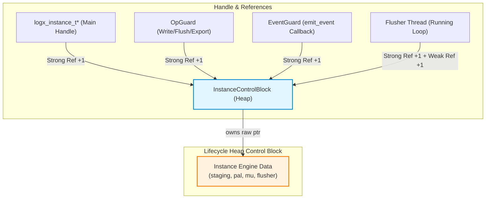

# LogX 1.x 生命周期堆控制块（Control Block）重构实施计划 (T5.8 / R41-05 根治)

> **版本**: v1.0 (2026-10-18)  
> **任务编号**: T5.8 (登记于 `docs/LogX后续实施计划表.md` §2 阶段三任务表)  
> **当前状态**: 📋 方案设计完成，待评审后实施 (未发布状态)  
> **关联审查**: [`code_review_R41_2026-10-17.md`](file:///d:/Project/Android_Project/LogX/logx/docs/reviews/code_review_R41_2026-10-17.md) (R41-05), [`code_review_R42_2026-10-17.md`](file:///d:/Project/Android_Project/LogX/logx/docs/reviews/code_review_R42_2026-10-17.md), [`code_review_R43_2026-10-17.md`](file:///d:/Project/Android_Project/LogX/logx/docs/reviews/code_review_R43_2026-10-17.md)

---

## 一、 重构背景与核心目标

### 1.1 现状分析与痛点 (R41-05 的本质)
在当前 LogX 实现中，引擎生命周期与关闭时序由内嵌在 `Instance` 结构体中的 4 个原子状态量协同控制：
1. `active_ops`: 记录当前正在执行的外部 API 操作（`logx_write` / `logx_flush` / `logx_export`）；
2. `in_callback`: 记录当前正在执行的错误回调调用深度（`emit_event`）；
3. `close_pending`: 记录外部线程触发但因存在活跃操作而转入递延关闭的标志；
4. `close_on_flusher`: 记录 Flusher 线程内部触发或转置自毁的标志。

**存在的核心痛点**：
- **极高的并发心智负担**：为协调这 4 个变量，退出逻辑分散在 5 个关键路径（`logx_close_ex` 外部主干、`logx_close_ex` 内部双检兜底、`OpGuard::~OpGuard` 退出段、`emit_event` 退出段、`flusher_main` 循环退出段）。在 R41~R43 期间连续修复了 Dekker store-load 重排、Flusher 回调盲区、递延漏认领等隐蔽并发缺陷。这套机制在数学推导上虽然已证明闭环，但维护极为脆弱；
- **理论“尾读 UAF”隐患 (R41-05)**：所有状态标志均位于 `Instance` **内部**。当胜出线程判定条件满足并调用 `destroy_instance(inst)` 执行 `delete inst` 后，败方线程在此微秒级间隙仍在执行 `fetch_sub` 后的指令（如寄存器加载与栈清理）。虽然通过严格的 Dekker 屏障可以防止其触碰业务数据，但在严格的 C++ 内存模型下，对已释放 `inst` 指针的任何窥探都属于理论未定义行为（UB）。

### 1.2 重构目标
1. **解耦生命周期元数据与实例主体数据**：引入独立的堆控制块（`InstanceControlBlock`），其存活期超越 `Instance` 主体，彻底根治 R41-05 尾读 UAF；
2. **状态机大幅收敛**：废弃 `active_ops`、`in_callback`、`close_pending`、`close_on_flusher` 四态纠缠与双检 Dekker 屏障，统一退化为标准的**强/弱引用计数模型**；
3. **零破损 C ABI / JNI 契约**：`logx_instance_t*` 依然维持不透明指针形态，底层平滑切换；JNI 层与 Android Kotlin Facade 零改动；
4. **性能无损**：热路径（`logx_write`）零多余堆分配，保持单次原子操作提升强引用，吞吐与纳秒级延迟无劣化。

---

## 二、 核心架构设计方案

### 2.1 引用计数模型（强弱引用拓扑）



- **`strong_count`（强引用计数）**：管辖 `Instance` 数据主体的生命周期。
  - 初始值为 1（由 `logx_open` 交付给调用方的主句柄持有）；
  - Flusher 线程启动并运行循环期间持有 1 个强引用；
  - 任何进入热路径的操作（`logx_write` / `logx_flush` / `logx_export`）通过 RAII `OpGuard` 尝试提升持有 1 个强引用；
  - 触发错误回调（`emit_event`）时通过 `EventGuard` 持有 1 个强引用；
  - **单一析构归属**：任何导致 `strong_count` 归零的最后一个线程（无论是外部 close、最后退出的写线程、还是 Flusher 线程），**天然且唯一**负责执行 `Instance` 资源的物理释放（`dispose_instance`），彻底消灭竞态！
- **`weak_count`（弱引用计数）**：管辖 `InstanceControlBlock` 控制块自身的内存存活。
  - 所有强引用整体共享 1 个弱引用；
  - Flusher 线程内部持有 1 个弱引用；
  - 当 `strong_count` 归零并释放 `Instance` 后，强引用持有的弱引用被释放；
  - 当 `weak_count` 归零时，`delete cb` 释放控制块自身。

---

### 2.2 数据结构定义

在 [`core/include/logx_internal.h`](file:///d:/Project/Android_Project/LogX/logx/core/include/logx_internal.h) 中定义：

```cpp
namespace logx {

struct Instance;

// 生命周期堆控制块
struct InstanceControlBlock {
    std::atomic<uint32_t> strong_count{1};  // 初始 1 归主句柄
    std::atomic<uint32_t> weak_count{2};    // 初始 2: 1 代表所有强引用, 1 代表 Flusher 线程存活
    std::atomic<bool>     is_closing{false}; // 关闭中标志 (拒绝新写入/操作)
    std::atomic<uint64_t> flusher_tid{0};    // Flusher 线程 TID (用于自死锁检测)

    Instance*             inst{nullptr};     // 引擎实例数据主体
    Pal*                  pal{nullptr};      // 平台抽象层指针

    // 销毁回调与上下文 (J-1/F-2 契约)
    void (*on_destroy)(void* user, void* err_user){nullptr};
    void*                 on_destroy_key_user{nullptr};
    void*                 on_destroy_err_user{nullptr};

    // 强引用获取 (仅在未关闭且强引用有效时成功)
    bool acquire_strong() noexcept {
        if (is_closing.load(std::memory_order_acquire)) return false;
        uint32_t cur = strong_count.load(std::memory_order_relaxed);
        while (true) {
            if (cur == 0 || is_closing.load(std::memory_order_relaxed)) return false;
            if (strong_count.compare_exchange_weak(
                    cur, cur + 1,
                    std::memory_order_acquire, std::memory_order_relaxed)) {
                return true;
            }
        }
    }

    // 释放强引用：归零者执行 dispose_instance
    void release_strong(bool is_flusher_thread = false) noexcept;

    // 弱引用管理
    void acquire_weak() noexcept {
        weak_count.fetch_add(1, std::memory_order_relaxed);
    }

    void release_weak() noexcept {
        if (weak_count.fetch_sub(1, std::memory_order_acq_rel) == 1) {
            delete this; // 控制块自身物理释放
        }
    }

    // 释放 Instance 资源主体 (仅由归零胜出者调用一次)
    void dispose_instance(bool is_flusher_thread) noexcept;
};

} // namespace logx
```

同时，从 `Instance` 结构体中**彻底移除**以下废弃字段：
- ~~`std::atomic<int> active_ops;`~~
- ~~`std::atomic<int> in_callback;`~~
- ~~`std::atomic<bool> closing;`~~
- ~~`std::atomic<bool> close_pending;`~~
- ~~`std::atomic<bool> close_on_flusher;`~~

`Instance` 内部反向持有指向其所属控制块的指针：`InstanceControlBlock* cb = nullptr;`。

---

## 三、 关键路径重构逻辑

### 3.1 实例创建 (`logx_open`)
1. 分配 `InstanceControlBlock* cb = new InstanceControlBlock();`
2. 分配 `Instance* inst = new Instance();`，并将 `inst->cb = cb; cb->inst = inst;`；
3. 初始化 `on_destroy`、`pal` 等元数据到 `cb`；
4. 启动 Flusher 线程（Flusher 线程启动即自然持有其分配的 1 个强引用与 1 个弱引用）；
5. 成功后将 `*out_inst = reinterpret_cast<logx_instance_t*>(cb);` 返回给外部。

### 3.2 写入/刷盘/导出热路径 (`logx_write` / `logx_flush` / `logx_export`)
通过 RAII 守卫 `OpGuard` 简化为纯引用计数提升：
```cpp
struct OpGuard {
    InstanceControlBlock* cb{nullptr};
    Instance*             inst{nullptr};

    explicit OpGuard(logx_instance_t* h) {
        if (!h) return;
        auto* c = reinterpret_cast<InstanceControlBlock*>(h);
        if (c->acquire_strong()) {
            cb = c;
            inst = c->inst;
        }
    }

    ~OpGuard() {
        if (cb) {
            cb->release_strong(/*is_flusher_thread=*/false);
        }
    }

    bool is_valid() const noexcept { return inst != nullptr; }
};
```
在 `logx_write` 中：
```cpp
logx_status_e logx_write(logx_instance_t* h, int level, const char* tag,
                         const uint8_t* payload, uint32_t payload_len) {
    OpGuard guard{h};
    if (!guard.is_valid()) return LOGX_ERR_STATE; // 已关闭或无效
    Instance* inst = guard.inst;
    // ... 后续格式化与入环逻辑完全不变 ...
}
```
> **优势**：不再需要先 `fetch_add` 再读 `closing` 的试探补偿逻辑，不再需要析构时的 Dekker 全序屏障！

### 3.3 错误事件发射 (`emit_event`)
错误回调包装为 `EventGuard`：
```cpp
inline void emit_event(Instance* inst, logx_event_kind_e k, int code, const char* msg) {
    if (!inst || !inst->cb) return;
    InstanceControlBlock* cb = inst->cb;
    
    // 回调期间持有强引用，防止回调执行期间实例被销毁
    if (!cb->acquire_strong()) return;

    inst->err_mu.lock();
    logx_error_fn fn = inst->err_fn;
    void* user = inst->err_user;
    inst->err_mu.unlock();

    if (fn) {
        fn(user, k, code, msg ? msg : "");
    }

    // 释放强引用；若当前是 Flusher 线程，如实标记线程身份
    uint64_t current_tid = inst->pal->tid();
    bool on_flusher = (cb->flusher_tid.load(std::memory_order_relaxed) == current_tid);
    cb->release_strong(on_flusher);
}
```
> **优势**：彻底删除了原 R41/R42/R43 的 `close_pending.exchange(false)`、`close_on_flusher` 转置移交、以及复杂的盲区规避代码！

### 3.4 实例关闭 (`logx_close_ex` / `logx_close`)
```cpp
logx_status_e logx_close_ex(logx_instance_t* h, bool* out_closed_immediately) {
    if (out_closed_immediately) *out_closed_immediately = false;
    if (!h) return LOGX_ERR_INVALID_ARG;
    auto* cb = reinterpret_cast<InstanceControlBlock*>(h);

    // 1. 原子标记 is_closing (仅首个调用者生效)
    if (cb->is_closing.exchange(true, std::memory_order_acq_rel)) {
        return LOGX_OK; // 已在关闭中，幂等返回
    }

    Instance* inst = cb->inst;
    if (inst) {
        if (inst->space_event) inst->pal->ev_signal(inst->space_event);
        inst->flusher_exit.store(true, std::memory_order_release);
        if (inst->flush_event) inst->pal->ev_signal(inst->flush_event);
    }

    uint64_t current_tid = cb->pal->tid();
    bool on_flusher = (cb->flusher_tid.load(std::memory_order_acquire) == current_tid);

    // 2. 检查当前是否可执行同步立即销毁:
    //    仅当非 Flusher 线程且外部无并发活跃操作 (当前仅剩主句柄与 Flusher 线程持有的 2 个强引用)
    if (!on_flusher && cb->strong_count.load(std::memory_order_acquire) == 2) {
        // 同步关闭主流程：先 flush_blocking，再 join Flusher
        if (inst) {
            flush_blocking(inst);
            if (inst->flusher_thread) {
                cb->pal->thread_join(inst->flusher_thread);
                inst->flusher_thread = nullptr;
            }
        }
        // 释放主句柄持有的强引用 (Flusher 退出时已释放其强引用，此时归零触发 dispose_instance)
        cb->release_strong(/*is_flusher_thread=*/false);
        if (out_closed_immediately) *out_closed_immediately = true;
        return LOGX_OK;
    }

    // 3. 递延关闭分支 (处于 Flusher 线程内部或有并发操作在持):
    //    放弃主句柄持有的 1 个强引用，后续归零责任自然转交由最后一个退出者承担
    cb->release_strong(on_flusher);
    return LOGX_OK;
}
```

### 3.5 统一物理清理 (`dispose_instance`)
由 `strong_count` 归零胜出者无竞争执行：
```cpp
void InstanceControlBlock::dispose_instance(bool is_flusher_thread) noexcept {
    if (!inst) return;
    Instance* target = inst;
    inst = nullptr; // 阻断后续任何可能的再次访问

    // 若非 Flusher 线程且 Flusher 尚未 join，执行兜底 join
    if (!is_flusher_thread && target->flusher_thread) {
        target->flusher_exit.store(true, std::memory_order_release);
        if (target->flush_event) target->pal->ev_signal(target->flush_event);
        target->pal->thread_join(target->flusher_thread);
        target->flusher_thread = nullptr;
    }

    delete target->staging;
    target->staging = nullptr;
    if (target->space_event) target->pal->ev_destroy(target->space_event);
    if (target->flush_event) target->pal->ev_destroy(target->flush_event);
    if (target->mu) target->pal->mutex_destroy(target->mu);

    delete target; // 释放 Instance 资源主体

    // 触发 JNI / 外部销毁通知
    if (on_destroy) {
        on_destroy(on_destroy_key_user, on_destroy_err_user);
    }
}
```

---

## 四、 新旧状态机对比与收益确认

| 维度 | 旧架构 (Dekker 多状态原子仲裁) | 新架构 (InstanceControlBlock 堆控制块) |
|---|---|---|
| **状态量个数** | 4 个 (`active_ops`, `in_callback`, `close_pending`, `close_on_flusher`) | **1 个强引用 + 1 个弱引用 + 1 个布尔** |
| **内存屏障复杂度** | 全链路强制要求 `seq_cst` Store-Load 屏障与双重校验 | 标准的 `acquire` / `release` 引用计数语义 |
| **认领点位置** | 分散在 5 处退出段，逻辑各异容易漏补 | **单一归零事件触发**，代码归拢至 `dispose_instance` |
| **尾读 UAF (R41-05)** | 理论存在（败方在胜方 `delete inst` 后访问其字段） | **彻底根除**（控制块内存独立且由弱引用保活） |
| **Flusher 盲区泄漏** | 需针对 Flusher 回调增加移交转置分支 (R43-01) | 天然免疫（Flusher 线程持有强引用直至物理退出） |
| **C ABI 与 JNI 侵入** | 依赖特定的 `on_destroy` 回调时机 | 外部完全透明，契约 100% 保持一致 |

---

## 五、 测试与回归验证计划

本重构属于核心并发框架调整，必须执行严格的“两端四象限”全矩阵验证：

1. **测试用例清理与适配**：
   - 更新 `test_r19_regression.cpp` 中针对老 Dekker 竞态（如 R41/R42/R43）编写的探针用例，确保在新架构下全部通过且断言依然有效；
   - 新增专用控制块生命周期单测：验证多线程并发 `logx_close` 与并发写、Flusher 回调内 `logx_close`、以及强/弱引用释放时序；
2. **桌面端 MSVC x64 全量验证**：
   - 必须遵循 **R21-2** 纪律（涉及结构体布局变动，必须 clean 全量重建）：`clean_build.bat` 全量编译，达到 **0 警告 0 错误**；
   - CTest 四套件 **100% 通过**：
     - `logx_unit_tests` (197 项)
     - `logx_hotpath_alloc_tests` (2 项零堆分配守护断言)
     - `logx_stress_tests` (4 项 50 线程极限并发压测)
     - `logx_crash_fork_tests` (3 项真实进程崩溃恢复对账)
3. **Android NDK 交叉编译验证**：
   - 必须遵循 **B-11-1** 纪律：NDK 26.1 / 29.0 Clang clean 编译，达到 **61/61 TU 0 警告**；
4. **Android 真机 (Redmi K30 Pro) 全量复跑**：
   - 通过无线 adb 部署四套件至设备；
   - 断言 **197/197 + 2/2 + 4/4 + 3/3 全部退出码为 0**；
   - 检查 `MemAvailable` 波动与 ASan/TSan 内存安全。

---

## 六、 实施步骤与节奏 (WBS)

- [ ] **Step 1: 控制块数据结构与核心头文件改造** (`core/include/logx_internal.h`, `core/include/logx_c.h`)
- [ ] **Step 2: C ABI 实现层生命周期逻辑重构** (`core/src/logx_c.cpp`)
- [ ] **Step 3: Flusher 线程循环引用持有与退出改造** (`core/src/flusher.cpp`)
- [ ] **Step 4: 测试套件适配与 MSVC clean 全量构建回归 (CTest 4/4)**
- [ ] **Step 5: Android NDK clean 构建与真机四套件部署复测**
- [ ] **Step 6: 文档同步与正式发布状态复核** (`CHANGELOG.md`, `README.md`, `LogX后续实施计划表.md`)
