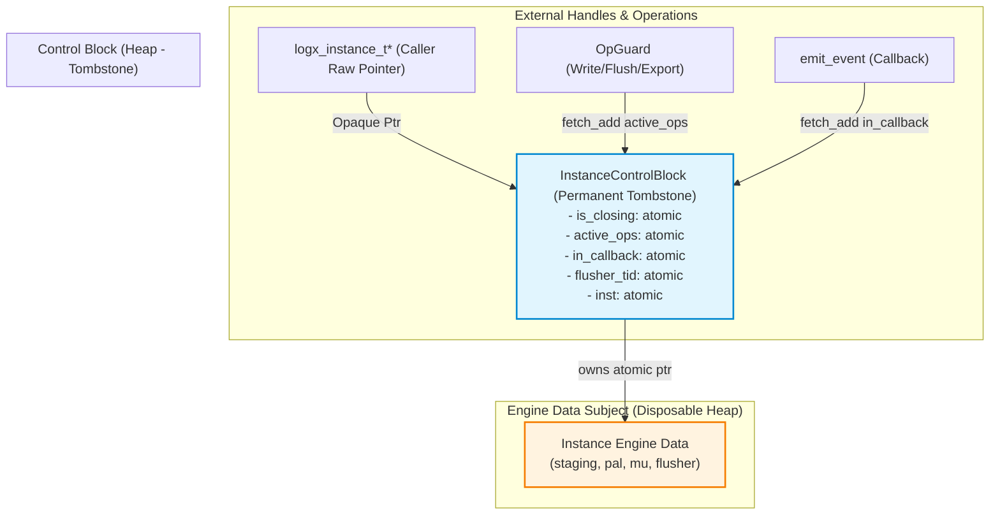
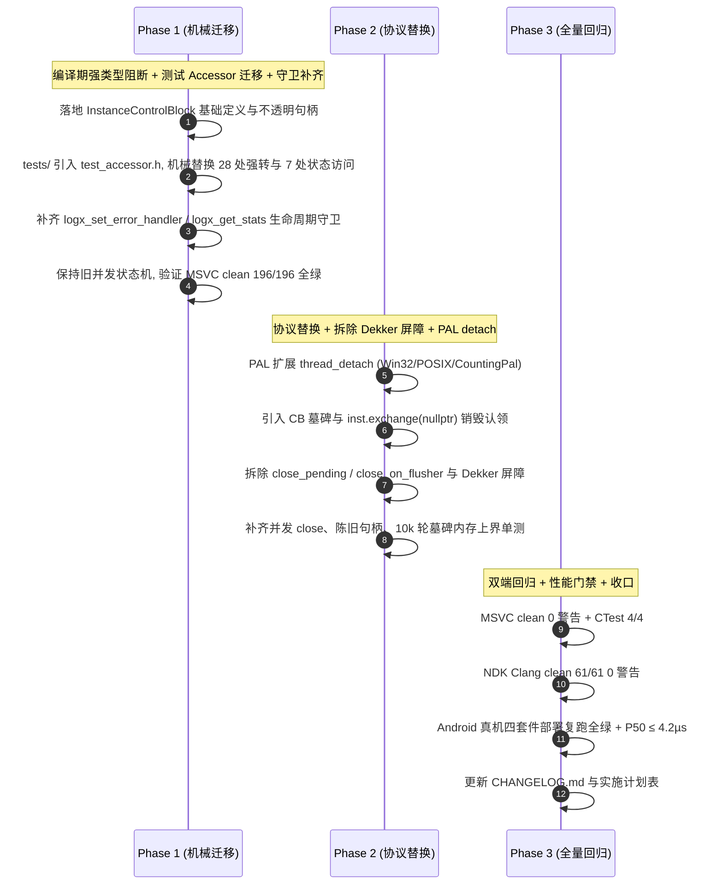

# LogX 1.x 生命周期堆控制块（Control Block）重构实施计划 (T5.8 / R41-05 根治)

> **版本**: v1.3 (2026-10-24)  
> **任务编号**: T5.8 (登记于 `docs/LogX后续实施计划表.md` §2 阶段三任务表)  
> **当前状态**: 🔧 **主体已落地（`431d5ee` 重构 + `0ef345f` 收口），尚未收口完成**——R46 复核判定 R45 十二项为 **7 成立 / 4 部分 / 1 未完成**，另新发现 **4×P2 + 8×P3** 待闭环（清单见 §七）；发布状态仍为「未发布 / 进行中」  
> **关联裁决**: [`lifecycle_control_block_decisions.md`](file:///d:/Project/Android_Project/LogX/logx/docs/lifecycle_control_block_decisions.md) v1.3 (6 大决策项正式拍板)  
> **关联审查**: [`reviews/code_review_R44_2026-10-18.md`](file:///d:/Project/Android_Project/LogX/logx/docs/reviews/code_review_R44_2026-10-18.md)、[`reviews/code_review_R45_2026-10-24.md`](file:///d:/Project/Android_Project/LogX/logx/docs/reviews/code_review_R45_2026-10-24.md)、[`reviews/code_review_R46_2026-10-24.md`](file:///d:/Project/Android_Project/LogX/logx/docs/reviews/code_review_R46_2026-10-24.md)  
>
> **v1.3 修订摘要（相比 v1.2，依据 R46 复核报告）**：
> 1. **状态口径纠偏**：v1.2 声称"已按 R45 审查结论完成修复并对齐实装代码"过于乐观——R46 逐项核实为 7 成立 / 4 部分 / 1 未完成，本节状态改为"主体已落地、待收口"。
> 2. **§3.1 步骤 6 字段勘误（R46 P3-04）**：`431d5ee` 已删除 `InstanceControlBlock::flusher_thread`（线程句柄仅存于 `Instance`），原文 `cb->flusher_thread = inst->flusher_thread;` 为失效描述，改为按实装直述 `thread_start` 调用。
> 3. **新增 §七 未闭合项清单**：把 R46 的 4×P2 + 8×P3 逐条登记到本文档，作为下一批次的唯一输入，避免只存在于审查报告而丢失跟踪。
>
> **v1.1 关键修订摘要（相比 v1.0）**：
> 1. **根治 R44-01（尾读 UAF）**：采纳 **CB 墓碑模型 (Tombstone)**，实例销毁仅物理释放 `Instance` 数据主体，控制块 CB 永久保留。彻底消除裸句柄在入口首行解引用已释放内存的 UAF 窗口；顺带消除 `weak_count` 及其配套复杂拓扑。
> 2. **根治 R44-02（关停丢数据）**：采纳**强引用 + `active_ops` 静止判定（含回调在飞门禁）**，同步关停判定严格为 `active_ops == 0 && in_callback == 0`，一次判定非零即递延，绝不自旋等待。同步路径先 `flush_blocking` 排空再停转 Flusher；递延路径由收尾者协同 Flusher 完成最终落盘与认领，杜绝在途日志静默丢失。
> 3. **闭合 R44-03 / R44-07（协议与启动引用）**：`cb->inst` 采用 `std::atomic<Instance*>` 并在读写侧建立 acquire-release 配对；销毁认领采用 `inst.exchange(nullptr)` 唯一胜出语义；open 初始引用清晰归属，启动失败路径完整回收。
> 4. **解决 R44-04（关闭期事件）**：在墓碑模型下，只要 `inst != nullptr` 允许关闭期事件正常分发；关停协议感知 `in_callback > 0` 递延，规避 R43 死锁形态。
> 5. **解决 R44-05（Flusher 自毁泄漏）**：扩展 PAL 接口增加 `thread_detach`，Flusher 回调内自销毁时 detach 自身，根治原生线程句柄泄漏。
> 6. **解决 R44-06（句柄错转型与迁移漏项）**：C++ 内部声明不透明句柄类型，引入 `test_accessor.h` 穿透测试 seam，批量迁移 28 处强转与 7 处状态访问；`logx_set_error_handler` 与 `logx_get_stats` 补齐生命周期守卫。
> 7. **对齐 R44-12（基线与门禁）**：单测基线勘误为实测 **196 项**；锁定真机热路径 P50 **门禁线 ≤ 4.2µs**（成功线 4.0µs，对齐 B2 回归基线 3.958µs）。

---

## 一、 重构背景与核心目标

### 1.1 现状分析与痛点 (R41-05 的本质)
在当前 LogX 实现中，引擎生命周期与关闭时序由内嵌在 `Instance` 结构体中的 4 个原子状态量协同控制：
1. `active_ops`: 记录当前正在执行的外部 API 操作（`logx_write` / `logx_flush` / `logx_export`）；
2. `in_callback`: 记录当前正在执行的错误回调调用深度（`emit_event`）；
3. `close_pending`: 记录外部线程触发但因存在活跃操作而转入递延关闭的标志；
4. `close_on_flusher`: 记录 Flusher 线程内部触发或转置自毁的标志。

**存在的核心痛点**：
- **极高的并发心智负担**：为协调这 4 个变量，退出逻辑分散在 5 个关键路径（`logx_close_ex` 外部主干、`logx_close_ex` 内部双检兜底、`OpGuard::~OpGuard` 退出段、`emit_event` 退出段、`flusher_main` 循环退出段）。在 R41~R43 期间连续修复了 Dekker store-load 重排、Flusher 回调盲区、递延漏认领等隐蔽并发缺陷。这套机制维护极为脆弱；
- **理论“尾读 UAF”隐患 (R41-05)**：所有状态标志均位于 `Instance` **内部**。当胜出线程判定条件满足并调用 `destroy_instance(inst)` 执行 `delete inst` 后，败方线程在此微秒级间隙仍在执行 `fetch_sub` 后的指令（如寄存器加载与栈清理）。虽然通过严格的 Dekker 屏障可以防止其触碰业务数据，但在严格的 C++ 内存模型下，对已释放 `inst` 指针的任何窥探都属于未定义行为（UB）。
- **v1.0 初稿的局限**：初稿试图通过 weak 计数管辖 CB，但外部传入的裸句柄在入口首行解引用 CB 时尚未持有任何引用，UAF 只是从 `Instance` 搬到了 CB（R44-01）。

### 1.2 重构目标
1. **解耦生命周期元数据与实例主体数据**：引入独立的堆控制块（`InstanceControlBlock`），其生命周期超越 `Instance` 主体，且采用**墓碑模型（Tombstone）**，彻底根治 R41-05 尾读 UAF；
2. **状态机大幅收敛**：废弃 `close_pending`、`close_on_flusher` 两态纠缠与双检 Dekker 屏障，统一由 CB 的原子 `is_closing` 拦截、`active_ops` 与 `in_callback` 精确静止判定、以及 `inst.exchange(nullptr)` 唯一胜出认领收敛；
3. **零破损 C ABI / JNI 契约**：`logx_instance_t*` 依然维持不透明指针形态；JNI 层与 Android Kotlin Facade 零改动；C++ 源码级改用严格不透明类型阻断危险强转；
4. **性能极致保全**：热路径（`logx_write`）零多余堆分配，**仅维护单次原子在途计数加减**（绝不增加双重原子引用计数），确保真机 P50 满足 ≤ 4.2µs 严苛门禁。

---

## 二、 核心架构设计方案

### 2.1 控制块墓碑模型与内存拓扑



- **墓碑模型（Tombstone）核心语义**：
  - `InstanceControlBlock` 在 `logx_open` 成功时分配一次；
  - 当实例被 `logx_close` 关闭并最终销毁时，**仅物理释放 `Instance` 数据主体**，并将 `cb->inst` 原子置空（`exchange(nullptr)`）；
  - **CB 结构体自身永久保留在堆中**，永不 `delete cb`；
  - 外部无论何时传入陈旧裸句柄，首行读取 `cb->is_closing` 或 `cb->inst` 永远是合法内存访问，绝对消灭 heap-use-after-free 崩溃窗口；
  - 顺带彻底消除内存地址快速复用导致的 ABA 假句柄隐患；
  - 单个 CB 结构体约 56B，计入分配器元数据约 80~100B，在移动端单实例/低频实例形态下开销可完全忽略。

### 2.2 数据结构定义

在 [`core/include/logx_internal.h`](file:///d:/Project/Android_Project/LogX/logx/core/include/logx_internal.h) 中定义：

```cpp
namespace logx {

struct Instance;

// 生命周期堆控制块（墓碑模型，sizeof <= 64B）
struct InstanceControlBlock {
    std::atomic<bool>      is_closing{false};      // 关闭中标志 (阻断新进入者)
    std::atomic<bool>      close_requested{false}; // 外部已发起 close (递延销毁触发源)
    std::atomic<int>       active_ops{0};          // 在途外部操作计数 (write/flush/export/stats/set_err)
    std::atomic<int>       in_callback{0};         // 在途回调计数 (emit_event / key_provider)
    std::atomic<uint64_t>  flusher_tid{0};         // Flusher 线程 TID (用于自销毁检测)

    std::atomic<Instance*> inst{nullptr};          // 实例主体指针 (原子指针，负责认领销毁)
    Pal*                   pal{nullptr};           // 平台抽象层指针

    // 销毁回调与上下文 (J-1/F-2 / R45-12 契约)
    void (*on_destroy)(void* user, void* err_user){nullptr};
    void*                  on_destroy_key_user{nullptr};
    void*                  on_destroy_err_user{nullptr};
};

static_assert(sizeof(InstanceControlBlock) <= 64,
              "InstanceControlBlock must fit within a single 64-byte cache line");

// 统一释放 Instance 资源主体 (仅由 inst.exchange(nullptr) 胜出者调用一次)
void destroy_instance(InstanceControlBlock* cb, Instance* inst, bool is_flusher_thread);

} // namespace logx
```

同时，从 `Instance` 结构体中**彻底移除**以下废弃字段：
- ~~`std::atomic<int> active_ops;`~~（改由 `cb->active_ops` 承载）
- ~~`std::atomic<int> in_callback;`~~（改由 `cb->in_callback` 承载）
- ~~`std::atomic<bool> closing;`~~（改由 `cb->is_closing` 承载）
- ~~`std::atomic<bool> close_pending;`~~（彻底删除）
- ~~`std::atomic<bool> close_on_flusher;`~~（彻底删除）

`Instance` 内部保留反向引用：`InstanceControlBlock* cb{nullptr};`。

---

## 三、 关键路径重构逻辑

### 3.1 实例创建 (`logx_open`) 失败路径与清理清单
1. 分配 `InstanceControlBlock* cb = new (std::nothrow) InstanceControlBlock();`；
2. 分配 `Instance* inst = new (std::nothrow) Instance();`，若失败则 `delete cb; return LOGX_ERR_NO_MEM;`；
3. 将 `inst->cb = cb; cb->inst.store(inst, std::memory_order_relaxed);`；
4. 初始化 `cb->pal = pal; cb->on_destroy = cfg->on_destroy;` 等元数据；
5. 初始化 mutex、events、staging mmap 与 recovery；
   - **失败清理清单**：若在 `thread_start` 之前的任一步骤失败（如 staging 创建失败、event 创建失败），必须按照依赖逆序释放 `staging`/`events`/`mutex`/`inst`，最后 `delete cb`（此时尚未向外部暴露句柄，无并发，可安全释放 CB），并返回对应错误码；
6. 启动 Flusher 线程：`inst->pal->thread_start(&flusher_main, inst, &inst->flusher_thread)`；线程句柄**仅**存放于 `Instance`，`InstanceControlBlock` 不持有副本（`431d5ee` 已删除 `cb->flusher_thread`——v1.2 原文的 `cb->flusher_thread = inst->flusher_thread;` 为失效描述，R46 P3-04 勘误）；
   - 若 `thread_start` 失败，统一走 `cleanup_open_failure(LOGX_ERR_STATE)`（依赖逆序销毁 `staging`→`space_event`→`flush_event`→`mu`→`inst`→`cb`，返回 `LOGX_ERR_STATE` 而非 `LOGX_ERR_OS`）；
7. 成功后将 `*out_inst = reinterpret_cast<logx_instance_t*>(cb);` 返回给外部。

### 3.2 写入/刷盘/导出/统计/设置错误回调热路径 (`OpGuard`)
为保证真机 P50 写入延迟 ≤ 4.2µs 门禁，**热路径仅维护一次 `active_ops` 原子加减**，并在跨变量 Store-Load 对偶点使用 `std::memory_order_seq_cst` 全序屏障（R45-01 / R45-02）：
```cpp
struct OpGuard {
    InstanceControlBlock* cb{nullptr};
    Instance*             inst{nullptr};

    explicit OpGuard(logx_instance_t* h) {
        if (!h) return;
        auto* c = reinterpret_cast<InstanceControlBlock*>(h);
        if (c->is_closing.load(std::memory_order_acquire)) return;

        c->active_ops.fetch_add(1, std::memory_order_seq_cst);
        if (c->is_closing.load(std::memory_order_seq_cst)) {
            int rem = c->active_ops.fetch_sub(1, std::memory_order_seq_cst) - 1;
            if (rem == 0) {
                check_deferred_dispose_on_exit(c);
            }
            return;
        }

        Instance* i = c->inst.load(std::memory_order_acquire);
        if (!i) {
            int rem = c->active_ops.fetch_sub(1, std::memory_order_seq_cst) - 1;
            if (rem == 0) {
                check_deferred_dispose_on_exit(c);
            }
            return;
        }

        cb = c;
        inst = i;
    }

    ~OpGuard() {
        if (cb) {
            int rem = cb->active_ops.fetch_sub(1, std::memory_order_seq_cst) - 1;
            if (rem == 0 && cb->is_closing.load(std::memory_order_seq_cst)) {
                check_deferred_dispose_on_exit(cb);
            }
        }
    }

    bool is_valid() const noexcept { return inst != nullptr; }
};
```
在 `logx_write` / `logx_flush` / `logx_export` / `logx_set_error_handler` / `logx_get_stats` 中统一使用 `OpGuard` 保护（R44-06 / R45-04）。

### 3.3 错误事件发射 (`emit_event`) 与密钥回调门禁 (`invoke_key_provider`)
允许关闭期事件正常穿透分发，并对 `emit_event` 与 `key_provider` 对称维护 `in_callback`（R44-04 / R45-02 / R45-06）：
```cpp
inline void emit_event(Instance* inst, logx_event_kind_e k, int code, const char* msg) {
    if (!inst) return;
    InstanceControlBlock* cb = inst->cb;
    if (cb) {
        cb->in_callback.fetch_add(1, std::memory_order_seq_cst);
    }
    inst->err_mu.lock();
    logx_error_fn fn = inst->err_fn;
    void* user = inst->err_user;
    inst->err_mu.unlock();
    if (fn) {
        fn(user, k, code, msg ? msg : "");
    }
    if (cb) {
        int rem = cb->in_callback.fetch_sub(1, std::memory_order_seq_cst) - 1;
        if (rem == 0 && cb->is_closing.load(std::memory_order_seq_cst)) {
            check_deferred_dispose_on_exit(cb);
        }
    }
}

inline const uint8_t* invoke_key_provider(Instance* inst, uint16_t kid) {
    if (!inst || !inst->key_provider) return nullptr;
    InstanceControlBlock* cb = inst->cb;
    if (cb) {
        cb->in_callback.fetch_add(1, std::memory_order_seq_cst);
    }
    const uint8_t* key = inst->key_provider(kid, inst->key_user);
    if (cb) {
        int rem = cb->in_callback.fetch_sub(1, std::memory_order_seq_cst) - 1;
        if (rem == 0 && cb->is_closing.load(std::memory_order_seq_cst)) {
            check_deferred_dispose_on_exit(cb);
        }
    }
    return key;
}
```

### 3.4 实例关闭 (`logx_close_ex` / `logx_close`)
严格遵循 **决策二方案 B（`active_ops == 0 && in_callback == 0` 静止判定 + R45-02/R45-03 修复）**：
```cpp
logx_status_e logx_close_ex(logx_instance_t* h, bool* out_closed_immediately) {
    if (out_closed_immediately) *out_closed_immediately = false;
    if (!h) return LOGX_ERR_INVALID_ARG;
    auto* cb = reinterpret_cast<InstanceControlBlock*>(h);

    if (cb->is_closing.exchange(true, std::memory_order_seq_cst)) {
        return LOGX_OK;
    }

    Instance* inst = cb->inst.load(std::memory_order_acquire);
    Pal* pal = cb->pal;
    if (inst && inst->space_event && pal) {
        pal->ev_signal(inst->space_event);
    }

    uint64_t current_tid = pal ? pal->tid() : 0;
    bool on_flusher = (current_tid != 0 &&
                       cb->flusher_tid.load(std::memory_order_acquire) == current_tid);

    if (!on_flusher &&
        cb->active_ops.load(std::memory_order_seq_cst) == 0 &&
        cb->in_callback.load(std::memory_order_seq_cst) == 0) {
        Instance* target = cb->inst.exchange(nullptr, std::memory_order_acq_rel);
        if (target != nullptr) {
            destroy_instance(cb, target, /*is_flusher_thread=*/false);
        }
        if (out_closed_immediately) *out_closed_immediately = true;
        return LOGX_OK;
    }

    if (on_flusher && inst &&
        cb->active_ops.load(std::memory_order_seq_cst) == 0 &&
        cb->in_callback.load(std::memory_order_seq_cst) == 0) {
        inst->flusher_exit.store(true, std::memory_order_release);
        if (inst->flush_event && pal) pal->ev_signal(inst->flush_event);
    }

    cb->close_requested.store(true, std::memory_order_seq_cst);

    if (!on_flusher &&
        cb->active_ops.load(std::memory_order_seq_cst) == 0 &&
        cb->in_callback.load(std::memory_order_seq_cst) == 0) {
        if (cb->close_requested.exchange(false, std::memory_order_seq_cst)) {
            Instance* target = cb->inst.exchange(nullptr, std::memory_order_acq_rel);
            if (target != nullptr) {
                destroy_instance(cb, target, /*is_flusher_thread=*/false);
                if (out_closed_immediately) *out_closed_immediately = true;
            }
        }
    }

    return LOGX_OK;
}
```

### 3.5 递延排空与销毁认领 (`check_deferred_dispose_on_exit`)
当在途操作或回调归零时协同认领（R45-02 / R45-03 / R45-09）：
```cpp
inline void check_deferred_dispose_on_exit(InstanceControlBlock* cb) {
    if (!cb) return;
    if (!cb->close_requested.load(std::memory_order_seq_cst)) return;
    if (cb->active_ops.load(std::memory_order_seq_cst) == 0 &&
        cb->in_callback.load(std::memory_order_seq_cst) == 0) {
        Pal* pal = cb->pal;
        uint64_t current_tid = pal ? pal->tid() : 0;
        bool on_flusher = (current_tid != 0 &&
                           cb->flusher_tid.load(std::memory_order_acquire) == current_tid);
        if (!on_flusher) {
            if (cb->close_requested.exchange(false, std::memory_order_seq_cst)) {
                Instance* target = cb->inst.exchange(nullptr, std::memory_order_acq_rel);
                if (target != nullptr) {
                    destroy_instance(cb, target, /*is_flusher_thread=*/false);
                }
            }
        } else {
            Instance* inst = cb->inst.load(std::memory_order_acquire);
            if (inst) {
                inst->flusher_exit.store(true, std::memory_order_release);
                if (inst->flush_event && pal) pal->ev_signal(inst->flush_event);
            }
        }
    }
}
```

### 3.6 统一物理清理 (`destroy_instance`)
由 `inst.exchange(nullptr)` 唯一胜出者调用：
```cpp
void destroy_instance(InstanceControlBlock* cb, Instance* inst, bool is_flusher_thread) {
    if (!inst) return;
    Pal* pal = cb ? cb->pal : inst->pal;
    if (!is_flusher_thread) {
        flush_blocking(inst);
    }
    inst->flusher_exit.store(true, std::memory_order_release);
    if (inst->flush_event && pal) pal->ev_signal(inst->flush_event);
    if (inst->space_event && pal) pal->ev_signal(inst->space_event);
    if (inst->flusher_thread) {
        if (!is_flusher_thread) {
            if (pal) pal->thread_join(inst->flusher_thread);
        } else {
            if (pal) pal->thread_detach(inst->flusher_thread);
        }
        inst->flusher_thread = nullptr;
    }
    delete inst->staging;
    inst->staging = nullptr;
    if (inst->space_event && pal) { pal->ev_destroy(inst->space_event); inst->space_event = nullptr; }
    if (inst->flush_event && pal) { pal->ev_destroy(inst->flush_event); inst->flush_event = nullptr; }
    if (inst->mu && pal) { pal->mutex_destroy(inst->mu); inst->mu = nullptr; }
    auto on_destroy = cb ? cb->on_destroy : nullptr;
    void* key_user = cb ? cb->on_destroy_key_user : inst->key_user;
    void* err_user = cb ? cb->on_destroy_err_user : inst->err_user;
    delete inst;
    if (cb) {
        cb->flusher_tid.store(0, std::memory_order_release);
        cb->pal = nullptr;
    }
    if (on_destroy) {
        on_destroy(key_user, err_user);
    }
}
```

---

## 四、 新旧状态机对比与收益确认

| 维度 | 旧架构 (Dekker 多状态原子仲裁) | 新架构 (CB 墓碑模型 + 精确静止) |
|---|---|---|
| **状态量个数** | 4 个 (`active_ops`, `in_callback`, `close_pending`, `close_on_flusher`) | **CB 永久留存 + `is_closing` + `active_ops` + `in_callback`** |
| **内存屏障复杂度** | 全链路强制要求 `seq_cst` Store-Load 屏障与双重校验 | 标准的 `acquire` / `release` 内存序 |
| **认领点位置** | 分散在 5 处退出段，逻辑各异容易漏补 | **收敛至 `try_deferred_dispose` 配合 `inst.exchange(nullptr)`** |
| **尾读 UAF (R41-05)** | 理论存在（败方在胜方 `delete inst` 后访问其字段） | **彻底根除**（控制块墓碑永久存活，指针解引用合法） |
| **Flusher 自毁泄漏** | 无法 join 导致 OS 原生线程句柄泄漏 | **彻底根除**（PAL `thread_detach` 原生解耦回收） |
| **热路径性能** | 存在 check-then-increment 窗口，Dekker 屏障开销 | **单次原子操作提升**，零额外堆开销，延迟 ≤ 4.2µs |

---

## 五、 测试与回归验证计划

1. **测试基线核准**：
   - 实测单元测试基线确认为 **196 项**（clean 构建产物 `--gtest_list_tests` 实数）；
2. **桌面端 MSVC x64 全量验证**：
   - 必须遵循 **R21-2** 纪律：头文件变更强制 clean 全量编译，达到 **0 警告 0 错误**；
   - CTest 四套件 **100% 通过 (4/4)**：
     - `logx_unit_tests` (196 项)
     - `logx_hotpath_alloc_tests` (2 项零堆分配守护断言)
     - `logx_stress_tests` (4 项 50 线程极限并发压测)
     - `logx_crash_fork_tests` (3 项真实进程崩溃恢复对账)
3. **Android NDK 交叉编译验证**：
   - 必须遵循 **B-11-1** 纪律：NDK 26.1 / 29.0 Clang clean 编译，达到 **61/61 TU 0 警告**；
4. **Android 真机 (Redmi K30 Pro) 全量复跑**：
   - 通过无线 adb 部署四套件至设备，断言全绿；
   - 热路径写入性能门禁：P50 **门禁线 ≤ 4.2µs**（成功线 4.0µs）；
5. **专项测试补齐**：
   - 陈旧句柄访问测试（返回 `LOGX_ERR_STATE` 且不崩溃）；
   - 并发双 close 压力测试；
   - 10k 轮 open/close 墓碑内存上界断言（验证内存平稳有界）；
   - `thread_detach` 句柄配对断言。

---

## 六、 分阶段实施计划 (WBS)



---

## 七、 R46 复核未闭合项清单（下一批次唯一输入）

> 来源：[`reviews/code_review_R46_2026-10-24.md`](file:///d:/Project/Android_Project/LogX/logx/docs/reviews/code_review_R46_2026-10-24.md) §四/§六。R46 裁定 `0ef345f` **无 P0/P1 阻断项、可入库**，但"12 项全量收口"应修正为 **7 成立 / 4 部分 / 1 未完成**；下列 12 项（4×P2 + 8×P3）为本专项收口前必须闭环的余量。

### 7.1 P2（4 项，建议优先）

| 编号 | 位置 | 问题 | 影响 | 收口动作 |
|---|---|---|---|---|
| **P2-01** | `core/src/flusher.cpp:1155` | `append_block` 内仍裸调 `inst->key_provider(inst->kid, inst->key_user)`，未走 `invoke_key_provider` 门禁（ACT-6 漏改第 4 处） | 当前仅单元测试可达；一旦接入生产路径即原样复现 R45-06 的 `thread_join` 死锁，且无 `OpGuard` 保护 | 改走 `invoke_key_provider`；同时补 `append_block` 生产路径可达性门禁或注释明示"仅测试用"，并补"Flusher 阻塞于 key_provider 期间并发 close 不死锁"用例 |
| **P2-02** | `core/src/logx_c.cpp`（`logx_set_error_handler`）、`core/include/logx_c.h` | 空句柄返回码由 `LOGX_ERR_INVALID_ARG` 静默改为 `LOGX_ERR_STATE`，头文件无空句柄契约、CHANGELOG 未登记 | 公开 C ABI 行为变更无痕；与 `logx_close`/`logx_export`/`logx_write` 全族的 `INVALID_ARG` 口径不一致，宿主分支判断易出错 | 二选一：① 恢复 `INVALID_ARG`（推荐，保持全族一致）；② 若确需 `STATE`，在 `logx_c.h` 显式写明空句柄语义并在 CHANGELOG 登记 |
| **P2-03** | `tests/unit/test_r19_regression.cpp:2964` | 10k 轮内存上界断言为 `sizeof(InstanceControlBlock) * 10000 <= 640KB` 的恒真式 | 删掉 `delete inst` 也照样通过 ⇒ R45-10 的门禁实质未建立，泄漏无任何拦截能力 | 改为可失败的真实断言（CB/Instance 分配计数净零，或稳态 RSS 增量上界），并按 R18-2 做撤销变异验证必红 |
| **P2-04** | `tests/unit/test_r19_regression.cpp`（新增 key_provider 用例） | 在 `logx_open` 之后改写 `encrypt_enable`/`kid`/`key_provider` 等非原子字段，与运行中的 Flusher 并发读 | 形式上的数据竞争（UB）；CI 偶发假绿/假红，且污染"并发正确性"证据链 | 改为 open 前配置；确需运行期变更时，经同步点先行静止 Flusher（或把这些字段升为 atomic，属更大改动，需单独评估） |

### 7.2 P3（8 项）

| 编号 | 位置 | 问题 | 收口动作 |
|---|---|---|---|
| **P3-01** | `core/src/logx_c.cpp`（`check_deferred_dispose_on_exit` Flusher 分支） | 以 `cb->inst.load()` 重新取 `inst`，其安全性依赖"此路径上 Flusher 必已不再解引用 inst"的 join 不变量，但该不变量未在任何注释中写明 | 补注释声明不变量与成立理由，或改为由调用方传参避免二次读取 |
| **P3-02** | `core/include/logx_internal.h`（`InstanceControlBlock::pal`） | `cb->pal` 为非原子指针，销毁认领者写 `nullptr` 与并发读存在跨线程读写竞争 | 升为 `std::atomic<Pal*>`，或在契约注释中限定"仅在 `inst` 已认领后访问"并说明为何不构成竞争 |
| **P3-03** | `core/include/logx_c.h`（`on_destroy` 契约段） | 新增文案"Flusher 线程已退出"与"可能在 Flusher 线程执行"自相矛盾 | 改写为"执行线程为最后完成销毁认领的线程（可能是 Flusher 线程）；回调返回后库不再访问任何实例资源" |
| **P3-04** | 本文档 §3.1 步骤 6 | 引用 `431d5ee` 已删除的 `cb->flusher_thread` 字段 | ✅ **本批次（v1.3）已闭环** |
| **P3-05** | `docs/reviews/code_review_R45_*.md`、`CHANGELOG.md` | R45 报告 8 个 ACT 复选框未勾选、修复批次未登记 | ✅ **本批次已闭环**（ACT 按 R46 判定标注勾选/部分/未完成；CHANGELOG 第 24 条已登记提交与批次） |
| **P3-06** | `core/include/logx_internal.h`（64B 断言） | `static_assert(sizeof(...) <= 64)` 只约束尺寸，实测 `alignof` 仅 8 ⇒ 未达成"独占单缓存行"的原意 | 加 `alignas(64)`，或补 `alignof` 断言；若有意不要求对齐，则把注释"single 64-byte cache line"改为"size ≤ 64B" |
| **P3-07** | `core/src/logx_c.cpp`（`logx_close_ex` 同步快路径） | 未成功认领（`exchange(nullptr)` 落空）时仍回填 `*out_closed_immediately = true`，语义失真 | 以认领结果回填该出参（认领失败应为 `false`）；当前无消费方，属语义正确性打磨 |
| **P3-08** | `android/cpp/jni_key_cache.h` / `logx_jni.cpp` | TLS 明文密钥仅"下次 `lookup`/`allocate_slot` 时"惰性清零；线程空闲或不再调用日志接口时明文长期驻留 | 接受并写入契约（声明残留窗口）或提供显式 scrub 入口；不建议为此引入跨线程强制清槽 |

### 7.3 收口顺序建议（沿用 R46 §六）

`P2-01`（3 行，消除潜在 P1）→ `P2-04`（CI 稳定性）→ `P2-03`（重建门禁）→ `P2-02`（契约与登记）→ `P3-01/02/03/06`（注释与少量代码，零风险）→ `P3-07/08`（语义打磨）。

> **发布判定前置条件**：上述 4×P2 全部闭环 + NDK clean 构建 + ASan/TSAN 复跑 + 真机四套件与 P50 ≤ 4.2µs 门禁重测，方可把本专项与发布状态从「未发布 / 进行中」转为已收口。
>
> **基线更新（R46 实测）**：§五 登记的 **196 项**为立项时 clean 产物实数；`0ef345f` 后 host 实测已增至 **203 项**（含新增生命周期/并发用例），后续验收以 203 为起点，并按「重构新增用例在此基础上如实递增」累加。
