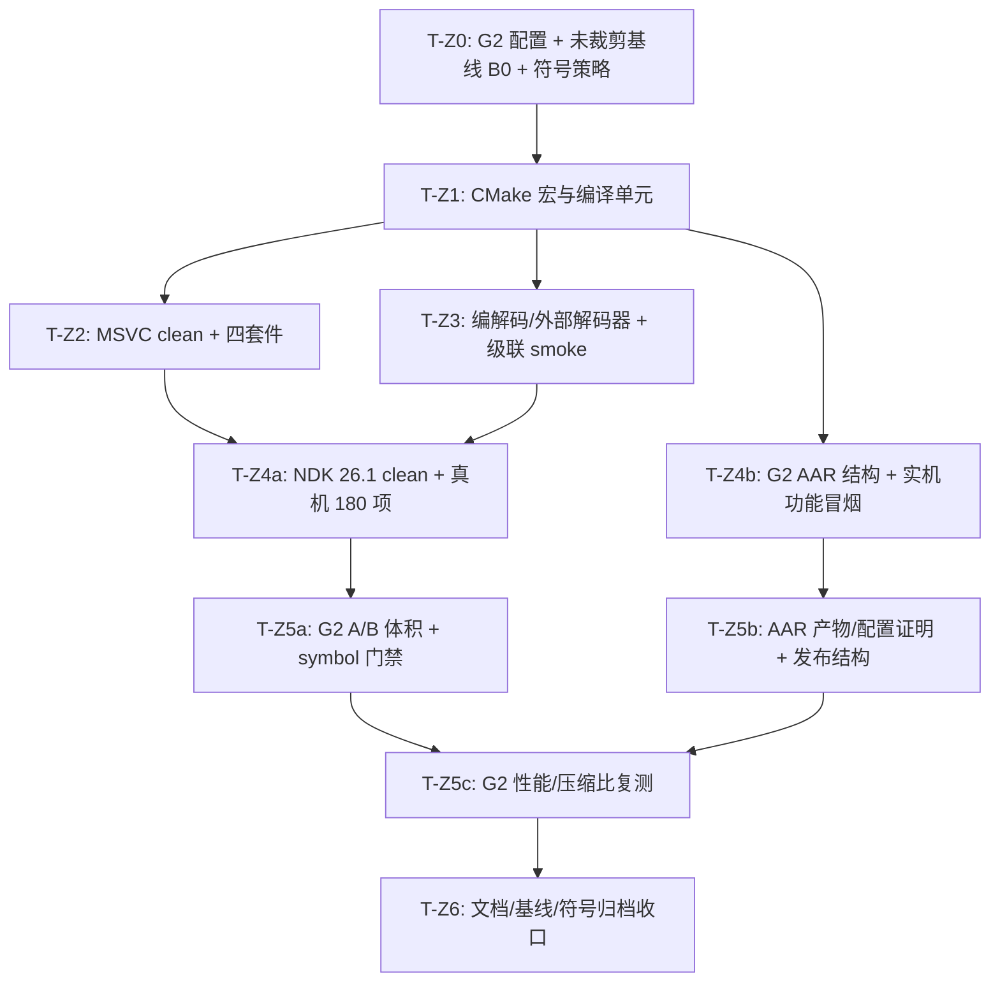

# LogX 专项实施计划：zstd 源码级裁剪与 SO 体积精简 (v1.7)

> **文档标识**: `docs/zstd_prune_plan.md`  
> **版本**: v1.7  
> **创建日期**: 2026-10-15  
> **修订日期**: 2026-10-17  
> **关联里程碑**: M5 基线收尾 / 体积优化专项  
> **状态**: 收口（T-Z0~T-Z6 + D6-B2 完成；G2 PASS **385,112 B**；D6 已关闭）

---

## 修订记录

| 版本 | 日期 | 修订内容 |
|---|---|---|
| v1.0 | 2026-10-15 | 初稿。 |
| v1.1 | 2026-10-17 | 审查修订：固定体积口径、修正 `clevels.h` 引用、修正 clean 重建归因、补充 symbol 门禁/级联 smoke/fallback、数字勘误。 |
| v1.2 | 2026-10-17 | **第 5 项拍板为 G2**：硬门禁改为「发布 AAR 内 `jni/arm64-v8a/liblogx.so` strip 后 < 512,000 B」，AAR release 的 native 构建类型从 RelWithDebInfo 切到 MinSizeRel；T-Z0 必须重测「G2 + 未裁剪」基线 B0，禁止沿用 benchmark 的 561,664 B；新增 G2 配置证明、AAR 实机功能冒烟、MinSizeRel 性能复测、native 符号保留策略与 AAR 发布结构验证；重排 WBS 与验收/风险/局限/待拍板。 |
| v1.3 | 2026-10-17 | **D4 拍板为 A**：MinSizeRel 对象统一追加 `-g`（`-Oz -DNDEBUG -g`），AGP 打包阶段仍 strip，归档未 strip `.so`；T-Z0 验证「有/无 `-g` 的 stripped SO 体积差 ≤1KB」且打包 SO 无 `.debug_*` 段。`LOGX_AAR_KEEP_SYMBOLS` 默认 ON、release 强制 ON，仅 T-Z0 的 A/B 对照可临时 OFF，发布产物不得 OFF；D4 从待拍板清单移入已拍板记录，A 验证失败时暂停并重新拍板 D4-B，不得静默切换。 |
| v1.4 | 2026-10-17 | **D2 拍板为新增**：T-Z3 必须加入 level 0–22 的级联 smoke，不得以“未实测”措辞替代；**D3 拍板为保留**：`zstd_lazy.c`/`zstd_opt.c` 维持空 TU，不引入源文件开关。T-Z0 开始执行。 |
| v1.5 | 2026-10-17 | **STL 口径拍板为 `c++_shared`**：G2 门禁仍只计 AAR 内 `liblogx.so`，AAR 同时打包 `libc++_shared.so`，总 native 载荷单列记录、不参与门禁。T-Z0/T-Z1/T-Z5a 实测完成：B0(static)=868,096 B、B0(shared)=520,464 B、B1(static)=719,192 B、**B1(shared)=371,544 B（门禁 PASS，余量 140,456 B）**；D4-A 在 shared 配置复验：stripped 差 240 B、打包 SO 无 `.debug_*`。 |
| v1.6 | 2026-10-17 | **全部实测收口**：host/真机回归 197/197 + 2/2 + 4/4 + 3/3；T-Z3 104/104、T-Z4b 141/141 逐字节一致；T-Z5b G2 PASS；T-Z5c 压缩比 1.52x 不变、P99/吞吐在噪声内，但纯路径 P50 3,646→4,844 ns（+32.9%），归因 MinSizeRel `-Oz`。新增 §2.7 实测汇总，勘误 §1.5/§5/§7 的预估与计数，登记待拍板 **D6**（接受回退 vs 热路径单独 `-O2`）。 |
| v1.7 | 2026-10-17 | **D6 拍板为 B2 并实测关闭**：MinSizeRel 下仅对 `logx_c.cpp`/`flusher.cpp`/`format.cpp`/`staging.cpp` 追加 `-O2`（`LOGX_HOTPATH_O2=ON`，zstd/mbedtls 保持 `-Oz`）。AAR stripped `liblogx.so` **385,112 B**（仍 PASS，余量 126,888 B）；真机 3 轮交错 + 逆序轮：纯路径 P50 **3,698 ns**、生产口径 zstd P50 **3,958 ns**，回到 baseline 水平（final-A 为 4,896 / 5,052 ns）；host/NDK/真机回归全绿。`third_party/zstd` 保持 0-diff。 |

---

## 0. 计划目标与既定决策

本计划落实 [`docs/benchmark_report.md`](./benchmark_report.md) §5.3 的「zstd 源码级裁剪（体积优化备选）」，在**不改 `third_party/zstd` 源码**的前提下，把发布 AAR 的 arm64-v8a `liblogx.so` 压到 500KB 硬指标以内。

> **2026-10-17 拍板记录**：第 5 项选择「发布 AAR 内 arm64 `.so` 必须 <500KB」，因此验收对象固定为 **G2（AAR `:logx:assembleRelease`，native 构建类型 MinSizeRel）**。G1 独立 MinSizeRel 构建不再作为门禁，仅在需要时作为 benchmark 交叉参考。

| 决策项 | 结论 | 决策依据 / 约束 |
|---|---|---|
| **体积硬指标** | **G2**：AAR `:logx:assembleRelease` 内 `jni/arm64-v8a/liblogx.so`，strip 后 **< 512,000 B（500KB，KB=1024）** | 对齐用户拍板；当前 AAR 是 RelWithDebInfo，最近 stripped SO = 980,864 B；G2 未裁剪基线 B0 由 T-Z0 实测 |
| **体积 stretch** | 400KB~440KB | **仅努力方向，不进入验收 checklist**；以 B0/B1 实测为准，T-Z0 后可重算 |
| **验收对象** | **G2（已拍板）**：AAR release 的 native 构建类型必须实际为 MinSizeRel | 不能只看 `build.gradle.kts`；必须以 CMakeCache/编译命令证明 `MinSizeRel`/`-Oz` 生效 |
| **源码侵入性** | 对 `third_party/zstd/` 保持零源码修改（0 diff） | vendored 依赖纯净原则，不阻断上游升级；任何 patch 必须单独拍板 |
| **实现路径** | CMake 编译期宏剔除 + 移除单线程下无引用的编译单元 | 利用 zstd 官方 `ZSTD_EXCLUDE_*` 宏与自动级联机制 |
| **解压兼容性** | 100% 保持标准 zstd 帧解压能力 | 解压全套算法单元完整保留，保证 `logx_export` 与离线解码器兼容 |
| **压缩行为** | 维持 Level 3 默认压缩等级；L3 只用 `ZSTD_dfast` | 写入热路径策略不变；MinSizeRel 的 codegen 影响需在 G2 实机复测 |
| **构建门禁** | R21-2（全量 clean 构建）+ B-11-1（NDK 冒烟门禁） | 宏/源文件列表/构建 profile 变更必须 clean-first，杜绝陈旧对象与宏不一致 |
| **新增验证** | B0/B1 A/B 体积表 + `llvm-nm` symbol 门禁 + 外部解码器对账 + 级联 smoke + **G2 AAR 实机冒烟/性能复测** | 体积下降不能单独证明目标代码被移除；发布 profile 变更必须用真实 AAR 验证 |
| **native 符号** | **D4-A（已拍板）**：release 构建 `LOGX_AAR_KEEP_SYMBOLS=ON`，MinSizeRel 对象统一追加 `-g`，AGP 打包仍 strip，归档未 strip `.so` | 当前 RelWithDebInfo 构建目录有 8,027,240 B 未 strip SO；切 MinSizeRel 后必须保留符号，否则 native 崩溃栈不可读；T-Z0 验证 stripped 体积差 ≤1KB |
| **STL 口径** | **`c++_shared`（2026-10-17 拍板）**：AAR 打包 `libc++_shared.so`，G2 门禁仍只计 `liblogx.so` | 静态 libc++ 会让 `liblogx.so` 多约 347KB，B1(static)=719,192 B 无法达标；benchmark 的 561,664 B 实际也是 `c++_shared` 口径。总 native 载荷（B1）**1,745,880 B**、（B2）**1,759,448 B**，必须在报告中单列，不得用门禁数据暗示整体变小 |

### 0.1 体积基线口径（v1.7，实测已回填）

当前仓库存在多套不同的 SO/包产物，**不能混用**：

| 产物 | 实际构建配置 | 实测（stripped） | 用途 |
|---|---|---|---|
| **AAR 改造前** | `RelWithDebInfo`、`c++_static` | **980,864 B** | 改造前现状 |
| **G2 B0（static）** | AAR release、MinSizeRel、`c++_static`、未裁剪 | **868,096 B** | 静态口径基线 |
| **G2 B0（shared）** | AAR release、MinSizeRel、`c++_shared`、未裁剪 | **520,464 B** | 最终口径基线 |
| **G2 B1（D6-B2 前）** | AAR release、MinSizeRel、`c++_shared`、裁剪后 | **371,544 B** | D6 决策前产物 |
| **G2 B2（final）** | AAR release、MinSizeRel、`c++_shared`、裁剪 + 热路径 `-O2` | **385,112 B** | **门禁对象（PASS，余量 126,888 B）** |
| G2 B1（static） | AAR release、MinSizeRel、`c++_static`、裁剪后 | **719,192 B** | 证明 STL 差额主导 |
| Benchmark MinSizeRel | NDK 29、android-24、MinSizeRel、**`c++_shared`** | **561,664 B** | 仅参考；已确认与 AAR shared 口径同类 |
| AAR 压缩包 | `logx-release.aar` | 405,075 B（前）/ **676,936 B（final B2）** | 仅信息；**不是体积指标** |
| **AAR 总 native 载荷（final B2）** | `liblogx.so` + `libc++_shared.so` | **1,759,448 B** | **单列披露，不参与门禁** |
| AAR 未 strip（final B2） | MinSizeRel + `-g`、`c++_shared`、热路径 `-O2` | **3,048,752 B** | D4-A 符号归档 |
| Host `build-full` | MSVC Release + zstd ON + AES-GCM ON | 不适用（x64 测试） | 正确性与回归测试 |

关键结论：

1. **G2 已达标**：B2(shared)=385,112 B < 512,000 B。B1(shared)=371,544 B 为 D6-B2 前产物；热路径 `-O2` 增加 13,568 B。B0(shared)=520,464 B，仅超门禁 8,464 B，zstd 裁剪贡献 **148,920 B**，是达标的关键增量。
2. **STL 口径主导体积**：同一份代码从 `c++_static` 切到 `c++_shared`，B0 从 868,096 B 降到 520,464 B（−347,632 B）；B1 从 719,192 B 降到 371,544 B。benchmark 的 561,664 B 实际是 `c++_shared` 口径，v1.4 之前把它当作 AAR 静态基线是**口径错误**。
3. **总载荷必须单列**：shared 方案让 AAR 额外打包 1,374,336 B 的 `libc++_shared.so`，B2 总 native 载荷 1,759,448 B，反而大于 static B1 的 719,192 B。门禁只衡量 `liblogx.so`，报告不得据此宣称整体体积下降。
4. **只量 AAR 内解压后的 `.so`**：AAR zip 为压缩包，不是体积指标；现代 AGP 默认 APK 内 native 库不压缩（`useLegacyPackaging=false`）。
5. **NDK 版本分叉**：`build-android-tests` 固化 NDK 26.1.10909125；AAR 使用 NDK 29.0.14206865。T-Z4a/T-Z4b/T-Z5 必须分别注明。
6. **D4-A 已验证**：final shared 配置 ON=371,544 B、OFF(`-g0`)=371,304 B，差 **240 B ≤1KB**；打包 SO 无 `.debug_*`；B1 未 strip 产物保留 1,596 个符号、2,810,704 B；B2 未 strip 为 3,048,752 B。AGP/NDK 基线自带 `-g`，OFF 分支必须显式 `-g0` 才是有效对照。
7. **构建 flags 修正**：CMake 3.22 的 MinSizeRel 默认是 `-Os -DNDEBUG`，不是 `-Oz`；AAR CMake 已显式固定 `-Oz -DNDEBUG`，再按 D4-A 追加 `-g`。
8. **性能代价已由 B2 消除（v1.7）**：`-Oz` 曾使纯路径 P50 从 3,646 ns 升至 4,844 ns（+32.9%）；D6 选 B2 后，热路径 4 个 TU 单独 `-O2`，3 轮交错中位纯路径 P50 **3,698 ns**、生产口径 zstd P50 **3,958 ns**，与 baseline 持平，压缩比 1.52x 不变；见 §2.7 与 `t_z6_b2_hotpath/result.md`。

---

## 1. 代码调研与事实依据（v1.3 复核）

### 1.1 体积构成与归因事实

根据 [`docs/benchmark_report.md`](./benchmark_report.md) §5.1/§5.2：

- **裸核心**（`core` 6 文件 + JNI 胶水）：约 **121.3KB**；
- **AES-GCM**（mbedtls 裁剪版）：约 **12KB**；
- **zstd v1.5.7**（当前 vendor **25** 个 `.c` 参与编译）：贡献约 **426KB**（占 benchmark SO 体积的 77%）；
- **Benchmark MinSizeRel 全开 + strip**：**561,664 B**（=548.5KiB；benchmark 原文误写 548.9KB，已勘误；超 500KB 硬指标）；
- **AAR 当前发布件**：**980,864 B**（RelWithDebInfo；不是 MinSizeRel 基线）；
- **AAR 压缩包**：T5.2 期 **405,075 B**、final B1 **668,819 B**、final B2 **676,936 B**（zip 内 `.so` 被压缩；仅信息，不是体积指标）。

> `benchmark_report.md` 原文写“24 个 .c”，当前 `core/CMakeLists.txt` 实为 **25 个**（1.5.7 新增 `zstd_preSplit.c`）。T-Z6 一并勘误。

### 1.2 LogX 真实调用面审计

查阅 [`core/src/codec.cpp`](file:///d:/Project/Android_Project/LogX/logx/core/src/codec.cpp)，LogX 核心对 zstd 的调用仅 5 个 API（全仓 `grep ZSTD_` 复核，无其他直接调用）：

1. `ZSTD_compressBound(in_len)`：计算缓冲区上限；
2. `ZSTD_compress(out->data(), bound, in, in_len, 3)`：单次内存块同步压缩，**写死 Level 3**；
3. `ZSTD_getFrameContentSize(in, in_len)`：查询解压前原始大小（带防炸弹校验）；
4. `ZSTD_decompress(out->data(), total, in, in_len)`：单次内存块同步解压；
5. `ZSTD_isError(n)`：错误状态码判别。

测试/bench 均通过 `compress_block()` 间接调用，不存在第二处直接 zstd 使用点。

### 1.3 运行时几何与算法映射事实

LogX 物理块上限 `kBlockMaxRawWithSeam = 20491`（约 20KB，`core/include/logx_staging.h:243`）。该尺寸 **>16KB 且 ≤128KB**，因此 `ZSTD_getCParams_internal()` 计算：

```c
tableID = (rSize <= 256 KB) + (rSize <= 128 KB) + (rSize <= 16 KB) = 2
```

即命中 **`srcSize <= 128KB` 表**（[`clevels.h:78-84`](file:///d:/Project/Android_Project/LogX/logx/third_party/zstd/lib/compress/clevels.h)），**不是** `srcSize <= 256KB` 表。实际映射：

- **Level 1**：`ZSTD_fast`；
- **Level 2**：`ZSTD_fast`；
- **Level 3**：`ZSTD_dfast`；
- **Level 4**：`ZSTD_dfast`；
- **Level 5 及以上**：`ZSTD_greedy` / `ZSTD_lazy` / `ZSTD_lazy2` / `ZSTD_btlazy2` / `ZSTD_btopt` / `ZSTD_btultra` / `ZSTD_btultra2`，直到 `ZSTD_MAX_CLEVEL = 22`。

**结论不变**：LogX 全生命周期只调用 Level 3，**绝不会触发** Level 5+ 的重型匹配搜索器。`zstd_lazy.c`（101K 源码）与 `zstd_opt.c`（71K 源码）在运行期是 100% 死代码；最后一块若 ≤16KB，命中 `<=16KB` 表，L3 仍是 dfast，结论对全部块长成立。

### 1.4 上游官方排斥宏与级联防御

查阅 [`zstd_compress.c:1483-1523`](file:///d:/Project/Android_Project/LogX/logx/third_party/zstd/lib/compress/zstd_compress.c#L1483)，6 个 `ZSTD_EXCLUDE_*` 宏会按 `btultra2 → btultra → btopt → btlazy2 → lazy2 → lazy → greedy → dfast` 顺序级联，把越界请求降回当前二进制支持的最高策略。

上游实现细节（决定验证方式）：

- `zstd_lazy.c` / `zstd_opt.c` 在对应宏全部定义时被完整 `#if` 包裹，编译为空单元；
- `zstd_lazy.h` / `zstd_opt.h` 把被排除策略的 dispatch 宏映射为 `NULL`（如 `ZSTD_COMPRESSBLOCK_GREEDY NULL`）；
- [`ZSTD_selectBlockCompressor()`](file:///d:/Project/Android_Project/LogX/logx/third_party/zstd/lib/compress/zstd_compress.c#L3069) 的静态表含 `NULL` 项，并有 `assert(selectedCompressor != NULL)`；**Release/NDEBUG 下 assert 关闭**，级联回退是唯一防线；
- 上游还存在 `ZSTD_EXCLUDE_DFAST_BLOCK_COMPRESSOR`，但 **不能定义**：LogX 的 Level 3 就使用 dfast，排除后会级联到 fast，压缩比受损；
- 因此“越界请求绝无崩溃”不能只凭源码注释声称，T-Z3 必须补 level>3 的 smoke，或把措辞降级为“依赖上游级联，未实测”。

**clean 重建的真实归因**：6 个 `ZSTD_EXCLUDE_*` 宏**不会**收缩 `ZSTD_MatchState_t`——`optState_t opt` 是无条件成员（[`zstd_compress_internal.h:247,299`](file:///d:/Project/Android_Project/LogX/logx/third_party/zstd/lib/compress/zstd_compress_internal.h)）。真正改变内部布局的是 `ZSTD_NO_TRACE`：它移除 `ZSTD_CCtx_s.traceCtx`（`zstd_compress_internal.h:536`）和 `ZSTD_DCtx_s.traceCtx`（`zstd_decompress_internal.h:208`）。clean 重建仍然必须做，但理由改为：**所有 zstd TU 必须看到同一组宏 + 构建 profile 变更需要全量重编 + 项目历史上存在陈旧 .obj/头文件依赖失配**。

### 1.5 体积收益的实测证据（v1.3）

> **v1.6 实测回填（2026-10-17）**：本节 60–95KB 及“G2 落点”为 v1.3 当时的预估，已被 T-Z0/T-Z5a 取代：shared 口径 B0 520,464 B → B1 **371,544 B（−148,920 B）**，static 口径 868,096 B → 719,192 B（−148,904 B）；B0 的 64 个重型匹配器符号在 B1 中清零。下表仅保留为决策历史，不得再作为收益承诺。

v1.0 用源文件大小论证收益，属于口径错误。当前能拿到的实测（AAR RelWithDebInfo 最终 SO，未 strip）：

| 项目 | 实测值 | 说明 |
|---|---|---|
| `zstd_lazy.c` / `zstd_opt.c` 源码 | 101K / 71K | 源码文本，不等于目标码 |
| 重型匹配器最终 SO text | **约 102,912 B / 53 个符号** | 67,316 B（34 个 `ZSTD_compressBlock_*`）+ 35,596 B（19 个 opt/匹配辅助）；v1.1 的 86,032 B/50 符号是子集口径 |
| `zstd_ldm.c` 最终 SO text | **约 5,760 B / 9 个符号** | patch LDM 收益很小 |
| fast / doubleFast 最终 SO text | **约 60,592 B / 8 个符号** | fast 无上游 EXCLUDE 宏；patch 需改 dispatch/级联 |
| 错误字符串 | **36 条；字符串本体约 1.3KB** | v1.0 写“40+ 条/~3.5KB”；3.5KB 含 switch/表，需实测 |
| `ZSTD_NO_TRACE` | 收益较小 | 主要省 traceCtx 与若干弱符号桩 |
| 预估 MinSizeRel 节省 | **约 60–95KB** | 以 T-Z0/T-Z5a 的 B0/B1 A/B 实测为准；不是承诺值 |
| G2 落点 | **B0 − 60~95KB** | 若 B0≈561,664 B→约 466,664–501,664 B；若 B0≈600,000 B→约 505,000–540,000 B |

> 上述 102.9KB/60.6KB 均来自 RelWithDebInfo 产物；MinSizeRel(-Oz) 下会缩小，真实节省可能低于 95KB。**因此 T-Z0 的 B0 测量与 T-Z5a 的 B1 复测是强制前置，不能在 T-Z5 才第一次量体积。**

### 1.6 构建配置事实（v1.3）

- **AAR 当前配置**：AGP configure 命令实录 `-DCMAKE_BUILD_TYPE=RelWithDebInfo`；`build.gradle.kts` 未设置 native build type；NDK 29.0.14206865；API 21；`abiFilters = arm64-v8a`；AAR 未 strip 产物 8,027,240 B，打包 stripped SO 980,864 B。
- **Benchmark MinSizeRel 参考**：NDK 29 Clang、android-24、MinSizeRel、`strip --strip-all`，561,664 B；与 AAR 的 API 21 不同。
- **build-android-tests**：NDK 26.1.10909125；T-Z4a 的 180 项真机测试走这一侧。
- **AAR 消费端现状**：`android/kotlin-gradle` 与 `android/logx-tester` 当前都是「源码 + jniLibs 中的 `.so`」方式，**不是 Maven/AAR 依赖**；T-Z4b 需要新建/复用一个最小 AAR 消费端，才能验证真实 AAR 打包产物。
- **链接选项**：AAR 当前 link flags 已含 `-Wl,--gc-sections`；**未含 `--icf=all`**。编译 flags 为 `-O2 -g -DNDEBUG`（RelWithDebInfo）；G2 + D4-A 的目标编译 flags 为 **`-Oz -DNDEBUG -g`**。
- **third_party/zstd**：当前 git clean，0-diff 验收可执行。

---

## 2. 详细改造方案

### 2.1 编译单元调整

**保留 `zstd_lazy.c` / `zstd_opt.c`（D3 已拍板，2026-10-17）**：宏生效后两者本来就是空 TU，移除对最终 SO 体积没有贡献，却会引入“宏开关 + 源文件开关”双状态不同步的隐患。保留它们可随时回退到上游全量策略，符合“不阻断上游升级”的目标。若后续确实要缩短构建时间，可移除，但必须在 CMake 加 guard/注释。

从 [`core/CMakeLists.txt`](file:///d:/Project/Android_Project/LogX/logx/core/CMakeLists.txt) 移除：

1. `${LOGX_ZSTD_DIR}/common/pool.c`（单线程无引用）；
2. `${LOGX_ZSTD_DIR}/common/threading.c`（单线程无引用）。

保留的编译单元（共 **23** 个）：

- `common/` (6)：`debug.c`, `entropy_common.c`, `error_private.c`, `fse_decompress.c`, `xxhash.c`, `zstd_common.c`
- `compress/` (13)：`fse_compress.c`, `hist.c`, `huf_compress.c`, `zstd_compress.c`, `zstd_compress_literals.c`, `zstd_compress_sequences.c`, `zstd_compress_superblock.c`, `zstd_double_fast.c`, `zstd_fast.c`, `zstd_lazy.c`, `zstd_ldm.c`, `zstd_opt.c`, `zstd_preSplit.c`
- `decompress/` (4)：`huf_decompress.c`, `zstd_ddict.c`, `zstd_decompress.c`, `zstd_decompress_block.c`

> `pool.c`/`threading.c` 在当前单线程构建中不会被最终链接（对象仅 2,132B/635B），移除**只省编译时间，不计入体积收益**。CMake 中加注释：若未来定义 `ZSTD_MULTITHREAD`，必须恢复这两个文件与 `zstdmt_compress.c`。

### 2.2 注入官方裁剪宏

在 `core/CMakeLists.txt` 的 `if(LOGX_WITH_ZSTD)` 分支下追加：

```cmake
    target_compile_definitions(logx_core PRIVATE
        # 1. 剔除 Level 5+ 对应的所有重型匹配引擎（0-diff；实际几何见 §1.3）
        ZSTD_EXCLUDE_GREEDY_BLOCK_COMPRESSOR=1
        ZSTD_EXCLUDE_LAZY_BLOCK_COMPRESSOR=1
        ZSTD_EXCLUDE_LAZY2_BLOCK_COMPRESSOR=1
        ZSTD_EXCLUDE_BTLAZY2_BLOCK_COMPRESSOR=1
        ZSTD_EXCLUDE_BTOPT_BLOCK_COMPRESSOR=1
        ZSTD_EXCLUDE_BTULTRA_BLOCK_COMPRESSOR=1

        # 2. 剥离错误字符串（36 条；实测收益以 A/B 为准）
        ZSTD_STRIP_ERROR_STRINGS=1

        # 3. 剥离 trace 桩；注意会改变 ZSTD_CCtx_s/ZSTD_DCtx_s 内部布局
        ZSTD_NO_TRACE=1
    )
```

宏必须作为 `logx_core` 的 target-wide `PRIVATE` 定义，确保**所有** zstd TU 看到同一组值；不要只加给 `zstd_compress.c`。**不得定义 `ZSTD_EXCLUDE_DFAST_BLOCK_COMPRESSOR`**（Level 3 依赖 dfast）。

### 2.3 G2 发布 profile 切换与符号保留（v1.2 新增，v1.3 落地 D4-A）

#### 2.3.1 让 AAR release 实际使用 MinSizeRel

**目标**：`:logx:assembleRelease` 的 native 构建类型实际为 MinSizeRel；不是只改一行 Gradle 配置就宣称完成。

**首选实现**（T-Z0 验证；位于 AAR 顶层 CMake）：

1. 在 [`android/logx-aar/logx/src/main/cpp/CMakeLists.txt`](file:///d:/Project/Android_Project/LogX/logx/android/logx-aar/logx/src/main/cpp/CMakeLists.txt) 的 `project()` 之后、`add_subdirectory(core)` 之前加入受控开关：

```cmake
option(LOGX_AAR_NATIVE_MIN_SIZE "Force MinSizeRel for AAR release" OFF)
option(LOGX_AAR_KEEP_SYMBOLS "Keep -g in MinSizeRel objects (release MUST be ON)" ON)

if(LOGX_AAR_NATIVE_MIN_SIZE AND NOT CMAKE_BUILD_TYPE STREQUAL "Debug")
    # AGP 对 release 变体传入 RelWithDebInfo；体积门禁要求有效配置为 MinSizeRel。
    set(CMAKE_BUILD_TYPE MinSizeRel CACHE STRING "" FORCE)
    # D4-A：release 必须保留未 strip 符号产物；AGP 打包阶段仍会 strip。
    if(LOGX_AAR_KEEP_SYMBOLS)
        set(CMAKE_C_FLAGS_MINSIZEREL "${CMAKE_C_FLAGS_MINSIZEREL} -g")
        set(CMAKE_CXX_FLAGS_MINSIZEREL "${CMAKE_CXX_FLAGS_MINSIZEREL} -g")
    endif()
endif()
```

2. 在 [`android/logx-aar/logx/build.gradle.kts`](file:///d:/Project/Android_Project/LogX/logx/android/logx-aar/logx/build.gradle.kts) 的 `externalNativeBuild.cmake` 中传入开关：

```kotlin
externalNativeBuild {
    cmake {
        path = file("src/main/cpp/CMakeLists.txt")
        version = "3.22.1"
        arguments += listOf(
            "-DLOGX_AAR_NATIVE_MIN_SIZE=ON",
            "-DLOGX_AAR_KEEP_SYMBOLS=ON",
        )
    }
}
```

3. **备选**：若 AGP 对 `arguments` 的传参/覆盖行为不符合预期，改用包装 toolchain 文件或 Gradle variant API；无论哪种，**验收证据必须是 `CMakeCache.txt` 中 `CMAKE_BUILD_TYPE:STRING=MinSizeRel` 且编译命令出现 `-Oz`（不是 `-O2`）**。`configure_command.bat` 里仍可能显示 AGP 原始的 `-DCMAKE_BUILD_TYPE=RelWithDebInfo`，这只能作为过程记录，不能作为有效配置证明。

> 约束：`LOGX_AAR_NATIVE_MIN_SIZE` 只由 Gradle release 构建传入；手工 Debug 构建不传，保持 Debug。若手工以 RelWithDebInfo 构建 AAR 且传入该开关，会强制 MinSizeRel，这是预期行为。

#### 2.3.2 native 符号保留（D4-A，已拍板）

**D4 已拍板采用 A**：MinSizeRel 对象统一追加 `-g`（即 `-Oz -DNDEBUG -g`），AGP 打包阶段仍 strip，归档未 strip `.so`。`LOGX_AAR_KEEP_SYMBOLS` 默认 ON，Gradle release 显式传 ON；仅 T-Z0 的「有/无 `-g`」A/B 对照可临时传 OFF，**发布产物必须 ON**。

当前 RelWithDebInfo AAR 的未 strip 产物 8,027,240 B 是 native 崩溃定位的关键输入；G2 后重建并归档。T-Z0 验收条件：

1. 未 strip `.so` 可被 `llvm-nm -S --defined-only` 解析，内部符号完整；
2. AAR 内打包 SO 无 `.debug_*` 段，且已由 AGP strip；
3. 「有/无 `-g`」的 stripped SO 字节数差异 **≤1KB**；若超过，暂停并重新拍板 D4-B（独立 RelWithDebInfo 符号构建），不得静默切换或放弃符号。

> D4-B/C 仅为应急备选，不属于当前计划范围；任何切换都必须重新拍板。

#### 2.3.3 AAR 体积测量对象

- 构建：在 `android/logx-aar` 下执行 `assembleRelease`（当前项目无 `gradlew`，T-Z0 记录实际使用的 Gradle 版本/命令）。
- 门禁对象：`logx-release.aar` 内 `jni/arm64-v8a/liblogx.so`，解压到临时目录后 `stat -c %s`；同时对照 `build/intermediates/stripped_native_libs/release/.../liblogx.so`。
- 辅助检查：`llvm-size`、`llvm-nm -S --defined-only`、`llvm-readelf -S`（确认打包 SO 无 `.debug_*`）、`sha256sum`。
- AAR zip（T5.2 期 405,075 B / final B1 668,819 B / final B2 676,936 B）只记录，不参与判定。
- 记录 NDK、API、AGP/Gradle/CMake、strip 工具版本与命令。

#### 2.3.4 D6-B2 热路径 `-O2`（v1.7 落地）

**背景**：T-Z5c 证明 P50 回退来自全库 `-Oz`。D6 拍板 B2：只对写入热路径
`logx_c.cpp` / `flusher.cpp` / `format.cpp` / `staging.cpp` 追加 `-O2`，
zstd/mbedtls 继续 `-Oz`，避免抵消体积裁剪。

- `core/CMakeLists.txt`：`option(LOGX_HOTPATH_O2 ... OFF)`，仅当
  `CMAKE_BUILD_TYPE=MinSizeRel` 且编译器为 Clang/GNU 时
  `set_source_files_properties(... COMPILE_OPTIONS "-O2")`；
- `android/logx-aar/logx/build.gradle.kts`：release 默认传
  `-DLOGX_HOTPATH_O2=ON`，可 `-PlogxHotpathO2=OFF` 做 A/B；
- 证明：AAR `build.ninja` 中 4 个热路径 TU 的 FLAGS 以 `-O2` 结尾，
  `zstd_compress.c` 仍只有 `-Oz`（`hotpath_flags_proof.txt`）。

### 2.4 T-Z0：G2 验收口径与未裁剪基线（v1.3）

T-Z0 必须先完成以下事项，T-Z1 才能开工：

1. **落地 G2 配置切换**：按 §2.3.1 加开关，构建 `assembleRelease`，证明有效配置为 MinSizeRel（CMakeCache + `-Oz`）。
2. **测量未裁剪基线 B0**：在**未加 zstd 裁剪宏**的当前代码上，用 G2 配置构建并测量 AAR 内 arm64 `.so`。记录 B0（字节数）、AAR zip 大小、未 strip 大小、NDK/API、Gradle/AGP/CMake、strip 参数。
3. **禁止沿用 561,664 B**：若 B0 与 benchmark 差异明显，先查明原因（API 21 vs 24、AGP flags、strip、源码漂移），再进入裁剪。若 B0 异常大（例如 >620,000 B），先修配置，不要带病裁剪。
4. **建立 A/B 记录表**：同一 G2 配置下“宏前 B0 / 宏后 B1”各构建一次，记录 stripped 字节数、`llvm-nm` heavy 符号清单、压缩比、AAR 实机结果。
5. **符号产物（D4-A）**：用 `LOGX_AAR_KEEP_SYMBOLS=ON/OFF` 做「有/无 `-g`」A/B（ON 为发布配置），验证未 strip 产物可解析、打包 SO 已 strip、stripped 体积差 ≤1KB；若超差，暂停并按 D4-B 重新拍板，不得静默切换。归档 ON 配置的未 strip `.so`。
6. **准备 AAR 消费端**：为 T-Z4b 准备最小消费 app（`implementation(files(...aar))` 或 `publishToMavenLocal` + Maven 依赖），确保测的是真实 AAR，而不是直接拷 `.so` 的旧 app。
7. **分支处理**：B0(shared)=520,464 B >512,000 B，裁剪是达标必需项；D5 因此不适用。

**执行结果（2026-10-17）**：

| 项目 | 结果 |
|---|---|
| 有效配置 | `CMAKE_BUILD_TYPE=MinSizeRel`、`CMAKE_C_FLAGS_MINSIZEREL=-Oz -DNDEBUG -g`、`ANDROID_STL=c++_shared`（CMakeCache + build.ninja 39 处 `-Oz`） |
| B0（未裁剪） | static **868,096 B**；shared **520,464 B** |
| B1（裁剪后） | static **719,192 B**；shared **371,544 B（PASS）** |
| 裁剪收益 | shared **148,920 B**；static **148,904 B** |
| 符号门禁 | B0 heavy 64 符号/59,152 B → B1 仅剩 `ZSTD_optimalBlockSize.splitLevels`（40 B，preSplit 辅助，非匹配器） |
| D4-A | shared ON=371,544 B、OFF(`-g0`)=371,304 B，差 **240 B**；打包 SO 无 `.debug_*`；未 strip 1,596 符号 |
| 总 native 载荷 | `liblogx.so` 371,544 + `libc++_shared.so` 1,374,336 = **1,745,880 B**（单列，不参与门禁；B2 为 1,759,448 B） |
| 回归/真机 | host 197/197 + 2/2 + 4/4 + 3/3；NDK 26.1 真机 197/197 + 2/2 + 4/4 + 3/3（T-Z2/T-Z3/T-Z4a 已完成，见 §2.7） |
| AAR 真实产物 | T-Z4b 141/141 逐字节一致；T-Z5b G2 PASS；T-Z5c 性能复测见 §2.7 |

### 2.5 失败时的 fallback 决策点（v1.3）

如果 T-Z5a 的 G2 裁剪产物 B1 **≥512,000 B**，停止并按下表决策，不得静默放宽目标：

| 选项 | 动作 | 约束 |
|---|---|---|
| A. 先查口径 | 确认有效配置是 MinSizeRel、编译为 `-Oz`、AAR 内 `.so` 已 strip、无 `.debug_*`、ABI 正确；确认 symbol 门禁通过 | 排除“测错产物/配置未生效” |
| B. 0-diff 继续裁 | 试 `-Wl,--icf=all`（当前未开）、ThinLTO、per-source size flags 等；`--gc-sections` 已开 | 不修改 third_party；需全量回归 |
| C. 允许最小 patch | 经用户拍板后，才可修改 `third_party/zstd`（破坏 0-diff） | 不在 v1.3 默认范围；需单独评估升级成本 |
| D. 换构建 profile/目标 | 调整 MinSizeRel 细节、热路径源文件单独 `-O2`、或重新基线 500KB 要求 | 属于产品/构建决策，需单独拍板 |

patch 的收益参考（RelWithDebInfo 最终 SO）：LDM 约 5.8KB，不足以单独填坑；fast 系列约 60.6KB，但移除它需要同时改 `ZSTD_selectBlockCompressor` dispatch 与 `ZSTD_adjustCParams_internal` 的级联（否则 level 1/2 会命中 NULL），不是“最小 patch”。**建议阈值**：

| 缺口 | 处理 |
|---|---|
| ≤约 10KB | 先试 B（ICF/LTO/per-source flags） |
| 10–30KB | 才考虑 C，且 patch 必须单独评审；LDM patch 不够 |
| >30KB | patch 很难可靠补齐，回到 D（profile/目标） |

### 2.6 G2 真实产物验证（v1.3）

1. **T-Z4b AAR 结构 + 实机冒烟**：用最小消费端依赖 `logx-release.aar`（或 `publishToMavenLocal` 后按坐标依赖），确认 AAR 内 `classes.jar`、`consumer-rules.pro`、`jni/arm64-v8a/liblogx.so` 完整；在 Redmi K30 Pro 上安装并执行压缩/解压/导出冒烟，导出文件经 `logx_decode.py` 对账。
2. **T-Z5c 性能/压缩比**：用同一 G2 配置（最好直接用 AAR 消费端）复测标准混合样本压缩比（目标 ≈1.52x）、flush P99、吞吐；与当前 RelWithDebInfo AAR 基线对比并记录。MinSizeRel 改变全库 codegen，不能只用 host 测试替代真机性能验证。
3. **回归纪律**：任一指标劣化超过 30% 按 `benchmark_report.md` §7 处理并登记；劣化 10%–30% 需在 T-Z5c 记录并拍板是否接受。若性能不可接受，先考虑 D（热路径源文件单独优化）而不是直接放弃体积目标。

### 2.7 实测收口汇总（v1.7，2026-10-17）

| 任务 | 结果 | 证据 |
|---|---|---|
| **T-Z1** | 注入 6 个 `ZSTD_EXCLUDE_*` + `ZSTD_STRIP_ERROR_STRINGS` + `ZSTD_NO_TRACE`，移除 `pool.c`/`threading.c`，保留 `zstd_lazy.c`/`zstd_opt.c` 空 TU；`third_party/zstd` 0 diff | `core/CMakeLists.txt`；`git -C logx status -- third_party/zstd` 空 |
| **T-Z2** | MSVC clean 构建 0 警告 0 错误；CTest 4/4；单测 **197/197**、hotpath 2/2、stress 4/4、crash_fork 3/3 | `docs/evidence/zstd_prune/build_host_clean.log`、`ctest_host.log` |
| **T-Z3** | level 0–22 级联 smoke PASS；真实 zstd+AES-GCM 样本 **104/104 逐字节一致**（Big 40,960 B、Split 83） | `t_z3_external_decoder/result.md` |
| **T-Z4a** | NDK 26.1 clean **61/61**、0 警告；真机 **197/197 + 2/2 + 4/4 + 3/3** 全绿 | `t_z4a_device_regression/result.md` |
| **T-Z4b** | AAR 消费端 `:app:assembleDebug` 成功；MIUI 安装受限改用 app_process（同一 AAR 原生库，SHA-256 相同）；**141/141 逐字节一致**、3 分卷、零写入失败 | `t_z4b_aar_consumer/result.md` |
| **T-Z5a** | B0(shared) 520,464 → B1(shared) **371,544 B**（−148,920 B）；B0(static) 868,096 → B1(static) 719,192（−148,904 B）；heavy 符号 64 → 0 | §2.4、`nm_defined.txt` |
| **T-Z5b** | AAR 结构完整；`CMAKE_BUILD_TYPE=MinSizeRel`、`-Oz -DNDEBUG -g`；打包 SO 无 `.debug_*`/`.symtab`；G2 **PASS（余量 140,456 B）** | `t_z5b_final_aar/result.md` |
| **T-Z5c** | 压缩比 **1.52x 不变**；纯路径 P50 **3,646→4,844 ns（+32.9%）**、P99 12,604→14,010 ns（+11.2%）；吞吐与 flush P99 在噪声内；归因 `-Oz` | `t_z5c_perf/result.md` |
| **T-Z6/D6-B2** | 热路径 4 TU 单独 `-O2`；AAR stripped **385,112 B**（PASS，余量 126,888 B）；纯路径 P50 **3,698 ns**、生产 zstd P50 **3,958 ns**（final-A 4,896 / 5,052）；host 57/57 + ctest 4/4、NDK 61/61、真机 197/2/4/3 全绿 | `t_z6_b2_hotpath/result.md` |

**T-Z5c 关键数据（3 轮交错中位，Redmi K30 Pro，固定性能模式）：**

| 指标 | baseline（RelWithDebInfo + static） | final（MinSizeRel `-Oz` + shared + 裁剪） | 变化 |
|---|---:|---:|---:|
| 纯路径 none P50 / P99 | 3,646 / 13,073 ns | 4,844 / 14,531 ns | +32.9% / +11.2% |
| 生产口径 zstd P50 / P99 | 3,802 / 51,614 ns | 5,052 / 50,104 ns | +32.9% / −2.9% |
| Stage B none / zstd 吞吐 | 103,383 / 67,823 logs/s | 111,605 / 72,309 logs/s | +7.9% / +6.6%（波动大） |
| 压缩比 | 1.52x | 1.52x | 不变 |
| flush P99 | 10.04 ms | 10.48 ms | +4.4% |

**归因**：同机补测 B0（MinSizeRel + static、未裁剪，868,096 B）纯路径 P50 4,896 ns、
B1static（MinSizeRel + static、裁剪，719,192 B）4,896 ns、final（shared）4,844 ns，
而 baseline 为 3,646 ns——P50 回归完全来自 `-Oz` 构建 profile，裁剪与
`c++_shared` 无额外影响。

**D6-B2 复测（v1.7，3 轮交错中位 + 逆序确认轮）：**

| 指标 | baseline | final-A（`-Oz`） | **B2（热路径 `-O2`）** |
|---|---:|---:|---:|
| 纯路径 none P50 / P99 | 3,698 / 13,125 ns | 4,896 / 15,156 ns | **3,698 / 12,917 ns** |
| 生产口径 zstd P50 / P99 | 3,855 / 52,656 ns | 5,052 / 54,584 ns | **3,958 / 50,782 ns** |
| 压缩比 | 1.52x | 1.52x | **1.52x** |

逆序轮（B2→final-A→baseline）B2 纯路径 P50 3,646 ns、生产 zstd P50 3,802 ns，
与 baseline 持平。B2 体积 385,112 B（+13,568 B），仍远低于 512,000 B 门禁；
门禁判定按「P50 ≤4.0µs 成功」通过。D6 关闭，构建 flags 与产品代码以 B2 配置为准。

---

## 3. 任务分解表 (WBS, v1.3)



| 任务编号 | 任务名称 | 责任文件 | 优先级 | 预计工时 | 详细实施要点与验证标准 |
|---|---|---|---|---|---|
| **T-Z0** | G2 配置、B0 基线与符号策略 | `android/logx-aar/logx/build.gradle.kts`、`.../src/main/cpp/CMakeLists.txt` | **P0** | 1.0~1.5h | 1. 落地 MinSizeRel 开关；2. 以 CMakeCache/`-Oz` 证明有效配置；3. 测未裁剪 B0；4. 建 A/B 记录表；5. 落地 D4-A（MinSizeRel + `-g`）并验证 stripped 体积差 ≤1KB、打包 SO 无 `.debug_*`；6. 准备最小 AAR 消费端。 |
| **T-Z1** | CMake 裁剪配置接入 | `core/CMakeLists.txt` | **P0** | 0.5h | 1. 注入 8 个宏；2. 移除 `pool.c`/`threading.c`，保留 `zstd_lazy.c`/`zstd_opt.c`（空 TU）；3. 加 `ZSTD_MULTITHREAD` guard 注释；4. 保持 third_party 源码 0 diff。 |
| **T-Z2** | MSVC 全量重建与测试 | `build-full/` | **P0** | 1.0h | 1. 全量 clean 构建，0 警告 0 错误；2. 确认 cache 仍为 `LOGX_WITH_ZSTD=ON`；3. 单测 197/197、压测 4/4、hotpath 2/2、crash_fork 3/3。 |
| **T-Z3** | 编解码、外部解码器与级联 smoke | `tests/unit/`、`decoder/` | **P0** | 1.0h | 1. 跑 codec 全分支（压缩失败回退、坏块防炸弹、截断）；2. 真实样本经 `logx_decode.py`（独立 `zstandard` 模块）逐字节对账；3. 新增 level 0–22 的 `ZSTD_compress` smoke（含 4/19），断言不崩溃且非错误；4. host 构建须为 `LOGX_WITH_ZSTD=ON`，测试目标补 zstd include 路径。 |
| **T-Z4a** | NDK 26.1 编译与真机复测 | `build-android-tests` | **P0** | 1.5h | 1. B-11-1：NDK Clang clean-first 61 目标，精确 0 警告（注明 NDK 26.1.10909125）；2. Redmi K30 Pro 真机 197/197 + 2/2 + 4/4 + 3/3，退出码全 0。 |
| **T-Z4b** | G2 AAR 真实产物验证 | 最小 AAR 消费端、`android/logx-aar/` | **P0** | 1.0~1.5h | 1. AAR 依赖可解析、`classes.jar`/`consumer-rules.pro`/arm64 `.so` 完整；2. 真机安装并执行压缩/解压/导出；3. `logx_decode.py` 对账；4. 记录 AAR 路径、SHA-256、NDK/API。 |
| **T-Z5a** | G2 A/B 体积与 symbol 门禁 | `build-android*/`、`android/logx-aar/` | **P0** | 1.0h | 1. B0/B1 同配置 A/B；2. `llvm-nm -S --defined-only` 断言 heavy 符号宏前存在、宏后为空；3. 记录 stripped 字节数、AAR zip、未 strip 体积。 |
| **T-Z5b** | AAR 产物/配置证明与发布结构 | `android/logx-aar/` | **P0** | 0.5h | 1. 确认 AAR 内 arm64 `.so` 尺寸；2. 证明有效构建类型 MinSizeRel；3. 确认打包 SO 已 strip、无 `.debug_*`；4. 记录 AAR zip 仅信息；5. 必要时 `publishToMavenLocal` 验证发布结构。 |
| **T-Z5c** | G2 性能与压缩比复测 | 真机、bench 工具、AAR 消费端 | **P0** | 1.0h | 1. 标准混合样本压缩比 ≈1.52x；2. flush P99、吞吐与 RelWithDebInfo AAR 基线对比；3. 劣化 >10% 记录/拍板，>30% 按回归纪律处理；4. 结果写入报告。 |
| **T-Z6** | 文档与收尾归档 | `docs/benchmark_report.md`、`CHANGELOG.md`、计划表 | **P2** | 1.0h | 1. 更新 B0/B1、AAR 体积、配置证明、性能结果；2. 勘误“24 个 .c”→25、“548.9KB”口径；3. 补登 CHANGELOG/计划表；4. 归档 D4-A 的 MinSizeRel + `-g` 未 strip 符号产物；5. 记录 stretch 结果与 D1–D6 最终状态。 |

---

## 4. 关键技术纪律与防劣化护栏（v1.3）

1. **G2 配置证明优先**：
   - 只接受 `CMakeCache.txt` 的 `CMAKE_BUILD_TYPE=MinSizeRel` + 编译命令 `-Oz` 作为有效证据；
   - `build.gradle.kts` 改动、`configure_command.bat` 中的 AGP 原始参数、口头声明均不能单独作为证据；
   - 若 AGP 覆盖参数，必须使用 §2.3.1 的受控 CMake 强制或备选方案，并记录原因。
2. **只量 SO，不量 zip**：
   - 硬门禁对象是 AAR 内解压后的 `jni/arm64-v8a/liblogx.so`；
   - AAR zip（T5.2 期 405,075 B / final B1 668,819 B / final B2 676,936 B）是压缩假象，不得用于验收；
   - 同时确认打包 SO 无 `.debug_*` 段。
3. **G2 必须验证真实产物**：
   - 现有 NDK 26.1 测试与 AAR 的 NDK 29/API 21/MinSizeRel 不是同一配置；
   - T-Z4b/T-Z5c 必须直接验证 AAR 消费端与同一 native 配置，不能只用 `build-android-tests` 的结果替代。
4. **符号可用性（D4-A，已拍板）**：
   - release 构建必须 `LOGX_AAR_KEEP_SYMBOLS=ON`，MinSizeRel 对象带 `-g`，AGP 打包仍 strip；OFF 仅用于 T-Z0 的 A/B 对照，不得用于发布；
   - 验证「有/无 `-g`」的 stripped SO 体积差 ≤1KB；超差时暂停并重新拍板 D4-B，不得静默放弃符号；
   - 归档 MinSizeRel + `-g` 的未 strip `.so`（含构建号/版本），不得只留在临时构建目录。
5. **全量 clean 重建（R21-2）**：
   - `ZSTD_NO_TRACE` 会移除 `ZSTD_CCtx_s`/`ZSTD_DCtx_s` 的 `traceCtx`，所有 zstd TU 必须一起重编；
   - 6 个 `ZSTD_EXCLUDE_*` 宏不会改变 `ZSTD_MatchState_t` 布局（`optState_t opt` 恒在）；
   - 构建 profile 变更也必须 clean-first，不得拿旧 `.o`/旧 AAR 增量结果采信。
6. **NDK 版本隔离**：
   - T-Z4a 记录 NDK 26.1.10909125；AAR/T-Z4b/T-Z5 记录 NDK 29.0.14206865；
   - 不得把一侧的 0 警告/体积/性能套到另一侧。
7. **symbol 门禁**：
   - 对 B0/B1 的 unstripped SO 分别执行 `llvm-nm -S --defined-only`，断言 `ZSTD_compressBlock_(greedy|lazy*|btlazy2|btopt|btultra*)` 在 B0 存在、B1 为空；
   - 体积下降本身不作为“代码已移除”的证据；必须配宏前正向对照。
8. **外部解码一致性**：
   - `logx_decode.py` 使用独立 `zstandard` 模块，必须是最终对账工具；不要用同一份裁剪 zstd 源码自证。
9. **A/B 体积测量**：
   - 所有“节省 XX KB”的结论必须来自同一 G2 配置下的 B0/B1 实测；源文件大小、对象大小、benchmark 参考值均不得直接写进验收。
10. **级联兜底验证（D2 已拍板）**：
    - T-Z3 必须新增 level 0–22 的级联 smoke；报告中的“无缝回退”声明必须以该 smoke 结果为依据，不得只凭源码注释；
11. **上游升级护栏**：
    - `ZSTD_EXCLUDE_*` 是上游内部构建宏，不保证跨版本稳定；升级 zstd 时必须以 T-Z5a 的 symbol 门禁 + 体积门禁复验。
12. **单线程约束**：
    - 移除 `pool.c`/`threading.c` 的前提是未定义 `ZSTD_MULTITHREAD`；CMake 中保留 guard 注释，未来启用多线程必须恢复。
13. **patch 需单独授权**：
    - 0-diff 是默认护栏；任何对 `third_party/zstd` 的修改必须经用户拍板，且单独评估上游升级成本。

---

## 5. 预期成果与验收清单（v1.3）

| 检查项 | 验收指标 | 验证方式 |
|---|---|---|
| **G2 配置生效** | AAR release 的有效 native 构建类型 = MinSizeRel | `CMakeCache.txt` + 编译命令 `-Oz` + 构建日志 |
| **体积硬指标** | AAR 内 `jni/arm64-v8a/liblogx.so` strip 后 **< 512,000 B** | 解压 AAR + `stat -c %s`/`llvm-size`；B0/B1 A/B 表 |
| **体积 stretch** | 400KB~440KB | 仅记录；B1 实测 **371,544 B**、B2 实测 **385,112 B**，均低于区间下界（不作为通过条件） |
| **AAR 发布件** | `:logx:assembleRelease` 正常构建；AAR 结构完整 | Gradle + `unzip -l`；必要时 `publishToMavenLocal` |
| **AAR zip** | 仅记录（T5.2 期 405,075 B / final B1 668,819 B / final B2 676,936 B） | `stat`；不作为体积指标 |
| **代码剔除证据** | B0 存在 heavy 符号、B1 为空 | `llvm-nm -S --defined-only` + 正向对照 |
| **编译质量** | MSVC clean / NDK clean 双端 **0 警告 0 错误** | 按“工具链 × clean/增量”四象限标注；本次要求 clean |
| **单测套件** | Windows 197/197；Android 197/197 100% PASS | CTest / 设备 shell |
| **并发与压测** | 50 线程并发零丢失零损坏；崩溃注入 100% 复原 | `logx_stress_tests` / `logx_crash_fork_tests` |
| **AAR 实机冒烟** | 真实 AAR 消费端可加载、压缩/解压/导出正常 | Redmi K30 Pro + `logx_decode.py`；APK 安装受 MIUI 限制时用 app_process 加载同一 AAR 原生库（T-Z4b） |
| **压缩指标** | 标准混合样本压缩比 ≈1.52x；P99/吞吐有对比记录 | G2 AAR 或同配置真机 bench；RelWithDebInfo 基线对比 |
| **性能回归** | B2 后纯路径 P50 **3,698 ns**、生产 zstd P50 **3,958 ns**（≤4.0µs 成功线）；final-A 为 4,896 / 5,052 ns；压缩比 1.52x 不变 | T-Z6 3 轮交错 + 逆序轮；详见 §2.7 |
| **热路径 flag 生效** | AAR `build.ninja` 中 4 个热路径 TU 以 `-O2` 结尾，zstd TU 仍 `-Oz` | `hotpath_flags_proof.txt` + `CMakeCache.txt`（`LOGX_HOTPATH_O2=ON`） |
| **外部解码** | 真实样本经 `logx_decode.py` 与原文逐字节一致 | 独立 `zstandard` 模块 |
| **级联兜底** | level 0–22 smoke 通过（D2 已拍板，必测） | 新增 smoke / 文档限制 |
| **上游纯净** | `git status third_party/zstd` clean（0 改动） | Git status 检验 |
| **符号产物（D4-A）** | MinSizeRel + `-g` 未 strip SO 已归档；打包 SO 无 `.debug_*`；`-g` 前后 stripped 体积差 ≤1KB | 归档路径 + `llvm-nm`/`llvm-readelf -S` + A/B |
| **验收口径** | 报告中明确 G2、NDK、API、build type、strip 工具、Gradle/AGP 版本 | T-Z0/T-Z5 记录表 |

---

## 6. 风险与应对（v1.3）

| 风险 | 概率/影响 | 应对 | 触发条件 |
|---|---|---|---|
| G2 未裁剪基线 B0 偏高，裁剪后仍 ≥512,000 B | 中/高 | 按 §2.5 决策；不静默放宽目标 | T-Z5a |
| AGP 覆盖 MinSizeRel，配置未真正生效 | 中/高 | CMakeCache/`-Oz` 证明 + §2.3.1 强制/备选；证明失败前不开工 T-Z1 | T-Z0 |
| MinSizeRel 导致全库性能/延迟回退 | 中/高 | T-Z5c 用真实 G2 AAR 复测；>10% 记录/拍板，>30% 按回归纪律 | T-Z5c |
| D4-A 的 `-g` 影响 stripped 体积或 AGP 未 strip 干净 | 低/中 | T-Z0 做有/无 `-g` A/B + `.debug_*` 检查；超差暂停并重新拍板 D4-B | T-Z0 |
| 现有 NDK 26.1 测试覆盖不到 G2 AAR | 中/中 | T-Z4b 直接验证真实 AAR；T-Z5c 用同配置性能测试 | T-Z4b/T-Z5c |
| AAR zip 被误当体积指标 | 中/中 | 统一量解压后的 `.so`；zip 仅信息 | T-Z5b |
| 为达标 patch 破坏 0-diff | 中/高 | 不预先授权；先试 ICF/LTO；patch 单独评审 | T-Z5a |
| 上游宏在升级后失效，重型代码回归 | 低/高 | 升级时强制 symbol 门禁 + 体积门禁；pin zstd 版本 | zstd 升级批次 |
| NDK 26.1/29.0 口径混淆 | 中/中 | T-Z4a 与 T-Z4b/T-Z5 分别记录 NDK/API | 构建记录 |
| ICF/LTO 引入行为差异 | 低/中 | 仅在 fallback 时启用；全量测试 + 真机验证 | §2.5 B |
| AAR 消费端与发布结构不一致 | 低/中 | `publishToMavenLocal` + 坐标依赖验证；不要用直接拷 `.so` 的 app 代替 | T-Z4b/T-Z5b |

---

## 7. 验证局限（v1.7 收口后）

1. **P50 回退已由 B2 消除**：`-Oz` 曾使纯路径 P50 从 3,646 ns 升至 4,844 ns
   （+32.9%）；D6-B2 后 3 轮交错中位为 **3,698 ns**、生产 zstd **3,958 ns**，
   逆序轮 3,646 / 3,802 ns，与 baseline 持平。代价是 `liblogx.so` 增加
   13,568 B（385,112 B），仍低于 512,000 B 门禁。
2. **总 native 载荷反而增大**：shared STL 让 AAR 额外携带 1,374,336 B 的
   `libc++_shared.so`，B2 总载荷 1,759,448 B，大于 static B1 的 719,192 B；
   G2 只衡量 `liblogx.so`，报告不得据此宣称整体下载/安装体积下降。
3. **T-Z4b 未覆盖 APK 安装路径**：MIUI V140 返回
   `INSTALL_FAILED_USER_RESTRICTED`，设备无 root；改用 app_process 加载
   AAR 内 SHA-256 相同的原生库完成功能验证。安装、启动、APK 打包后的
   native 加载链路仍未在真机覆盖。
4. **二进制载荷的文本解码有损**：`logx_decode.py` 的文本输出会将非法 UTF-8
   替换为 U+FFFD；字节级对账必须使用其二进制记录 API。T-Z3/T-Z4b 均按此口径
   执行（T-Z3 样本本身为合法 UTF-8）。
5. **设备休眠会造成计时假红**：首轮 flush 超时用例仅 1.1–1.7s 即返回，根因为
   产品 `wallclock_ms`（CLOCK_REALTIME）与 gtest `steady_clock` 在休眠期间的
   语义差异；保持唤醒后全绿。后续真机性能/超时测试必须固定性能模式并保持亮屏。
6. **工具链口径分叉仍存在**：T-Z4a 为 NDK 26.1.10909125 / android-21，
   T-Z4b/T-Z5 为 NDK 29.0.14206865 / AAR minSdk 21、benchmark 为 android-24；
   不得跨侧套用 0 警告、体积或性能数字。
7. **benchmark 561,664 B 不是 AAR 基线**：它是 NDK 29 / android-24 /
   `c++_shared` 的参考值；AAR 改造前 980,864 B 才是 RelWithDebInfo + static
   的真实起点。B0/B1 的 A/B 已同配置实测，旧预估不再作为收益承诺。
8. **采样波动**：P50 在 3 轮间稳定（±2%），Stage B 吞吐与尾延迟轮间波动可达
   数十个百分点；D6-B2 轮的 Stage B 吞吐（37k–110k logs/s）与 flush P99
   随执行顺序/热状态漂移，未用于门禁；P50 是有效判据。
9. **stretch 与门禁的差异**：B2 为 385,112 B，低于 400–440KB 的 stretch 下界；
   “总载荷 1,759,448 B”必须与门禁结果同时披露，避免选择性报喜。
10. **B2 的作用域**：`-O2` 只覆盖 4 个热路径 TU；zstd/mbedtls 仍为 `-Oz`，
    因此不能把 B2 理解为“关闭了体积优化”。后续若新增热路径文件，需显式加入
    该列表并重测体积/P50。

---

## 8. 拍板记录与待办

### 已拍板

| 日期 | 决策项 | 结论 |
|---|---|---|
| 2026-10-17 | 第 5 项：发布 AAR 是否也必须 <500KB | **是；选 G2**——以 AAR 内 arm64 `.so` 为硬门禁，AAR release native 构建类型切 MinSizeRel。第 1 项随之固定为 G2，不再作为待定项。 |
| 2026-10-17 | D4：G2 后 native 符号保留 | **采用 A**：release 构建 `LOGX_AAR_KEEP_SYMBOLS=ON`，MinSizeRel 对象统一追加 `-g`（`-Oz -DNDEBUG -g`），AGP 打包仍 strip，归档未 strip `.so`；T-Z0 验证 stripped 体积差 ≤1KB 且无 `.debug_*`；验证失败时暂停并重新拍板 D4-B，不静默切换。 |
| 2026-10-17 | D2：是否新增 level 0–22 级联 smoke | **新增**；T-Z3 强制项，host 构建 `LOGX_WITH_ZSTD=ON` 下断言 level 0–22 均不崩溃且非错误。 |
| 2026-10-17 | D3：是否保留 `zstd_lazy.c`/`zstd_opt.c` 空 TU | **保留**；不新增源文件开关，避免“宏开关 + 源文件开关”双状态不同步。 |
| 2026-10-17 | STL 口径（T-Z0 实测新增决策） | **`c++_shared`**：G2 仍只计 AAR 内 `liblogx.so`；AAR 同时打包 `libc++_shared.so`，总 native 载荷单列披露、不参与门禁。选择依据：B1(static)=719,192 B 无法达标，B1(shared)=371,544 B 达标；benchmark 的 561,664 B 也是 shared 口径。 |
| 2026-10-17 | D6：MinSizeRel `-Oz` 导致 P50 +32.9% 的处置 | **采用 B2**：仅 `logx_c.cpp`/`flusher.cpp`/`format.cpp`/`staging.cpp` 在 MinSizeRel 下追加 `-O2`（`LOGX_HOTPATH_O2=ON`），zstd/mbedtls 保持 `-Oz`。实测 AAR **385,112 B**（PASS）、纯路径 P50 **3,698 ns**、生产 zstd P50 **3,958 ns**；host/NDK/真机回归全绿。 |

### 待拍板

无。T-Z0~T-Z6 与 D6-B2 均已收口。

### 决策关闭 / 不再需要拍板

| 编号 | 事项 | 结论 |
|---|---|---|
| **D1** | B1 ≥512,000 B 时是否允许 patch | **未触发**：B1(shared)=371,544 B、B2=385,112 B，无需 ICF/LTO/patch，`third_party/zstd` 保持 0-diff。 |
| **D5** | B0 已 <512,000 B 时是否继续裁剪 | **不适用**：B0(shared)=520,464 B 仍超门禁 8,464 B，裁剪是达标必需项。 |
| **D6** | 性能取舍 | **已关闭（B2）**：见上表；构建 flags 与产品代码以 B2 配置为准。 |

> G2 的 AAR release profile、D4-A 符号保留、D2/D3、STL 口径与 D6-B2 均已拍板；
> T-Z0~T-Z6 全部收口，无遗留待拍板项。
