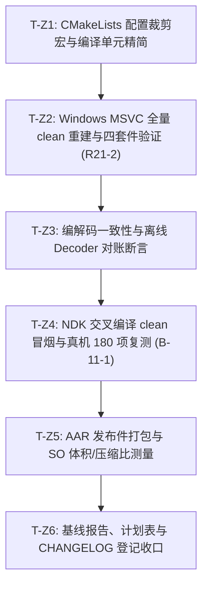

# LogX 专项实施计划：zstd 源码级裁剪与 SO 体积精简 (v1.0)

> **文档标识**: `docs/zstd_prune_plan.md`  
> **版本**: v1.0  
> **创建日期**: 2026-10-15  
> **关联里程碑**: M5 基线收尾 / 体积优化专项  
> **状态**: 📋 待执行 (Ready for Review & Execution)

---

## 0. 计划目标与既定决策

本计划旨在落实 [`docs/benchmark_report.md`](./benchmark_report.md) §5.3 提出的 **「zstd 源码级裁剪（体积优化备选）」** 方案，彻底根治 Release 版 `liblogx.so` 超出 500KB 上限的问题。

| 决策项 | 结论 | 决策依据 / 约束 |
|---|---|---|
| **体积目标** | `liblogx.so` (arm64-v8a, MinSizeRel, strip) **< 500KB**（预估由 548.9KB 降至 **400KB~440KB**，缩减 100KB+） | 对齐 spec M5 体积硬指标 |
| **源码侵入性** | **对 `third_party/zstd/` 保持零源码修改（0 diff）** | 遵循 vendored 依赖纯净原则，不阻断上游升级 |
| **实现路径** | **CMake 编译期宏剔除 + 剔除冗余编译单元** | 利用 zstd 官方原生排斥宏 `ZSTD_EXCLUDE_*` 与自动级联机制 |
| **解压兼容性** | **100% 保持标准 zstd 帧解压能力** | 解压缩全套算法单元完整保留，保证 `logx_export` 与离线解码器兼容 |
| **压缩行为** | 维持 Level 3 默认压缩等级，压缩比（1.52x）与纯写吞吐零损失 | Level 3 仅使用 `ZSTD_dfast`，不依赖被裁剪的重型查找器 |
| **构建门禁** | 严格遵循 **R21-2**（全量 clean 构建）与 **B-11-1**（NDK 冒烟门禁） | 宏变动引起结构体收缩，必须 clean-first 杜绝混 ABI |

---

## 1. 代码调研与事实依据（逐项核查锁定）

### 1.1 体积构成与归因事实
根据 [`docs/benchmark_report.md`](./benchmark_report.md) §5.1 与 §5.2 的物理测量记录：
- **裸核心**（`core` 6 文件 + JNI 胶水）：约 **121.3KB**；
- **AES-GCM**（mbedtls 裁剪版）：约 **12KB**；
- **zstd v1.5.7**（vendor 全量 25 个 .c 参与编译）：贡献约 **426KB**（占 SO 体积的 77%）；
- **当前产物**：MinSizeRel 全开 + strip = **548.9KB**（超出 500KB 门槛 48.9KB / 9.8%）。

### 1.2 LogX 真实调用面审计
查阅 [`core/src/codec.cpp`](file:///d:/Project/Android_Project/LogX/logx/core/src/codec.cpp)：
LogX 核心对 zstd 的调用仅局限于 **5 个基础 API**：
1. `ZSTD_compressBound(in_len)`：计算缓冲区上限；
2. `ZSTD_compress(out->data(), bound, in, in_len, 3)`：单次内存块同步压缩，**写死 Level 3**；
3. `ZSTD_getFrameContentSize(in, in_len)`：查询解压前原始大小（带防炸弹校验）；
4. `ZSTD_decompress(out->data(), total, in, in_len)`：单次内存块同步解压；
5. `ZSTD_isError(n)`：错误状态码判别。

### 1.3 运行时几何与算法映射事实
查阅 [`third_party/zstd/lib/compress/clevels.h:52-57`](file:///d:/Project/Android_Project/LogX/logx/third_party/zstd/lib/compress/clevels.h)：
在 `srcSize <= 256KB` 几何下（LogX 物理块上限 `kBlockMaxRawWithSeam = 20491`，约 20KB）：
- **Level 1**：策略为 `ZSTD_fast`；
- **Level 2**：策略为 `ZSTD_dfast`；
- **Level 3**：策略为 `ZSTD_dfast`（Double Fast Match Finder，位于 `zstd_double_fast.c`）；
- **Level 4 及以上**：才启用 `ZSTD_greedy`、`ZSTD_lazy`、`ZSTD_lazy2`、`ZSTD_btlazy2`、`ZSTD_btopt`、`ZSTD_btultra`。

**结论**：LogX 在全生命周期中，**绝不会触发** Level 4~19 的任何重型匹配搜索器！重型搜索器源文件（`zstd_lazy.c` 102KB、`zstd_opt.c` 72KB）在二进制中为 100% 的死代码。

### 1.4 上游官方排斥宏与级联防御
查阅 [`third_party/zstd/lib/compress/zstd_compress.c:1483-1523`](file:///d:/Project/Android_Project/LogX/logx/third_party/zstd/lib/compress/zstd_compress.c)：
```c
/* Cascade the selected strategy down to the next-highest one built into this binary. */
#ifdef ZSTD_EXCLUDE_BTULTRA_BLOCK_COMPRESSOR
    if (cPar.strategy == ZSTD_btultra2) cPar.strategy = ZSTD_btultra;
    if (cPar.strategy == ZSTD_btultra)  cPar.strategy = ZSTD_btopt;
#endif
#ifdef ZSTD_EXCLUDE_BTOPT_BLOCK_COMPRESSOR
    if (cPar.strategy == ZSTD_btopt)    cPar.strategy = ZSTD_btlazy2;
#endif
#ifdef ZSTD_EXCLUDE_BTLAZY2_BLOCK_COMPRESSOR
    if (cPar.strategy == ZSTD_btlazy2)  cPar.strategy = ZSTD_lazy2;
#endif
#ifdef ZSTD_EXCLUDE_LAZY2_BLOCK_COMPRESSOR
    if (cPar.strategy == ZSTD_lazy2)    cPar.strategy = ZSTD_lazy;
#endif
#ifdef ZSTD_EXCLUDE_LAZY_BLOCK_COMPRESSOR
    if (cPar.strategy == ZSTD_lazy)     cPar.strategy = ZSTD_greedy;
#endif
#ifdef ZSTD_EXCLUDE_GREEDY_BLOCK_COMPRESSOR
    if (cPar.strategy == ZSTD_greedy)   cPar.strategy = ZSTD_dfast;
#endif
```
- 上游原生支持编译期宏排斥：当定义全部 6 个排斥宏时，`zstd_opt.h` 和 `zstd_lazy.h` 声明被全部清空，`zstd_opt.c` 和 `zstd_lazy.c` 内容被完整 `#if` 包裹变为空单元；
- 具备**活性防御兜底**：若发生越界请求，压缩器自动无缝级联回退到当前二进制支持的最高策略（`ZSTD_dfast`），绝无崩溃或 UB 风险。

---

## 2. 详细改造方案

### 2.1 剔除冗余编译单元 (4 个文件)
在 [`core/CMakeLists.txt`](file:///d:/Project/Android_Project/LogX/logx/core/CMakeLists.txt) 的 `target_sources(logx_core PRIVATE ...)` 中移除：
1. `${LOGX_ZSTD_DIR}/common/pool.c`（线程池实现，单线程单实例无引用）；
2. `${LOGX_ZSTD_DIR}/common/threading.c`（多线程 pthread/Win32 包装，无引用）；
3. `${LOGX_ZSTD_DIR}/compress/zstd_opt.c`（btopt / btultra 查找器，宏关闭后为空）；
4. `${LOGX_ZSTD_DIR}/compress/zstd_lazy.c`（greedy / lazy / lazy2 查找器，宏关闭后为空）。

保留的编译单元（共 21 个）：
- `common/` (6 个): `debug.c`, `entropy_common.c`, `error_private.c`, `fse_decompress.c`, `xxhash.c`, `zstd_common.c`
- `compress/` (11 个): `fse_compress.c`, `hist.c`, `huf_compress.c`, `zstd_compress.c`, `zstd_compress_literals.c`, `zstd_compress_sequences.c`, `zstd_compress_superblock.c`, `zstd_double_fast.c`, `zstd_fast.c`, `zstd_ldm.c`, `zstd_preSplit.c`
- `decompress/` (4 个): `huf_decompress.c`, `zstd_ddict.c`, `zstd_decompress.c`, `zstd_decompress_block.c`

### 2.2 注入官方裁剪宏定义
在 [`core/CMakeLists.txt`](file:///d:/Project/Android_Project/LogX/logx/core/CMakeLists.txt) `if(LOGX_WITH_ZSTD)` 分支下追加：
```cmake
    target_compile_definitions(logx_core PRIVATE
        # 1. 剔除 Level 4~19 对应的所有重型匹配引擎 (节约 ~100KB 代码)
        ZSTD_EXCLUDE_GREEDY_BLOCK_COMPRESSOR=1
        ZSTD_EXCLUDE_LAZY_BLOCK_COMPRESSOR=1
        ZSTD_EXCLUDE_LAZY2_BLOCK_COMPRESSOR=1
        ZSTD_EXCLUDE_BTLAZY2_BLOCK_COMPRESSOR=1
        ZSTD_EXCLUDE_BTOPT_BLOCK_COMPRESSOR=1
        ZSTD_EXCLUDE_BTULTRA_BLOCK_COMPRESSOR=1

        # 2. 剥离无用的 40+ 条静态错误文本 (节约 ~3.5KB 常量表)
        ZSTD_STRIP_ERROR_STRINGS=1

        # 3. 剥离调试与追踪桩
        ZSTD_NO_TRACE=1
    )
```

### 2.3 单源继承保证
由于 [`android/logx-aar/logx/src/main/cpp/CMakeLists.txt`](file:///d:/Project/Android_Project/LogX/logx/android/logx-aar/logx/src/main/cpp/CMakeLists.txt) 直接以 `add_subdirectory(${LOGX_ROOT}/core ...)` 单源链接 `logx_core`，AAR 工程将**自动同步继承**全部裁剪配置，无需重复维护！

---

## 3. 任务分解表 (WBS)



| 任务编号 | 任务名称 | 责任文件 | 优先级 | 预计工时 | 详细实施要点与验证标准 |
|---|---|---|---|---|---|
| **T-Z1** | CMake 裁剪配置接入 | `core/CMakeLists.txt` | **P0** | 0.5h | 1. 注入 8 个裁剪宏；<br>2. 移除 `pool.c`/`threading.c`/`zstd_opt.c`/`zstd_lazy.c`；<br>3. 保持 third_party 源码 0 diff。 |
| **T-Z2** | MSVC 全量重建与测试验证 | `build-full/` | **P0** | 1.0h | 1. **执行 R21-2 门禁**：`ninja -t clean` 后全量构建，确保 0 警告 0 错误；<br>2. 运行单测 **179/179**、压测 **4/4**、hotpath **2/2**、crash_fork **3/3** 100% 全绿。 |
| **T-Z3** | 编解码与容灾对账回归 | `tests/unit/test_codec.cpp`, `decoder/` | **P0** | 1.0h | 1. 运行 `test_codec.cpp` 验证压缩失败回退、坏块防炸弹、截断等全部分支；<br>2. 真实样本经 `logx_decode.py` 解码，与原文逐字节对账一致。 |
| **T-Z4** | Android NDK 编译与真机复测 | `build-android-tests` | **P0** | 1.5h | 1. **执行 B-11-1 门禁**：NDK Clang clean-first 重建 62 目标，精确 **0 警告**；<br>2. Redmi K30 Pro 真机实跑 **180/180 + 2/2 + 4/4 + 3/3** 退出码全 0。 |
| **T-Z5** | SO 体积与性能基线量化 | `android/logx-aar/` | **P1** | 1.0h | 1. 打包 `:logx:assembleRelease`，解包提取 `liblogx.so`；<br>2. `llvm-strip` 后实测体积，**断言严格 < 500KB**；<br>3. 抽样验证 1.52x 压缩比与吞吐量无劣化。 |
| **T-Z6** | 文档与收尾归档 | `docs/benchmark_report.md`, `CHANGELOG.md` | **P2** | 1.0h | 1. `benchmark_report.md` §5 更新体积基线数据与未达标状态转正；<br>2. `LogX后续实施计划表.md` 补登版本修订说明；<br>3. `CHANGELOG.md` 登记提交行。 |

---

## 4. 关键技术纪律与防劣化护栏

实施过程中必须强制执行以下纪律，杜绝隐性缺陷：

1. **结构体布局与全量 clean 重建门禁 (R21-2)**:
   - 排斥宏（如 `ZSTD_EXCLUDE_*`）会使 `ZSTD_CCtx_s` 内部的 `matchState_t` 结构体成员减少（去除了 `opt` / `lazy` 相关的查找表指针）；
   - **严禁增量构建**！改动后必须执行 `ninja -t clean`，强制 `codec.cpp` 与全部 zstd C 单元全量重新编译，杜绝跨编译单元的指针偏移漂移（混 ABI 崩溃）。
2. **NDK 冒烟与 0 警告门禁 (B-11-1)**:
   - NDK Clang 编译器对于未使用的局部宏或函数具有极高的告警灵敏度，必须执行 clean 构建，且提交信息必须注明「NDK 冒烟 62/62 clean 0 警告」。
3. **解码一致性反向验证**:
   - 必须通过 `logx_decode.py` 验证外部独立解码器能否正常解压裁剪后引擎生成的 zstd 块，确保 Frame 格式对齐 RFC 8878 标准。

---

## 5. 预期成果与验收清单 (Checklist)

| 检查项 | 验收指标 | 验证方式 |
|---|---|---|
| **SO 体积** | `liblogx.so` (MinSizeRel strip) **< 500KB**（目标 400KB~440KB，较 548.9KB 降幅 $\ge 18\%$） | `ls -l` / `llvm-size` 实际文件大小 |
| **编译质量** | MSVC 与 NDK Clang 双端构建 **0 警告 0 错误** | 编译器控制台日志匹配 |
| **单测套件** | Windows 主机 **179/179**，Android 真机 **180/180** 100% PASS | CTest / 设备 shell 执行 |
| **并发与压测** | 50 线程并发 30w+ logs/s 零丢失零损坏，50 轮崩溃注入 100% 复原 | `logx_stress_tests` |
| **压缩指标** | 混合变长数据落盘体积压缩比稳定在 **$\approx 1.52\text{x}$** | 落盘数据字节统计 |
| **AAR 发布件** | `com.zzlfeng:logx:1.0.0` assembleRelease 正常构建与解包核对 | Gradle 任务与 zip 解包 |
| **上游纯净** | `git status third_party/zstd` 保持 clean（0 改动） | Git status 检验 |

